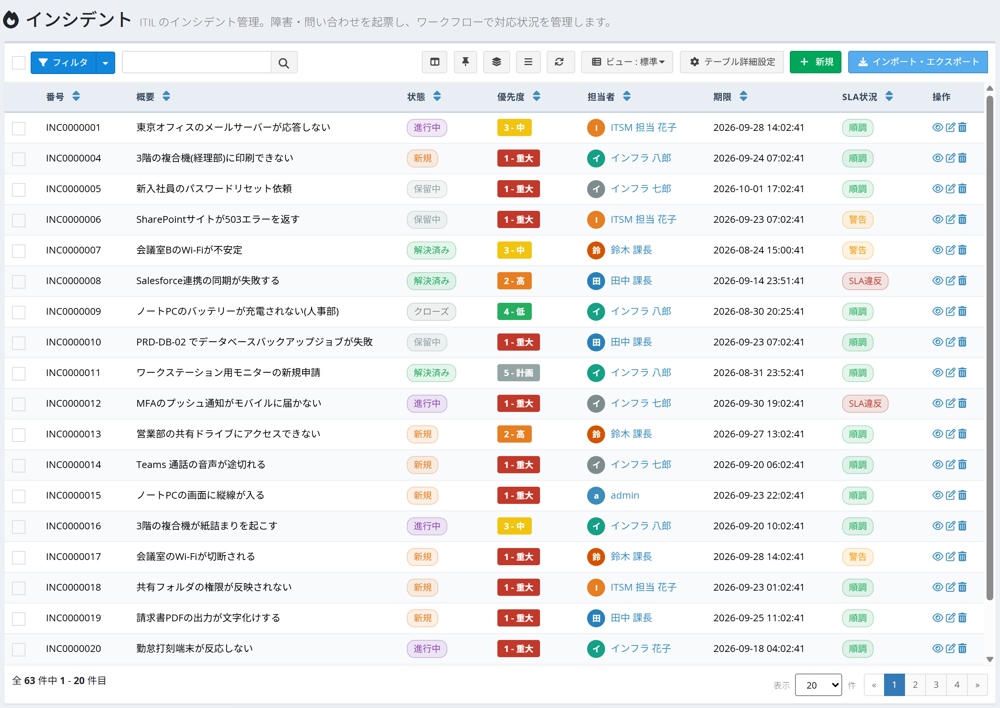
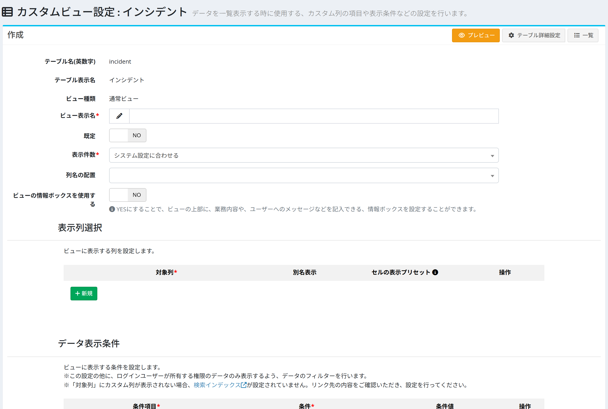
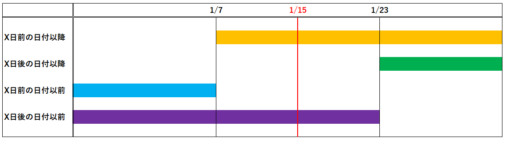
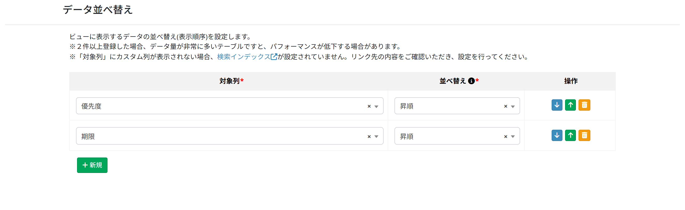
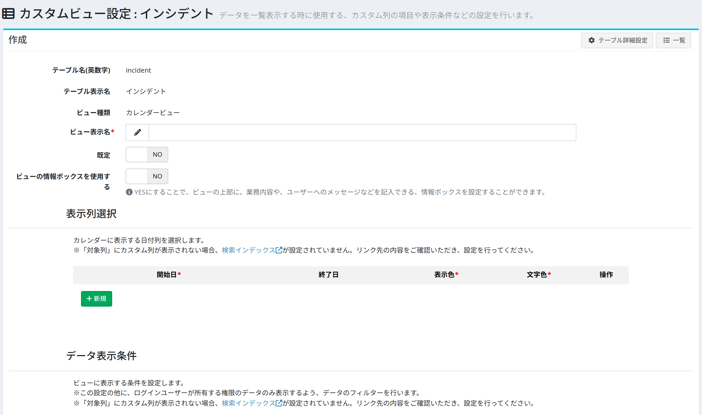

# Custom views
A view is "how the [data list screen](/data_grid) looks". Each view decides which columns are shown, which data is shown, and in what order.  
This page explains the kinds of views, how to make a view, and its setting items.

The flow of the setting is as follows.

1. Open the list of views ("Page display")  
2. With [New], choose the kind of view you want to make ("Add new view")  
3. Enter the setting items and save with [Submit]

## View type
Currently, there are the following kinds.

| Kind | Use |
|---|---|
| View (normal view) | See the data as a list |
| Summary view | See totals, counts and so on for each group |
| Calendar view | See the data as a calendar |
| Kanban view | See the data as cards, in one column per state |
| Gantt chart view | See the data as horizontal bars from the start date to the due date |
| All data view | A view of the same shape as the normal view, made automatically by the system |
| Filter view (condition view) | Used only for narrowing down, for example in the conditions of a notification |

### View (normal view)

This is the ordinary view: a data list.  
It lists the registered data.

### Summary view

It puts the registered data into groups and shows summary values such as the total, the count and the maximum.  
On the dashboard, it can be shown as a chart.

### Calendar view

It shows the registered data as a calendar.

### Kanban view

It shows the registered data as cards, in one column per state.  
Dragging a card to another column changes the value of that item.  
See [Kanban view](/view_kanban) for details.

### Gantt chart view
It shows the registered data in time order, each record as a horizontal bar from its start date to its due (end) date.  
See [Gantt chart view](/view_gantt) for details.

### All view
It is basically the same as the normal view, but differs in these points.  
- The system makes it automatically.  
- Only one is made. Users cannot make a new one or delete it.  
- It is used when a list is shown on the [search](/search) screen.  
- It is used when the detail data is shown from a summary view.

### Condition view
A view used only for narrowing down. It is used for the notification conditions of a [notification](/notify), and for narrowing down when the column setting of a custom column is "Select (From Table)".  
- It has no setting for display columns.  
- It is not shown on the data list screen.  
- Only administrators can set it. General users cannot.

## Page display
- In the custom table list, check one table you want to set, and click "Table Detail Setting" at the top right.  
  
- Or choose the table you want to set from the menu, and click "Table Detail Setting" at the top right in the same way.  
Note: the table must be shown in the menu beforehand.  
  
- On the Table Detail Setting screen, click the icon of the view setting.  

- The list of views of that custom table is now shown.  

## Add new view
- On the "Custom view setting" screen, click the [New] button at the top right of the page.

In the dialog, click the button of the kind you want to make.  
  
- The screen for adding a new view is shown. Enter the necessary items.

## View settings
#### View display name
Enter the name of the view.  

#### View permissions
Decide who can use this view: System View or User View.

- System View  
Only the system administrator can set it.  
All users who have access permission to the table can use this view.

- User View  
A view that can be set even by someone who is not the system administrator.  
Only the user who made it can use this view.

Note: a System View cannot be changed to a User View later.  
A **User View made by the system administrator** can be changed to a System View later.  
Note: with the [User view disabled](/config?id=user-view-disabled) setting, general users can no longer make views.

#### Displayed results
Select how many records are shown per page in the data list.

#### default
When there are several views, the view set to "YES" is the one shown first when a user opens the data list.  
Note: a view set to "NO" can also be shown by choosing it from the list of views.  
Note: "Default" can be "YES" for only one view in one custom table.  
If you set "YES" on two or more views, all but the one set to "YES" last change to "NO".

#### Use View Infobox
When set to [YES], an information box can be shown above the view.  
Enter a title and a body to show what the work is about, or a message to the users.

#### Display column selection
The setting of the columns shown in the view.  
The columns set here are shown on the data list screen and so on.

##### View target column
The column shown in the view.  
  
##### Alias display name  
The view shows the column under the name entered here.  

##### Cell appearance preset  
Choose how the column looks in this view.  
Note: this has priority over the custom column setting. See [Cell style presets](/cell_style_preset) for details.  

##### [↓] button  
Moves the item shown in the view to the right.  

##### [↑] button  
Moves the item shown in the view to the left.  

##### [Delete] button  
Deletes the item from the view.

##### [New] button  
Adds a new display column to the view.

#### Data display conditions
The conditions that narrow down the data shown in the view.  
Add a condition when you want to narrow down, such as "show only the ones within a period" or "show only the ones of a certain status".  
Note: apart from this setting, the data is narrowed down so that only the data the logged-in user has permission for is shown. Data without permission is not shown, whatever this setting is.

>When the column type of the condition item is Select (From Table), the words shown as the condition value can be changed in the [Heading display column setting](/table?id=heading-display-column-setting).

##### View target column
The column used for the narrowing condition.  
  
##### Search Condition
Select the content of the condition.  
For details, see [About search conditions](/view?id=about-search-conditions).  

##### Filter Condition Value
Enter the value to compare with the condition.  
  
##### [Delete] button
Deletes the display condition of the view.
  
##### [New] button
Adds a new display condition to the view.

##### Condtion Join
With "Match All Condition", the data that matches all the conditions is shown.  
With "Match Any Condition", the data that matches at least one condition is shown.

##### Condtion Reverse
When "Reverse condition" is checked, the data that does not match the conditions is shown.  
Note: the summary view cannot use the reversal of conditions.

#### About search conditions
The choices of the condition change with the kind of the column selected in "View target column" ("Date", "User" and so on).  
Only the search conditions that need an explanation are written here.

##### When the target column type is "date"
- After the date X days ago  
- After the date X days later  
- Before the date X days ago  
- Before the date X days later  
The data is shown in the view when its date is in that range.  

Example: the current date is 1/15 and the search value is registered as "8"  

##### When the target column type is "User"
- Match Login User  
The data is shown in the view when its value is the same as the logged-in user.  

- Not Match Login User    
The data is shown in the view when its value is different from the logged-in user.  

#### Data Sorting
Set the sorting (display order) of the data shown in the view.

 
##### Target Column  
The column used for sorting.  

##### Sorting  
Specify whether to sort in "ascending order (smallest first)" or "descending order (largest first)".  

##### [↓] Button  
Lowers the priority in the sort order.  

##### [↑] Button  
Raises the priority in the sort order.  

##### [Delete] Button  
Deletes the data sorting from the view.  

##### [New] Button
Adds a new data sorting.

#### Specifying "Filter" Items in the View

Specify the columns offered as choices in the "Filter" shown above the view.
  

##### Target Column  
The column shown in the "Filter".  

##### [↓] Button  
Moves the item down in the "Filter".  

##### [↑] Button  
Moves the item up in the "Filter".  

##### [Delete] Button  
Deletes the item from the "Filter" of the view.  

##### [New] Button
Adds a new display column to the "Filter" of the view.  

## Add new summary view
- On the "Custom view setting" screen, click "Create Summary View" under [New] at the top right of the page.

- The screen for adding a new summary view is shown. Enter the necessary items.

## Aggregation view settings

#### View display name, view authority, default
These are the same setting items as [View settings](/view?id=view-settings) above.

#### Group column selection
The data is put into groups by the value of the column selected here, and summarized.  
When several columns are set, the data is divided and summarized by each combination of those items.

##### View target column  
The column the grouping is based on.  

- Example 1: when two target columns are set, the data is grouped by the combination of the two columns and summarized, as in the image.  
Note: "Sales amount" is not a group column; it is set as a summary column.

  

- Example 2: when only the "Sales month" column is a group column, the data that was divided by the "Employee name" column too in Example 1 is put together into groups of one column and summarized.  

  

##### Alias display name
The view shows the column under the name entered here.  

##### Column type
Only when the custom column type of the target column is "Date" or "Date and Time", you can choose from the following.  
"Year" "Year-Month" "Year-Month-Day" "Month" "Day" "Weekday"  
The target column is grouped by the unit of date chosen here.  
Note: the images of Examples 1 to 3 show the case where the column type of the sales month is "Year-Month".

##### Sort order
The setting of the order in which the summary view shows the data.  
It decides the priority of the columns: which column's values are looked at first when the data is ordered.  
The numbers are given across both "Select grouping columns" and "Select summary columns".  

- Example 3: Example 2 above is the display when "Sales month" is 1 and "Sales amount" is 2 in the sort order. When "Sales month" is 2 and "Sales amount" is 1, the order gives priority to the values of the "Sales amount" column, as in the image below.  

  

##### Sort  
Set whether the target column is ordered from the smallest value or from the largest value.  
Choose "ascending order (smallest first)" or "descending order (largest first)".  

- Example 4: Example 3 above is the display when "Sales amount" is in descending order. In ascending order, it looks like the image below.  

  

##### [Arrow] buttons
Set the order of the columns in the summary view.  
The higher an item is in the group column selection, the further left it is shown in the summary view.  

##### [Delete] button  
Deletes the group column of the view.

##### [New] button  
Adds a new group column to the view.

#### Calculation column selection
The values of the column selected here are summarized.  

##### View target column  
The column whose values are summarized.  

##### Summary type  
"Summary" "Count" "Min" "Max"  
Choose from these four summary types. The result of the chosen summary is shown in the target column of the view.

##### Alias display name  
The view shows the column under the name entered here.  

##### [Delete] button  
Deletes the summary column of the view.
  
##### [New] button  
Adds a new summary column to the view.

#### Display condition
The conditions that narrow down the data shown in the view.  
Add a condition when you want to narrow down, such as "show only the ones within a period" or "show only the ones of a certain status".  
Note: apart from this setting, the data is narrowed down so that only the data the logged-in user has permission for is shown. Data without permission is not shown, whatever this setting is.

>When the column type of the condition item is Select (From Table), the words shown as the condition value can be changed in the [Heading display column setting](/table?id=heading-display-column-setting).

##### View target column  
The column used for the narrowing condition.  
  
##### Filter Condition  
Select the content of the condition.  
For details, see [About search conditions](/view?id=about-search-conditions).  
  
##### Filter Condition Value  
Enter the value to compare with the condition.  
  
##### [Delete] button  
Deletes the display condition of the view.
  
##### [New] button  
Adds a new display condition to the view.

## New calendar view added

- On the "Custom view setting" screen, click "Calendar view new creation" under [New] at the top right of the page.

- The screen for adding a new calendar view is shown. Enter the necessary items.

## Calendar view settings

#### View display name, view authority, default
These are the same setting items as [View settings](/view?id=view-settings) above.

#### Display column selection
The setting of the columns shown in the view.  
In the calendar view, when a start date and an end date are set, the data of the date columns can be shown as a period.  
Note: to show the data on one day only, specify only the start date.

##### Start date  
Set the column used as the start date of the period.  
Note: when no end date is set, the data is shown on one day only, on the day of the column set as the start date.

##### End date  
Set the column used as the end date of the period.

##### Display color  
Set the background color of the data shown in the view.

##### Letter color  
Set the text color of the data shown in the view.

##### [Delete] button  
Deletes the item from the view.

##### [New] button  
Adds a new display column to the view.

#### Display condition
The conditions that narrow down the data shown in the view.  
Add a condition when you want to narrow down, such as "show only the ones within a period" or "show only the ones of a certain status".  
Note: apart from this setting, the data is narrowed down so that only the data the logged-in user has permission for is shown. Data without permission is not shown, whatever this setting is.

>When the column type of the condition item is Select (From Table), the words shown as the condition value can be changed in the [Heading display column setting](/table?id=heading-display-column-setting).

##### View target column  
The column used for the narrowing condition.  
  
##### Filter Condition  
Select the content of the condition.  
For details, see [About search conditions](/view?id=about-search-conditions).  
  
##### Filter Condition Value  
Enter the value to compare with the condition.  
  
##### [Delete] button  
Deletes the display condition of the view.
  
##### [New] button  
Adds a new display condition to the view.

#### Headings in calendar view
As in the example of the image, the calendar view shows a heading at the date of each record.  

- The heading shown is the one set in the [Heading display column setting](/table?id=heading-display-column-setting).

- Also, when a column whose custom column type is "Date and Time" is set as the start date of the display column selection, the time of the data is shown at the beginning of the heading.  

## Save
After entering the settings, click [Submit].

## Preview
On the screen for creating or editing a view, click the [Preview] button at the top right of the page to check, in a separate window, how the data looks (data list, kanban, gantt chart) with the settings being entered.  
You can check the look before saving the settings.

- The [Preview] button is shown for the normal view, the all data view, the kanban view and the gantt chart view. It is not shown for the summary view, the calendar view, the condition view and so on.  
- The preview does not save the settings. To refresh the display after changing the settings, click the [Preview] button again on the original screen.  
- Rows of "Display column selection", "Data display conditions" and "Data Sorting" whose target column or condition is not chosen are not reflected in the preview. In that case, the preview screen shows "N row(s) are left out of this preview: their column or condition is not chosen yet."

## Edit
To edit a view, click the [Edit] link of that row.  

## Delete
To delete a view, click the [Delete] link of that row.  

## Duplicate custom view
Click the [Duplicate this view] link to make a view with the same settings and only the view display name left blank.

## Data list display
Click the [List data in this view] button to show the data list with the settings of that view.

## Sharing a custom view
Share a custom view you made with other users and organizations.  
Note: only a "User View" can be shared. (A "System View" is open to all users with permission from the start.)  
Note: only users or organizations that have access permission to the table can be chosen as the share target.  

#### How to share
1. Click the "Share" button on the edit screen of the custom view.  
Note: this button is not shown when creating a new view.  

2. The dialog for sharing the custom view is shown.  

3. Add the users or organizations you want to share with, and click "Submit". The view is now shared.  
  
