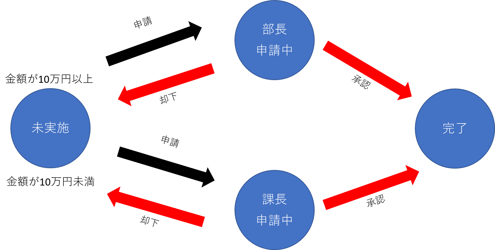
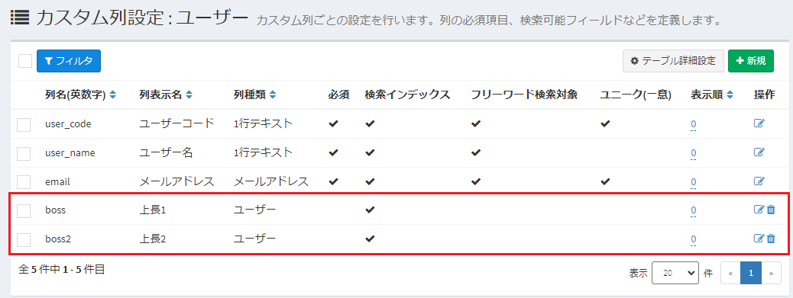
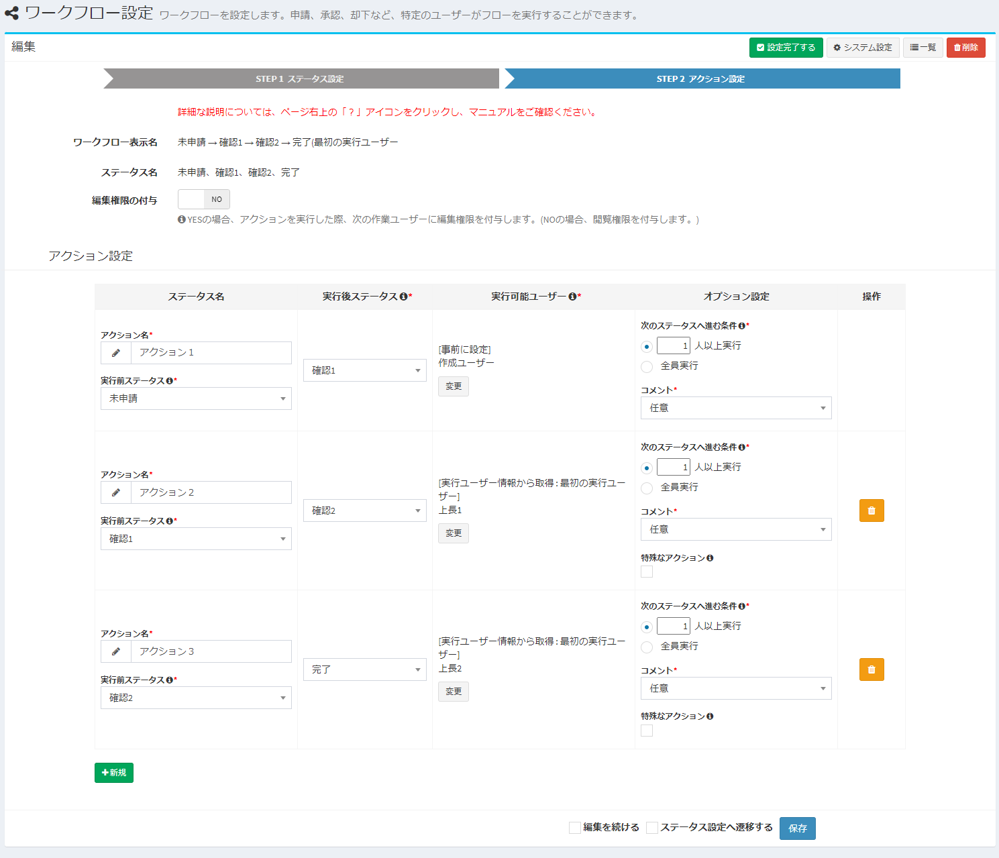
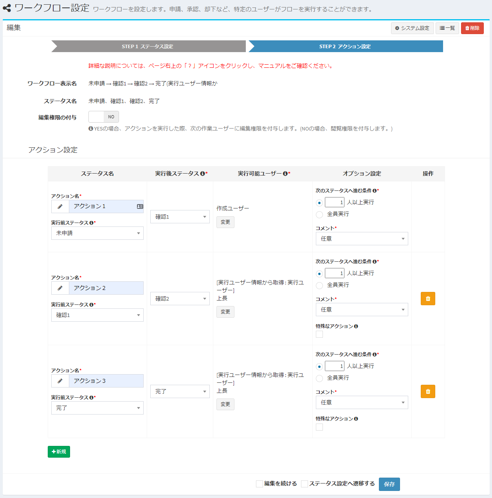

# Workflow setting example
Examples of workflow settings. Choose the example closest to the flow you want to make, and enter it as shown.  
For the meaning of each item, see [Workflow settings](/workflow_setting).

| The flow you want to make | Example |
|---|---|
| A simple flow: apply, then approve or reject | [Apply → Approve / Reject](#example1) |
| Divide the approver (the action) by the amount of the applied data | [Apply → General manager approval or section manager approval / Reject](#example2) |
| Check in 2 stages. Both checkers are decided from the superior columns of the applicant | [Not applied → Check 1 → Check 2 → Completed (obtained from the first execution user information)](#example4) |
| Check in 2 stages. The second checker is the superior of the first checker | [Not applied → Check 1 → Check 2 → Completed (obtained from execution user information)](#example5) |
| Lock data (cannot be edited or deleted) | [Lock data](#example3) |

<h2 id="example1"><a href="#/workflow_example?id=example1" data-id="example1" class="anchor">Apply → Approve / Reject</a></h2>

How to set a simple flow where data is applied for, and approved or rejected.

  
- A user applies to the administration department
- The administration department approves the application, or rejects it
- Approved data cannot be modified afterwards

### Step1. Status setting

  

- **Workflow View Name** : any name

- **Workflow Type** : "Generic"

- **Start Status Name** : "Not done"

- **Status, 1st row**  
Status Name: "Applying"  
Cannot Edit Data: "YES"  

- **Status, 2nd row**  
Status Name: "Completed"  
Cannot Edit Data: "YES"  

### Step2.Action setting

  

- **Action setting, 1st row**  
Action Name: "Apply"  
Before Status: "Not done"  
Action Setting > After Status: "Applying"  
Executable user : "Created User"  
Option Setting > Condition to advance to next status : "1 or more people execute"  
Option Setting > Comment : "Nullable"  

- **Action setting, 2nd row**  
Action Name: "Approve"  
Before Status: "Applying"  
Action Setting > After Status: "Completed"  
Executable user : "Administration group" (create the organization "Administration group" beforehand)  
Option Setting > Condition to advance to next status : "2 or more people execute"  
Option Setting > Comment : "Nullable"  
Option Setting > Special action : not checked  

- **Action setting, 3rd row**  
Action Name: "Reject"  
Before Status: "Applying"  
Action Setting > After Status: "Not done"  
Executable user : "Administration group" (create the organization "Administration group" beforehand)  
Option Setting > Condition to advance to next status : "1 or more people execute"  
Option Setting > Comment : "Required"  
Option Setting > Special action : checked  

<h2 id="example2"><a href="#/workflow_example?id=example2" data-id="example2" class="anchor">Apply → General manager approval or section manager approval / Reject</a></h2>

How to set a flow where the action and the person in charge are divided by the amount of the applied data.

  
- A user applies for expenses
- When the "Amount" of the applied data is 100,000 yen or more, it goes to the general manager automatically; when it is less than 100,000 yen, to the section manager
- The general manager or the section manager approves the application, or rejects it
- Approved data cannot be modified afterwards

### Step1.Status setting

  

- **Workflow View Name** : any name

- **Workflow Type** : "Table Only"

- **Table** : select the table in which the workflow is executed

- **Start Status Name** : "Not applied"

- **Status, 1st row**  
Status Name: "Applying to general manager"  
Cannot Edit Data: "YES"  

- **Status, 2nd row**  
Status Name: "Applying to section manager"  
Cannot Edit Data: "YES"  

- **Status, 3rd row**  
Status Name: "Completed"  
Cannot Edit Data: "YES"  

### Step2.Action setting

  

- **Action setting, 1st row**  
Action Name: "Apply"  
Before Status: "Not applied"  
Action Setting > After Status: see the image below  

  
>When the column type of a condition item is "Select (from the list of values in another table)", the text shown as the condition value can be changed in the [Heading display column setting](/table?id=heading-display-column-setting).

Executable user : "Created User"  
Option Setting > Condition to advance to next status : "1 or more people execute"  
Option Setting > Comment : "Nullable"  

- **Action setting, 2nd row**  
Action Name: "Approve"  
Before Status: "Applying to general manager"  
Action Setting > After Status: "Completed"  
Executable user : "General manager" (create the organization "General manager" beforehand)  
Option Setting > Condition to advance to next status : "1 or more people execute"  
Option Setting > Comment : "Nullable"  
Option Setting > Special action : not checked  

- **Action setting, 3rd row**  
Action Name: "Approve"  
Before Status: "Applying to section manager"  
Action Setting > After Status: "Completed"  
Executable user : "Section manager" (create the organization "Section manager" beforehand)  
Option Setting > Condition to advance to next status : "1 or more people execute"  
Option Setting > Comment : "Nullable"  
Option Setting > Special action : not checked  

- **Action setting, 4th row**  
Action Name: "Reject"  
Before Status: "Applying to general manager"  
Action Setting > After Status: "Not applied"  
Executable user : "General manager" (create the organization "General manager" beforehand)  
Option Setting > Condition to advance to next status : "1 or more people execute"  
Option Setting > Comment : "Required"  
Option Setting > Special action : checked  

- **Action setting, 5th row**  
Action Name: "Reject"  
Before Status: "Applying to section manager"  
Action Setting > After Status: "Not applied"  
Executable user : "Section manager" (create the organization "Section manager" beforehand)  
Option Setting > Condition to advance to next status : "1 or more people execute"  
Option Setting > Comment : "Required"  
Option Setting > Special action : checked  

<h2 id="example4"><a href="#/workflow_example?id=example4" data-id="example4" class="anchor">Not applied → Check 1 → Check 2 → Completed (obtained from the first execution user information)</a></h2>

How to set the flow "Not applied → Check 1 → Check 2 → Completed". The executable users of the actions are "obtained from the information of the first execution user".

  
- The action "Check 1" can be executed by the user set in the column "Superior 1" of the applicant (the first execution user of the flow)
- The action "Check 2" can be executed by the user set in the column "Superior 2" of the applicant (the first execution user of the flow)

### Step0. User column setting

First, add the following columns in the custom column setting of the "User" table.

  

- Column 1:
    - Column Name: "boss1"
    - Column View Name: "Superior 1"
    - Index Enabled: YES
    - Column Type: User

- Column 2:
    - Column Name: "boss2"
    - Column View Name: "Superior 2"
    - Index Enabled: YES
    - Column Type: User
  
Then edit the information of each user and register the items of the columns "Superior 1" and "Superior 2".

  

Note: when the data of the user "Execution user" is registered as above, the workflow is executed as follows.

  

### Step1. Status setting

- **Workflow View Name** : any name

- **Workflow Type** : "Generic"

- **Start Status Name** : "Not applied"

- **Status, 1st row**  
Status Name: "Check 1"  
Cannot Edit Data: "NO"  

- **Status, 2nd row**  
Status Name: "Check 2"  
Cannot Edit Data: "NO"  

- **Status, 3rd row**  
Status Name: "Completed"  
Cannot Edit Data: "YES"  

### Step2.Action setting

  

- **Common setting**  
Execution User - Base User : "First Execution User"  

- **Action setting, 1st row**  
Action Name: "Action 1"  
Before Status: "Not applied"  
After Status: Check 1  
Executable user : "Created User"  
Option Setting > Condition to advance to next status : "1 or more people execute"  
Option Setting > Comment : "Nullable"  

- **Action setting, 2nd row**  
Action Name: "Action 2"  
Before Status: "Check 1"  
After Status: "Check 2"  
Executable user : (Obtained from execution user information) Superior 1  
Option Setting > Condition to advance to next status : "1 or more people execute"  
Option Setting > Comment : "Nullable"  
Option Setting > Special action : not checked  

- **Action setting, 3rd row**  
Action Name: "Action 3"  
Before Status: "Check 2"  
After Status: "Completed"  
Executable user : (Obtained from execution user information) Superior 2  
Option Setting > Condition to advance to next status : "1 or more people execute"  
Option Setting > Comment : "Nullable"  
Option Setting > Special action : not checked  

#### Reference: the dialog shown when the [Change] button of the executable user is clicked

  

<h2 id="example5"><a href="#/workflow_example?id=example5" data-id="example5" class="anchor">Not applied → Check 1 → Check 2 → Completed (obtained from execution user information)</a></h2>

How to set the flow "Not applied → Check 1 → Check 2 → Completed". The executable users of the actions are "Obtained from execution user information".

  
- The action "Check 1" can be executed by the user set in the column "Superior" of the applicant (the first execution user of the flow)
- The action "Check 2" can be executed by the user set in the column "Superior" of the user who executed the action "Check 1"

### Step0. User column setting

First, add the following column in the custom column setting of the "User" table.

  

- Column:
    - Column Name: "boss"
    - Column View Name: "Superior"
    - Index Enabled: YES
    - Column Type: User

  
Then edit the information of each user and register the item of the column "Superior".  
First, make the data of the first user, "Execution user", as follows.

  

Also make the data of the user "Subsection chief" as follows.

  

Note: when the data is registered as above, the workflow is executed as follows.

  

### Step1. Status setting

- **Workflow View Name** : any name

- **Workflow Type** : "Generic"

- **Start Status Name** : "Not applied"

- **Status, 1st row**  
Status Name: "Check 1"  
Cannot Edit Data: "NO"  

- **Status, 2nd row**  
Status Name: "Check 2"  
Cannot Edit Data: "NO"  

- **Status, 3rd row**  
Status Name: "Completed"  
Cannot Edit Data: "YES"  

### Step2.Action setting

  

- **Common setting**  
Execution User - Base User : "Execution User"  

- **Action setting, 1st row**  
Action Name: "Action 1"  
Before Status: "Not applied"  
After Status: Check 1  
Executable user : "Created User"  
Option Setting > Condition to advance to next status : "1 or more people execute"  
Option Setting > Comment : "Nullable"  

- **Action setting, 2nd row**  
Action Name: "Action 2"  
Before Status: "Check 1"  
After Status: "Check 2"  
Executable user : (Obtained from execution user information) Superior  
Option Setting > Condition to advance to next status : "1 or more people execute"  
Option Setting > Comment : "Nullable"  
Option Setting > Special action : not checked  

- **Action setting, 3rd row**  
Action Name: "Action 3"  
Before Status: "Check 2"  
After Status: "Completed"  
Executable user : (Obtained from execution user information) Superior  
Option Setting > Condition to advance to next status : "1 or more people execute"  
Option Setting > Comment : "Nullable"  
Option Setting > Special action : not checked  

#### Reference: the dialog shown when the [Change] button of the executable user is clicked

  

<h2 id="example3"><a href="#/workflow_example?id=example3" data-id="example3" class="anchor">Lock data</a></h2>

How to set a flow for locking specific data (so that it cannot be edited or deleted).

  
- The creator locks and unlocks the data
- Locked data cannot be modified until it is unlocked

### Step1. Status setting

  

- **Workflow View Name** : any name

- **Workflow Type** : "Generic"

- **Start Status Name** : "Not done"

- **Status, 1st row**  
Status Name: "Locked"  
Cannot Edit Data: "YES"  

### Step2.Action setting

  

- **Action setting, 1st row**  
Action Name: "Lock"  
Before Status: "Not done"  
Action Setting > After Status: "Locked"  
Executable user : "Created User"  
Option Setting > Condition to advance to next status : "1 or more people execute"  
Option Setting > Comment : "Nullable"  

- **Action setting, 2nd row**  
Action Name: "Unlock"  
Before Status: "Locked"  
Action Setting > After Status: "Not done"  
Executable user : "Created User"  
Option Setting > Condition to advance to next status : "1 or more people execute"  
Option Setting > Comment : "Nullable"  
Option Setting > Special action : checked  
