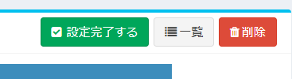

# Workflow settings
This page explains how to create a "workflow", such as application and approval, and make it usable in tables. The system administrator sets it.

The flow of the settings is as follows.

1. **Step1. Status setting**: decide the states, such as "Not applied", "Waiting for approval" and "Completed".
2. **Step2. Action setting**: decide the operations, such as "Apply" and "Approve", and who can execute them.
3. **Setting Complete**: complete the settings of the workflow. After this, statuses cannot be added, deleted or reordered.
4. **Step3. Notify setting**: decide the notifications sent when the workflow is executed.
5. **Step4. Usage settings**: decide in which tables it is used.

Note: statuses and actions can also be created and edited directly on the flow chart. See [Flow designer](/workflow_design) for details.

## What is a workflow?
A workflow is "the flow of a series of exchanges in a business task".  
Many tasks have a flow of "who starts it, who judges and processes it, and how it is completed".  
When you set a workflow in Exment, you can execute a flow such as the following.

  
- A user applies to the administration department for expenses
- The administration department approves the expense application, or rejects it
- The data of approved expenses cannot be modified afterwards

## Glossary
The terms used in the workflow of Exment.

  

##### Workflow  
The whole flow of a task, such as application and approval.

##### Status  
The current state of the workflow.  
Example: Not applied, Waiting for approval, Completed

##### Action  
An operation executed by a user. When it is executed, the data moves from one status to another status.  
Example: Apply, Approve, Reject, Send back

##### Working user  
The user whose turn it is to execute the next action.

## List screen display
The system administrator clicks "Admin Setting > Workflow" in the menu.  
A list of the saved workflows is displayed.

## Create New

1. Click the [New] button at the top right of the list screen.
2. "Step1. Status setting" of the workflow creation screen is displayed. Enter the necessary items.

### Step1. Status setting
Set the statuses of the workflow.

  

#### Workflow display name ※ required
- The name of the workflow shown on the screen. Japanese can also be used. (Example: Approval flow)

#### Workflow type ※ required
- The type of the workflow to create. Select either "Generic" or "Table Only".  
Note: it cannot be changed after creation.
##### Generic  
The workflow can be used in several tables.  
Select this when you want to use only standard statuses and actions, such as "Apply", "Approve" and "Reject".
##### Table Only  
The workflow can be used only in the table selected at creation. In return, you can change where an action leads by using the custom columns of that table.  
Example: in the "Expense settlement" table, when the custom column "Amount" is 100,000 yen or more, the "General manager approval" action is executed, and when it is less than 100,000 yen, the "Section manager approval" action is executed.

#### Start status name ※ required
- Set the status name for the state where the workflow has not been executed yet.

#### Status settings
- Define the settings of the workflow and the statuses to use.  
Note: make the status in the last row of the table the one that means the flow is completed.
##### Status Name  
The name of the status.
##### Cannot Edit Data  
Whether the target data cannot be edited while it is in this status. When you do not want it edited, set YES.  
Example: the data can be edited and deleted while "Not applied", but you do not want it edited or deleted while "Applying" or "Completed". In this case, set YES for "Applying" and "Completed".

### Step2.Action setting

  
#### Workflow View Name  
The display name set in the status setting is shown.
#### Status Name  
The status names set in the status setting are shown.
#### Grant editing permission  
When the workflow is executed, the edit permission can be given to the "next working user".
#### Execution User - Base User ※ required  
Set the user used as the base when the executable user of an action is "Obtained from execution user information". You can select from "First Execution User", "Execution User" and "Created Data User".

#### Action settings
- Set the actions executed in the workflow.
##### Action Name  
The name of the action.
##### Before Status  
Set the status in which the action can be executed.  
Example: when the status before execution is "Not done", the action can be executed if the status of the data is "Not done".
##### Action Setting  
Set what the action does. Click the [Change] button to change the setting.  
The contents depend on the workflow type.

  Note: when the workflow type is "Generic":  
    Set the status after this action is executed. Select a status different from the "Before Status".

  Note: when the workflow type is "Table Only":  
Set the conditions for executing the action and the status after execution. Up to three combinations of condition and status can be set.

> When the column type of a condition item is "Select (from the list of values in another table)", the text shown as the condition value can be changed in the [Heading display column setting](/table?id=heading-display-column-setting).

#### Work User (executable users)  

Select the users, organizations and so on that can execute this action. Click the [Change] button to change the setting.
  

##### Executable user: Selected by the user who executed the previous action
The user who executes the action chooses, each time, which user or organization it goes to.
  

##### Executable user: Set in advance
The administrator decides beforehand which user or organization it goes to. The flow proceeds as set.
  

**■ Setting items**

- User  
The specified users can execute the action.

- Organization  
The users who belong to the specified organizations can execute the action.

- Custom column  
The user or organization set in the custom column of the target data can execute the action. This is only for "Table Only".

- System > Created User  
The user who created the custom data can execute the action.

##### Executable user: Obtained from execution user information
The destination is decided from the information of the user who executes the workflow. The value of a user / organization item set for that user (such as the superior) is taken, and the action goes to that user or organization.

- Example 1: when the superior of User A is "General manager X", the action goes to General manager X
- Example 2: when the superiors of User B are "General manager Y" and "General manager Z", the action goes to General managers Y and Z
  

Note: for this function, the system administrator must add columns of the custom column type "User" or "Organization" to the "User" table beforehand. Also, "Index Enabled" must be YES for these columns.

**■ Base user**

The user used as the base when the executable users are got. It is [set for each workflow](/workflow_setting?id=Execution-User-Base-User-※-required).

- "First Execution User": based on the user who executed the first action of the flow.
- "Execution User": based on the user who executed the action concerned.
- "Created Data User": based on the user who created the data.

> For how the behavior differs by base user, see [Workflow examples](/workflow_example).

**■ Custom column**

The "User" and "Organization" columns of the user table are shown as candidates. When the action is executed, the user or organization set in that column of the base user can execute the next action.

#### Option Setting > Condition to advance to next status  
Set how many people must execute this action before the data goes to the next status.  
Note: usually, the flow proceeds when one person executes it. Change this value when you want something like "go to the next status only when 3 or more people have approved" or "go to the next status only when all users of the administration organization have approved".

#### Option Setting > Comment  
Whether a comment can be entered when the action is executed.  
You can select from "Required", "Nullable" and "Not Use".  
Note: an action set to "Required" has no button on the notification card of [LINE](/line?id=executing-workflow-actions-from-line), and cannot be executed from LINE.

#### Option Setting > Special action  
The label on the screen is "Ignore as Work User". When it is checked, the "executable users" of this action are not included in the current working users.  
(The current working users are the users who can execute some workflow action in the current status.)  
Check it for actions such as one where the administrator approves as a special case.  
Note: when a working user is assigned only to "special actions", that user is not notified, and is not shown in "Current Work Users" either.

Note: the main use is an action to bring a workflow in progress back to the beginning with administrator permission, or to bring a flow to completion as a special case.

#### Differences from a normal action
| Outline | Normal | Special action |
| ---- | ---- | ---- |
| Executable user setting | No limit | Only "Set in advance" |
| Notification to the target users | Sent | Not sent |
| Display in "Current Work Users" | Shown | Not shown |
| Display in [Pending tasks](/workflow_task) | Shown | Not shown |

### Setup completed
When both the status setting and the action setting are done, the "Setting Complete" button is shown at the top right of the page.

  

Click it to complete the settings of the workflow.  
Note: after the setting is completed, the following can no longer be done.
- Adding, deleting and reordering statuses

### Step3.Notify setting
Step 3 and step 4 are displayed after [Setting Complete] has been executed.  
Set the notifications sent when the workflow is executed. For the setting items, see [Notification / Email sending settings](/notify).

### Step4.Usage settings
Set which workflow is executed in which table.  
  

- For each table, the workflows shown are the "Generic" ones and the ones created only for that table, whose setting is completed.

- To use a workflow, check the "Available" checkbox.

- To switch workflows by date, enter dates in "Use Start Date" and "Use End Date". Save them so that the periods do not overlap.

This completes the workflow settings.  
To actually execute a workflow, see [Workflow execution](/workflow_execution).

### Deleting a workflow
A registered workflow setting can be deleted.  
When you delete a workflow setting that is already in use, note the following.

- The workflow setting cannot be restored.
- Workflows in progress become invalid.
- **Even when "Cannot Edit Data" is YES in the status setting, the data that could not be edited becomes editable again.**

  

### Other detailed specifications

- With "Executable user: Obtained from execution user information" and "Execution User - Base User: Execution User", when "Option Setting > Condition to advance to next status" is 2 people or more, the next working users are got based on the user who executed last.  
Example: when "Condition to advance to next status" is 3 people, the base user for getting "the users who execute the next action" is only the third user who executed the action. The information of the first and second users is not got.

- For actions with the same "Before Status", "Executable user: Set in advance" and "Executable user: Selected by the user who executed the previous action" cannot be set at the same time. (Except when "Executable user: Set in advance" is made a "special action".)

- For actions with the same "Before Status", "Executable user: Obtained from execution user information" and "Executable user: Selected by the user who executed the previous action" cannot be set at the same time. (Except when "Executable user: Obtained from execution user information" is made a "special action".)
