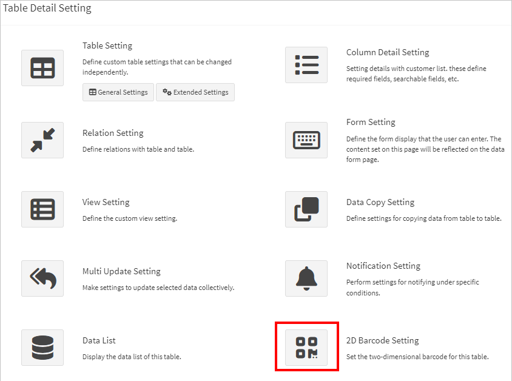
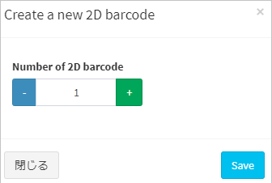

# 二维码设置
本页说明按表决定二维码标签的外观，以及扫描时的动作的页面。

到开始使用为止的流程如下。

1. 打开二维码设置页面
2. 设置并保存
3. 点击“启用”按钮
4. 从数据列表生成二维码的PDF

## 二维码功能的概要
二维码功能的概要，请参阅[官方网站的文章](https://exment.net/release_v6-1-0/)。

### 需要的 PHP 扩展（标签的 PDF）
要生成二维码标签的 PDF，需要安装带 FreeType 的 PHP gd 扩展（可以使用 `imagettftext`）。没有安装时，生成标签的 PDF 会出错。

- 使用 docker-exment 时：请更新 docker-exment（2026-11-23 的 PR #23 及以后），并重新构建 php 的镜像（执行 `docker compose build php` 之后执行 `docker compose up -d`）。
- 其他服务器时：请安装带 FreeType 的 gd（通常包含在发行版的 php-gd 软件包中）。能否使用，可以用下面的命令确认。显示 `bool(true)` 就可以使用。

```
php -r 'var_dump(function_exists("imagettftext"));'
```

## 打开页面
- 在自定义表列表中，勾选要设置的表，点击右上角的“表详细设置”。  


> ※ 也可以从该自定义表的数据列表页面或数据登记页面直接跳转。这时也请点击右上角的“表详细设置”。  


- 在表详细设置页面，点击二维码设置的图标，就会显示二维码设置页面。  


## 二维码的设置项目


### 二维码补充信息
设置显示在二维码右侧的信息。

- #### 标题
输入显示在二维码右侧的固定文字。

- #### 显示列
选择显示在二维码右侧的自定义数据的列。   
可以选择 ID 列或自动编号列（必须唯一且必填）。

### 二维码布局尺寸
设置二维码的布局尺寸。 
请看下表。

| Case | Cell width（单元格宽度） | Cell height（单元格高度） | Margin right（右边距） | Margin top（上边距） | Column per page（每页列数） | Row per page（每页行数） | Column spacing（列间距） | Row spacing（行间距） |
| ---- | ---- | ---- | ---- | ---- | ---- | ---- | ---- | ---- |
| 2x5 | 84 | 52 | 17 | 10.5 | 2 | 5 | 8 | 4 |
| 2x6 | 83.8 | 42.3 | 19.3 | 21.5 | 2 | 6 | 3.8 | 0 |
| 2x7 | 83 | 32 | 20 | 24 | 2 | 7 | 4 | 4 |
| 3x6 | 63.5 | 46.5 | 7.2 | 9 | 3 | 6 | 2.55 | 0 |
| 3x7 | 63.5 | 38 | 7.2 | 15.5 | 3 | 7 | 2.55 | 0 |
| 3x8 | 56 | 30 | 17 | 14.5 | 3 | 8 | 4 | 4 |
| 3x9 | 62 | 31 | 9 | 9 | 3 | 9 | 3 | 0 |
| 3x10 | 53.3 | 25.4 | 19 | 21.5 | 3 | 10 | 3.8 | 0 |
| 3x12 | 60 | 20 | 12 | 12 | 3 | 12 | 3 | 3 |
| 4x11 | 48.3 | 25.4 | 8.4 | 8.8 | 4 | 11 | 0 | 0 |


### 二维码扫描
设置扫描二维码时的动作。 

- #### 扫描二维码后的表单
选择扫描二维码后打开的登记表单。  
可以从该表已登记的自定义表单中选择。 

- #### 数据登记后的操作  
选择登记数据后显示的页面。  
可以从 TOP 页面、列表页面、详情页面、编辑页面、启动相机页面中选择。

设置后，点击“保存”按钮。  

### 启用二维码设置  
- 要在该表中使用二维码功能，需要“启用”。请先保存一次，然后点击页面右上角的“启用”按钮。


## 新建二维码
- 启用二维码功能后，该表的数据列表中会显示“新建二维码”按钮。  
按钮名称中“二维码”的部分，可以用 .env 文件的“EXMENT_TEXT_QR_BUTTON_JA/EN”更改。  


- 点击“新建二维码”后，显示新建二维码页面。

- 输入二维码数量并保存后，会创建相应数量的数据，同时输出二维码的PDF。


## 下载二维码
- 启用二维码功能后，该表的数据列表中会显示“下载二维码”按钮。  
按钮名称中“二维码”的部分，可以用 .env 文件的“EXMENT_TEXT_QR_BUTTON_JA/EN”更改。


- 选择数据并点击“下载二维码”后，所选数据的二维码会以PDF输出。


## 从 Exment 启动相机页面
- 可以从 Exment 的仪表板启动用于扫描二维码的相机页面。

- 在仪表板中添加项目“二维码／JAN 条形码”的步骤，请参阅[仪表板](/zh/dashboard)。
