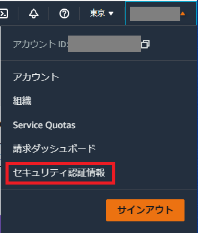
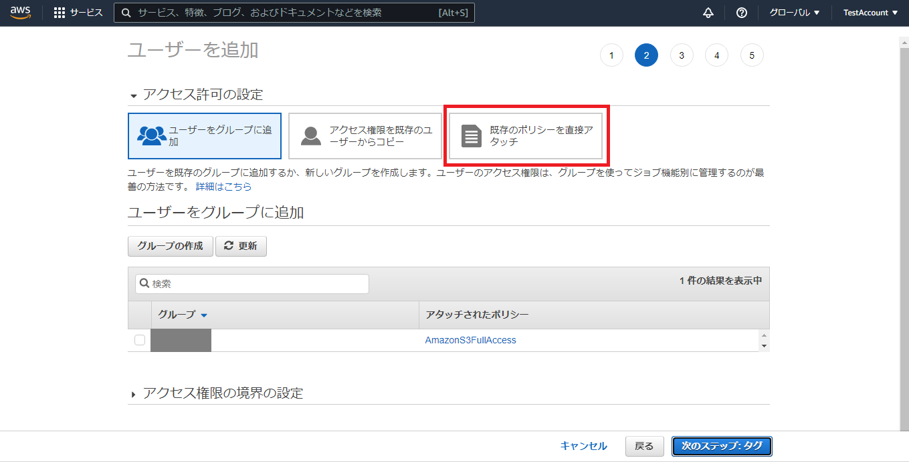
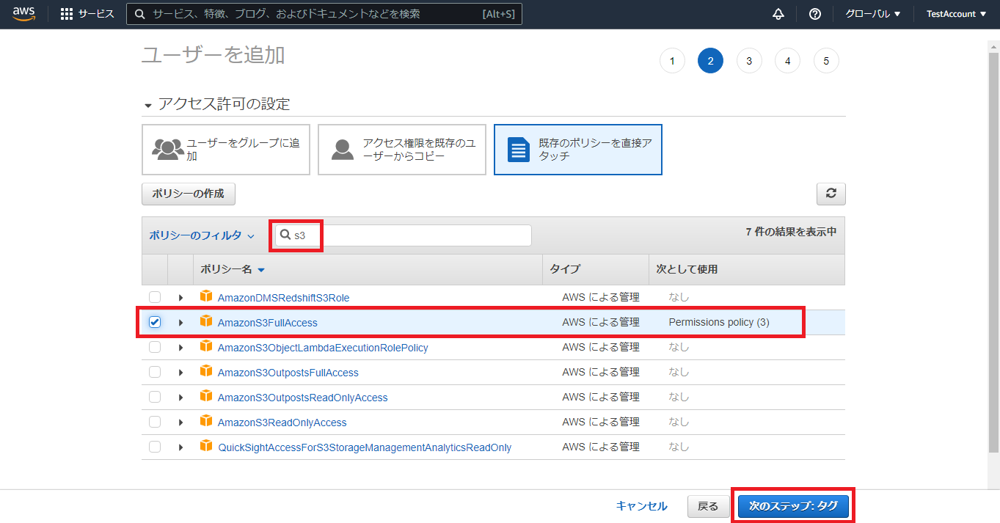
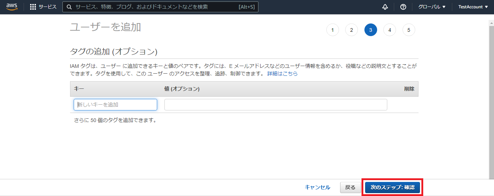
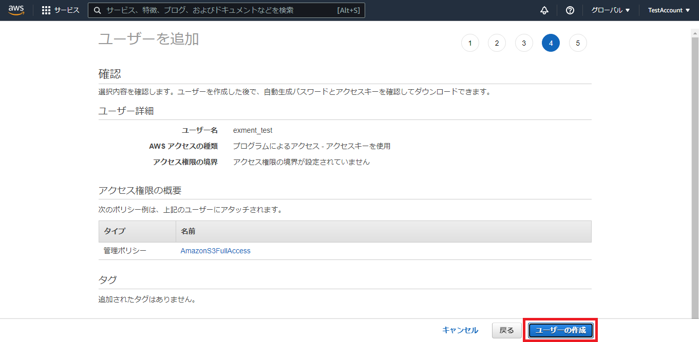
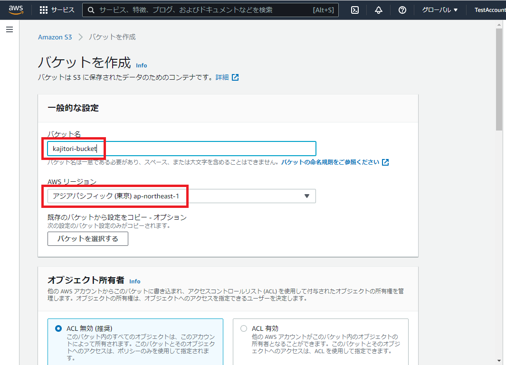
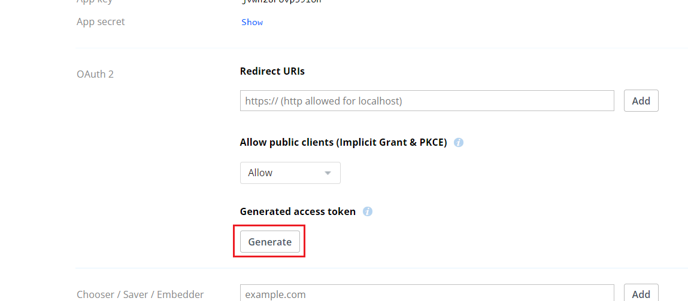

# （面向高级用户）更改文件的保存位置
这是把附件、备份等文件保存到 Web 服务器以外的地方（FTP、Amazon S3 等）的设置。  
在标准设置下，附件保存在 Web 服务器上。例如，在下面这些情况下，需要更改保存位置。

- 把备份文件保存到 FTP
- 为了做冗余，把文件保存到 AWS S3

设置按下面的顺序进行。

1. 决定要更改保存位置的“文件种类”，以及要使用的“上传位置（驱动）”。
2. 在“通用设置”中，按文件种类指定驱动。
3. 在“各驱动的设置”中，设置连接目标的信息。

## 文件的种类
目前 Exment 有下面这些文件种类。保存位置可以按种类分别决定。  
※键名在后面的设置中使用。

| 文件的种类 | 内容 | 键名 |
| ---- | ---- | ---- |
| **附件** | 从页面保存的数据附件 | exment |
| **备份** | 从备份页面执行的 Exment 数据备份文件 | backup |
| **插件** | 作为 Exment 的扩展功能上传的插件文件 | plugin |
| **模板** | Exment 的自定义表、自定义列等的设置文件 | template |


## 上传位置（驱动）的种类
目前 Exment 支持下面这些上传位置（驱动）。  
※键名在后面的设置中使用。

| 上传位置（驱动） | 保存的地方 | 键名 |
| ---- | ---- | ---- |
| **本地（默认）** | Web 服务器 | local |
| **FTP** | FTP | ftp |
| **SFTP** | SFTP | sftp |
| **Amazon S3** | Amazon S3 | s3 |
| **Azure Blob** | Azure Blob | azure |

> 从 v3.6.2 起，支持自己的驱动。详情请查看本页下方的“添加自己的驱动”。

## 设置方法

### 通用设置
- 打开“.env”，按要更改的文件种类指定驱动。

~~~
EXMENT_DRIVER_EXMENT=(附件要使用的驱动的键名)
EXMENT_DRIVER_BACKUP=(备份要使用的驱动的键名)
EXMENT_DRIVER_TEMPLATE=(模板要使用的驱动的键名)
EXMENT_DRIVER_PLUGIN=(插件要使用的驱动的键名)

// 例1：只想把备份位置改为 FTP 时
EXMENT_DRIVER_BACKUP=ftp

// 例2：想把所有上传位置都改为 Amazon S3 时
EXMENT_DRIVER_EXMENT=s3
EXMENT_DRIVER_BACKUP=s3
EXMENT_DRIVER_TEMPLATE=s3
EXMENT_DRIVER_PLUGIN=s3
~~~

### 首次安装的版本低于 v3.0.8 时
如果首次安装 Exment 时的版本低于 v3.0.8，需要做下面的修改。  
（如果不知道首次安装的版本，为保险起见请确认一下）

- 打开项目根文件夹中的“config/exment.php”。

- 找到下面这样的内容。

~~~ php
    /*
    |--------------------------------------------------------------------------
    | driver
    |--------------------------------------------------------------------------
    |
    | file upload driver
    |
    */
    'driver' => [
        'default' => env('EXMENT_DRIVER_DEFAULT', 'local'),
    ],
~~~

- 把这段内容改成下面这样。

~~~ php
    /*
    |--------------------------------------------------------------------------
    | driver
    |--------------------------------------------------------------------------
    |
    | file upload driver
    |
    */
    'driver' => [
        'exment' => env('EXMENT_DRIVER_EXMENT', 'local'), //修改
        'backup' => env('EXMENT_DRIVER_BACKUP', 'local'), //添加
        'plugin' => env('EXMENT_DRIVER_PLUGIN', 'local'), //添加
        'template' => env('EXMENT_DRIVER_TEMPLATE', 'local'), //添加
    ],
~~~

### （1 推荐）各驱动的设置 - config 和 .env 设置
这种方法在 config 中只写最少的内容，设置值写在 .env 中。  
设置值可以在各文件种类之间共用，所以设置起来比较简单。

#### FTP

- 执行下面的命令。

~~~
composer require league/flysystem-ftp ~3.0
~~~

- 打开“config/filesystems.php”，确认“disks.ftp”的设置值。  
如果不存在，请添加下面的设置。

~~~php
    'disks' => [
        // 从这里开始添加
        'ftp' => [
            'driver'   => 'ftp',
            'host'     => env('FTP_HOST'),
            'username' => env('FTP_USERNAME'),
            'password' => env('FTP_PASSWORD'),
    
            // FTP 设置的选项
            'port'     => env('FTP_PORT', 21),
            'ssl'      => env('FTP_SSL', false),
            'timeout'  => env('FTP_TIMEOUT', 30),
        ],
    ],
~~~

- 打开“.env”，添加下面的内容。  

~~~
FTP_HOST=(FTP 的主机名)
FTP_USERNAME=(FTP 的用户名)
FTP_PASSWORD=(FTP 的密码)
~~~

- 按要使用 FTP 的文件种类，追加下面的设置。

~~~
FTP_ROOT_EXMENT=(附件使用的 FTP 根路径)
FTP_ROOT_BACKUP=(备份使用的 FTP 根路径)
FTP_ROOT_TEMPLATE=(模板使用的 FTP 根路径)
FTP_ROOT_PLUGIN=(插件使用的 FTP 根路径)

// 例1：指定备份的 FTP 根路径
FTP_ROOT_BACKUP=/var/foo/exment/ftp/backup

// 例2：指定所有的 FTP 根路径
FTP_ROOT_EXMENT=/var/foo/exment/ftp/admin
FTP_ROOT_BACKUP=/var/foo/exment/ftp/backup
FTP_ROOT_TEMPLATE=/var/foo/exment/ftp/template
FTP_ROOT_PLUGIN=/var/foo/exment/ftp/plugin
~~~


#### SFTP

- 执行下面的命令。

~~~
composer require league/flysystem-sftp-v3 ~3.0
~~~

- 打开“config/filesystems.php”，确认“disks.sftp”的设置值。  
如果不存在，请添加下面的设置。

~~~php
    'disks' => [

        // 从这里开始添加
        'sftp' => [
            'driver'   => 'sftp',
            'host'     => env('SFTP_HOST'),
            'username' => env('SFTP_USERNAME'),
            'password' => env('SFTP_PASSWORD'),

            // 基于 SSH key 的认证设置(只在需要时填写)
            // 'privateKey' => env('SFTP_PRIVATE_KEY'),
            // 'password' => env('SFTP_PASSWORD'),

            // FTP 设置的选项
            'port' => env('SFTP_PORT', 22),
            'timeout' => env('SFTP_TIMEOUT', 30),
        ],
    ],
~~~

- 打开“.env”，添加下面的内容。  

~~~
SFTP_HOST=(SFTP 的主机名)
SFTP_USERNAME=(SFTP 的用户名)
SFTP_PASSWORD=(SFTP 的密码)
~~~

- 按要使用 SFTP 的文件种类，追加下面的设置。

~~~
SFTP_ROOT_EXMENT=(附件使用的 SFTP 根路径)
SFTP_ROOT_BACKUP=(备份使用的 SFTP 根路径)
SFTP_ROOT_TEMPLATE=(模板使用的 SFTP 根路径)
SFTP_ROOT_PLUGIN=(插件使用的 SFTP 根路径)

// 例1：指定备份的 SFTP 根路径
SFTP_ROOT_BACKUP=/var/foo/exment/sftp/backup

// 例2：指定所有的 SFTP 根路径
SFTP_ROOT_EXMENT=/var/foo/exment/sftp/admin
SFTP_ROOT_BACKUP=/var/foo/exment/sftp/backup
SFTP_ROOT_TEMPLATE=/var/foo/exment/sftp/template
SFTP_ROOT_PLUGIN=/var/foo/exment/sftp/plugin
~~~


#### Amazon S3
- 请事先[创建 AWS S3 的存储桶和 IAM](/zh/additional_file_saveplace?id=创建-S3-用的-IAM)。  
※要用于多个文件种类时，请按文件种类分别创建存储桶

- 执行下面的命令。

~~~
composer require league/flysystem-aws-s3-v3 ~3.0
~~~

- 打开“config/filesystems.php”，确认“disks.s3”的设置值。  
如果不存在，请添加下面的设置。

~~~php
    'disks' => [

        // 从这里开始添加
        's3' => [
            'driver' => 's3',
            'key' => env('AWS_ACCESS_KEY_ID'),
            'secret' => env('AWS_SECRET_ACCESS_KEY'),
            'region' => env('AWS_DEFAULT_REGION'),

            // 下面一项，只在因使用 PrivateLink 等而要更改端点时填写
            'endpoint' => env('AWS_ENDPOINT'),
        ],
    ],
~~~

- 把下面的内容添加到“.env”。  

~~~
AWS_ACCESS_KEY_ID=(AWS S3 的访问密钥)
AWS_SECRET_ACCESS_KEY=(AWS S3 的秘密访问密钥)
AWS_DEFAULT_REGION=(AWS S3 的区域)
#下面一项，只在因使用 PrivateLink 等而要更改端点时填写
AWS_ENDPOINT=(AWS S3 的端点)
~~~

> **不使用访问密钥，而用 IAM 角色连接时**
> 只有同时设置了“AWS_ACCESS_KEY_ID”和“AWS_SECRET_ACCESS_KEY”两项时，才用该访问密钥连接。
> 其中任何一项没有设置时，用 AWS SDK 的默认方法取得认证信息（环境变量、共享认证信息文件、ECS 任务或 EC2 实例的 IAM 角色等）。
> 在 EC2 或 ECS 上分配了 IAM 角色时，不填写这两项，就可以在不保存访问密钥的情况下连接到 S3。“AWS_DEFAULT_REGION”和存储桶的设置仍然需要。

- 按要使用 Amazon S3 的文件种类，追加下面的设置。

~~~
AWS_BUCKET_EXMENT=(附件使用的 AWS S3 存储桶)
AWS_BUCKET_BACKUP=(备份使用的 AWS S3 存储桶)
AWS_BUCKET_TEMPLATE=(模板使用的 AWS S3 存储桶)
AWS_BUCKET_PLUGIN=(插件使用的 AWS S3 存储桶)

// 例1：指定备份的 AWS S3 存储桶
AWS_BUCKET_BACKUP=exment_backup

// 例2：指定所有的 AWS S3 存储桶
AWS_BUCKET_EXMENT=exment_default
AWS_BUCKET_BACKUP=exment_backup
AWS_BUCKET_TEMPLATE=exment_template
AWS_BUCKET_PLUGIN=exment_plugin
~~~

- 把附件的保存位置设为 Amazon S3 后，下载附件时会重定向到 Amazon S3 的临时 URL（带签名的 URL）。浏览器不经过 Exment，直接从 Amazon S3 下载文件。  
因此，用户的浏览器必须能连接到 Amazon S3（的端点）。  
※临时 URL 的有效期限（分钟）可以用“.env”的“EXMENT_FILE_DOWNLOAD_TEMPORARY_URL_MINUTES”更改（默认值为 15）。详情请查看[这里](/zh/config)。


#### Azure Blob
- 创建 Azure 的 Blob。  
※要用于多个文件种类时，请按文件种类分别创建容器

- 执行下面的命令。

~~~
composer require league/flysystem-azure-blob-storage ~3.0
~~~

- 打开“config/filesystems.php”，确认“disks.azure”的设置值。  
如果不存在，请添加下面的设置。

~~~php
    'disks' => [
        // 从这里开始添加
        'azure' => [
            'driver' => 'azure',
            'account' => env('AZURE_STORAGE_ACCOUNT'),
            'key' => env('AZURE_STORAGE_KEY'),
        ],
    ],
~~~

- 把下面的内容添加到“.env”。  

~~~
AZURE_STORAGE_ACCOUNT=(Azure Blob 的账户)
AZURE_STORAGE_KEY=(Azure Blob 的访问密钥)
~~~

- 按要使用 Azure Blob 的文件种类，追加下面的设置。

~~~
AZURE_STORAGE_CONTAINER_EXMENT=(附件使用的 Azure Blob 容器)
AZURE_STORAGE_CONTAINER_BACKUP=(备份使用的 Azure Blob 容器)
AZURE_STORAGE_CONTAINER_TEMPLATE=(模板使用的 Azure Blob 容器)
AZURE_STORAGE_CONTAINER_PLUGIN=(插件使用的 Azure Blob 容器)

// 例1：指定备份的 Azure Blob 容器
AZURE_STORAGE_CONTAINER_BACKUP=exment_backup

// 例2：指定所有的 Azure Blob 容器
AZURE_STORAGE_CONTAINER_EXMENT=exment_default
AZURE_STORAGE_CONTAINER_BACKUP=exment_backup
AZURE_STORAGE_CONTAINER_TEMPLATE=exment_template
AZURE_STORAGE_CONTAINER_PLUGIN=exment_plugin
~~~


### （2 不推荐）各驱动的设置 - 在 config 中分别指定
这种方法按文件种类，把各驱动的信息详细地设置在 config 中。

#### 例：FTP
- 打开“config/filesystems.php”，添加下面的值。  

~~~php
    'disks' => [
        // 文件种类为备份时，从这里开始添加
        'backup' => [ // 输入文件种类的键名
            'driver'   => 'ftp',
            'host'     => env('FTP_HOST'),
            'username' => env('FTP_USERNAME'),
            'password' => env('FTP_PASSWORD'),
            'root' => env('FTP_ROOT'),
    
            // FTP 设置的选项
            'port'     => env('FTP_PORT', 21),
            'ssl'      => env('FTP_SSL', false),
            'timeout'  => env('FTP_TIMEOUT', 30),
        ],

        // 要更改其他文件种类的驱动时，在这里写同样的设置
    ],
~~~

- 打开“.env”，添加上面“env”函数中写的设置值。

- 要更改其他文件种类的驱动时，请在“.env”文件中添加设置。


### 注意事项
- 有些服务器可能无法保存文件。  
特别是租用服务器，**提供商的设置可能限制了 FTP 等**。敬请谅解。


## （面向高级用户和开发者）添加自己的驱动
Exment 在标准状态下支持 FTP、Amazon S3 等驱动。  
这里说明使用标准不支持的、自己的驱动的方法。  

### 前提
- ※在 Exment 中，需要按前面所说的“文件的种类（附件、备份、插件、模板）”分开根文件夹。  

- 如果使用的文件系统没有分开根文件夹的功能，就需要采取更改上传位置、按文件种类分别创建应用等对策。

### 使用条件
Exment 使用 [Laravel 的文件系统](https://readouble.com/laravel/12.x/ja/filesystem.html)（日语）功能来管理自己的驱动。  
因此，只有提供了 Laravel 文件系统的服务，才能用于 Exment 的文件管理。（或者，需要自己准备驱动。）

### 开发方法
这里以把文件的上传位置设为 Dropbox 为例进行说明。  
※Dropbox 一侧的设置，请查看[参考：取得 Dropbox 访问令牌的方法](/zh/additional_file_saveplace?id=参考：取得-Dropbox-访问令牌的方法)。  

#### 取得需要的包
添加用 Laravel 管理 Dropbox 所需的包。

```
composer require spatie/flysystem-dropbox=^2.0.5
```

#### 创建和追加文件
添加或追加下面的文件。

- ##### 适配器
新建“app/Exment/Driver”文件夹，并创建文件“ExmentAdapterDropbox.php”。

``` php
<?php

namespace App\Exment\Driver;

use Spatie\FlysystemDropbox\DropboxAdapter;

use Exceedone\Exment\Model\File;
use Exceedone\Exment\Enums\Driver;
use Exceedone\Exment\Storage\Adapter\ExmentAdapterInterface2;
use Exceedone\Exment\Storage\Adapter\AdapterTrait;

// (1) 继承 DropboxAdapter。※DropboxAdapter 继承了 \League\Flysystem\Adapter\AbstractAdapter
// (2) 实现 ExmentAdapterInterface 或 ExmentAdapterInterface2
class ExmentAdapterDropbox extends DropboxAdapter implements ExmentAdapterInterface2
{
    //(3) use AdapterTrait
    use AdapterTrait;
    
    /**
     * (4) 取得文件的 URL。基本上请原样使用下面的处理
     */
    public function getUrl(string $path): string
    {
        return File::getUrl($path);
    }
    
    /**
     * (5) 适配器实例化时调用的方法
     */
    public static function getAdapter($app, $config, $driverKey)
    {
        $mergeConfig = static::getConfig($config);

        $client = new \Spatie\Dropbox\Client(array_get($mergeConfig, 'token'));

        // Let's teach Flysystem to interact with Dropdox,
        // thanks to an adapter made by Spatie as usual.
        $driver = new self($client);
        return $driver;
    }


    /**
     * (6) 合并设置文件
     * @param string $mergeFrom 'exment', 'backup', 'plugin', 'template' 字符串
     */
    public static function getMergeConfigKeys(string $mergeFrom, array $options = []) : array{
        return [
            'token' => config('filesystems.disks.dropbox.access_token_' . $mergeFrom),
        ];
    }

    /**
     * (7) 取得设置信息
     * *从 Exment5.0.0 起需要的项目*
     *
     * @param array $config
     * @return array
     */
    public static function getConfig($config) : array
    {
        $mergeFrom = array_get($config, 'mergeFrom');
        $mergeConfig = static::mergeFileConfig('filesystems.disks.dropbox', "filesystems.disks.$mergeFrom", $mergeFrom); // 请只把“dropbox”的部分改成自己的适配器名
        return $mergeConfig;
    }
}

```

```
(1) 适配器文件请继承 \League\Flysystem\Adapter\AbstractAdapter。  
对于 Dropbox，\Spatie\FlysystemDropbox\DropboxAdapter 已经继承了上面的类，所以请继承它。  

(2) 请实现 \Exceedone\Exment\Storage\Adapter\ExmentAdapterInterface2 或 \Exceedone\Exment\Storage\Adapter\ExmentAdapterInterface。  
※ExmentAdapterInterface 和 ExmentAdapterInterface2 的区别，只在于函数 getUrl 的参数和返回值是否明确写了类型。  

(3) 请 use AdapterTrait。  

(4) 基本上请原样使用所写的处理。  

(5) 这是适配器实例化时调用的方法。基本上请按照各自文件服务的实例化方法来实现。    

(6) 用关联数组设置要合并到设置信息中的键和值的组合。  

(7) 返回合并后的设置信息。基本上请只把“dropbox”的部分改成自己的适配器名，然后原样复制粘贴。
  ※这是从 Exment5.0.0 起需要的项目。

※在 Exment 中，需要按前面所说的“文件的种类(附件、备份、插件、模板)”分开根文件夹。  
Dropbox 没有在同一个应用中分开根文件夹的功能。  
因此，需要按文件种类分别创建 Dropbox 应用。  
这个合并处理，用来把按文件种类分别创建的访问令牌分配为设置值。
```

    
- ##### 钩子
在“app/Exment”文件夹的“bootstrap.php”中，追加下面的内容。

``` php
<?php
// 执行 \Exceedone\Exment\Enums\Driver::extend 方法
// 第一个参数：适配器的键名
// 第二个参数：所实现的 Adapter 的路径
\Exceedone\Exment\Enums\Driver::extend('dropbox', \App\Exment\Driver\ExmentAdapterDropbox::class);

```

    
- ##### 设置值
在“config”文件夹的“filesystems.php”中，追加下面的内容。  
因为需要按文件种类分开 Dropbox 的应用，所以按文件种类设置令牌。

``` php
    'dropbox' => [
        'driver' => 'dropbox',
        'access_token_exment' => env('DROPBOX_ACCESS_TOKEN_EXMENT'),
        'access_token_backup' => env('DROPBOX_ACCESS_TOKEN_BACKUP'),
        'access_token_plugin' => env('DROPBOX_ACCESS_TOKEN_PLUGIN'),
        'access_token_template' => env('DROPBOX_ACCESS_TOKEN_TEMPLATE'),
    ],
```

    
- ##### .env 文件
在根文件夹的“.env”中，追加下面的内容。  
※访问令牌的取得方法，请查看下面的“参考：取得 Dropbox 访问令牌的方法”。

```
# 下面的内容，只追加需要的项目
EXMENT_DRIVER_EXMENT=dropbox
EXMENT_DRIVER_BACKUP=dropbox
EXMENT_DRIVER_TEMPLATE=dropbox
EXMENT_DRIVER_PLUGIN=dropbox

# 下面的内容，只追加需要的项目。填写访问令牌
DROPBOX_ACCESS_TOKEN_EXMENT=XXXXXX
DROPBOX_ACCESS_TOKEN_BACKUP=YYYYYY
DROPBOX_ACCESS_TOKEN_TEMPLATE=ZZZZZZ
DROPBOX_ACCESS_TOKEN_PLUGIN=VVVVVV

```

到这里，实现就完成了。


## 参考：创建 AWS S3 的方法
这里简单说明 Amazon Simple Storage Service (Amazon S3) 的创建方法。  
※需要事先创建 AWS 账户并登录。

#### 创建 S3 用的 IAM
- 在控制台页面的右上方，单击自己的账户，打开子菜单。请选择“Security credentials”（安全凭证）。
  

- 在左侧的侧边菜单中选择“Users”（用户）。
  

- 单击“Add users”（添加用户）按钮。
  

- 在“User name”（用户名）中输入任意的名称。
在“Select AWS credential type”（选择 AWS 凭证类型）中勾选“Access key - Programmatic access”（访问密钥 - 编程访问），然后单击“Next: Permissions”（下一步：权限）按钮。
  

- 在“Set permissions”（设置权限）中单击“Attach existing policies directly”（直接附加现有策略）。
  

- 在“Filter policies”（筛选策略）中输入“S3”进行搜索。在显示的列表中勾选“AmazonS3FullAccess”，然后单击“Next: Tags”（下一步：标签）按钮。
  

- 单击“Next: Review”（下一步：审核）按钮。
  

- 显示确认页面。确认所选内容后，单击“Create user”（创建用户）按钮。
  

- 用户创建成功后，会显示“Access key ID”（访问密钥 ID）和“Secret access key”（秘密访问密钥）。
后面会用到，请务必记下来。
  

#### 创建存储桶

- 创建用户之后，创建存储桶。  
单击控制台页面左上方的 Services（服务），选择“Storage”（存储）→“S3”。
  

- 单击“Create bucket”（创建存储桶）按钮。
  

- 在“Bucket name”（存储桶名称）中输入任意的名称。“AWS Region”（AWS 区域）选择“Asia Pacific (Tokyo)”（亚太地区（东京））。  
※其他选项请根据需要设置。
  

- 单击“Create bucket”（创建存储桶）按钮。
  

- 确认创建的存储桶已添加到列表中。
  


## 参考：取得 Dropbox 访问令牌的方法
- 访问 Dropbox 的 [App Console](https://www.dropbox.com/developers/apps)。

- 单击“Create App”。
  

- 把“2. Choose the type of access you need”设为“App folder”，在“3. Name your app”中输入任意的名称，然后单击“Create app”。
  

- 应用新建完成。接着更改 Permissions 权限。单击 Permissions 选项卡。
  

- 勾选下面的项目。设置完成后，请单击 Submit。
    - files.metadata.write
    - files.content.write
    - files.content.read
  

- 在 Settings 选项卡的“OAuth 2”的“Generated access token”菜单中，单击“Generate”按钮。
  

- 访问令牌新建完成。请把这个值填写到设置文件中。
  


[←返回追加设置一览](/zh/quickstart_more)
