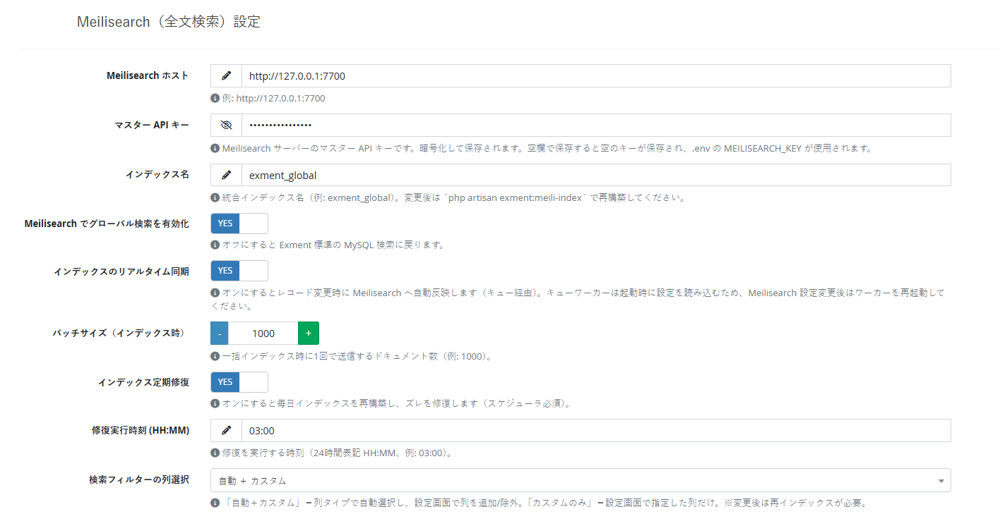
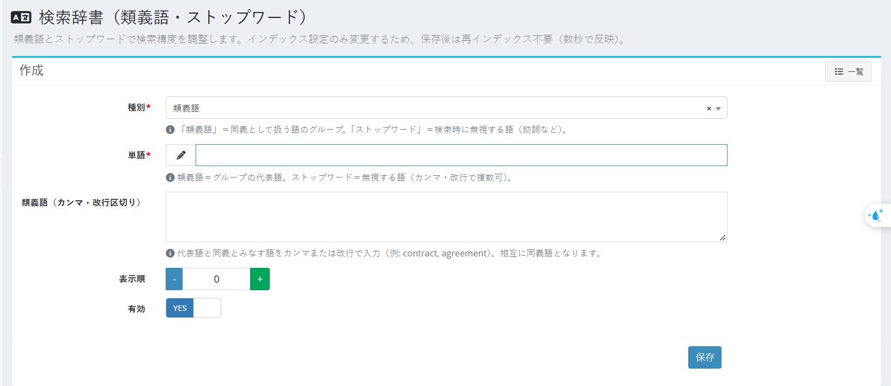

# (面向高级用户)使用全文搜索引擎(Meilisearch)
这是使用全文搜索引擎“[Meilisearch](https://www.meilisearch.com/)”让 Exment 的搜索变快的设置。  
Exment 通常搜索数据库。使用 Meilisearch 后，即使在数据非常多的环境中，也能快速搜索。  
※此功能可在 Exment v7.0.0 及以后的版本中使用。

安装方法有 2 种。

| 安装方法 | 适合的情况 |
|---|---|
| [简单的安装方法](/zh/additional_meilisearch?id=简单的安装方法) | Exment v7.2.2 及以后。想只运行 1 次脚本就装好 |
| [手动安装时](/zh/additional_meilisearch?id=手动安装时) | 想不用脚本进行设置。想确认设置的内容 |

可以使用下面的功能。

- 关键字搜索的加速
- 搜索结果的筛选(筛选、分面)
- 搜索关键词的高亮显示
- 搜索结果的排序(按相关度、最新优先、最早优先)
- 搜索条件的保存和共享
- 搜索结果的导出(CSV、XLSX)
- 同义词、停用词的设置

  

> Exment 通常的搜索机制，请看[搜索](/zh/search)。


## 运行条件
要使用 Meilisearch，需要满足下面的条件。

|项目|内容|
|---|---|
|Meilisearch 服务器|v1.10 及以后|
|PHP 库|需要安装“meilisearch/meilisearch-php”(v1.10 及以后)。简易安装的 zip 中已包含。**这个库不是 Exment 的必需库**。没有安装时，Meilisearch 相关的命令会出错，实时同步也无效。<br />另外，这个库需要与“guzzlehttp/guzzle”兼容的 HTTP 客户端。|
|队列|需要把“QUEUE_CONNECTION”设为 database(或 redis)，并且已执行迁移。<br />实时同步通过队列执行，所以保持初始值 sync 时，页面的处理会被阻塞。详细内容请看[通知处理的延迟执行](/zh/additional_queue)。|
|自定义表|只有在自定义表设置中“可搜索”为 YES，并且拥有“关键字搜索对象”为 YES 的自定义列的表，才是创建索引的对象。|


## 注意事项
- <span class="red">※请不要把 Meilisearch 公开到互联网。</span>请设置为只能从与 Exment 相同的服务器，或内部网络连接。主密钥请严格管理，不要让其他人知道。
- **Meilisearch 和队列工作进程需要一直运行**。在步骤 1 和步骤 3 中，两者都登记为自动重启的服务。停止时，会变成下面这样。

|停止的对象|会怎样|
|---|---|
|Meilisearch|搜索页面切换为使用数据库的通常搜索(应用了筛选条件时，不显示搜索结果，排序也不生效)。|
|队列工作进程|更新的内容不会反映到索引。|

- Meilisearch 的索引（搜索用的数据）与 Exment 的数据库分开保存。因此，两者之间有时会出现差异。在步骤 4 中，设置每天 1 次的自动修复。
- <span class="red">※把“EXMENT_SEARCH_DOCUMENT”设为 true 时，搜索页面不使用 Meilisearch。</span>附件的文件名不进入索引，所以即使“MEILISEARCH_GLOBAL_SEARCH”为 true，搜索页面也使用数据库搜索。自定义列“选项（从其他表中选择）”的输入补全不受影响。
- Meilisearch 本身的详细说明，请看 [Meilisearch 官方文档](https://www.meilisearch.com/docs)。


## 简单的安装方法
在 Exment v7.2.2 及以后的版本中，只要运行 1 次脚本，就可以一次完成下面[手动安装时](/zh/additional_meilisearch?id=手动安装时)的步骤 1〜4。脚本运行多少次都没有问题(已有的主密钥和设置会原样使用)。

请看符合您环境的部分。

|环境|要看的地方|
|---|---|
|Linux 服务器(也包括 AWS 的 EC2 等)|下面的“Linux 的情况”|
|Windows 服务器|下面的“Windows 的情况”|
|docker-exment|下面的“Docker 的情况”|
|Meilisearch 已经在运行(在其他服务器上准备好的情况等)|[只进行 Exment 的设置时](/zh/additional_meilisearch?id=只进行-Exment-的设置时)|
|AWS、Azure、租用服务器|下面的“AWS、租用服务器的情况”|

### Linux 的情况
在使用 systemd 的服务器(Ubuntu、Debian、RHEL、Amazon Linux 等。也包括 AWS 的 EC2)上，移动到 Exment 的文件夹，执行下面的命令。

```
cd /var/www/exment
sudo sh vendor/exceedone/exment/resources/meilisearch/install-meilisearch.sh
```

脚本会进行下面的处理。

1. 安装 Meilisearch(“/usr/local/bin/meilisearch”)，创建运行用的用户，创建写有新主密钥的“/etc/meilisearch.conf”(只有 root 可以读取)，登记服务“meilisearch”(只在 127.0.0.1:7700 上监听)
1. Exment 的设置(“php artisan exment:meili-setup”。内容请看[只进行 Exment 的设置时](/zh/additional_meilisearch?id=只进行-Exment-的设置时))
1. 登记队列工作进程的服务“exment-meili-worker”
1. 向 Web 服务器用户的 crontab 添加计划任务(php artisan schedule:run)

请根据需要指定下面的选项。

|选项|内容|
|---|---|
|--exment-dir=文件夹|Exment 的文件夹。默认值是当前文件夹。|
|--user=用户|Web 服务器运行 PHP 的用户(www-data、apache、nginx 等)。默认值是“storage”文件夹的所有者。|
|--php=路径|php 命令的路径。请指定与 Web 服务器相同版本的 php(例: --php=/usr/bin/php8.3)。默认值是 PATH 中的 php。|
|--version=版本|Meilisearch 的版本。默认值是“v1.10.3”。|
|--index=名称|索引名称。默认值是“exment_global”。|
|--no-cron|不向 crontab 添加计划任务。已经用其他方法运行计划任务时指定。|

### Windows 的情况
用“以管理员身份运行”打开 PowerShell，在 Exment 的文件夹中执行下面的命令。
※请把“C:\php\php.exe”改为 IIS 使用的 php 的路径。

```
cd C:\inetpub\exment
powershell -ExecutionPolicy Bypass -File vendor\exceedone\exment\resources\meilisearch\install-meilisearch.ps1 -Php C:\php\php.exe
```

脚本会进行下面的处理。

1. 安装 Meilisearch(“C:\meilisearch”)，创建新主密钥(“C:\meilisearch\master-key.txt”。只有 Administrators 和 SYSTEM 可以读取)，用 NSSM 登记服务“Meilisearch”，把索引的保存位置从 Windows Defender 的扫描对象中排除
1. Exment 的设置(“php artisan exment:meili-setup”)
1. 登记队列工作进程的服务“ExmentMeiliWorker”
1. 向任务计划程序登记任务“ExmentScheduler”(每 1 分钟执行 php artisan schedule:run)

> NSSM 请用“-Nssm”指定路径，或放在 PATH 或“C:\nssm\nssm.exe”。两处都没有时，如果有 winget，会自动安装。
> 其他选项: “-ExmentDir”(Exment 的文件夹)、“-Version”(Meilisearch 的版本)、“-InstallDir”(Meilisearch 的文件夹)、“-Index”(索引名称)、“-NoScheduler”(不登记任务)、“-NoDefenderExclusion”(不更改 Windows Defender 的设置)

### Docker 的情况
使用 [docker-exment](https://github.com/exceedone/docker-exment) 时，只要添加“docker-compose.meilisearch.yml”，Meilisearch、队列工作进程、计划任务的容器就会启动。

- 在 docker-exment 文件夹的“.env”中，填写 16 个字符以上的主密钥(例: 用“openssl rand -hex 16”生成的值)。

```
EXMENT_DOCKER_MEILISEARCH_MASTER_KEY=(主密钥)
```

- 执行下面的命令，启动容器，然后进行 Exment 的设置。

```
docker compose -f docker-compose.yml -f docker-compose.mysql.yml -f docker-compose.meilisearch.yml up -d
docker compose -f docker-compose.yml -f docker-compose.mysql.yml -f docker-compose.meilisearch.yml exec -u www-data php php artisan exment:meili-setup
```

### 只进行 Exment 的设置时
Meilisearch 已经在运行时(在其他服务器上准备好的情况等)，在 Exment 的文件夹中执行下面的命令。它会一次完成手动安装时的“[2. Exment 的设置](/zh/additional_meilisearch?id=2.-Exment-的设置)”。

```
php artisan exment:meili-setup --host=http://127.0.0.1:7700 --key-file=/etc/meilisearch.conf
```

这个命令按下面的顺序执行。中途出错时，会显示错误内容并停止。修正后，请再执行一次。

1. 确认可以连接 Meilisearch、主密钥正确、版本是 v1.10 及以后
1. “.env”的设置: “QUEUE_CONNECTION”为 sync 时改为 database，并添加“MEILISEARCH_REINDEX_QUEUE=meili-reindex”
1. 没有队列的表(jobs、failed_jobs)时创建它们，并执行“php artisan migrate”
1. 保存系统设置: 主机、主密钥、索引名称、实时同步(YES)、定期修复索引(YES)、修复时间
1. 创建索引。完成后，把全局搜索设为 YES
1. 确认连接状态(“php artisan exment:meili-health --failed”)，并指示正在运行的队列工作进程重启(“php artisan queue:restart”)

|选项|内容|
|---|---|
|--host=URL|Meilisearch 的连接地址。默认值是当前的设置值(“http://127.0.0.1:7700”)。|
|--key-file=文件|写有主密钥的文件。指定含有“MEILI_MASTER_KEY=”一行的文件(“/etc/meilisearch.conf”等)，或只写了密钥的文件。|
|--key=密钥|主密钥。写在命令行中的密钥，有时其他用户也能看到，所以建议使用“--key-file”或环境变量“MEILI_MASTER_KEY”。|
|--index=名称|索引名称。默认值是当前的设置值(“exment_global”)。|
|--repair-at=HH:MM|定期修复索引的时刻。默认值是当前的设置值(“03:00”)。|
|--skip-env|不更改“.env”。请自己填写显示出来的内容。|
|--skip-index|只保存设置，不创建索引。全局搜索保持 NO。|

> 主密钥按“--key-file”、环境变量“MEILI_MASTER_KEY”、“--key”、系统设置中已保存的值的顺序查找，都没有时会要求输入。
> 这个命令不登记队列工作进程和计划任务。请进行手动安装时的“[3. 登记队列工作进程](/zh/additional_meilisearch?id=3.-登记队列工作进程)”“[4. 设置计划任务](/zh/additional_meilisearch?id=4.-设置计划任务)”。

### AWS、租用服务器的情况
- **AWS(EC2)、Azure 的虚拟机等**: 与 Linux、Windows 服务器一样，可以使用上面的脚本。请不要用安全组等把端口 7700 公开到外部。
- **租用服务器(Xserver 等)**: 不能运行常驻的程序，所以 Meilisearch 不能在租用服务器中运行。请把 Meilisearch 放在可以常驻运行的其他服务器(AWS 的 EC2 等)上，并设置为只能从 Exment 的服务器连接。然后，在 Exment 的文件夹中执行“php artisan exment:meili-setup --host=(Meilisearch 的连接地址)”。队列工作进程不能常驻运行，所以用 cron 每 1 分钟执行一次。详细内容请看[通知处理的延迟执行](/zh/additional_queue)。


## 手动安装时
这是不用脚本进行设置，或想确认设置内容时的步骤。按下面的顺序设置。

1. 安装 Meilisearch 服务器
1. Exment 的设置
1. 登记队列工作进程
1. 设置计划任务


## 1. 安装 Meilisearch 服务器

### Linux 的情况
这是在 Ubuntu 以及使用 systemd 的环境中的步骤。  
※请根据您的环境更改路径和用户名。

- 执行下面的命令，放置 Meilisearch 的二进制文件。  
Meilisearch 用 1 个文件就能运行，所以不需要安装其他库。

```
curl -L -o /tmp/meilisearch \
  https://github.com/meilisearch/meilisearch/releases/download/v1.10.3/meilisearch-linux-amd64

chmod +x /tmp/meilisearch && sudo mv /tmp/meilisearch /usr/local/bin/meilisearch
```

- 执行下面的命令，确认显示出版本。

```
meilisearch --version
```

- 执行下面的命令，创建 Meilisearch 运行用的用户和保存数据的文件夹。

```
sudo useradd -r -s /usr/sbin/nologin meilisearch
sudo mkdir -p /var/lib/meilisearch
sudo chown meilisearch:meilisearch /var/lib/meilisearch
```

- 执行下面的命令，创建 Meilisearch 的设置文件。  
主密钥会用随机字符串自动生成。

```
sudo tee /etc/meilisearch.conf > /dev/null << EOF
MEILI_DB_PATH=/var/lib/meilisearch/data.ms
MEILI_HTTP_ADDR=127.0.0.1:7700
MEILI_ENV=production
MEILI_MASTER_KEY=$(openssl rand -hex 16)
MEILI_NO_ANALYTICS=true
EOF

sudo chmod 600 /etc/meilisearch.conf
```

> “MEILI_ENV=production”时，主密钥需要 16 字节以上。  
“openssl rand -hex 16”会生成 32 个字符的字符串，所以满足这个条件。

- 执行下面的命令，确认生成的主密钥。  
**这个密钥稍后要输入到 Exment 的“系统设置”中，请务必记下来**。

```
sudo grep MASTER_KEY /etc/meilisearch.conf
```

- 执行下面的命令，把 Meilisearch 登记为服务。

```
sudo tee /etc/systemd/system/meilisearch.service > /dev/null << 'EOF'
[Unit]
Description=Meilisearch search engine
After=network.target

[Service]
Type=simple
User=meilisearch
Group=meilisearch
EnvironmentFile=/etc/meilisearch.conf
WorkingDirectory=/var/lib/meilisearch
ExecStart=/usr/local/bin/meilisearch
Restart=always
RestartSec=3
NoNewPrivileges=true
ProtectSystem=full
ProtectHome=true
ReadWritePaths=/var/lib/meilisearch

[Install]
WantedBy=multi-user.target
EOF
```

> “WorkingDirectory=/var/lib/meilisearch”这一行必须写。  
Meilisearch 会在当前目录中创建临时文件夹，所以没有这一行时，会发生“Permission denied”，服务会反复启动和停止。

- 执行下面的命令，启用服务的自动启动，然后启动 Meilisearch。

```
sudo systemctl daemon-reload
sudo systemctl enable --now meilisearch
```

- 执行下面的命令，确认显示出“{"status":"available"}”。

```
curl -s http://127.0.0.1:7700/health
```

### Windows 的情况
这是在使用 NSSM(Non-Sucking Service Manager)和任务计划程序的环境中的步骤。  
请用“以管理员身份运行”打开 PowerShell，执行下面的命令。  
※请根据您的环境更改路径。

- 执行下面的命令，创建文件夹，并下载 Meilisearch 的二进制文件。

```
New-Item -ItemType Directory -Force C:\meilisearch
Invoke-WebRequest -Uri "https://github.com/meilisearch/meilisearch/releases/download/v1.10.3/meilisearch-windows-amd64.exe" `
  -OutFile C:\meilisearch\meilisearch.exe
```

- 执行下面的命令，确认显示出版本。

```
C:\meilisearch\meilisearch.exe --version
```

- 执行下面的命令，生成 32 个字符的主密钥。  
**这个密钥稍后要输入到 Exment 的“系统设置”中，请务必记下来**。

```
$key = -join (1..32 | ForEach-Object { '0123456789abcdef'[(Get-Random -Maximum 16)] })
$key
```

> “Get-Random -Count 32”不会重复取得相同的值，所以对于只有 16 种的十六进制字符，只能生成 16 个字符的密钥。请不要使用。

- 从 [NSSM 官方网站](https://nssm.cc/download)下载 NSSM，把“nssm.exe”放在“C:\nssm\”文件夹中。  
※也可以用“winget install nssm”命令安装。

- 执行下面的命令，把 Meilisearch 登记为 Windows 服务。

```
C:\nssm\nssm.exe install Meilisearch C:\meilisearch\meilisearch.exe
C:\nssm\nssm.exe set Meilisearch AppParameters "--db-path C:\meilisearch\data.ms --http-addr 127.0.0.1:7700 --env production --master-key $key --no-analytics"
C:\nssm\nssm.exe set Meilisearch AppDirectory C:\meilisearch
C:\nssm\nssm.exe set Meilisearch AppExit Default Restart
C:\nssm\nssm.exe set Meilisearch Start SERVICE_AUTO_START
C:\nssm\nssm.exe start Meilisearch
```

> “$key”是上一个步骤中生成的主密钥。  
重新打开 PowerShell 后，变量的内容已经丢失，所以请直接填写生成的密钥字符串。

- 执行下面的命令，确认显示出“status : available”。

```
Invoke-RestMethod http://127.0.0.1:7700/health
```

- 执行下面的命令，把索引的保存文件夹从 Windows Defender 的扫描对象中排除。  
※包含在扫描对象中时，索引的创建和更新有时会变慢。

```
Add-MpPreference -ExclusionPath "C:\meilisearch\data.ms"
```


## 2. Exment 的设置
Meilisearch 服务器准备好后，进行 Exment 一侧的设置。  
※这个步骤也可以用“php artisan exment:meili-setup”一次完成。详细内容请看[只进行 Exment 的设置时](/zh/additional_meilisearch?id=只进行-Exment-的设置时)。  
下面的步骤，Linux 和 Windows 相同。

### 安装库
- 在 Exment 的文件夹中，执行下面的命令。

```
composer require meilisearch/meilisearch-php
```

### .env 的设置
- 在 Exment 的文件夹中打开“.env”文件，填写下面的设置。  
Meilisearch 服务器的连接信息和主要设置，不在“.env”中设置，而是在后面的步骤中从系统设置页面设置。

```
#队列驱动。保持初始值 sync(同步处理)时，页面的处理会被阻塞
QUEUE_CONNECTION=database

#把按表重新创建索引的处理(处理较重)，放在与按 1 条自定义数据同步的处理不同的队列中执行
MEILISEARCH_REINDEX_QUEUE=meili-reindex
```

- 上面以外的设置值，请看[设置值一览](/zh/config)的“搜索”部分。只在要更改默认值时填写。

> Meilisearch 的设置文件在 Exment 的包内读取。因此，不需要执行“php artisan vendor:publish”。

### 创建表
- 执行下面的命令，创建保存队列信息的表，以及 Meilisearch 使用的表。

```
php artisan queue:table
php artisan queue:failed-table
php artisan migrate
```

> “jobs”“failed_jobs”表，有时由创建 Laravel 项目时包含的迁移创建。请确认“database/migrations”文件夹，按下面的方式执行。
> - 有包含“create_jobs_table”的文件时(用 Laravel 11 及以后创建的项目): 两个表由标准的迁移创建，所以不执行“queue:table”“queue:failed-table”，只执行“php artisan migrate”。
> - 只有包含“create_failed_jobs_table”的文件时: 执行“queue:table”和“php artisan migrate”。
> - 两者都没有时: 执行上面全部 3 个命令。
>
> 显示“Migration already exists.”时，说明这个迁移已经存在，请忽略错误，继续执行下一个命令。

- 执行下面的命令，删除设置内容的缓存。  
※使用设置缓存时，请再次执行“php artisan config:cache”。

```
php artisan config:clear
```

### 系统设置
- 用系统管理员登录 Exment，打开菜单“管理员设置 > 系统设置”，切换到“详细设置”。
- 在“Meilisearch（全文搜索）设置”中，设置下面的项目并保存。  
  

|项目|要设置的值|
|---|---|
|Meilisearch 主机|Meilisearch 服务器的连接地址。Exment 和 Meilisearch 在同一台服务器时，保持“http://127.0.0.1:7700”。|
|主 API 密钥|安装 Meilisearch 服务器时生成的主密钥。|
|索引名称|保持“exment_global”。多个 Exment 使用同一个 Meilisearch 服务器时，请给每个 Exment 设置不同的名称。|
|通过 Meilisearch 启用全局搜索|设为 YES。这是搜索一侧的设置，所以也可以在索引创建完成后再改为 YES。|
|索引实时同步|设为 YES。这是更新一侧的设置，所以需要步骤 3 中登记的队列工作进程。|
|批处理大小（索引时）|保持“1000”。|
|定期修复索引|设为 YES。需要步骤 4 中设置的计划任务。|
|修复时间（HH:MM）|设置“03:00”等负载较低的时刻。|
|搜索筛选列|保持“自动 + 自定义”。|

> 在这个页面保存的值保存在数据库中，优先于“.env”的设置值。主 API 密钥会加密保存。  
> 这些项目也可以不用页面，而用“.env”设置。详细内容请看[用 .env 设置页面上的项目](/zh/additional_meilisearch?id=用-.env-设置页面上的项目)。

> 1 个索引只能由 1 个 Exment 使用。最先使用索引的 Exment，会作为所有者记录在名为“(索引名称)__owner”的索引中。(记录的值是根据“.env”的“APP_KEY”生成的识别值)  
> 多个 Exment 使用同一个 Meilisearch 服务器时，请给每个 Exment 设置不同的“索引名称”。其他 Exment 被记录为所有者的索引不能使用。详细内容请看[运行不正常时](/zh/additional_meilisearch?id=运行不正常时)。

### 创建索引
- 执行下面的命令，根据数据库的内容创建索引。  
※根据数据条数，处理有时需要较长时间。

```
php artisan exment:meili-index
```

- 执行下面的命令，确认与 Meilisearch 的连接状态，以及已登记的文档条数。

```
php artisan exment:meili-health
```


## 3. 登记队列工作进程
为了把自定义数据的更新内容反映到索引，把队列工作进程登记为服务。  

队列工作进程需要以下面 2 个队列为对象。

- default : 进行按 1 条自定义数据的同步、设置的反映等处理较轻的队列。(“MEILISEARCH_SYNC_QUEUE”的默认值)
- meili-reindex : 按表重新创建索引的处理较重的队列。(在“.env 的设置”中给“MEILISEARCH_REINDEX_QUEUE”设置的值)

※不设置“MEILISEARCH_REINDEX_QUEUE”时，按表的处理也在与“MEILISEARCH_SYNC_QUEUE”相同的队列(默认值:default)中执行。这时，在较重的处理结束之前，按 1 条自定义数据的同步要等待。  
※更改了“MEILISEARCH_SYNC_QUEUE”“MEILISEARCH_REINDEX_QUEUE”的设置时，请同时更改“--queue=”的内容。

### Linux 的情况
- 执行下面的命令。  
※“/var/www/exment”是 Exment 的安装文件夹，“/usr/bin/php”是 php 命令的路径。请根据您的环境更改。

```
sudo tee /etc/systemd/system/exment-meili-worker.service > /dev/null << 'EOF'
[Unit]
Description=Exment queue worker (Meilisearch sync)
After=network.target mysql.service

[Service]
User=www-data
Group=www-data
WorkingDirectory=/var/www/exment
ExecStart=/usr/bin/php artisan queue:work --queue=default,meili-reindex --max-time=3600 --tries=3
Restart=always
RestartSec=3

[Install]
WantedBy=multi-user.target
EOF
```

- 执行下面的命令，启用服务的自动启动，然后启动队列工作进程。

```
sudo systemctl daemon-reload
sudo systemctl enable --now exment-meili-worker
```

- 执行下面的命令，确认服务已经启动。

```
systemctl status exment-meili-worker --no-pager
```

### Windows 的情况
- 执行下面的命令。  
※“C:\inetpub\exment”是 Exment 的安装文件夹，“C:\php\php.exe”是 php 命令的路径。请根据您的环境更改。

```
C:\nssm\nssm.exe install ExmentMeiliWorker C:\php\php.exe
C:\nssm\nssm.exe set ExmentMeiliWorker AppParameters "artisan queue:work --queue=default,meili-reindex --max-time=3600 --tries=3"
C:\nssm\nssm.exe set ExmentMeiliWorker AppDirectory C:\inetpub\exment
C:\nssm\nssm.exe set ExmentMeiliWorker AppExit Default Restart
C:\nssm\nssm.exe set ExmentMeiliWorker Start SERVICE_AUTO_START
C:\nssm\nssm.exe start ExmentMeiliWorker
```


## 4. 设置计划任务
把“MEILISEARCH_REPAIR_ENABLED”设为 true 时，会在“MEILISEARCH_REPAIR_AT”设置的时刻执行索引的自动修复。  
要执行这个处理，需要设置计划任务。**不进行设置时，自动修复不会执行**。  
※已经完成[任务计划](/zh/additional_task_schedule)的设置时，不需要这个步骤。

### Linux 的情况
- 执行下面的命令。

```
sudo crontab -u www-data -l 2>/dev/null | { cat; echo "* * * * * cd /var/www/exment && php artisan schedule:run >> /dev/null 2>&1"; } | sudo crontab -u www-data -
```

### Windows 的情况
- 执行下面的命令。

```
schtasks /create /tn "ExmentScheduler" /sc minute /mo 1 /ru SYSTEM /f /tr "C:\php\php.exe C:\inetpub\exment\artisan schedule:run"
```

> “/f”是在已经登记了同名任务时，不显示确认消息而直接覆盖的选项。


## 用 .env 设置页面上的项目
“Meilisearch（全文搜索）设置”的项目，在自动分发设置等情况下，也可以不用系统设置页面，而用“.env”设置。设置键如下。

|项目|“.env”的设置键|
|---|---|
|Meilisearch 主机|MEILISEARCH_HOST|
|主 API 密钥|MEILISEARCH_KEY|
|索引名称|MEILISEARCH_INDEX|
|通过 Meilisearch 启用全局搜索|MEILISEARCH_GLOBAL_SEARCH|
|索引实时同步|MEILISEARCH_REALTIME_SYNC|
|批处理大小（索引时）|MEILISEARCH_BATCH_SIZE|
|定期修复索引|MEILISEARCH_REPAIR_ENABLED|
|修复时间（HH:MM）|MEILISEARCH_REPAIR_AT|
|搜索筛选列|MEILISEARCH_FILTER_MODE (“自动 + 自定义”是 override，“仅自定义”是 manual)|

<span class="red">※系统设置的“详细设置”页面，每次保存时，都会把上面的全部项目写入数据库，包括没有更改的项目。此后，这些项目以页面保存的值为优先，“.env”的值被忽略。</span>  
用“.env”管理这些项目时，请注意下面几点。

- “通过 Meilisearch 启用全局搜索”“索引实时同步”“定期修复索引”“搜索筛选列”不能以空的状态保存。只要保存过一次页面，这 4 个项目就一直使用页面的值，所以请在页面上更改。
- “Meilisearch 主机”“主 API 密钥”“索引名称”“批处理大小（索引时）”“修复时间（HH:MM）”，在页面上清空并保存后，会再次使用“.env”的值。
- 更改了“.env”却没有生效时，请确认页面上是否保存了值。
- 上面以外的设置值，只能用“.env”设置。


## 关于日语的搜索精度
Meilisearch 在搜索之前，会进行把文章分割成词语的处理(分词)。  
处理日语数据时，为了正确进行这个处理，会使用“MEILISEARCH_LOCALES”的设置。

- 默认值是“jpn”。只处理日语时，不需要填写。
- 值用逗号分隔填写 ISO-639-3 的语言代码。(例:“jpn”“jpn,eng”)
- 像“MEILISEARCH_LOCALES=”这样设为空时，这个设置会从索引中删除，Meilisearch 会自动判断语言。
- 要使用这个设置，需要 Meilisearch v1.10 及以后。
- 更改设置后，请执行“php artisan exment:meili-settings”。Meilisearch 会自动重新分词，所以不需要重新创建索引。

“MEILISEARCH_LOCALES”和词典设置(同义词、停用词)，进行处理的阶段不同。请把两者组合起来使用。

|设置|阶段|处理内容|
|---|---|---|
|MEILISEARCH_LOCALES|前|把文章分割成词语。|
|同义词、停用词|后|对分割后的词语，进行同义词的展开和排除的处理。|


## 管理页面
与 Meilisearch 相关的页面如下。  
※加在 URL 开头的值(“admin”等)，随“ADMIN_ROUTE_PREFIX”的设置而不同。详细内容请看[更改或删除 URL 中包含的“admin”](/zh/additional_prefix)。

|页面|URL|内容|
|---|---|---|
|系统设置|/system|在“详细设置”的“Meilisearch（全文搜索）设置”中，设置连接地址、主密钥和各种开关。|
|搜索筛选设置|/meili-filter|设置在搜索结果页面的侧边栏中显示的筛选条件。|
|搜索词典设置|/meili-dictionary|设置同义词、停用词。|

※“搜索筛选设置”“搜索词典设置”在初始状态下不显示在菜单中。请从上面的 URL 直接访问，或在[菜单设置](/zh/menu)中作为系统菜单添加。这 2 个页面只有在“MEILISEARCH_GLOBAL_SEARCH”为 true 时，才显示在菜单设置的选项中。

- 在“搜索筛选设置”中，选择表和列，设置筛选类型(等值、范围)、添加/排除、别名等。  
  

- 在“搜索词典设置”中，登记类型(同义词、停用词)和词语。  
  


## 运行确认
- 登录 Exment，在页面上方的搜索栏中输入词语进行搜索。
- 确认显示出搜索结果。
- 新建或更新自定义数据后，再次搜索，确认更新的内容反映在搜索结果中。  
※没有反映时，请确认队列工作进程是否在运行。

- 也可以从命令行执行搜索。它不像页面那样按用户权限进行筛选，而是直接查询 Meilisearch 并显示响应时间，所以可以区分问题是在 Meilisearch 本身，还是在页面一侧。

```
php artisan exment:meili-search "关键词" --limit=5 --highlight --facets
```

※只以特定的表为对象时，指定“--table=(表名)”。


## 搜索页面的功能
“MEILISEARCH_GLOBAL_SEARCH”为 true 时，在搜索结果页面可以使用下面的功能。

- 筛选 : 在侧边栏中，按表、列的值、日期和数值的范围等筛选搜索结果。作为对象的列，可以在“搜索筛选设置”页面更改。
- 排序 : 按“按相关度”“最新优先”“最早优先”排序。
- 保存搜索条件 : 用“保存当前条件”保存筛选条件(也可以选择同时保存搜索关键词)，下次以后可以从“已保存的搜索”中调出。  
    - 共享范围从“仅自己”“角色组”“组织”“所有用户”中选择。只有系统管理员可以共享给“所有用户”。
    - 1 个用户可以保存的条数，最多为“MEILISEARCH_SAVED_SEARCH_LIMIT”(默认值 50)。

      

- 导出 : 按表把搜索结果输出为 CSV 或 XLSX。输出对象的条数达到上限(“MEILISEARCH_PERMISSION_SCAN_CAP”(默认值 1000)和索引的“maxTotalHits”设置中较小的值)以上时会出错，所以请缩小搜索条件。  
※条数按进行查看权限筛选之前的全部搜索结果(命中)的条数判断。因此，即使可以查看的数据比上限少，有时也会出错。


## 索引的重新创建和修复
这是数据库和索引之间出现差异，或导入、删除了大量数据等情况下，修复索引的步骤。

### 修复差异
“exment:meili-reconcile”命令进行下面 2 个处理。

1. 对于作为索引对象的表，添加缺少的文档，删除不需要的文档(已从数据库中删除的数据)。
1. 把不再是索引对象的表(把“可搜索”改为 NO、不再有关键字搜索对象的列、删除了表本身等)的文档，从索引中全部删除。  
※指定“--table”执行时，不进行这个处理。

<span class="red">※这个命令会从索引中删除文档。</span>  
想事先确认要删除的内容时，请指定“--dry-run”执行。

- 执行下面的命令，确认数据库和索引的差异。指定“--dry-run”时，只进行确认，不进行修复。

```
php artisan exment:meili-reconcile --dry-run
```

- 执行下面的命令，修复差异。

```
php artisan exment:meili-reconcile
```

- 只修复特定的表时，指定“--table”。

```
php artisan exment:meili-reconcile --table=(表名)
```

### 重新创建索引
- 要全部重新创建索引时，执行下面的命令。  
指定“--fresh”时，会重新创建全部文档，所以执行时会显示确认消息。  
※重新创建期间，也可以用现有的索引进行搜索。创建完成时，切换到新的索引。

```
php artisan exment:meili-index --fresh
```

> 在批处理等情况下，要不显示确认消息而执行时，请同时指定“--force”。  
> 在不能显示确认消息的环境(cron 等)中没有指定“--force”时，命令会出错。
>
> ```
> php artisan exment:meili-index --fresh --force
> ```

- 重新创建期间更新的自定义数据，不包含在新的索引中。完成后，请执行下面的命令，修复差异。

```
php artisan exment:meili-reconcile
```

### 只反映设置
- 在“搜索词典设置”页面保存了同义词、停用词时，设置会经过队列自动反映到索引。不需要执行命令。  
※队列工作进程停止时不会反映。这时，请执行下面的命令。
- 在“.env”中更改了“MEILISEARCH_LOCALES”“MEILISEARCH_PERMISSION_SCAN_CAP”“MEILISEARCH_MAX_FACET_VALUES”时，请执行下面的命令。不用重新创建索引，就可以反映设置。  
※指定“--show”时，显示当前的设置内容。

```
php artisan exment:meili-settings
php artisan exment:meili-settings --show
```


## 系统更新时和更改设置时
队列工作进程是长时间运行的进程，所以不重启就不会反映代码和设置的更改。  
进行了 Exment 的更新，或更改了 Meilisearch 的设置(“.env”中以“MEILISEARCH_”开头的设置值，或“系统设置(详细设置)”的“Meilisearch（全文搜索）设置”)时，请执行下面的命令，重启队列工作进程。

- Linux 的情况

```
sudo systemctl restart exment-meili-worker
```

- Windows 的情况

```
C:\nssm\nssm.exe restart ExmentMeiliWorker
```


## 运行不正常时
|症状|可能的原因|
|---|---|
|修改了“.env”也没有生效|在“管理员设置 > 系统设置(详细设置)”中保存的值优先。请确认页面上的设置。|
|队列工作进程不启动|队列用的表(jobs、failed_jobs)没有创建。请参照“2. Exment 的设置”的“创建表”，创建表。|
|更新了数据，搜索结果也不变|“MEILISEARCH_REALTIME_SYNC”为 false，或队列工作进程已停止。请确认服务的状态，并用“php artisan exment:meili-health --failed”确认失败的任务。|
|更改了列的设置，搜索结果也不变|重新创建索引的处理没有完成。请确认日志中是否输出了“gave up after 3 attempts”，并执行“php artisan exment:meili-index”。|
|日志中输出“reindex ... skipped: the queue connection is 'sync'”|“QUEUE_CONNECTION”为 sync，所以处理被中止。请执行“php artisan exment:meili-index”，或把队列改为 database、redis 并运行队列工作进程。|
|导出时显示“导出对象过多（上限 N 件）”|搜索结果的条数达到上限(“MEILISEARCH_PERMISSION_SCAN_CAP”(默认值 1000)和索引的“maxTotalHits”设置中较小的值)以上。条数按用查看权限筛选之前的命中条数判断。系统不会减少条数，而是作为错误处理，所以请缩小搜索条件，或把设置值调大后执行“php artisan exment:meili-settings”。|
|用日语搜索时，有时不显示搜索结果(汉字和片假名连在一起的情况等)|分词的设置没有生效。请用“php artisan exment:meili-settings --show”确认设置内容，确认“MEILISEARCH_LOCALES”是否为空，Meilisearch 是否为 v1.10 及以后。|
|导入、批量删除后数据有差异，或把“可搜索”改为 NO 的表显示在搜索结果中|索引的文档缺少，或有残留。请不指定“--table”执行“php artisan exment:meili-reconcile”。|
|自动修复不执行|没有设置计划任务，或“MEILISEARCH_REPAIR_ENABLED”为 false。|
|Meilisearch 的服务反复启动和停止(Linux)|服务的设置文件中没有“WorkingDirectory=/var/lib/meilisearch”这一行。|
|命令的执行结果或日志中输出“Meilisearch index '(索引名称)' belongs to another Exment installation”|设置的索引正被其他 Exment 作为所有者使用。在同一个 Meilisearch 服务器上，其他 Exment 使用了相同的索引名称，或更改了“.env”的“APP_KEY”时会发生。在这个状态下，“exment:meili-index”“exment:meili-reconcile”命令会出错，数据的更新内容也不会反映到索引。另外，搜索使用数据库进行。<br />请把“系统设置(详细设置)”的“索引名称”改为与其他 Exment 不重复的名称并保存，然后执行“php artisan exment:meili-index”，并重启队列工作进程。原因是更改了“APP_KEY”时，把“APP_KEY”恢复为原来的值也可以解决。|

- Linux 的情况下，可以用下面的命令确认 Meilisearch 的错误内容。

```
sudo journalctl -u meilisearch -n 50 --no-pager
```

- 可以用下面的命令确认同步失败的任务条数。

```
php artisan exment:meili-health --failed
```


[←返回追加设置一览](/zh/quickstart_more)
