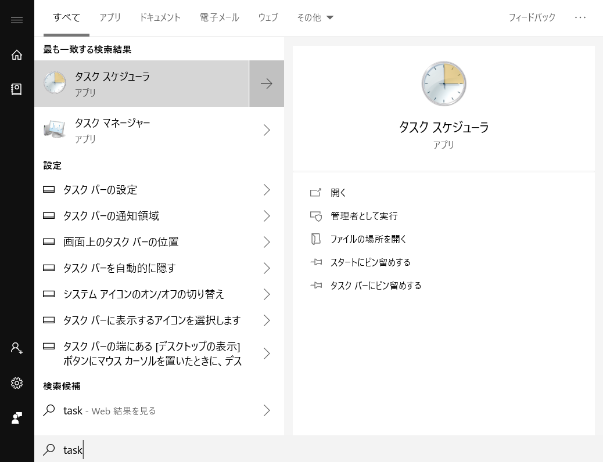

# 任务计划
这是让 Exment 的处理在固定时刻自动运行的设置（任务计划）。  
需要在服务器一侧进行追加设置。Linux 和 Windows 的步骤不同。

任务计划用于下面这些事情。

- 每天在固定的时间备份数据库和文件。  
- 按照通知的设置，在固定的时刻给符合条件的数据的相关人员发送邮件。
- 每分钟确认地震的信息，有符合条件的地震时，自动发送[安否确认](/zh/safety_check)(“exment:safetywatch”命令)。
- 使用全文搜索引擎(Meilisearch)时，每天 1 次自动修复数据库和索引的差异(“exment:meili-reconcile”命令)。  
※只有“MEILISEARCH_REPAIR_ENABLED”为 true 时，才会在“MEILISEARCH_REPAIR_AT”的时刻执行。详细内容请看[全文搜索引擎(Meilisearch)的页面](/zh/additional_meilisearch)。

### 设置步骤(Linux)
**(1) 执行下面的命令。**

~~~
crontab -e
~~~

**(2) 会出现 Cron 的设置页面，请写入下面的内容。**

这样，artisan schedule 命令会每分钟执行一次。之后，Exment 会在固定的时间执行任务。  
※下面只是一个例子。写法和设置可能因 OS 或服务而不同。

~~~
# 普通的 Linux
* * * * * cd /(Exment的根目录) && php artisan schedule:run >> /dev/null 2>&1

# Xserver(用完整路径写与管理页面中选择的 PHP 相同的版本。下面是 PHP 8.3 的例子)
* * * * * cd /(Exment的根目录) && nice -n 15 /usr/bin/php8.3 artisan schedule:run >> /dev/null 2>&1

# Sakura Internet
* * * * * cd /(Exment的根目录); php artisan schedule:run >> /dev/null 2>&1
~~~

> **在租用服务器（Xserver 等）上**：cron 的 `php` 有时不是管理页面中选择的 PHP，而是服务器默认的 PHP。请用完整路径写与管理页面相同版本的 PHP（[租用服务器](/zh/install_rental)）。

### 设置步骤(Windows)
- 执行下面的命令，复制 php.exe 文件所在的位置（路径）。  

~~~
where php
// C:\xampp\php\php.exe
~~~

- 在 Windows 菜单中输入“task”，启动任务计划程序。  


- 在任务计划程序中，点击“创建任务”。


- 在“常规”选项卡中，按下面这样设置。（“名称”可以用自己喜欢的名称）


- 点击“触发器”选项卡。创建 2 个触发器。  
    (1)点击“新建”按钮。  
    然后，按下面这样输入。  
    - 开始任务：启动时
    - 重复任务间隔：1 分钟
    - 持续时间：无限期
    - 勾选“已启用”  
    完成后点击“确定”。  


    (2)再点击一次“新建”按钮。  
    然后，按下面这样输入。  
    - 开始任务：创建/修改任务时
    - 重复任务间隔：1 分钟
    - 持续时间：无限期
    - 勾选“已启用”  
    完成后点击“确定”。  


- 在“操作”选项卡中，点击“新建”按钮。  
然后，按下面这样输入。
    - 操作：启动程序
    - 程序或脚本：刚才复制的到 php 为止的路径
    - 添加参数： (Exment的根目录)/artisan schedule:run


- 在“设置”选项卡中，勾选“如果过了计划开始时间，立即启动任务”。


- 是笔记本电脑时，在“条件”选项卡中，取消勾选“只有在计算机使用交流电源时才启动此任务”。 


- 到这里的设置完成后，点击“确定”。  
会出现输入用户凭据的页面，请输入密码。  


- 最后，在“任务计划程序库”中选择创建的任务，点击“运行”。 


这样设置就完成了。


## 不能正常运行时的检查(v4.0.6 以后)
不能正常运行时，请用下面 2 种方法确认原因在哪里。

| 方法 | 可以知道的事 |
| ---- | ---- |
| 输出日志 | cron 或任务计划程序有没有调用计划 |
| 直接执行命令 | 通知或备份的设置本身是否正确 |

### 输出日志
建议一边输出日志一边确认。  
v4.0.6 中添加了用于计划执行的调试日志。请按下面的步骤确认。

#### 设置步骤 
- 在 .env 文件中添加下面的内容，然后保存。

~~~
EXMENT_DEBUG_MODE_SCHEDULE=true
~~~

- 这样，定义计划时和执行计划时，/storage/logs/laravel.log 中会输出日志。  
任务计划的设置正确时，每隔 1 分钟输出一次日志。


#### 输出的日志内容

- Exment schedule debug defined.  
→这是下面的日志输出和计划的设置完成时输出的日志。  
→没有输出这条日志时，计划的定义或调用可能没有正确完成。请重新检查 cron 的设置或任务计划程序的设置。

- Exment schedule debug everyMinute called.  
→这是每分钟输出的日志。计划的定义正确完成时，每分钟都会输出。  
→没有输出这条日志时，计划的定义或调用可能没有正确完成。请重新检查 cron 的设置或任务计划程序的设置。

- Exment schedule debug hourly called.  
→这是每小时 0 分输出的日志。计划的定义正确完成时，每小时都会输出。  
它与 Exment 本来的计划命令是相同的定义。请先确认有没有输出这条日志。

- Exment schedule command called.  
→这是 Exment 的计划命令开始执行时输出的日志。输出了这条日志，说明至少计划命令已经正确执行。  
输出了这条日志，但通知或备份没有按预想执行时，请重新检查设置值。


#### 注意事项
这个日志不能区分“是从计划执行的，还是普通的命令执行的”。执行普通的命令时，也会输出日志。  
除了确认计划的时候以外，请删除设置值 EXMENT_DEBUG_MODE_SCHEDULE。


### 直接执行命令
通知或备份不能正常运行时，也可以自己执行 Exment 的计划命令来确认。  
请执行下面的命令。

```
php artisan exment:schedule
```

这个命令做下面的事情。两者本来都只在 00 分才运行，但直接执行命令时会马上执行。

- 执行通知（时间经过）中“通知时间”相符的通知。
- 执行自动备份中“自动备份开始时间（时）”相符的备份。

用这个命令能按预想运行时，可能是由于某种原因，计划（cron 或任务计划程序）一侧没有正确运行。  
请在查找原因时作为参考。


[←返回追加设置一览](/zh/quickstart_more)
