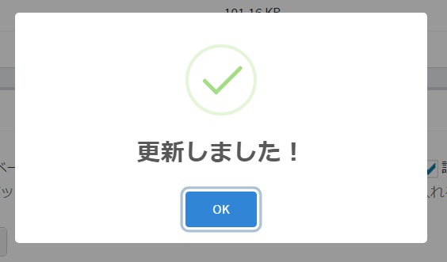
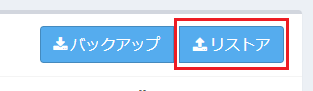

# 备份与还原
这里说明保存 Exment 数据的“备份”，以及用保存的数据恢复原状的“还原”的方法。

| 想做的事 | 查看的位置 |
|---|---|
| 现在马上备份 | 执行手动备份 |
| 每天等在固定的时间自动备份 | 执行自动备份 |
| 从备份恢复原状 | 还原 |
| 用命令进行 | (面向高级用户)用命令备份、(面向高级用户)用命令还原 |

## 概要
备份和还原例如在下面这样的时候使用。

- 在大规模更新数据之前先备份，不顺利时恢复原状。
- 每天备份，防备意外的故障。
- 把所有数据从现有的环境迁移到别的环境。（实施之前，请务必确认运行情况。）

备份的对象如下。
- 数据库
- 插件文件
- 附件
- 日志文件
- 配置文件

## 注意
- 迁移到别的环境时，根据环境的不同，有时不能正常完成。  
特别是迁移到别的 OS(Windows 或 Linux)、别的种类的数据库(MySQL 或 MariaDB)、别的版本的数据库时，可能因为各种原因不能正常完成。  
请务必事先确认。

- 作为事先的确认，主要建议下面几点。
    - 先在开发环境等作为迁移目标进行。
    - 在只创建了表定义的阶段尝试迁移。
    - 让数据库的种类和数据库的版本保持一致。

- 现在，SQLServer 不支持自动的备份和还原。  
请按[备份与还原（SQL Server）](/zh/backup_sqlserver)的步骤手动备份和还原。

## 画面
- 在左侧菜单中选择“管理员设置 > 备份”。  
或者访问下面的 URL。  
http(s)://(Exment的URL)/backup  
这样就会显示备份画面。

> ※这个 URL 是不带“/admin”的标准设置（v7.2.1 及以后新安装的站点）下的 URL。如果 `.env` 的 `ADMIN_ROUTE_PREFIX` 有值（用以前的版本安装的站点是“admin”），请在站点 URL 的后面加上这个值（例：`http(s)://(Exment的URL)/admin/backup`）。详情请参阅[更改或删除 URL 中的“admin”](/zh/additional_prefix)。

## 备份
备份的方法有“手动”和“自动”2 种。

### 执行手动备份
这里是在任意时间手动备份的步骤。

- 点击页面右上角的［备份］按钮。  
  

- 显示确认对话框后，点击［确认］，然后请等待。  
**※备份需要很长时间。请不要操作，耐心等待。**
  

- 完成后会显示消息。  
备份列表中会出现创建时间为执行时间的文件。
  
  

- 创建的备份文件可以下载。  
请点击备份所在行的［下载］链接。  
  

- 创建的备份的文件名可以更改。  
请点击备份所在行的［编辑文件名］链接。  
※不能设置包含半角片假名、符号的名称。
  
- 输入文件名后，请点击［提交］按钮。
  

- 完成后会显示消息，备份列表中的文件名会改变。
  

  

### 执行自动备份
可以在固定的时间自动备份。  
定期备份，在不小心把数据更新错了很多等时候也可以恢复。  
**※需要事先进行[任务计划](/zh/additional_task_schedule)设置。**

下面以在“夜间 3 点”“每隔 1 天”备份、保留“7 代备份”的设置方法为例。  

- 在“备份设置”中，把“自动备份”选为“YES”。
  

- 更改选项的设置。
  

- 然后点击页面下方的［保存］按钮。  

<h3 id="backup_command"><a href="#/zh/backup?id=backup_command" data-id="backup_command" class="anchor">(面向高级用户)用命令备份</a></h3>

也可以用命令备份。请在项目的根目录执行下面的命令。

~~~
php artisan exment:backup
~~~

- 不指定“--target=”时，备份所有的对象(数据库、插件文件、附件、日志文件、配置文件)。
- 要限定对象时，在“--target=”中用逗号分隔指定下面的键。
    - database : 数据库
    - plugin : 插件文件
    - attachment : 附件
    - log : 日志文件
    - config : 配置文件

~~~
# 例：只备份数据库和附件时
php artisan exment:backup --target=database,attachment
~~~

## 还原
还原(恢复)数据的方法有“从备份列表选择”和“上传”2 种。  

### 还原时的注意
- 备份时的 Exment 版本和现在安装的 Exment 版本不同时，还原之后需要把数据库更新到最新。  
例： 
    - 备份时的版本：v1.1.6 
    - 现在的版本：v1.2.0  
    →需要把数据库更新到最新  
    
这时，请在还原后执行下面的命令。  

~~~
php artisan exment:update
~~~

- 还原之后会自动退出登录。请用备份中的用户的 ID 和密码登录。  

- 从 v4.1.0 起，还原进行期间会进入维护模式。  
还原结束后，维护模式会自动解除。万一因为某种原因维护模式没有解除，请按[解除维护模式](/zh/troubleshooting)的步骤解除维护模式。

### 从备份列表选择
这是从以前执行的备份列表中选择要还原的文件来恢复数据的方法。  

- 在备份列表中点击［还原］链接。  
  

- 显示确认对话框后，点击［确认］，然后请等待。  
**※还原需要很长时间。请不要操作，耐心等待。**
  

- 显示完成消息，就表示已经回到备份时的环境。  
会自动转到登录页面。  
  

### 上传
这是把保存在手头（本地）的备份上传到 Exment 来恢复数据的方法。  
**※上传的文件太大时，有时不能正常完成。** 这时请看下面的[文件过大无法上传时](/zh/backup?id=文件过大无法上传时)。  

- 点击页面右上角的［还原］按钮。  
  

- 显示文件上传的对话框后，选择下载到本地的备份文件，点击“提交”。  
  

- 点击“提交”按钮后，请等待。  
**※还原需要很长时间。请不要操作，耐心等待。**

- 显示完成消息，就表示已经回到备份时的环境。
  

### 文件过大无法上传时
用“上传”还原时，如果备份文件太大，还原有时会失败。  
这时，请用下面任何一种步骤进行还原。  

#### (1)更改上传上限

- 请按[更改 PHP 设置值](/zh/additional_php_ini)的步骤更改上传大小的上限。

#### (2)把备份文件直接放到服务器上

- 把下载的备份文件放到服务器的下面的路径。  

~~~
(项目的根目录)/storage/app/backup/list
~~~

- 重新加载备份画面。  

- 备份列表中会增加放置的备份文件。请按上面的“从备份列表选择”的步骤进行还原。

### 备份画面或命令显示错误时
备份画面或命令有时会显示下面这样的消息。

  

出现这个错误时，可能是服务器上没有进行备份和还原所需的设置。  
请查看[故障排除](/zh/troubleshooting)，更改服务器的设置。

### 还原后要初始化自定义数据等时
还原后，可以刷新保存的 Exment 自定义数据等，从头创建数据。  
详情请参阅[刷新自定义数据](/zh/refresh_data)。

### 使用 SQL Server 时
使用 SQLServer 时，现在 Exment 不支持从画面备份和还原。需要手动操作。  
详情请参阅[备份与还原（SQL Server）](/zh/backup_sqlserver)。

<h3 id="restore_command"><a href="#/zh/backup?id=restore_command" data-id="restore_command" class="anchor">(面向高级用户)用命令还原</a></h3>

也可以用命令还原。

- 把下载的备份文件放到服务器的下面的路径。  

~~~
(项目的根目录)/storage/app/backup/list
~~~

- 请在项目的根目录执行下面的命令。

~~~
php artisan exment:restore (zip文件名)
~~~

- 省略 zip 文件名时会显示备份列表，请选择要还原的文件。
- 执行前会显示确认消息。要不显示确认消息直接执行时，请指定“--yes”。

~~~
# 例：不显示确认消息直接还原时
php artisan exment:restore (zip文件名) --yes
~~~

<h3 id="change_backup_target"><a href="#/zh/backup?id=change_backup_target" data-id="change_backup_target" class="anchor">(面向高级用户)更改备份位置</a></h3>

通常，备份文件放在 Web 服务器里。  
也可以把备份文件放在别的地方。放在别的地方的话，即使 Web 服务器发生故障不能启动，也可以从那里下载备份文件来恢复 Exment。

※设置步骤已经移到[更改文件的保存位置](/zh/additional_file_saveplace)。

### 注意事项
- 有些服务器不能更改备份位置。  
特别是租用服务器，**有时会因为提供公司的设置而限制 FTP 等**。请事先了解。
