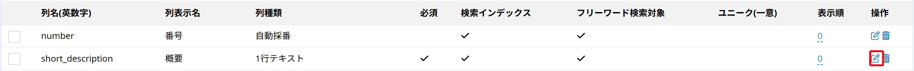
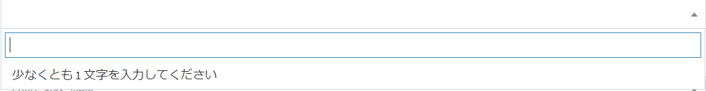

# 自定义列管理
这是创建、修改、删除自定义表的列（“自定义列”）的页面。列是像“客户名”“邮政编码”“地址”这样的数据的各个项目。  

- 列的创建方法：请按下面的“设置页面”→“新增列”→“保存”的顺序阅读。
- 有哪些种类的列：请看下面的“列类型”。
- 各项目的说明：请看下面的“填写项目的详细说明(通用)”“填写项目的详细说明(按列类型)”。  

## 设置页面
- 在自定义表列表中，勾选 1 个想设置的表，点击右上角的“表详细设置”。  

- 或者，从菜单选择想设置的表之后，同样点击右上角的“表详细设置”。  
※需要先进行把这个表显示在菜单中的设置。  

- 在出现的表详细设置页面中，点击自定义列的图标。

- 这样就会显示这个自定义表的列的列表。  

## 新增列
- 在“自定义列设置”页面中，点击页面右上角的［新建］按钮。

- 显示自定义列的新增页面，请输入必要的项目。

## 保存
输入设置后，请点击［提交］。

## 编辑
想修改列时，请点击那一行的［编辑］链接。  

## 删除
想删除列时，请点击那一行的［删除］链接。  

**※不过，系统安装的列不能删除。**

## 填写项目的详细说明(通用)
- 列名（英文和数字）：系统中使用的列的名称。用英文字母、数字或“-”“\_”填写。只能设置 1 次，不能更改。  
**※下面的名称不能使用。**  
id,suuid,parent_id,parent_type,created_at,updated_at,deleted_at,created_user,updated_user,deleted_user

### 列显示名称
显示在页面上的列的名称。

## 列类型
列的种类。这里选择的类型决定登记数据时输入栏的形式。

> 各自定义列在系统中的详细规格，请确认[自定义列参考](/zh/column_reference)。

#### 单行文本
单行文本（文本框）。  

#### 多行文本
多行文本（文本区域）。  

#### 文本编辑器
可以用文本编辑器输入数据。

#### URL
可以输入 URL 的表单。  

#### 电子邮件
可以输入邮件地址的表单。  

#### 整数
只能输入整数的表单。另外，登记数据时，可以在项目的左右显示［＋］［－］按钮，点击来增减值。  

#### 小数
只能输入小数的表单。把以百分比显示设为 YES 后，显示数据时会以 % 显示。  

#### 货币
可以输入货币的表单。显示格式可以从 4 种（￥、円、＄、€）中选择。

#### 日期
日期的表单。登记数据时，可以从日历更改日期。  

#### 时间
时间的表单。登记数据时，可以从时钟更改时间。  

#### 日期和时间
日期和时间的表单。登记数据时，可以从日历和时钟更改日期和时间。  

#### 选项（固定值）
选项的表单。值和标签相同的选项列表。  

#### 选项（登记值和标签）
选项的表单。值和标签不同的选项列表。  

#### 选项（从其他表中选择）
选项的表单。创建以其他表的项目作为选项的选项。  

#### YES/NO
创建在“YES”和“NO”之间切换的开关。登记数据时，YES 登记为 1，NO 登记为 0。  

#### 二选一
创建在 2 个值之间切换的开关。登记数据时的值也可以更改。  

#### 自动编号
在创建数据时生成 UUID、随机字符串等值。  

#### 图片
上传图片的表单。  
※在数据列表页面和数据详情页面中，图片带链接显示。链接（a 标签）带有 class“image-link”，所以可以用[插件（脚本）](/zh/plugin_quickstart_script)和[插件（样式）](/zh/plugin_quickstart_style)只对图片的链接更改处理和外观。

#### 文件
上传文件的表单。  

#### 用户
选择系统用户的选项。  

#### 组织
选择系统组织的选项。  

## 填写项目的详细说明(通用)
- ##### 列名（英文和数字）
系统中使用的列的名称。用英文字母、数字或“-”“_”填写。只能设置 1 次，不能更改。  
**※下面的名称不能使用。**  
id,suuid,parent_id,parent_type,created_at,updated_at,deleted_at,created_user,updated_user,deleted_user

- ##### 列显示名称
显示在页面上的列的名称。

- ##### 列类型
从[列类型的列表](/zh/column?id=列类型)中选择登记数据时使用的列。

- ##### 必填
选择是否把这个列设为必填。设为 YES 后，在数据的输入页面中成为必填项目，没有输入时会出错。  

- ##### 搜索索引
请参照下面的“[搜索索引](/zh/column?id=搜索索引-1)”。  

- ##### 关键字搜索对象
搜索索引为 YES 时显示。  
请参照下面的“[关键字搜索对象](/zh/column?id=フリーワード検索対象詳細)”。  

- ##### 唯一
设为 YES 后，登记数据时不能登记与其他数据相同的值。想用多个列的组合防止重复时，请参照[自定义表设置](/zh/table)的复合唯一键设置。  

- ##### 仅可输入一次
设为 YES 后，成为只能在新登记时输入的列。编辑数据时只显示。

- ##### 初始值
一开始就放在输入栏中的值。  

- ##### 占位符
输入栏为空时，用浅色字显示的字符串（占位符）。  

- ##### 帮助
作为说明显示在输入栏下面的内容。

- ##### 显示顺序
指定自定义列的列表页面中的显示顺序。

- ##### 添加到默认表单、默认视图
设为 YES 后，新建列时也会把这个列添加到默认的表单、视图中。只能在新建列时设置。之后要更改时，请分别从[表单页面](/zh/form)、[视图页面](/zh/view)更改。

- ##### 添加到标题列
可以把要创建的自定义列添加到标题列。  
※只在新建自定义列时显示的设置。之后要更改时，请在[自定义表设置](/zh/table)的标题显示列设置中更改。

- ##### 单元格显示
设置在数据列表中，以什么样的外观（颜色、标签、徽章等）显示这个列的值。  
从“显示预设”中选择。详情请参照[显示预设](/zh/cell_style_preset)。

## 填写项目的详细说明(按列类型)
- ##### 最大字符数(单行文本,多行文本)
可以输入的字符数的上限。超过时会出错。  

- ##### 可用字符(单行文本)
只能输入已勾选种类的字符。
一个都没有勾选时，可以输入所有种类的字符。

- ##### 输入建议(单行文本)
从同一个自定义列中已经登记的值里，把与输入内容相符的值作为输入的候选显示。

- ##### 正则表达式(单行文本)
可以用正则表达式（书写字符排列规则的写法）检查输入的内容。详情请看[正则表达式](/zh/column?id=正则表达式)。

- ##### 最小值(整数、小数)
可以输入的值的最小值。提交比它小的值时会出错。留空时不检查最小值。  

- ##### 最大值(整数、小数)
可以输入的值的最大值。提交比它大的值时会出错。留空时不检查最大值。  

- ##### 计算公式(整数、小数、货币)
详情请看下面的[计算公式](/zh/column?id=计算公式)。

- ##### 选项(选项（固定值）, 选项（登记值和标签）)
登记在输入栏中作为候选显示的选项。每行 1 个，用换行分隔来登记。  
列类型为“选项（登记值和标签）”时，用逗号分隔，第 1 列写值，第 2 列写标签。  

↓  
  
在表单中保存数据后，第 1 列的值会保存到数据库中。  

- #####  以单选按钮/复选框形式显示（YES/NO、选项（固定值）、选项（登记值和标签））
选项（固定值）、选项（登记值和标签）的列中允许多选为 NO 时，可以在表单中以单选按钮形式显示。
 

YES/NO 的列，或者选项（固定值）、选项（登记值和标签）的列中允许多选为 YES 时，可以在表单中以复选框形式显示。

- ##### 允许自由输入(选项（固定值）)
设为 YES 后，没有登记在列设置中的选项也可以自由输入并登记。  

>把[以单选按钮/复选框形式显示](/zh/column?id=radio_buttom)设为 YES 时，不能进行这个设置。

- ##### 初始值类型（日期、时间、日期和时间、用户）
可以决定新登记数据时的初始值的种类。  
・日期、时间、日期和时间的列中，可以把［指定日期和时间］或［数据输入日期和时间］设置为初始值。  
・用户列中，可以把［指定用户］或［登录用户］设置为初始值。

- ##### 目标表(选项（从其他表中选择）)
决定作为选项的候选显示的表。  

>作为选项显示在列表中的文字，可以在[自定义表设置](/zh/table)的标题显示列设置中更改。

- ##### 每次搜索选项(选项（从其他表中选择）、用户、组织）
通常，数据编辑页面的选项在加载页面时以列表显示所有候选。  

把这个设置设为 YES 后，一开始不加载选项，而是用用户输入的值搜索数据，筛选候选。  

在输入表单中输入字符串后，会在服务器上搜索数据，并把结果作为候选显示。

> 无论这个设置如何，数据的总条数在 100 条以上时，为了提高性能，都会成为进行筛选的设置。  
另外，这个上限值可以用[设置值](/zh/config)更改。  

- ##### 编号类型（自动编号）
选择登记数据时进行编号的种类。
- 格式  
按用户指定的格式登记编号。
- 随机（许可证代码）    
登记 5 个字符×5 共 25 个字符的随机字符串。
- 随机（UUID）  
登记合计 32 位的随机字符串。

- ##### 位数(自动编号)
自动编号时作为数据登记的位数。不足的部分用 0 补齐后登记。  

- ##### 同时显示没有权限的用户和组织(用户、组织)
决定是只显示对表有访问权限的用户、组织，还是显示所有用户、组织。

- ##### 显示“由我负责”按钮(用户)
设为 YES 后，在数据的登记、编辑页面中，这个列的旁边会显示［由我负责］按钮。点击按钮后，会选择正在登录的用户。  
※“允许多选”为 YES 时，会把正在登录的用户添加到已选择的用户中。

- ##### 接受从剪贴板粘贴的图片(图片、文件)
设为 YES 后，在数据的登记、编辑页面中，用 Ctrl+V 粘贴的图片（截图等）会作为这个列的文件添加。文件名是“paste-(年月日)-(时分秒)-(序号)”。  
※“允许多选”为 YES 时，会添加到已选择的文件中。为 NO 时，会替换为粘贴的图片。  
※在文本编辑器中粘贴时，和以前一样进入正文。另外，在文本框中粘贴文本时，不会作为文件添加。  
※页面上有多个这个设置为 YES 的列时，会添加到最前面的列。

- ##### 允许多选
在图片、文件和选项类的项目中，要让用户可以选择多个时，请设为 YES。  

## 自动编号格式规则
把列类型设为“自动编号”、编号类型（自动编号）设为“格式”后，可以按自己决定的规则自动编号。  

可以设置的参数变量请确认下面的页面。  
[参数变量](/zh/params)

## 搜索索引
“搜索索引”是为了让数据的搜索更快而预先设置在数据库中的东西。“索引”也叫“index”。  
在 Exment 中，一部分功能只能在搜索索引设为 YES 的列上使用。
    

设为 YES 时，下面的功能有效。  
- 显示在[自定义视图](/zh/view)的“显示条件”设置的“目标列”中  
    

- 显示在[自定义视图](/zh/view)的“排序”设置的“目标列”中  
    

- 显示在[数据列表](/zh/data_grid)的“筛选”设置的项目中  
    

- 显示[数据列表](/zh/data_grid)中进行“排序”的图标
    

- 用户在页面上方的搜索栏中输入词语时，成为数据搜索的搜索对象。各种代码、各种名称等想在搜索页面中搜索的列，请设为 YES。  

- 可以设置**关键字搜索对象**。  
设为 YES 后，在搜索栏中输入字符串进行搜索时，会成为搜索对象。

※在 1 个表中设置非常多的“搜索索引”时，数据的新建和更新可能会变慢。  
1 个表中可以设置的“搜索索引”，推荐最多 10 个，最大 20 个。  
※另外，搜索索引的上限值可以用[设置值](/zh/config)更改。

## 用于标签
> 这个设置方法在 v1.3.0 中改为[自定义表的扩展设置](/zh/table)。

## 正则表达式
> 这个设置只在启用了[专家模式](/zh/additional_expert)时显示。

自定义列类型为“单行文本”时，可以用正则表达式检查输入内容。  

  

#### 正则表达式的例子
~~~
# 电话号码  
^0\d{2,3}-\d{1,4}-\d{4}$

# 邮政编码  
^\d{3}-\d{4}$

# 仅平假名
^[ぁ-ん]+$

# 仅片假名
^[ァ-ヴ]+$
~~~

#### 其他
- 设置了正则表达式时，“可用字符”无效。  
- 正则表达式的判定使用 PHP 的函数。查找正则表达式的例子时，请查找 PHP 的正则表达式。  
- 不需要加在开头和结尾的“/”和结尾的“u”。  
- 关于正则表达式的内容，不在咨询的范围内。敬请谅解。

## 计算公式
自定义列类型为“整数”“小数”“货币”时，可以设置计算公式。  
在数据输入页面中输入项目后，会按设置的计算公式自动计算。  

### 设置方法
- 自定义列类型为“整数”“小数”“货币”时，会显示“计算公式”项目，请点击。  
    

- 显示计算公式用的对话框。  
  

- 请输入计算公式。公式可以点击右边一列的按钮输入，也可以手动输入。
※可以输入的变量在后面说明。
  

- 输入结束后，请点击“验证公式”按钮，确定输入。
  

- ※输入的公式有错误时，会出现错误，不能设置。
  

- 输入正确的公式后，点击“设置”按钮，对话框关闭，公式被设置。
  

- 设置后，在数据输入页面中会执行计算公式。（下面的例子是在列 3 中设置了列 1 × 列 2）
  

### 可以使用的公式和变量

#### 普通的运算符
- +, -, *, /  
※请用半角输入。请注意乘法不是"×"，除法不是"÷"。

- 括号()

#### 变量
※推荐从“计算公式”对话框右边一列的按钮输入变量。

- 其他列的值
- 引用的表的列值
- 父表的列值
- 子表的列的合计值
- 子表的条数

| 项目 | 例 | 说明 |
| ---- | ---- | ---- |
| ${value:(列名)} | ${value:mitsumori_zeigaku} | 设置同一个表内的其他值。 (例：对报价明细表填写报价额${value:mitsumori_zeigaku}时，会设置项目“报价额”中输入的值)  |
| ${select_table:(列名).(引用的表的列名)} | ${select_table:client.client_shikiri} | 同一个表内的列类型为“从其他表中选择”“用户”“组织”时，设置引用的列的值。 (例：“合同信息(contract)”表中有“客户(client)”列，并引用“客户信息(client)”表时，设置${select_table:client.client_shikiri}，就会设置“客户信息(client)”表的客户折扣值(client_shikiri)中输入的值)  |
| ${parent:(列名)} | ${parent:mitsumori_value} | 设置父表的其他值。 (例：报价表和报价明细表是 1:n 关联，对报价明细表的列填写父表列的报价额${parent:mitsumori_value}时，会设置父数据“报价额”中输入的列“报价额”的值)  |
| ${sum:(子表名).(子表的列名)} | ${sum:mitsumori_detail.mitsumori_zeigaku} | 设置了 1:n 关联，并且是同时输入父子数据的表单时，设置子表中指定列的值的合计值。 (例：报价表和报价明细表是 1:n 关联，对报价表的列填写子表列的报价明细额${sum:mitsumori_detail:mitsumori_zeigaku}时，会设置子数据“报价额”的所有数据合计的值)  |
| ${count:(子表名)} | ${count:mitsumori_detail} | 设置了 1:n 关联，并且是同时输入父子数据的表单时，设置子表的条数。 (例：报价表和报价明细表是 1:n 关联时，设置子表的条数)  |

### 成为循环公式时
按下面这样设置时，计算永远不会结束。    

- 列 calc1：计算公式“${value:calc2} + 2”
- 列 calc2：计算公式“${value:calc1} + 2”

会变成“输入列 calc1 的值”→“在列 calc2 的值中放入 calc1 的值 + 2”→“在列 calc1 的值中放入 calc2 的值 + 2”→“在列 calc2 的值中放入 calc1 的值 + 2”...，计算无法完成。  

设置了这样的计算公式时，在数据输入页面中输入值，会出现下面这样的警告。  
这时请重新检查计算公式的设置。
  

### 发生除以 0 时
有些计算公式可能会发生除以 0。  
这时，结果的项目会留空。

### 其他
计算公式的逻辑支持在页面中输入数据时。  
目前不支持用 API、插件等功能登记数据。敬请谅解。
