# 仪表板
仪表板是登录 Exment 时，或者点击“HOME”“左上角显示的站点名称”时显示的画面。  
可以自由排列数据的列表、图表、日历等，让 Exment 中管理的信息一目了然。

本页的内容如下。

| 想做的事 | 查看的位置 |
|---|---|
| 创建仪表板 | 新建仪表板、仪表板的设置项目 |
| 在仪表板上放置列表、图表等 | 选择要显示的项目 |
| 决定图表的横轴、纵轴显示什么 | 图表的设置内容 |
| 给其他用户和组织看 | 仪表板的共享 |
| 在画面上筛选、切换图表、排序 | 仪表板的操作 |
  
### 仪表板的显示例
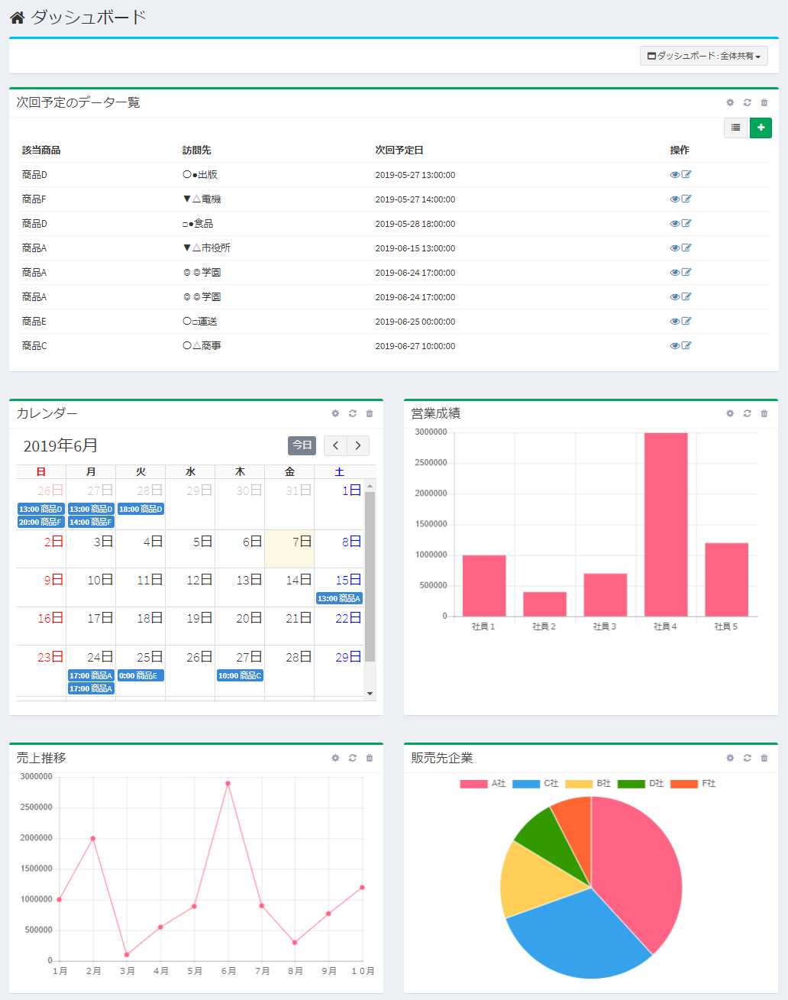

## 新建仪表板
1. 点击仪表板画面右上角的“新建仪表板”。
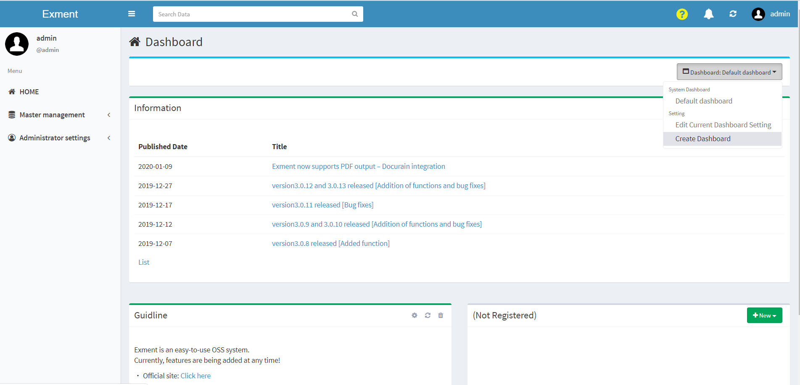

2. 设置必要的内容。项目的含义请看下面的“仪表板的设置项目”。  
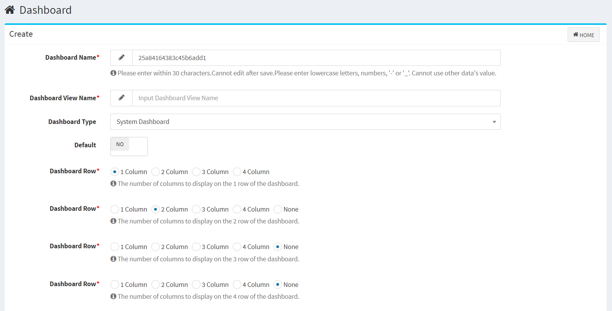

## 仪表板的设置项目
#### 仪表板名称（字母数字）
仪表板的名称。  
保存后不能更改。

#### 仪表板显示名称
选择仪表板时显示在画面上的名称。  
也可以使用中文等文字。保存后也可以更改。

#### 仪表板类型
选择“系统仪表板”或“用户仪表板”。  

- “系统仪表板”  
只有系统管理员可以设置。所有用户都可以使用的仪表板。  

- “用户仪表板”  
系统管理员以外的人也可以设置。只有创建的用户可以使用的仪表板。    

※“系统仪表板”不能在之后改成“用户仪表板”。  
**系统管理员创建的“用户仪表板”**可以在之后改成“系统仪表板”。  
※设置了[禁用用户仪表板](/zh/config)后，普通用户不能创建仪表板。

#### 默认
选择“YES”或“NO”。  
有多个仪表板时，打开仪表板后最先显示的是设为“YES”的仪表板。  
※设为“NO”的仪表板，从列表中选择也可以显示。  
※可以把“默认”设为“YES”的只有 1 个仪表板。  
在 2 个以上的仪表板上设为“YES”时，除了最后设为“YES”的仪表板以外，都会变成“NO”。

#### 选择列数
选择仪表板的各行显示的列数。  
1 行最多可以显示 4 列。  
※增加列数后，每 1 个项目的显示面积会变小。  

#### 仪表板第 (n) 行最大高度（px）
用像素指定该行显示的项目的最大高度。可以按行设置。  
项目的内容超过这个高度时，在项目内滚动。  
请输入 150～3000 的整数。没有输入时是 400px。

### 1 行显示 4 列的例子
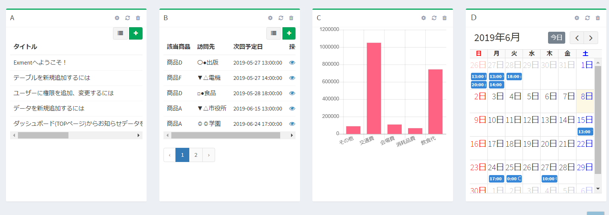  

## 仪表板筛选栏的设置
可以在仪表板的上方显示能把所有图表一起筛选的“筛选栏”。  
不用按地区、商品、负责人等条件分别创建视图，在 1 个仪表板上切换条件就可以确认汇总结果。  
※筛选栏的用法请查看[用筛选栏筛选](/zh/dashboard?id=用筛选栏筛选)。

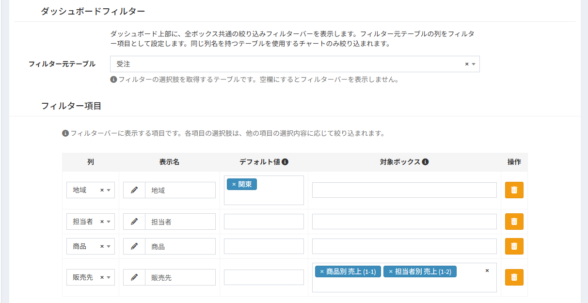

#### 筛选来源表
选择取得筛选选项的表。  
留空时不显示筛选栏。

#### 筛选项目
显示在筛选栏中的项目，1 行设置 1 个。用“新增”增加行。

| 设置 | 内容 |
|---|---|
| 列 | 从筛选来源表的列中选择用于筛选的列。 |
| 显示名称 | 显示在筛选栏中的名称。留空时显示列名。 |
| 默认值 | 打开仪表板时一开始就选中的值。从列表中选择的项目，用逗号分隔指定保存值；用“从”“到”的范围指定的项目，用“最小~最大”的格式指定（也可以只指定一边）。留空时以没有选择的状态显示。 |
| 目标项目框 | 选择用这个筛选来筛选的图表。留空时，有相同列名的所有图表都会被筛选。选项中只显示已保存的图表，所以请在添加图表之后在设置画面选择。 |

> 被筛选的只有使用了**具有与筛选项目相同列名的列的表**的图表。  
> 不符合的图表上会显示“不受筛选影响”。

> 为了在数据条数多的表上也能顺畅地操作，建议在[自定义列设置](/zh/column)中把用于筛选项目的列的“搜索索引”设为有效。

> 用[模板](/zh/template)导出和导入仪表板时，筛选栏的设置（包括目标项目框）也会原样继承。

# 选择要显示的项目
从已创建的仪表板各列右上角的［新增］选择想显示的项目。项目有“数据列表”“系统”“图表”“日历”4 种。  
※安装了[插件(仪表板)](/zh/plugin_quickstart_dashboard)时，也可以选择“插件”。

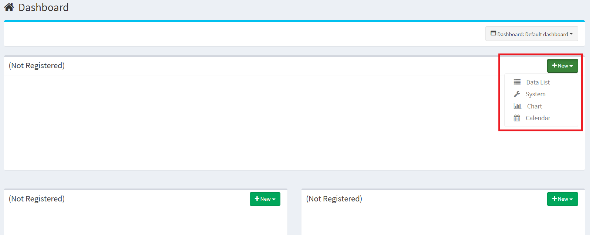  

之后，按项目设置要显示的内容。

## 数据列表
选择表和视图，把其数据的列表显示在仪表板上。

### 数据列表的显示例
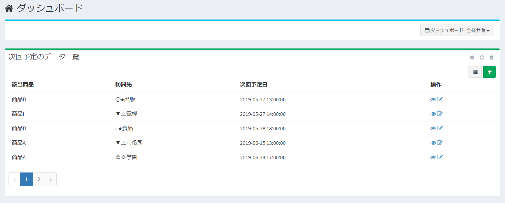

### 数据列表的设置项目
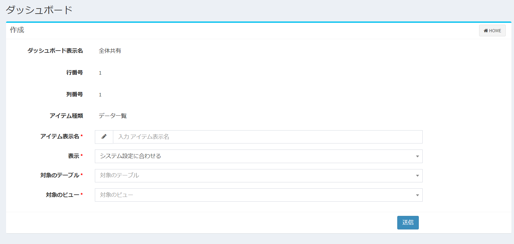
#### 项目显示名称
输入显示在画面上的项目的名称。

#### 显示
选择一次显示多少条数据。

#### 目标表
从在[自定义表设置](/zh/table)中已创建的表中选择要显示的对象。

#### 目标视图
从所选目标表的[视图](/zh/view)中选择要显示的对象。  
※不能选择日历视图、看板视图、甘特图视图、条件视图。系统仪表板只能选择系统视图。  

## 系统
在仪表板上显示与系统有关的内容。  
※现在可以显示“指南”“Exment 最新信息列表”“编辑器”“HTML”“通知列表”“二维码／JAN 条形码”。

### 系统的设置项目
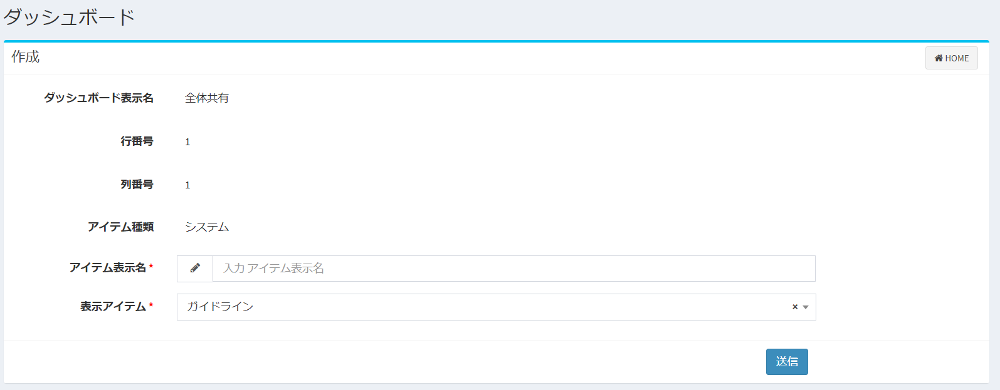

#### 项目显示名称
输入显示在画面上的项目的名称。

#### 显示项目
选择要显示的项目。

- ##### 指南
可以显示与系统有关的说明。  
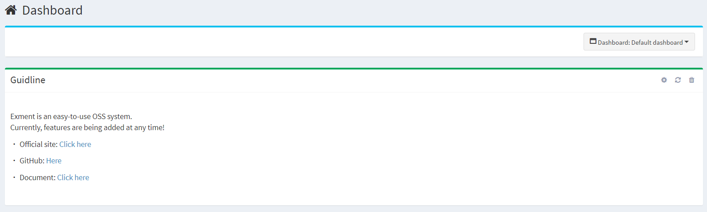

- ##### Exment 最新信息列表
从 Exment 官方网站取得最新信息并显示。
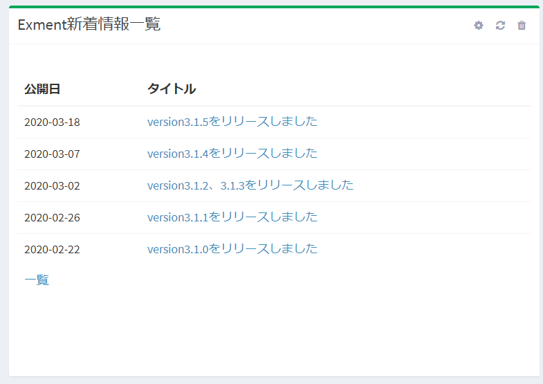

- ##### 编辑器
自由输入正文，显示在画面上。
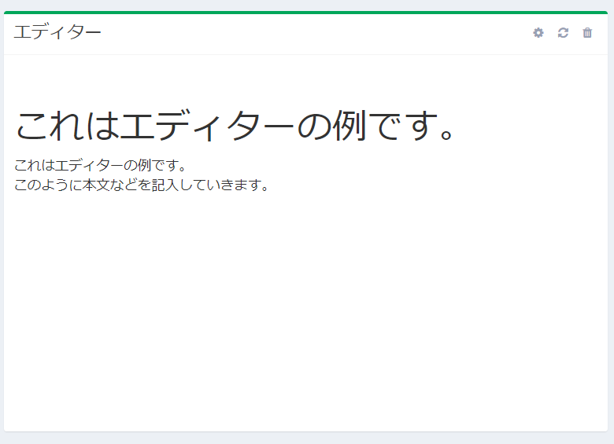

- ##### HTML
用 HTML 格式输入内容，显示在画面上。※脚本也会执行。
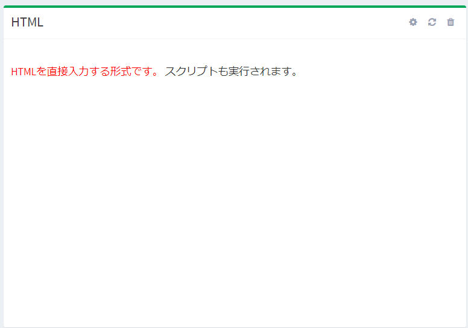

- ##### 二维码／JAN 条形码
显示读取二维码／JAN 条形码的按钮。  
“读取二维码／JAN 条形码”按钮中“二维码／JAN 条形码”的显示名称，可以用 .env 文件的“EXMENT_TEXT_SCAN_BUTTON_JA/EN”更改。  

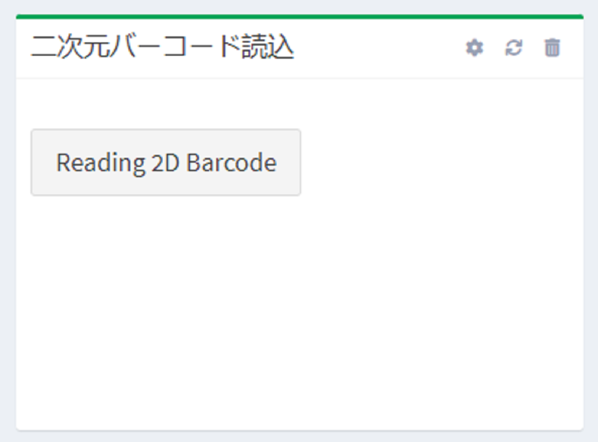

## 图表
把 Exment 的视图（视图、全部数据视图、汇总视图等）的数据做成图表显示在仪表板上。图表有柱状图、折线图、饼图等 18 种。  
显示中的图表可以在画面上切换类型、筛选、排序等（[仪表板的操作](/zh/dashboard?id=仪表板的操作)）。  
※详情请查看[图表的设置内容](/zh/dashboard?id=图表的设置内容)。

### 柱状图的显示例

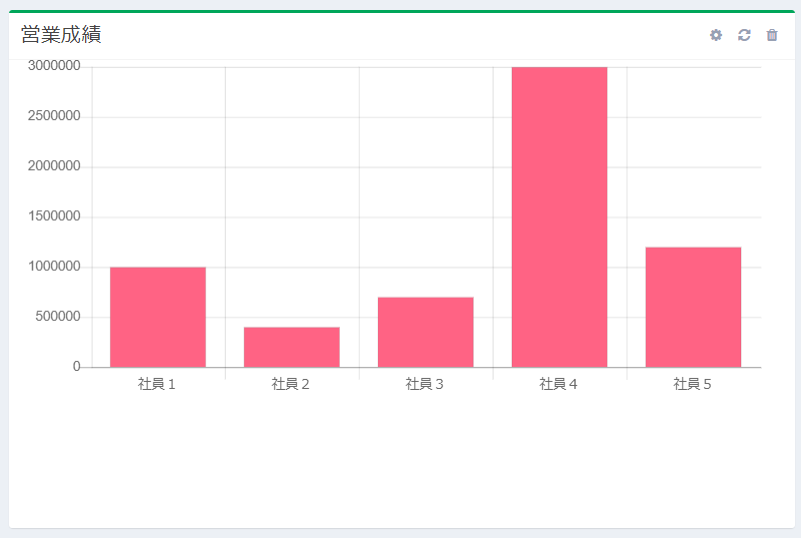

### 折线图的显示例  
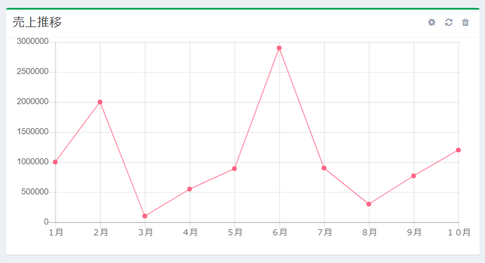

### 饼图的显示例
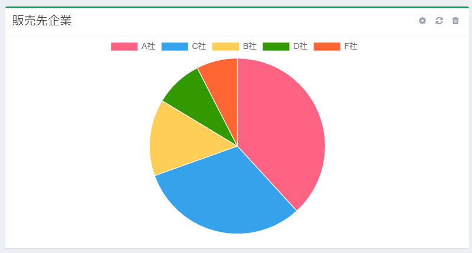

### 图表的设置项目
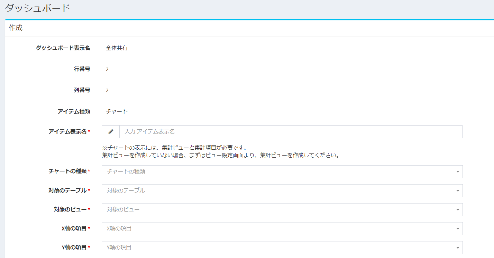

#### 项目显示名称
输入显示在画面上的项目的名称。

#### 图表类型
从下面 18 种中选择 1 种图表类型。

| 分类 | 图表类型 |
|---|---|
| 基本 | 柱状图、折线图、饼图 |
| 单系列 | 条形图、面积图、环形图、雷达图、漏斗图、仪表盘图、散点图 |
| 多系列 | 分组柱状图、堆积柱状图、多折线图、热力图、堆积面积图、矩形树图、旭日图、箱线图 |

“多系列”的图表，按横轴的每个项目显示多个系列（例：按商品显示每月的销售额）。

要使用多系列的图表，汇总视图需要用 2 列以上分组。分组列中，在[系列列（多系列）](/zh/dashboard?id=系列列（多系列）)中选择的列（默认是第 2 列）成为系列，除此以外的第一列成为横轴。

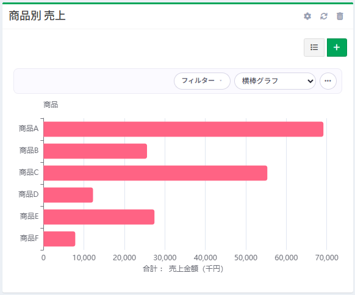

条形图

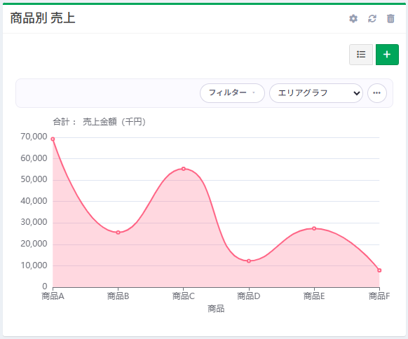

面积图

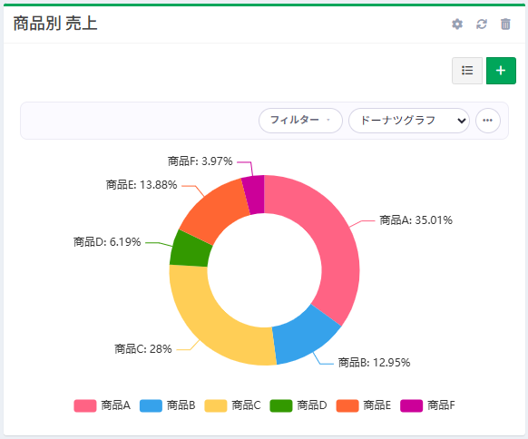

环形图

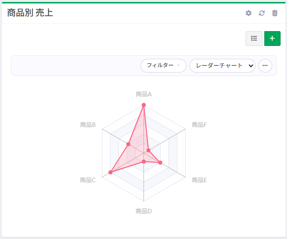

雷达图

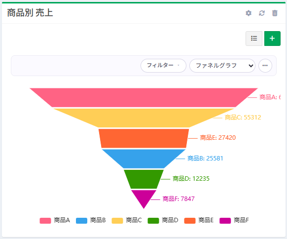

漏斗图

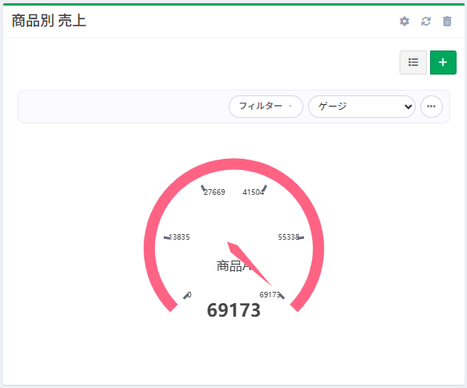

仪表盘图

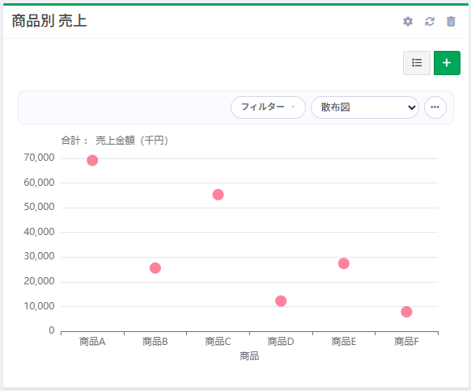

散点图

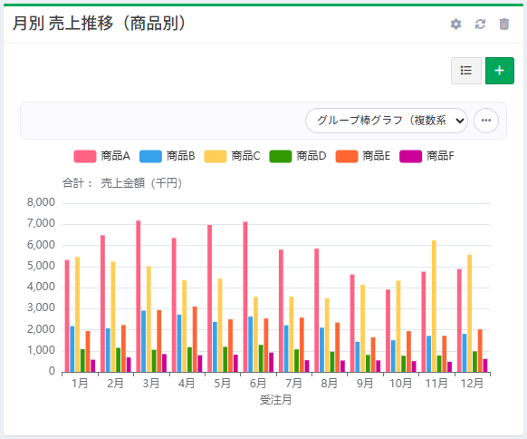

分组柱状图

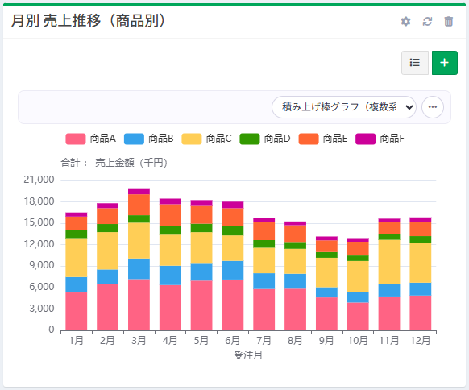

堆积柱状图

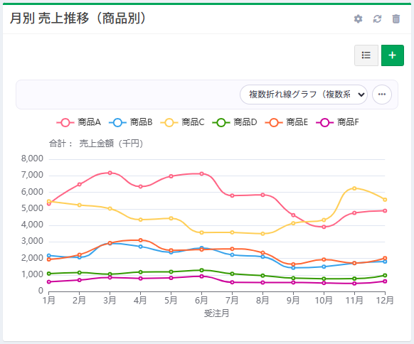

多折线图

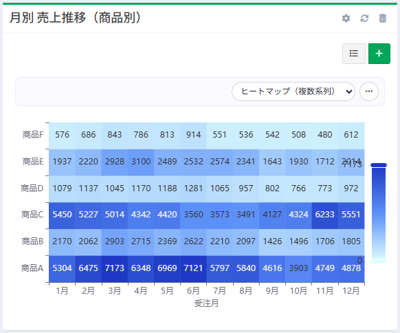

热力图

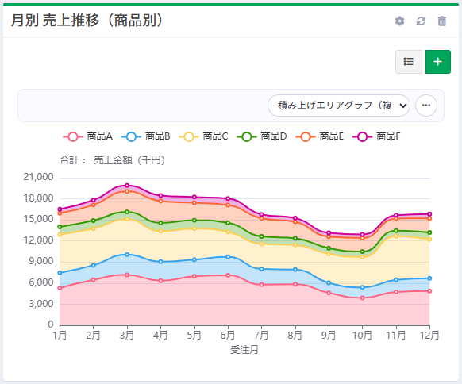

堆积面积图

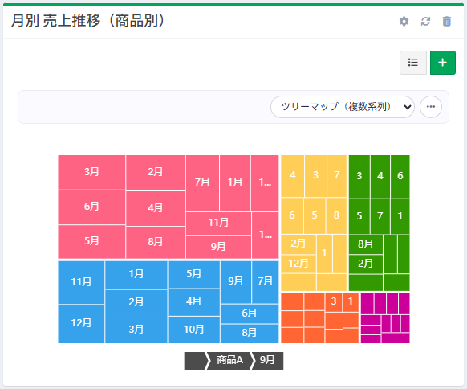

矩形树图

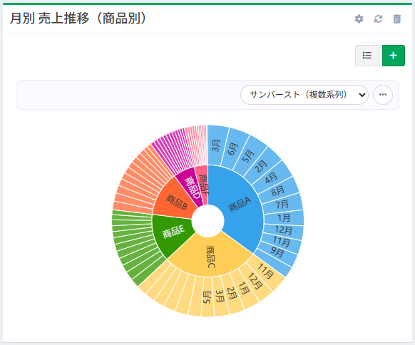

旭日图

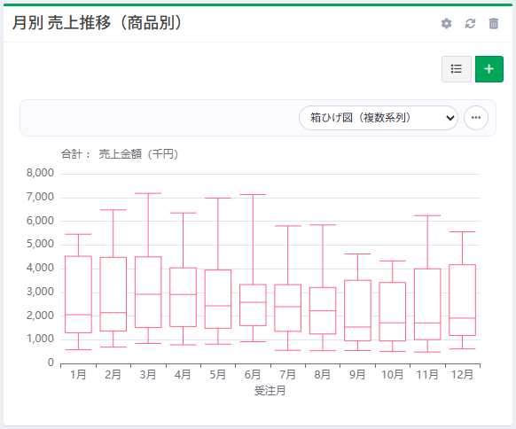

箱线图

#### 目标表
从在[自定义表设置](/zh/table)中已创建的表中选择要显示的对象。  
※选项中显示有查看权限的表。

#### 目标视图
从所选目标表的视图（视图、全部数据视图、汇总视图等）中选择要显示的对象。  
※不能选择日历视图、看板视图、甘特图视图、条件视图。系统仪表板只能选择系统视图。  
※使用多系列的图表时，请选择汇总视图。  

#### X 轴项目
选择作为图表显示的 X 轴（横轴）。  
※详情请查看[图表的设置内容](/zh/dashboard?id=图表的设置内容)。  

#### Y 轴项目
选择作为图表显示的 Y 轴（纵轴）。  
※详情请查看[图表的设置内容](/zh/dashboard?id=图表的设置内容)。  

#### 系列列（多系列）

只在选择了多系列的图表时显示的设置。

从汇总视图的分组列中选择作为系列使用的列。没有选择时，第 2 个分组列成为系列。

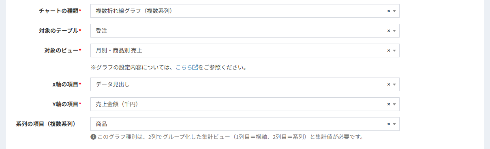

#### 图表筛选项目

选择只用来筛选这个图表的列。可以选择多个。

选择的列可以从图表的**筛选**按钮用于筛选（[用图表筛选进行筛选](/zh/dashboard?id=用图表筛选进行筛选)）。

不选择列时，不显示**筛选**按钮。

#### 与图表类型对应的其他选项

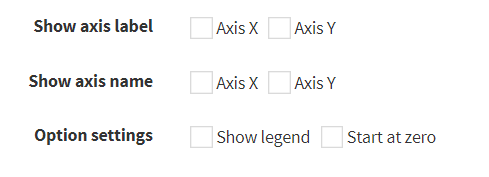

选择的选项会反映到图表上。

※**显示坐标轴标签**、**显示坐标轴名称**、**从零开始**只能用于柱状图和折线图。

## 日历
把 Exment 的日历视图的数据显示在仪表板上。显示的形式可以从“按月”“列表”2 种中选择。
>显示的文字可以在[标题显示列设置](/zh/table)中更改。

### 按月的显示例
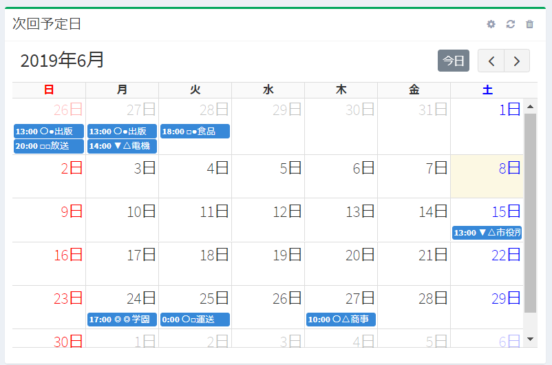  

### 列表的显示例
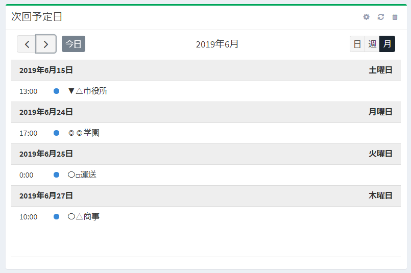  

### 日历的设置项目

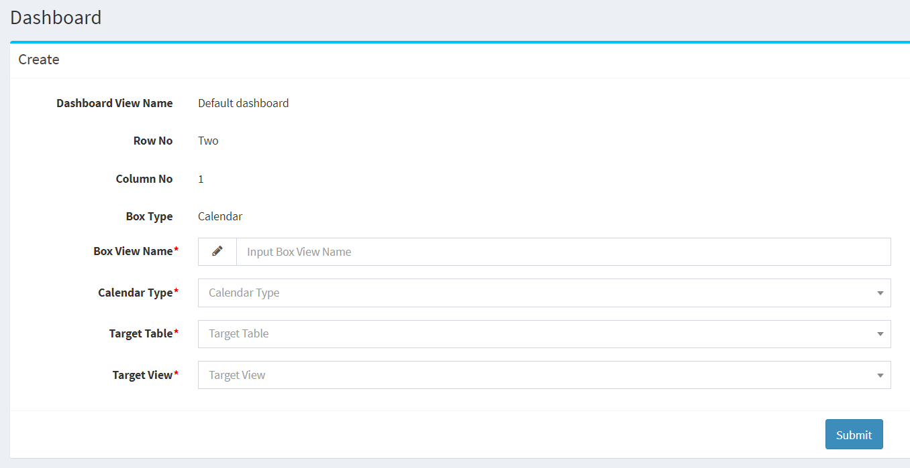  

#### 项目显示名称
输入显示在画面上的项目的名称。

#### 日历类型
从“按月”“列表”2 种中选择想显示的日历。

#### 目标表
从在[自定义表设置](/zh/table)中已创建的表中选择要显示的对象。  
※选项中只显示设置了日历视图的表。

#### 目标视图
从所选目标表的日历视图中选择要显示的对象。  

## 图表的设置内容
图表的 X 轴、Y 轴可以选择的项目，因目标视图的种类而不同。  

### 目标视图是全部数据视图、标准视图时

#### X 轴项目
X 轴的选项中显示下面 2 种。请选择其中一个。

- “图表标签”项目。  
  

选择后，[自定义表设置的标题显示列设置](/zh/table)显示在 X 轴上。  

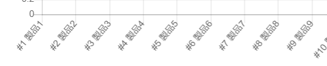  

- [自定义视图设置的“选择显示列”](/zh/view)中显示的项目。选择后，所选列的值显示在 X 轴上。  
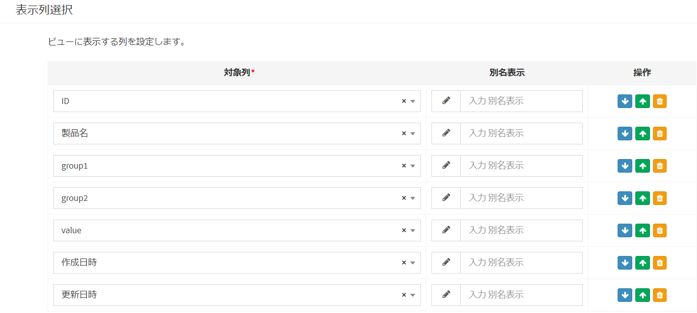  

#### Y 轴项目
Y 轴的选项中显示下面 1 种。请选择其中一个。

- [自定义视图设置的“选择显示列”](/zh/view)中显示的项目中，下面的列类型。选择后，所选列的值显示在 Y 轴上。
    - 整数
    - 小数
    - 货币

### 目标视图是汇总视图时

#### X 轴项目
X 轴的选项中显示下面 1 种。

- “图表标签”项目。  
  

选择后，在[自定义视图设置的“选择分组列”](/zh/view)中设置的值显示在 X 轴上。  
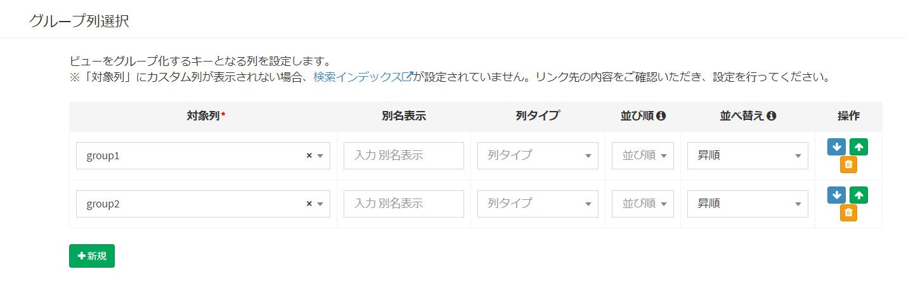  
  

#### Y 轴项目
Y 轴的选项中显示下面 2 种。请选择其中一个。

- [自定义视图设置的“选择分组列”](/zh/view)中显示的项目中，下面的列类型。选择后，所选列的值显示在 Y 轴上。
    - 整数
    - 小数
    - 货币

  

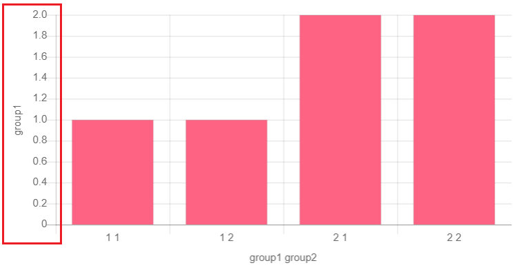  

- [自定义视图设置的“选择汇总列”](/zh/view)中显示的项目。选择后，所选列的值显示在 Y 轴上。

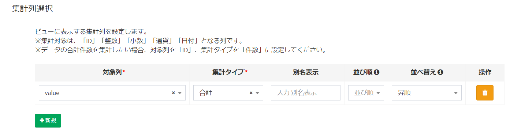  

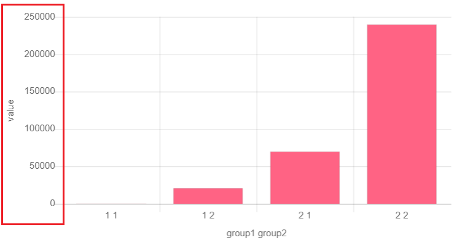  

## 仪表板的共享
把创建的仪表板共享给其他用户和组织。  
※可以共享的只有“用户仪表板”。（“系统仪表板”从一开始就对所有用户公开。）  

#### 共享方法
1. 点击仪表板的设置更改画面的“共享”按钮。  
※新建时不显示这个按钮。
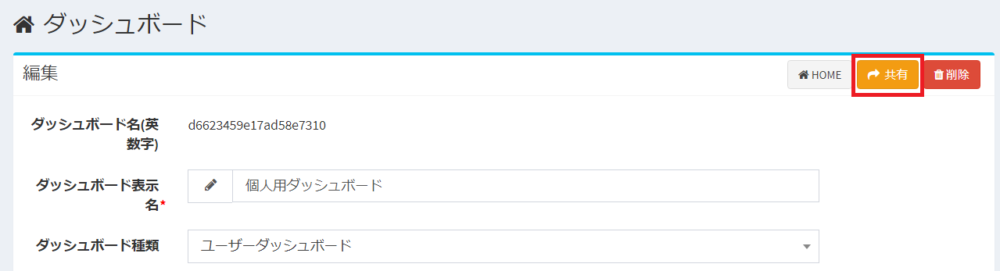

2. 显示仪表板的共享对话框。
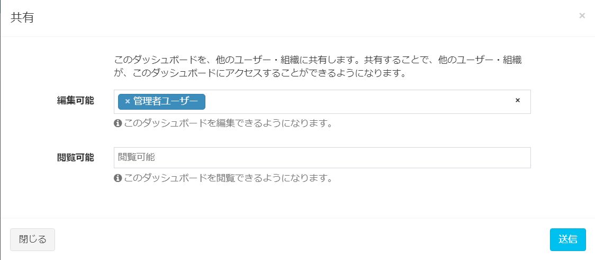

3. 添加想共享的用户或组织，点击“提交”。这样就共享了。  
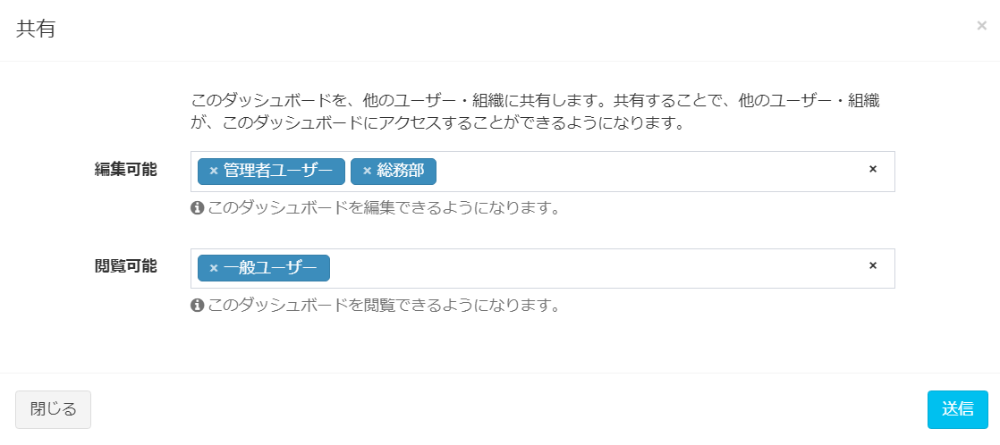  

# 仪表板的操作

在仪表板上可以筛选图表、切换图表类型、对数据排序。除了更改颜色以外，这些操作不会更改仪表板的设置、图表的设置和数据。

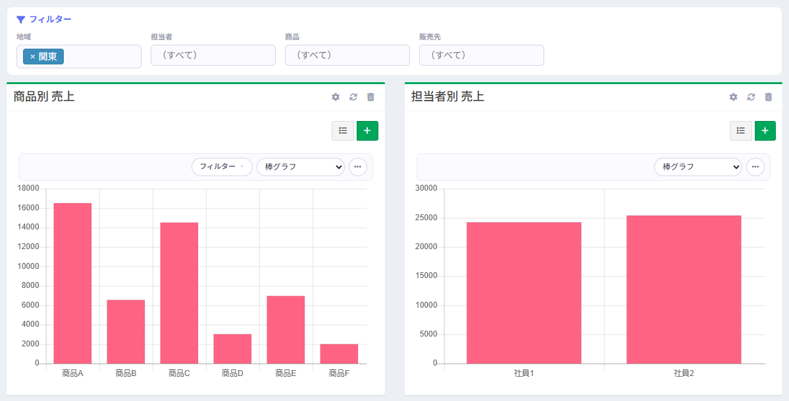

| 操作 | 可以做的事 | 对象 |
|---|---|---|
| [筛选栏](/zh/dashboard?id=用筛选栏筛选) | 把仪表板上的图表一起筛选 | 整个仪表板 |
| [点击图表](/zh/dashboard?id=点击图表进行筛选) | 在筛选栏中选中点击的值 | 整个仪表板 |
| [图表筛选](/zh/dashboard?id=用图表筛选进行筛选) | 只筛选 1 个图表 | 单个图表 |
| [切换图表类型](/zh/dashboard?id=切换图表的类型) | 用别的类型的图表显示相同的数据 | 单个图表 |
| [“⋯”菜单](/zh/dashboard?id=⋯菜单) | 排序、显示数据标签、导出数据 | 单个图表 |
| [更改颜色](/zh/dashboard?id=更改图表的颜色) | 更改柱、扇形等的颜色 | 单个图表 |

## 用筛选栏筛选

进行[仪表板筛选栏的设置](/zh/dashboard?id=仪表板筛选栏的设置)后，仪表板的上方会显示筛选栏。

在筛选栏中选择值后，同样的条件会应用到作为该筛选对象的所有图表。

※对没有筛选来源表的查看权限的用户，不显示筛选栏。

#### 选择值

点击筛选项目，从列表中选择值。可以选择多个值。

在其他筛选中选择了值之后，列表中只显示有符合该条件的数据的值。例如在“地区”中选择“关东”后，“负责人”中只显示关东的负责人。

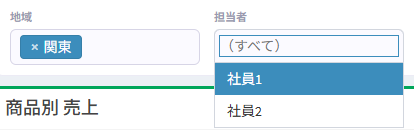

日期、日期时间的列不用列表，而是用“从”“到”的范围指定。数值的列在选项太多时也用范围指定。

> 选项太多不能显示时，请先在其他筛选中选择值来缩小范围。

#### 解除筛选

点击“重置”，回到[默认值](/zh/dashboard?id=筛选项目)的状态。

没有设置默认值时，所有的筛选都会解除。

#### 不受筛选影响的图表

不受筛选栏影响的图表上显示“不受筛选影响”，部分筛选项目没有应用的图表上显示“此处未应用的筛选”。

可以确认所选的筛选怎样反映到显示中的数据上。

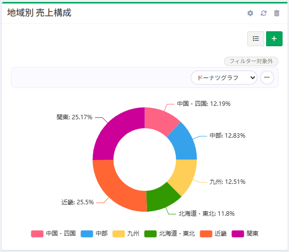

> 筛选的条件保存在 URL 中。可以用浏览器的“后退”“前进”回到以前的条件。另外，共享 URL，就可以让其他用户看到相同条件的仪表板。

> 最后选择的条件按用户记住，下次打开仪表板时也以相同的条件显示。

## 点击图表进行筛选

点击图表的柱、扇形等，该值会在筛选栏中被选中，其他的图表会被筛选。

被点击的图表仍然显示所有的值，所选的值显示得深，其他的值显示得浅。

| 操作 | 结果 |
|---|---|
| 点击值 | 只选择该值。 |
| 再点击一次选中的值（只选择了该值时） | 解除选择。 |
| 按住 Ctrl（Mac 是 ⌘）点击 | 追加选择值。点击已选择的值时，只把该值从选择中去掉。 |

※图表横轴的列包含在筛选栏的项目中时可以使用。  
※可以在汇总视图的图表上使用。横轴的列是用“从”“到”的范围指定的项目（日期列等）或多选的列时不能使用。  
※雷达图、仪表盘图、矩形树图、旭日图、箱线图不能使用。  
※在筛选栏中选择了值时，横轴对应该筛选项目的图表不会被筛选，而是强调显示所选的值。

## 用图表筛选进行筛选

图表筛选只应用于该图表。不影响其他图表。

在图表上设置[图表筛选项目](/zh/dashboard?id=图表筛选项目)后，图表右上角会显示“筛选”按钮。

点击“筛选”，选择想显示的值。

按钮上显示正在筛选的项目数。点击“重置”，解除图表筛选的条件。

选项超过 8 个时，列表的上方会显示搜索栏，可以查找想要的值。

日期、日期时间的列不用列表，而是用“从”“到”的范围指定。数值的列在选项太多时也用范围指定。

※图表筛选可以和筛选栏一起使用。这时按两边的条件筛选。  
※图表筛选的选择，在重新加载页面（F5）后解除。

## 切换图表的类型

从图表右上角的图表类型选择栏，可以用别的类型的图表显示相同的数据。

选择的图表类型按用户记住，下次打开仪表板时也以相同的类型显示。

重新选择原来的图表类型，切换就会解除，回到原来的类型。

※单系列的图表只能在单系列的图表之间切换，多系列的图表只能在多系列的图表之间切换。例如，柱状图可以切换成环形图或散点图，但不能切换成堆积柱状图（多系列）。

## “⋯”菜单

点击图表右上角的“⋯”，显示菜单。

| 菜单 | 内容 |
|---|---|
| 排序依据 | 按横轴的项目或值，以升序或降序排序。 |
| 数据标签 | 在柱、点等的上面显示值。只在柱状图、折线图、饼图、条形图、面积图、散点图、分组柱状图、堆积柱状图、多折线图、堆积面积图中显示。 |
| 导出数据 | 把显示中的数据下载为 CSV 文件。 |
| 重置颜色 | 把更改的颜色恢复原状。只在可以更改颜色的用户更改了颜色时显示。 |
| 重置 | 把排序和数据标签恢复成原来的设置。 |

※排序和数据标签的设置按用户记住。  
※没有可以显示的菜单项目的图表上不显示“⋯”。

## 更改图表的颜色

有仪表板编辑权限的用户，可以右键点击图表的柱、扇形等来更改颜色。

从“主题颜色”“标准颜色”中选择，或者用“其他颜色...”指定任意的颜色。选择“自动”会回到原来的颜色。

柱状图、饼图等可以按柱、扇形分别更改颜色。折线图、面积图等用 1 种颜色绘制的图表和多系列的图表，可以按系列更改颜色。

选择“其他颜色...”后，会打开可以指定任意颜色的调色板。

点击调色板，或者输入 RGB 的值。用 ↕ 可以切换到 HSL、HEX 的输入。点击“确定”后颜色生效。

※更改的颜色保存在图表的设置中，对所有用户都以相同的颜色显示。  
※只能查看的用户不能更改颜色。  
※热力图、箱线图不支持更改颜色。
