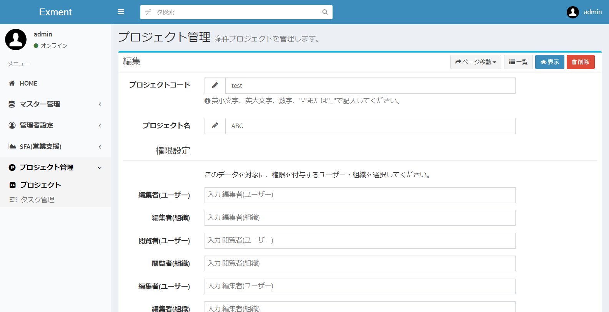
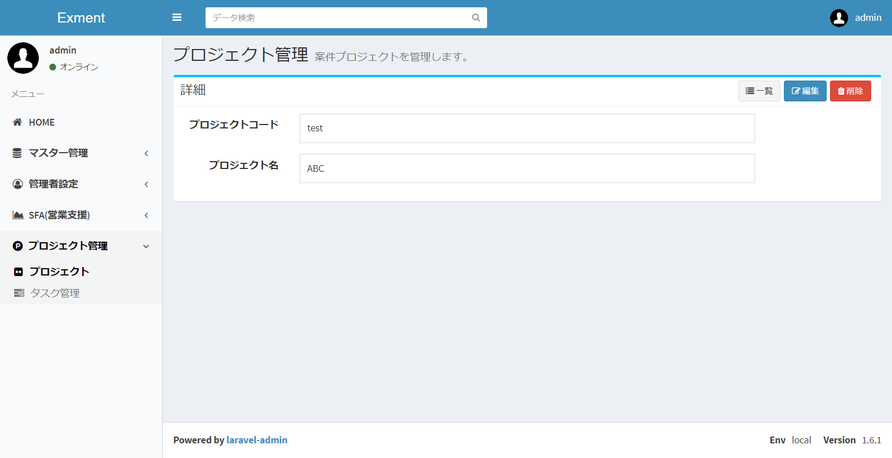

# 数据
本页说明对表中的数据进行列表查看、新增、编辑、显示、删除的页面。  
表由系统管理员创建。用户在表中输入值并保存。

| 想做的事 | 查看的位置 |
|---|---|
| 以列表查看数据 | [数据列表](/zh/data?id=数据列表) |
| 添加数据 | [新增数据](/zh/data?id=新增数据) |
| 修改数据 | [编辑数据](/zh/data?id=编辑数据) |
| 查看数据的内容 | [显示数据](/zh/data?id=显示数据) |
| 删除数据 | [删除数据](/zh/data?id=删除数据) |
| 复制数据来创建 | [复制数据](/zh/data?id=复制数据) |

## 数据列表
该表中保存的数据的列表。  
列表中显示的，是自己创建的数据，以及分配了权限给自己的数据。

※给用户或组织登记“编辑、查看所有数据的权限”后，无论上述条件如何，都会显示所有数据。  
  
  
列表页面的详细说明，请参阅[数据列表](/zh/data_grid)。  

## 新增数据
1. 点击页面右上角的［新建］链接。  

※登录用户没有该表的“编辑”权限时，不显示此按钮。  
权限的分配方法，请参阅左侧菜单的[角色组、权限设置](/zh/role_group)。  

2. 显示数据的新建页面。  

  
新增页面的详细说明，请参阅[数据表单](/zh/data_form)。  

### 保存前确认内容（预览）
点击新建页面右上角的［预览］按钮，可以不保存正在输入的内容，在另一个窗口中确认。  
按表单的每个区块，以项目名和值的列表显示。

- ［预览］按钮只在数据的新建页面显示。编辑页面不显示。  
- 预览不会保存数据。更改输入后要刷新显示，请在原来的页面再次点击［预览］按钮。  
- 子表的区块不会显示在预览中。

## 编辑数据
1. 点击要编辑的行的［编辑］链接。  

※登录用户没有该表的“编辑”权限时，不显示此链接。  
权限的分配方法，请参阅左侧菜单的[角色组、权限设置](/zh/role_group)。  

2. 显示数据的编辑页面。  

  
编辑页面的详细说明，请参阅[数据表单](/zh/data_form)。  

> 更新数据时，如果其他用户已经更新了同一条数据，会显示以下错误信息。

## 显示数据
1. 点击要显示的行的［查看］链接。  

2. 显示数据的显示页面。  

  
显示页面的详细说明，请参阅[数据详情](/zh/data_details)。  

## 删除数据
- 点击要删除的行的［删除］链接。  

## 复制数据
※要显示［复制］链接，需要更改设置值。请参阅[显示自定义数据的复制链接](/zh/config)。  

1. 点击要复制的行的［复制］链接。  

2. 显示编辑页面，其中已填入所选数据的内容。  

3. 修改需要的地方，然后保存。  

会复制的内容和不会复制的内容：

- 只复制表单上的项目。  
- 自动编号、文件、图片等不会复制。  
