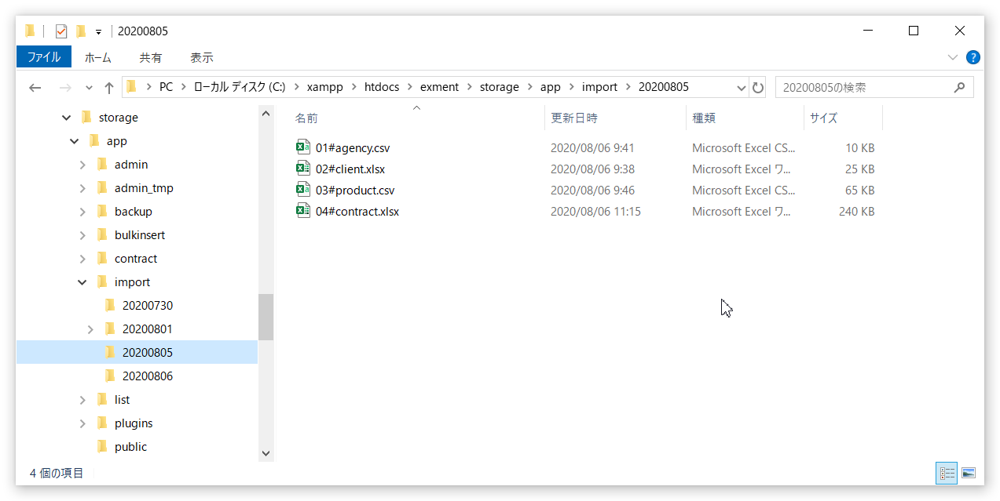
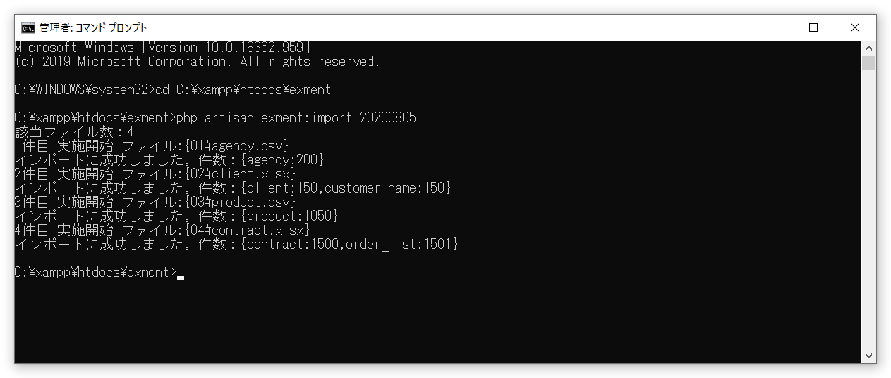

# 数据导入、导出（命令）
本页说明用服务器的命令导入、导出表数据的方法。

| 想做的事 | 命令 | 查看的位置 |
|---|---|---|
| 把数据输出到文件 | `php artisan exment:export` | “数据导出” |
| 把数据按指定的件数分开输出 | `php artisan exment:chunkexport` | “数据导出(chunk模式)” |
| 从文件放入数据 | `php artisan exment:import` | “数据导入” |
| 把文件一次性放入“图片”“文件”列 | `php artisan exment:file-import` | “数据导入 - 导入图片、文件列的附件” |
| 一次性放入数据的附件（文档） | `php artisan exment:document-import` | “数据导入 - 文档(附件)列表” |

> 关于数据导入、导出的概要，请确认[数据导入、导出](/zh/data_import_export)。

## 数据导出
用命令把表的数据导出（输出）到文件。  
文件的格式为 csv、xlsx。  


### 操作方法

- 在命令行中执行以下命令。

~~~
php artisan exment:export (表名)

# 例
php artisan exment:export information
~~~

- 执行此命令后，csv 数据会输出到文件夹“(Exment的根文件夹)/storage/app/export/(执行时间：yyyyMMddHHiiss)”。

### 命令的参数

```
php artisan exment:export (表名) {--action=default} {--type=all} {--page=1} {--count=} {--format=csv} {--view=} {--dirpath=} {--add_setting=0} {--add_relation=0} {--add_comment=0}
```

- ##### 表名  
(必填)要输出的表名(字母数字)。

- ##### action  
(可选)执行导出的方法。
    - default : 输出所有系统列和自定义列。默认值。
    - view : 按指定的视图形式输出。

- ##### type  
(可选)导出的数据的种类(件数)。
    - all : 全部数据。默认值。
    - page : 指定的页。

- ##### page    
(可选)type 为 page 时的页码。整数。未指定时输出第1页。

- ##### count    
(可选)type 为 page 时，输出的最大数据件数。未指定时，为目标视图中指定的数据件数。

- ##### format  
(可选)导出的文件格式。
    - csv : CSV 格式。默认值。
    - xlsx : Xlsx(Excel)格式。

- ##### view  
(可选)要输出的视图。用 id 或 suuid 指定。未设置时，用全部数据视图输出。

- ##### dirpath  
(可选)导出的文件夹路径。完整路径。未设置时，为 (Exment的根文件夹)/storage/app/export/(执行时间：yyyyMMddHHiiss)。

- ##### add_relation  
(可选)是否也输出关联数据。默认值为0(不输出)。只在 Xlsx 格式并且 action 为 default 时有效。

- ##### add_setting  
(可选)是否也输出设置数据。默认值为0(不输出)。只在 Xlsx 格式并且 action 为 default 时有效。

- ##### add_comment  
(可选)是否也输出各数据的评论。默认值为0(不输出)。指定1时，把评论输出到工作表(CSV 格式时为文件)“comment”。只在 action 为 default，并且是自定义表设置的“使用评论”为 YES 的表时有效。

~~~
# 例：包含评论，以 Xlsx 格式输出
php artisan exment:export information --format=xlsx --add_comment=1
~~~


<h2 id="export_chunk"><a href="#/zh/data_cmd_import_export?id=export_chunk" data-id="export_chunk" class="anchor"><span>数据导出(chunk模式)</span></a></h2>

按指定的件数(默认值：1000件)把数据分开输出。输出大量数据时，可以减少1个文件的行数。  


### 操作方法

- 在命令行中执行以下命令。

~~~
php artisan exment:chunkexport (表名)

# 例
php artisan exment:chunkexport information
~~~

- 执行此命令后，csv 数据会输出到文件夹“(Exment的根文件夹)/storage/app/export/(执行时间：yyyyMMddHHiiss)”。


### 命令的参数

```
php artisan exment:chunkexport (表名) {--action=default} {--start=1} {--end=1000} {--count=1000} {--seqlength=1} {--delimiter=} {--format=csv} {--view=} {--dirpath=}
```

- ##### 表名  
(必填)要输出的表名(字母数字)。

- ##### action  
(可选)执行导出的方法。
    - default : 输出所有系统列和自定义列。默认值。
    - view : 按指定的视图形式输出。

- ##### start  
(可选)开始输出的文件编号。导出中途结束时，也可以从指定的序号重新开始导出。未指定时为1。

- ##### end  
(可选)结束输出的文件编号。未指定时为1000。

- ##### count    
(可选)1个文件中输出的最大数据件数。未指定时为1000。

- ##### seqlength    
(可选)序号补0的位数。例如输入“3”时，像"001", "002"这样输出序号。未指定时为1。

- ##### delimiter    
(可选)文件名中，放在表名和序号之间的字符。未指定时为“.”(句点)。

- ##### format  
(可选)导出的文件格式。
    - csv : CSV 格式。默认值。
    - xlsx : Xlsx(Excel)格式。

- ##### view  
(可选)要输出的视图。用 id 或 suuid 指定。未设置时，用全部数据视图输出。

- ##### dirpath  
(可选)导出的文件夹路径。完整路径。未设置时，为 (Exment的根文件夹)/storage/app/export/(执行时间：yyyyMMddHHiiss)。


### 输出规格

- 文件名像 **“(自定义表的名称).序号.csv”** (例：client.1.csv)这样，按序号输出。

```
#例
client.1.csv
client.2.csv
client.3.csv

#例(指定 seqlength=3 时)
client.001.csv
client.002.csv
client.003.csv
```

- 无论数据的件数和 count 选项如何，1次执行可以输出的文件最多为1000个。


## 数据导入
从放在指定文件夹中的文件，把数据一次性放入自定义表。

- 可以使用的文件，是与页面上的导入相同格式的 EXCEL 文件或 csv 文件。  
- 页面上受限制的、超过5000件的数据也可以放入。  

### 注意事项
- 压缩为 ZIP 格式的 CSV 文件不能导入。  

- 会进行与页面上的导入相同的错误检查。因此，放入大量数据时，可能要花很长时间。  

- 数据每次导入100件。例如，正确登记了最初的100件之后，如果接下来的100件数据有问题，就会在那里中止文件的处理。已经登记的100件无法恢复。请手动删除，或从文件中去掉已登记的数据。  

- <span class="red">即使用命令导入，件数非常多的数据也可能因内存不足而出错。</span>  
目前正在改进。导入大量数据时，请使用[大量数据批量导入](/zh/data_bulk_insert)。

- 用 csv 导入时，目前只能导入该表的数据。也要导入关联数据时，请用 xlsx 导入。


### 准备数据
首先，制作导入用的文件。详情请参阅[导出模板](/zh/data_import_export)。  

- 可以导入的 csv 文件的字符编码是<strong>UTF-8</strong>。  

- 文件名请使用以下格式之一。  
※文件夹中的文件按名称的顺序导入。因此，同时导入有关联的数据等、导入顺序很重要时，请用 3. 的方法，按导入的顺序加上序号。

    1. “(自定义表的名称).csv”    ※例：client.csv
    2. “(自定义表的名称).(序号).csv”   ※例：client.1.csv、client.002.csv
    3. “(序号).(自定义表的名称).csv”   ※例：01.client.csv、02.estimate.csv

- <span class="small">在 v3.8.0 之前，用“<span class="bold">序号<span class="red">#</span>(自定义表的名称).csv</span>”的文件名也可以导入。  
在 v3.8.0 中，因为[更改了导入时使用的库](/ja/update/v3_8)（日语），所以不能再用这种文件名导入。  
加上序号导入时，请改为“<span class="bold">序号<span class="red">.</span>(自定义表的名称).csv</span>”的格式再导入。</span>

### 操作方法

- 在服务器的以下位置创建工作用的文件夹。文件夹名建议使用能看出这次工作内容的名称或日期等。  

~~~
(项目的根目录)/storage/app/import/(文件夹名)
~~~

- 把制作的 csv 文件或 EXCEL 文件（可以多个）放到该文件夹中。

#### 文件夹的放置示例
  

- 在命令行中执行以下命令。
~~~
php artisan exment:import {文件夹名}
~~~

#### 命令执行示例
  


### 执行完成后
- 导入结束后，放在"storage/app/import"文件夹中的文件，请根据需要删除。（※不会自动删除。）


<h2 id="import_file"><a href="#/zh/data_cmd_import_export?id=import_file" data-id="import_file" class="anchor"><span>数据导入 - 导入图片、文件列的附件</span></a></h2>
可以把附件一次性登记到自定义列类型为“图片”“文件”的列中。即下面页面中的部分。  

  

### 规格
- 向已经登记了附件的自定义列导入新的附件时，之前的文件会被删除。


### 准备导入数据

- 在服务器的以下位置创建工作用的文件夹。文件夹名建议使用能看出这次工作内容的名称或日期等。  

~~~
(项目的根目录)/storage/app/file-import/(文件夹名)
~~~

- 在创建的文件夹中，创建“files”文件夹。

- 把要导入的附件全部放到“files”文件夹中。

### 填写导入信息
- 制作导入用的文件。请从以下链接下载导入用文件。  
    - [xlsx格式](https://exment.net/downloads/template/file_import_ja.xlsx)
    - [csv格式](https://exment.net/downloads/template/file_import_ja.csv)

- 可以导入的 csv 文件的字符编码是<strong>UTF-8</strong>。  

- 文件名请使用以下格式之一。  
※文件夹中的文件按名称的顺序导入。因此，同时导入有关联的数据等、导入顺序很重要时，请用 3. 的方法，按导入的顺序加上序号。

    1. “(自定义表的名称).csv”    ※例：client.csv
    2. “(自定义表的名称).(序号).csv”   ※例：client.1.csv、client.002.csv
    3. “(序号).(自定义表的名称).csv”   ※例：01.client.csv、02.estimate.csv

- xlsx 时，文件名不限。请把工作表名设为以下格式。  

    1. “(自定义表的名称)”    ※例：client

- 在工作表中写入值。请按照下面的“导入项目一览”填写。

- 制作的导入用文件，请放到“(项目的根目录)/storage/app/file-import/(文件夹名)”。

#### 导入项目一览

  

##### id(ID)  
要导入附件的自定义数据的ID。登记数据时自动按顺序编号的正整数。  

##### column_name(列名)  
要导入附件的自定义列的字母数字名称。(例：estimate_file, avatar)  

##### file_name(附件名)  
请写入放在“files”文件夹中的附件的名称。

##### display_file_name(附件名（页面显示）)  
在页面上显示附件时、下载附件时的文件名。※可以不写。不写时，file_name 的值成为下载时的文件名。

### 导入前的文件夹结构
导入时的文件夹结构如下。

```
(项目的根目录)/storage/app/file-import/(文件夹名)
    - 导入用文件(例：client.csv)
    - files
        - 导入文件(例：附件1.pdf)
        - 导入文件(例：附件2.pdf)
        - 导入文件(例：附件3.jpg)
```

### 操作方法

- 在命令行中执行以下命令。
~~~
php artisan exment:file-import {文件夹名}
~~~

### 执行完成后
- 执行结束后，放在"storage/app/file-import"文件夹中的附件，会被复制到可以从应用程序下载的位置。  
放在"storage/app/file-import"文件夹中的文件，请根据需要删除。（※不会自动删除。）


<h2 id="import_document"><a href="#/zh/data_cmd_import_export?id=import_document" data-id="import_document" class="anchor"><span>数据导入 - 文档(附件)列表</span></a></h2>
可以把文件一次性登记到自定义数据的文档(附件)中。即下面页面中的部分。  

  

### 规格
- 同一条自定义数据可以添加多个附件。即使已经登记了附件，之前的文件也不会被删除。


### 准备导入数据

- 在服务器的以下位置创建工作用的文件夹。文件夹名建议使用能看出这次工作内容的名称或日期等。  

~~~
(项目的根目录)/storage/app/document-import/(文件夹名)
~~~

- 在创建的文件夹中，创建“documents”文件夹。

- 把要导入的附件全部放到“documents”文件夹中。

### 填写导入信息
- 制作导入用的文件。请从以下链接下载导入用文件。  
    - [xlsx格式](https://exment.net/downloads/template/document_import_ja.xlsx)
    - [csv格式](https://exment.net/downloads/template/document_import_ja.csv)

- 可以导入的 csv 文件的字符编码是<strong>UTF-8</strong>。  

- 文件名请使用以下格式之一。  
※文件夹中的文件按名称的顺序导入。因此，同时导入有关联的数据等、导入顺序很重要时，请用 3. 的方法，按导入的顺序加上序号。

    1. “(自定义表的名称).csv”    ※例：client.csv
    2. “(自定义表的名称).(序号).csv”   ※例：client.1.csv、client.002.csv
    3. “(序号).(自定义表的名称).csv”   ※例：01.client.csv、02.estimate.csv

- xlsx 时，文件名不限。请把工作表名设为以下格式。  

    1. “(自定义表的名称)”    ※例：client

- 在工作表中写入值。请按照下面的“导入项目一览”填写。

- 制作的导入用文件，请放到“(项目的根目录)/storage/app/document-import/(文件夹名)”。

#### 导入项目一览

  

##### id(ID)  
要导入附件的自定义数据的ID。登记数据时自动按顺序编号的正整数。  

##### file_name(附件名)  
请写入放在“documents”文件夹中的附件的名称。

##### display_file_name(附件名（页面显示）)  
在页面上显示附件时、下载附件时的文件名。※可以不写。不写时，file_name 的值成为下载时的文件名。

### 导入前的文件夹结构
导入时的文件夹结构如下。

```
(项目的根目录)/storage/app/document-import/(文件夹名)
    - 导入用文件(例：client.csv)
    - documents
        - 导入文件(例：附件1.pdf)
        - 导入文件(例：附件2.pdf)
        - 导入文件(例：附件3.jpg)
```

### 操作方法

- 在命令行中执行以下命令。
~~~
php artisan exment:document-import {文件夹名}
~~~

### 执行完成后
- 执行结束后，放在"storage/app/document-import"文件夹中的附件，会被复制到可以从应用程序下载的位置。  
放在"storage/app/document-import"文件夹中的文件，请根据需要删除。（※不会自动删除。）
