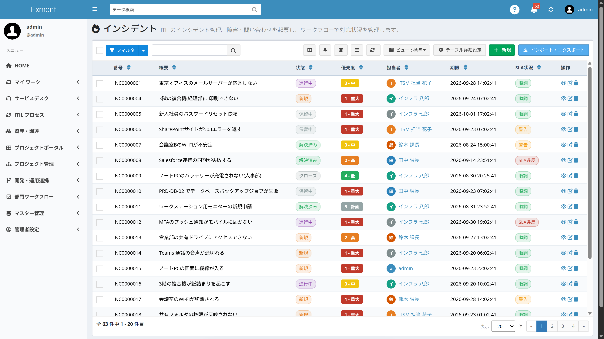

# 数据列表
本页说明以列表查看表中保存的数据的页面。

- 列表中显示的，是自己创建的数据，以及分配了权限给自己的数据。  
- 给用户或组织登记“编辑、查看所有数据的权限”后，无论上述条件如何，都会显示所有数据。关于权限，详情请参阅[角色、权限](/zh/permission)。

## 功能一览
  

※在数据列表中，还可以切换显示的列、固定列、分组、就地编辑等。详情请参阅[数据列表的操作工具](/zh/data_grid_tools)。

##### 自动刷新  
右上角5个操作图标中最右边的一个。按所选的间隔（关闭、30秒、1分钟、5分钟）重新加载列表。详情请参阅[数据列表的操作工具](/zh/data_grid_tools)。

##### 筛选  
筛选当前显示的数据列表。详情请看下面的“筛选”。

##### 视图  
当前显示的自定义表的视图按钮。详情请看下面的“视图”。  

##### 导入/导出  
导出当前显示的自定义表的数据，或导入数据的按钮。详情请参阅[数据导入、导出](/zh/data_import_export)。

##### 列表  
数据列表。  
显示的行，会按用户的权限、视图的筛选设置、列表页面的筛选设置进行筛选。  
显示的列，随视图的列设置而变化。  

##### 批量更新  
把所选的多行数据一起更新。  
需要事先在[批量更新设置](/zh/mass_update)中设置要批量更新的列和更新值。

## 功能详情  

### 筛选
筛选当前显示的数据列表。  
  
点击［筛选］按钮后，显示筛选的项目。  

- 可用于筛选的项目，按以下方式决定。  
  - 在视图中指定了“筛选”项目时（[自定义视图](/zh/view)的“视图筛选项目设置”），只有这些项目。  
  - 没有指定时，是系统项目（ID、创建时间、更新时间等。但不包括在[系统设置](/zh/system_setting)的“隐藏数据列表的筛选”中勾选的项目）、子表的父表、设置了工作流的表的工作流状态、使用评论时的评论，以及在自定义列设置中把“搜索索引”设为 ON 的列。
[自定义列设置的手册在这里](/zh/column)

- 在各项目中输入关键字并点击［搜索］按钮，只显示符合的行。  

- 要让筛选恢复原状，请点击［重置］按钮。

- 管理员以外的用户筛选时，是在该用户有权限的数据中筛选。没有权限的数据不在筛选的对象之内。  

- 筛选是在当前显示的视图的筛选条件之上追加进行的。

- 对于文本类的列，输入的关键字是与值的开头一致（前方一致），还是与值的一部分一致（部分一致），取决于[系统设置](/zh/system_setting)的“数据搜索方式”。初始值是前方一致。

>作为选项显示的项目中，设置了关联的项目，可以在[标题显示列设置](/zh/table)中更改文字。

### 视图
当前显示的自定义表的视图按钮。  
按钮上显示当前所显示视图的名称。  
点击后显示视图的菜单。
  

##### 系统视图  
显示系统中登记的视图的列表。  
点击项目后，切换到该视图。

##### 设置 - 更改当前视图设置  
更改当前显示的视图的设置。  
点击项目后，切换到该视图的设置更改页面。  
※只有拥有表的管理员权限的用户才会看到此项目。  

##### 设置 - 新建视图  
新建视图。  
点击项目后，切换到视图的新建页面。  
※只有拥有表的管理员权限的用户才会看到此项目。  

### 批量更新
把所选的多条数据一起更新。  
用各行左边的复选框选择行后，左上角会显示所选的行数和 ▼ 图标。
  

- 点击 ▼ 图标后，批量删除和已创建的批量更新设置会作为选项显示。  

- 点击要更新的内容的选项后，会显示确认是否可以批量更新的信息。请点击确认按钮。[批量更新设置](/zh/mass_update)中指定的列会变为更新值。
  