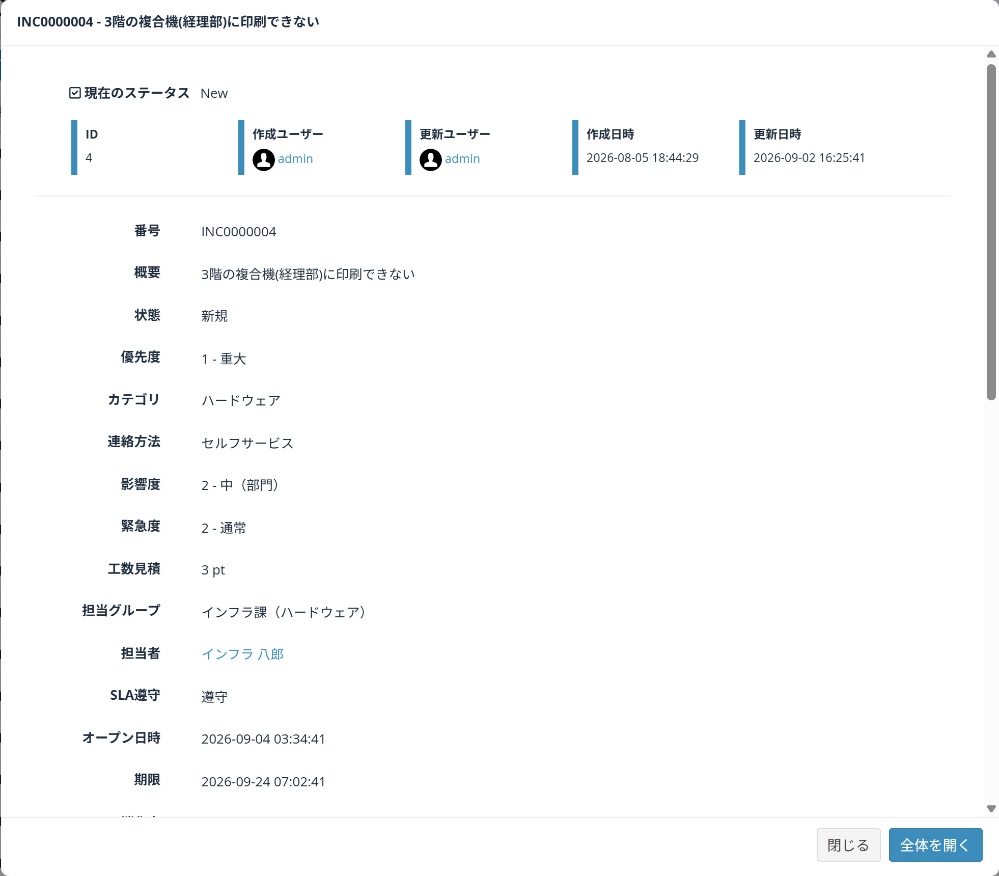

# 数据列表的操作工具

这里汇总了在[数据列表](/zh/data_grid)页面可以使用的显示切换和就地编辑功能。  
不需要设置，打开数据列表就可以马上使用。

## 工具栏的按钮

按钮排列在数据列表的右上角、视图选择的左侧。

从左起依次是［选择要显示的列］［固定列］［分组］［显示密度］［自动刷新］。v7.1.0 及以后，还会显示[［Excel 模式］](/zh/data_grid_tools?id=excel风格编辑)按钮。

> 这些设置是每个使用者各自的设置。不会更改视图的设置，所以不影响其他用户的页面。  
> ［固定列］［显示密度］会 **保存在浏览器中**，关闭浏览器后仍然保留。  
> ［分组］［自动刷新］保存在浏览器中，直到关闭标签页为止。  
> ［选择要显示的列］不保存在浏览器中，**只保留在列表的地址（URL）中**（`_columns_`）。从菜单重新打开列表或切换视图后，会恢复原状。打开复制的地址，会显示相同的列。在［筛选］中点击［搜索］时，所选列的指定也会取消。

### 选择要显示的列

从该视图的列中，选择要显示在页面上的列。

- 在上方的输入框中输入文字，可以按列名筛选。
- 用［全选］［全部取消］［恢复默认］可以一次操作。
- 用［应用］生效，用［取消］关闭。

※不能1列都不选就点击［应用］。  
※隐藏的列，数据也不会消失。用［恢复默认］随时可以恢复原状。

### 固定列

即使横向滚动，也把指定的列固定在页面的左端。在数据多的横长表格中，可以防止看不出正在看哪一行。

| 项目 | 内容 |
| --- | --- |
| 固定前2列 / 固定前3列 | 马上设置常用的组合 |
| 取消全部固定 | 取消所有固定 |
| 固定操作列 | 始终显示［操作］列。初始状态为 ON。在 v7.0 中名称是“把操作列固定在右侧” |
| 固定表头行 | 纵向滚动时保留标题行。初始状态为 ON |
| （列名的列表） | 逐个选择要固定的列 |

※页面宽度不够时，部分列不会被固定。这时页面上会显示信息。

### 分组

把当前显示的这一页的数据，按所选列的值归在一起显示。

- 分组的标题中显示该分组的件数。
- 点击标题左边的三角，可以折叠、展开分组。
- 用［不分组］恢复原来的排列。

> **显示“仅本页”的原因**  
> 分组只对现在页面上已加载的这一页数据重新排列。  
> 想跨所有数据进行汇总时，请创建[汇总视图](/zh/view)。

### 显示密度

切换行的高度和单元格内的换行。

| 项目 | 内容 |
| --- | --- |
| 紧凑 | 缩小行的高度。1个页面能放下更多的行。 |
| 标准 | 默认的高度。 |
| 宽松 | 加大行的高度。以易读为优先。 |
| 单行显示 | 单元格内的文字不换行，放在1行中。长的文章会在中途被省略。初始状态为 ON，与上面3种高度组合使用。 |

### 自动刷新

每隔一定时间自动重新加载列表。  
在多人同时处理的业务（受理咨询等）中，可以保持页面打开并确认最新的状态。

从 关闭／30秒／1分钟／5分钟 中选择。  
※关闭标签页后，此设置会取消。

## 在表格上的操作

※v7.1.0 及以后，页面的设计为“现代”时，［操作］列（查看、编辑、删除）显示在复选框的右边（表格的左侧）。“经典”中和以前一样在右端。

### 行内编辑（双击编辑）

双击单元格，可以就地更改值。可以编辑的单元格，把鼠标放上去会显示铅笔图标。

选择（输入）值后会自动保存，单元格的显示会更新。

可以编辑的列类型如下。

| 列类型 | 显示的输入方式 |
| --- | --- |
| 选项（固定值）、选项（登记值和标签）、YES/NO | 选择列表 |
| 单行文本、电子邮件、URL | 文本输入 |
| 整数、小数、货币 | 数值输入 |
| 日期、日期和时间 | Exment 的日历（日期选择）。与编辑页面的相同 |

以下的列不能就地编辑。

- 可以多选的列
- 用计算公式自动计算的列，以及被用作计算公式输入的列
- 在该数据的编辑页面（表单）中，用户不能更改的列

在禁用了编辑操作的表中，以及在回收站的显示中，不显示铅笔图标。没有表的编辑权限时也不显示。  
保存遵循与该数据的编辑页面相同的条件。包括表单的项目设置、“禁止从页面更改”的设置、输入检查、工作流的锁定、用户对该数据的权限。也会留下变更历史。无法更改时，不会保存，会用信息显示原因，并恢复原来的显示。

### Excel风格编辑

把工具栏的［Excel 模式］设为 ON 后，可以像 Excel 一样，用键盘选择单元格并编辑（v7.1.0 及以后）。初始状态为 OFF。ON/OFF 保存在浏览器中。

| 操作 | 内容 |
| --- | --- |
| 点击 | 选择单元格（不打开数据的详情） |
| 方向键、Tab、Shift+Tab | 移动所选的单元格 |
| Home、End（Ctrl+Home、Ctrl+End） | 移动到行的开头、末尾（表格的开头、末尾） |
| F2、Enter、双击、输入文字 | 开始编辑所选的单元格。输入文字时，从该文字开始输入（也支持输入法输入） |
| Delete、Backspace | 以空的状态开始编辑（在用 Enter 保存之前，值不会消失） |
| 编辑中的 Enter、Tab | 保存并移动到下一个单元格 |
| 编辑中的 Esc | 停止编辑，恢复原来的值 |

※OFF 时和以前一样（点击打开数据，双击或点击铅笔图标编辑）。  
※可以编辑的单元格和保存的条件（输入检查、权限、工作流等），与[行内编辑](/zh/data_grid_tools?id=行内编辑（双击编辑）)相同。改变的只是开始编辑和结束编辑的方式。

### 右键菜单

在行上点击右键，会用菜单显示对该数据的操作。

| 项目 | 内容 |
| --- | --- |
| 快速预览 | 不跳转页面，就地显示详情 |
| 查看 | 打开数据的详情页面 |
| 编辑 | 打开数据的编辑页面 |
| 复制为新记录 | 打开复制了此行的值的新建页面 |
| 将自己设为○○ | 把登录中的用户设置到负责人等列中 |
| 在本页内筛选：“○○” | 只显示与所点击单元格的值相同的行 |
| 复制单元格值 | 把所点击单元格的值复制到剪贴板 |
| 删除 | 确认后删除此数据 |

※菜单是按表根据用户的权限生成的，所以只能查看的用户看不到删除和编辑。每条数据的权限（被工作流锁定的数据等）在执行时确认，不能执行时会显示信息。  
※按住 Shift 键点击右键，会打开浏览器本来的菜单。

### 快速预览

不离开列表，就可以确认1条数据的内容。

- 用［打开完整页面］跳转到普通的详情页面。
- 用［关闭］回到列表。列表的滚动位置和筛选会原样保留。

### 多选和批量操作

选择行左端的复选框后，所选行的颜色会改变，页面下方会显示操作栏。

| 按钮 | 内容 |
| --- | --- |
| 批量编辑 | 一起更改所选行的值 |
| CSV / Excel | 只把所选的行输出到文件（每种格式各有1个按钮） |
| 批量删除 | 一起删除所选的行 |
| 取消选择 | 取消所有选择 |

※［批量删除］等项目，随权限和[批量更新设置](/zh/operation)而变化。

#### 执行工作流
在设置了工作流的表中，可以一起执行所勾选数据的工作流操作（v7.1.0 及以后）。  
从列表的批量操作菜单，或页面下方的操作栏点击［执行工作流］。

- 所选数据可以执行的操作，会像“批准（8 件 / 所选 10 件）”这样带件数显示。选择操作，需要时输入评论或下一个处理用户，然后点击［执行］。
- 数据逐条执行，执行前进行与数据详情页面的操作按钮相同的确认（能否查看、在该状态下能否执行、是否已经执行过）。不能执行的数据会跳过，结束后显示已执行的件数和跳过的件数（附原因）。
- 通知、插件、多人审批，与逐条执行时一样运行。1次最多可以执行500件。

※即使没有编辑权限，能对该数据执行操作的用户也会看到。在回收站的显示中不能使用。  
※关于工作流，请确认[执行工作流](/zh/workflow_execution)。

#### 批量编辑

- 只输入要更改的项目。所有项目一开始都是“（不更改）”，保持不动就不会更改。
- 在非必填的项目中选择空的选项时，**所选的所有行中该值都会被清除**。必填的项目不能设为空。
- 点击［应用到 ○ 行］后，确认后更新。
- 会显示进度，结束后显示成功件数和失败件数。

※批量编辑中显示的，只有可以用选择列表选择值的列。  
※保存是逐条经过普通的更新处理，所以输入检查、工作流、变更历史照常运行。因权限或检查而未能更新的行，作为“失败”显示在件数中。

### 筛选中的显示

在［筛选］中指定条件并搜索后，表格上方会用标签（小的标签块）显示当前的条件。

- 用条件名右边的“×”，可以只取消该条件。
- 用［全部清除］取消所有条件。

使用右键菜单的“在本页内筛选”时，用黄色的条显示。

- 会显示有多少件被隐藏。
- 用［清除筛选］恢复原状。

> “在本页内筛选”只以现在显示的这一页的行为对象。想跨页筛选时，请使用［筛选］面板或[视图的视图筛选条件](/zh/view)。

## 关于权限

这些功能直接使用现有的权限。

- 列表中显示的数据，和以前一样只有登录用户可以查看的数据。
- 编辑、删除的操作，根据用户对表的权限显示。不能更改的数据（对该数据没有权限，或被工作流锁定时），在执行时会被拒绝，什么都不会保存。
- 行内编辑和批量编辑遵循与该数据的编辑页面相同的条件（请参阅上面的“行内编辑”）。不能更改的数据不会更新。

## 相关项目

- [数据列表](/zh/data_grid)
- [自定义视图](/zh/view)
- [显示预设](/zh/cell_style_preset)
- [批量更新设置](/zh/operation)
