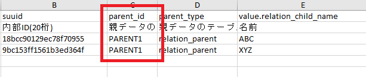
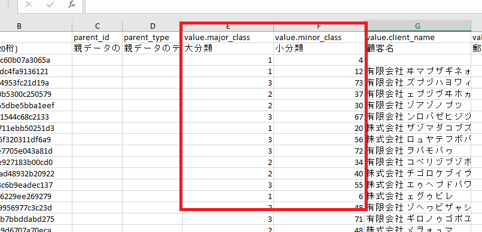
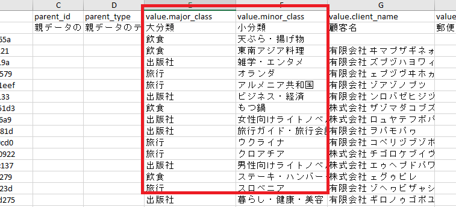
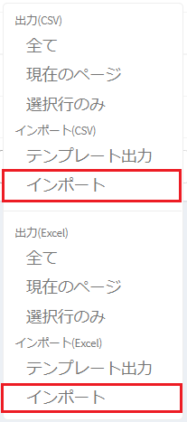
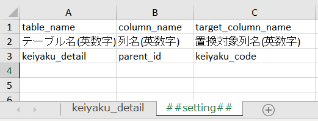
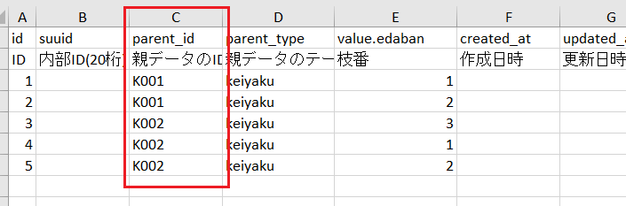

# 数据导入、导出
本页说明把表的数据输出到文件（csv、xlsx）（导出），以及从文件放入数据（导入）的页面。

| 想做的事 | 查看的位置 |
|---|---|
| 把数据输出到文件（所有列） | [数据导出](/zh/data_import_export?id=数据导出) |
| 按当前查看的视图的形式输出到文件 | “数据导出(视图)” |
| 从文件放入数据 | “数据导入” |
| 用命令导入、导出 | [用命令导入、导出数据](/zh/data_cmd_import_export) |
| 用命令一次性放入大量数据 | [大量数据批量导入](/zh/data_bulk_insert) |

## 数据导出、导入功能的种类
- 导出、导入的功能，目前有以下种类。
    - 导出  
    把保存的表数据，按所有列导出（输出）。  

    - 导出(视图)  
    按当前显示的视图的形式，导出（输出）表的数据。  

    - 导入  
    从 csv、xlsx 文件导入（输入）表的数据。  

- 在表的数据列表页面点击［导入/导出］按钮，会显示以下菜单。
  

>不使用的项目，可以用[设置值](/zh/config)设为不显示。

## 数据导出
把表的数据导出（输出）到文件。  
文件的格式为 csv、xlsx(推荐)。  

### 操作方法
- 显示数据列表页面。
  

- 页面右上角会显示［导入/导出］按钮，点击它。  
  

- 显示菜单，请选择要输出的项目。  
  
    - 全部  
    输出该表的全部数据。  
    ※不过，**登录用户没有权限的数据不会输出。**  
    
    - 当前页面  
    输出当前打开的页面的数据列表。

    - 全部（含评论）  
    输出该表的全部数据，以及每条数据的评论。  
    评论在 Excel 格式中输出到工作表“comment”，在 CSV 格式中输出到文件“comment”。  
    ※只在自定义表设置的“使用评论”为 YES 的表中显示。  
    ※评论的输出是用来查看的。导入时，“comment”工作表(文件)不会被导入。

- 点击［CSV］或［Excel］按钮，数据会以文件下载。  

### 输出项目一览
##### ID  
登记数据时自动按顺序编号的正整数。

##### 系统ID（20位）
登记数据时自动生成的20位字母数字。在页面上不常显示。用于数据迁移等。  

##### 父数据ID  
该表在关联设置中登记为“1:n”的 n 时，父表的 id。没有关联设置时为空。  

##### 父数据表名  
该表在关联设置中登记为“1:n”的 n 时，父表名（字母数字）。没有关联设置时为空。  

##### 自定义列一览  
作为自定义列登记的值，按列输出。  

##### 创建时间、更新时间、删除时间  
分别输出创建数据的时间、更新数据的时间、删除数据的时间。  

### 1:n 关联的导出
- 在关联设置中登记为“1:n”的“1”的表中导出数据时，**所关联的“n”的数据列表也会同时导出。**  

例：把“合同信息”作为1、“合同明细信息”作为 n，保存了关联设置时  
  
- 在“合同信息”页面执行数据导出时（※图片中的“客户”是测试数据）  
  
- “合同信息”和“合同明细信息”的数据都会输出。
  
  
- “n”的数据列表的“父数据ID”“父数据表名”中，输出关联的父表的ID、表名。

### n:n 关联的导出
- 在关联设置中登记为“n:n”的主 n 的表中导出数据时，**与关联的“n”之间的关联信息也会同时导出。**  

例：把“组织信息”和“用户信息”作为 n:n，保存了关联设置时  
  
- 在“组织信息”页面执行数据导出时，  
  
- 输出“组织信息”的数据。另外，还会输出把“用户信息”和“组织信息”关联起来的数据。
  
  
- “parent_id”中是作为父的组织信息的ID，“child_id”中是作为子的用户信息的ID。  

### 其他特别说明
- CSV 格式和 Excel 格式都是第1行为列名（字母数字），第2行为列显示名称。CSV 格式的表头也是2行，敬请谅解。  
- 以 CSV 格式输出的文件，字符编码为 UTF-8，换行符为 LF，无 BOM。  
- 因关联设置而输出多份数据时，Excel 格式中会成为多个工作表，CSV 格式中会把多个 csv 文件打包成 zip。  

### 导出时更改输出值
导出时，“父数据ID”“选项（从其他表中选择）”“用户”“组织”的列，通常输出引用表的数据的ID。可以把它 **改为引用表的自定义列的值。**  
步骤写在下面。  

#### parent_id(父数据ID)的情况
1. 打开关联设置页面。

2. 在“导出时的键列”中，设置导出时要输出的自定义列，然后保存。  

3. 之后导出数据时，输出值不再是 id，而是所选自定义列的值。 

※通常时
  
  
※指定了“导出时的键列”时
  

#### “选项（从其他表中选择）”“用户”“组织”的情况
1. 打开该列的自定义列设置页面。

2. 在“导出时的键列”中，设置导出时要输出的自定义列，然后保存。  

3. 之后在引用方的表中导出数据时，输出值不再是 id，而是所选自定义列的值。 

※通常时
  
  
※指定了“导出时的键列”时
  

## 数据导出(视图)
把表的数据按当前显示的视图的形式，导出（输出）到文件。  
文件的格式为 csv、xlsx(推荐)。  

### 操作方法
- 显示数据列表页面。
  

- 页面右上角会显示［导入/导出］按钮，点击它。  
  

- 显示菜单，请选择要输出的项目。
  
    - 全部  
    输出该表的全部数据。  
    ※不过，**登录用户没有权限的数据不会输出。**  

    - 当前页面  
    输出当前打开的页面的数据列表。

- 点击［CSV］或［Excel］按钮，数据会以文件下载。当前显示的视图的项目会原样输出。  

## 数据导入
从文件导入（输入）表的数据。  
文件的格式为 csv、xlsx(推荐)。数据需要事先按 Exment 规定的格式准备好。

流程如下。

1. 输出模板（“导出模板”）  
2. 在模板中写入要导入的数据（“导入项目一览”）  
3. 执行导入（“执行数据导入”）

> 目前，出于性能的考虑，1次可以导入的件数限制为5000件。  
1次登记超过5000件的数据时，请考虑使用[大量数据导入](/zh/data_bulk_insert)。

### 操作方法

#### 导出模板
输出用于导入数据的模板文件。

- 显示数据列表页面。
  

- 页面右上角会显示［导入/导出］按钮，点击它。  
  

- 在导入的导出模板中，点击［CSV］或［Excel］。
  

- 下载用于导入数据的 CSV 或 Excel 文件。  
  
※文件的格式与用“导出”输出时相同。  
模板以0条数据输出。

- 请在输出的模板中写入要导入的数据。

### 导入项目一览
##### ID  
登记数据时自动按顺序编号的正整数。  
只在导入时想自己决定这个 ID 时填写。  
不需要决定时，请留空。导入时系统会自动填入值。  

##### 系统ID（20位）  
登记数据时自动生成的20位字母数字。在页面上不常显示。  
只在导入时想自己决定这个系统ID时填写。  
不需要决定时，请留空。系统会自动填入值。  

##### 父数据ID  
通常留空。  
要导入的表在关联设置中登记为“1:n”的 n 时，请输入父表的 id。  
  
※初始设置中指定的是父表数据的ID，但 **也可以指定自定义列来导入**。详情请参阅“[更改其他表数据的指定方法](/zh/data_import_export?id=更改其他表数据的指定方法)”。  

##### 父数据表名  
通常留空。  
该表在关联设置中登记为“1:n”的 n 时，输入父表名（字母数字）。  
  

##### 自定义列一览  
请写入要作为自定义列登记的值。  
※值的写法因列类型而不同。请确认下面的“[导入时自定义列的输入方法](/zh/data_import_export?id=导入时自定义列的输入方法)”。

##### 创建时间、更新时间、删除时间  
通常留空。  
只在想自己决定创建数据的时间、更新数据的时间、删除数据的时间时填写。  
留空时，导入时系统会自动填入值。

### 执行数据导入
从页面执行导入。

- 显示数据列表页面。
  

- 页面右上角会显示［导入/导出］按钮，点击它。  
  

- 在“导入(CSV)”或“导入(Excel)”中，点击“导入”。
  

- 显示导入对话框。  
  

- 在“导入文件”中，选择写有数据的导入用模板文件。  

- 在“主键”中，选择导入时用来区分新增还是更新的主键。  
详情请确认下面的“主键的种类”。

- 设置好后，点击对话框的［提交］。

- 导入数据有问题时，“错误信息”中会显示表头之后的行号和错误的内容。

※ 在自定义列的设置中设为“[必填](/zh/column)”的项目没有值时，导入不会成功。请确认导入用模板文件中有没有漏填。
- 导入正常结束后，对话框关闭，数据重新加载。

### 新增数据和更新数据的判断方法
导入时，逐行判断是要新增的数据，还是更新现有数据的数据。  
下面写判断的方法。

- 在导入时的页面，指定用于判断的“主键”列。（这里以“ID”为例）  
※主键在导入时选择。请看下面的“主键的种类”

- 导入时，系统查看导入数据的 ID 列的值。
  

    - 导入数据的 ID 为空时，作为要新增的数据处理。
  

    - 导入数据的 ID 有值时，在已登记的数据中查找有没有相同 ID 的数据。  
  
    有相同 ID 的数据时，用导入数据的内容更新该数据。  
    没有时，新增导入数据。这时，ID 为导入数据的 ID。  

### 主键的种类

- ##### ID(推荐)  
系统自动生成的整数。也用于与其他表的关联等。  
这是简便、容易事先填入值的项目。不过，因为是自动按顺序编号的项目，在环境之间迁移时，有时会出现意想不到的错位。

- ##### 系统ID（20位）  
保存数据时系统自动生成的20位字母数字。  
在环境之间迁移时，为了明确要更新的数据，建议使用这个系统ID。  

- ##### 唯一列  
在自定义列的设置中设为“唯一”的列，可以选为主键。(例：电子邮件地址、用户代码)    

### 导入时自定义列的输入方法
导入时值的写法，因自定义列的类型而不同。  
请确认以下内容。

##### 选项（登记值和标签）  
请输入登记到数据库的“值”，或页面上显示的“标签”。  

##### 选项（从其他表中选择）、用户、组织  
请输入 **引用表的ID**。  
  
※初始设置中指定的是引用表数据的ID，但 **也可以指定自定义列来导入**。详情请参阅“[更改其他表数据的指定方法](/zh/data_import_export?id=更改其他表数据的指定方法)”。  

##### YES/NO  
请输入“YES”或“NO”，或者“1”或“0”。  

##### 二选一  
请输入在自定义列页面输入的“二选一”的显示或值。  
  

##### 其他  
请直接输入要登记的值。  

### 更改其他表数据的指定方法
导入时，“父数据ID”“选项（从其他表中选择）”“用户”“组织”的列，通常写引用表的数据的ID。可以 **改为用自定义列的值指定来导入。**  
步骤写在下面。  

#### parent_id(父数据ID)的情况
1. 打开关联设置页面。

2. 在“导入时的键列”中，设置导入时用来查找值的自定义列，然后保存。  
※只能指定在自定义列设置中指定为“搜索索引”的列。  

3. 之后，在子表中下载导入用的 Excel 文件。“##setting##”工作表中输出了子表名、“parent_id”、所指定的父表的自定义列名。  
  

4. 不要更改这个工作表的内容，请在子表的工作表中写入导入数据。  
这时，“parent_id”列中写入在 **导入时的键列** 中登记的自定义列的值。  
在下面的例子中，输入父表“合同信息”的“合同代码”的值。
  
  

5. 之后，执行导入。

#### “选项（从其他表中选择）”“用户”“组织”的情况
1. 打开该列的自定义列设置页面。

2. 在“导入时的键列”中，设置导入时用来查找值的自定义列，然后保存。  
※只能指定在自定义列设置中指定为“搜索索引”的列。  

3. 之后，在引用方的表中下载导入用的 Excel 文件。“##setting##”工作表中输出了引用方的表名、“value.” + 引用方的自定义列名、引用表的自定义列名。  
  

4. 不要更改这个工作表的内容，请在引用方的表的工作表中写入导入数据。  
这时，引用方的自定义列中写入在 **导入时的键列** 中登记的、引用表的自定义列的值。  
在下面的例子中，输入引用表“客户主数据”的“客户代码”的值。
  
  

5. 之后，执行导入。

#### 注意事项
- 只支持以 Excel 格式导入。目前不支持 CSV 格式。

