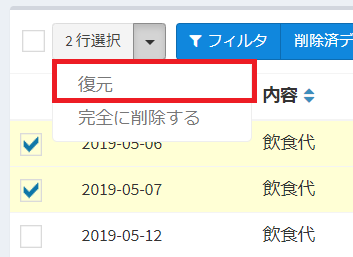
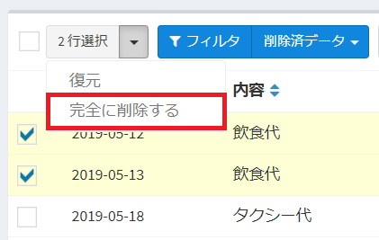

# 已删除数据
本页说明以列表查看已删除的数据，并进行恢复、彻底删除操作的页面。

- 只有拥有已删除数据显示权限的用户，才能显示已删除数据。
- 有编辑权限的用户，可以恢复数据或彻底删除数据。  

※关于权限，详情请参阅[角色组](/zh/role_group)。

## 显示列表
  

1. 在数据列表页面左上角［筛选］右边的▼标记中，选择“已删除数据”。
2. 显示改变，该表的已删除数据以列表显示。

  

## 显示详情

- 已删除数据列表中的数据，可以显示详情。  
- 请点击要显示的数据的行，或操作列中的查看图标。

  

- 在数据详情页面，可以确认删除用户和删除时间。

  

## 恢复

- 已删除数据可以放回数据列表页面（恢复）。
- 恢复的方法有3种。
    - 使用数据详情页面的［恢复］按钮。
      
    - 在已删除数据列表页面，使用操作列中的［恢复］图标。
      
    - 在已删除数据列表页面，勾选要恢复的数据，在已删除数据页面左上角的▼标记中选择“恢复”。
      

※只有拥有该数据编辑权限的用户，才能恢复数据。

## 彻底删除

- 已删除数据可以彻底删除。彻底删除的数据，也会从已删除数据列表中消失。
- 彻底删除的方法有3种。
    - 使用数据详情页面的［彻底删除］按钮。
      
    - 在已删除数据列表页面，使用操作列中的［彻底删除］图标。
      
    - 在已删除数据列表页面，勾选要彻底删除的数据，在已删除数据页面左上角的▼标记中选择“彻底删除”。
      

※只有拥有该数据编辑权限的用户，才能彻底删除数据。

## 跳转到数据列表页面

- 在已删除数据列表页面，点击［已删除数据▼］并选择“取消”，会跳转到该表的数据列表页面。

  

#### 权限设置
- 要显示已删除数据，用户需要有该数据的显示权限。
- 要恢复、彻底删除已删除数据，用户需要有该数据的编辑权限。

※关于权限的设置，请参阅[角色组](/zh/role_group)。
