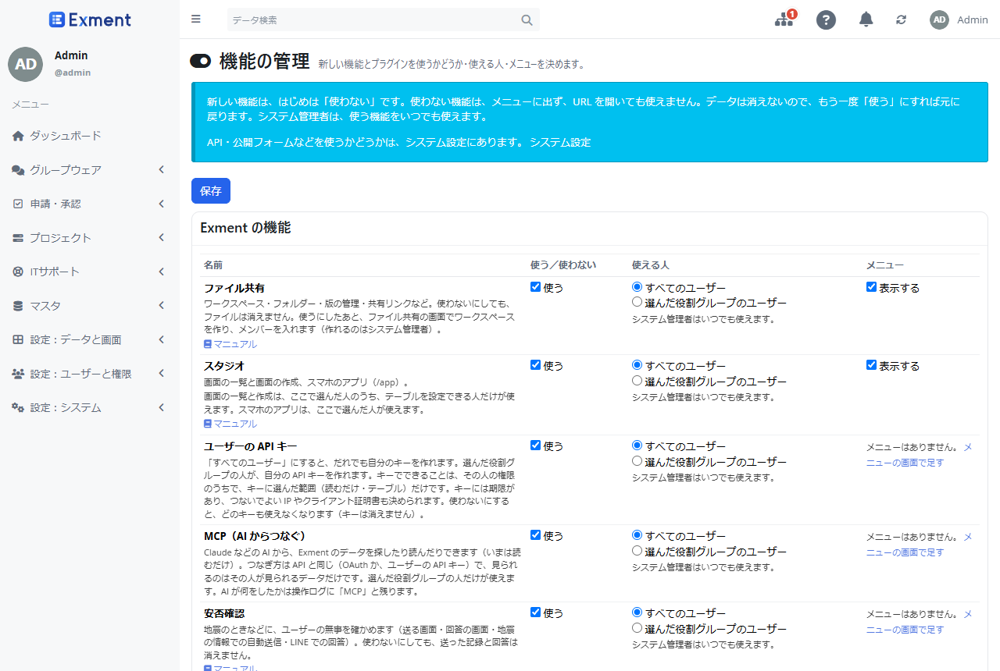

# 功能管理
决定是否使用新功能和插件、谁可以使用，以及菜单。  
Exment 被很多站点使用，所以新功能一开始是“不使用”。在系统管理员设为“使用”之前，它不会显示在菜单中，打开 URL 也不能使用。只是更新 Exment，页面和菜单不会改变。

※这个页面可以在 Exment v7.2.1 以后使用。

## 设置页面
以系统管理员登录，打开“管理员设置”→“功能管理”（URL 是 `/feature`）。  
只有系统管理员可以打开这个页面。

页面分为上面的“Exment 的功能”和下面的“插件”。

## Exment 的功能
Exment 本体的新功能。现在有下面这些。

| 名称 | 内容 |
| --- | --- |
| 文件共享 | 工作区、文件夹、版本管理、共享链接等。设为不使用，文件也不会消失。（只在带有文件共享的版本中显示） |
| Studio | 页面的列表和页面的创建、手机应用（/app）。可以使用的是能设置表的人。 |
| 数据维护 | 集中整理表的数据（现在是批量删除附件）。可以使用的是能设置表的人。（v7.3.0 以后）[数据维护](/zh/data_maintenance) |

每个功能要决定下面 3 项。

| 项目 | 内容 |
| --- | --- |
| 使用 | 是否在这个站点使用该功能。一开始是“不使用”。 |
| 谁可以使用 | “所有用户”或“所选角色组的用户”。一个角色组都不选时，只有系统管理员可以使用。系统管理员始终可以使用。 |
| 菜单 | 是否在菜单中“显示”。只对可以使用的人显示。没有菜单行时，会显示“不在菜单中。保存后将添加到“设置：系统”的末尾。” |

“状态”栏中显示如下内容。

| 状态 | 意思 |
| --- | --- |
| 新 | 还没有人决定的功能（按“不使用”处理）。 |
| 已启用 | 已设为“使用”，处于可以使用的状态。 |
| 此环境中不可用 | 已用服务器的设置停用（[用服务器的设置固定](/zh/feature?id=用服务器的设置固定)）。不能从这个页面设为“使用”。 |
| 所需的功能未启用，因此无法使用。 | 这是要有其他功能才能运行的功能（会显示“仅在使用“○○”时可用。”），而那个功能是“不使用”。 |

※Studio 只有在这里选择的人当中能设置表的人可以使用。  
※是否使用 API、公开表单等，和以前一样在[系统设置](/zh/system_setting)中。

<!-- 截图：Exment 的功能的 1 行（使用、谁可以使用、菜单）（img/feature/feature_core.png）。#1861 合并后拍摄 -->

## 插件
已安装的插件也排列在同一个页面中。  
这里不是另外保存一份新的设置，而是直接显示现有的设置。

| 项目 | 内容 |
| --- | --- |
| 使用 | 与插件的启用、停用相同。停用时会显示“已停用”。要更改时，从“在插件设置中更改”进入[插件](/zh/plugin)的页面更改。 |
| 谁可以使用 | 与角色组中插件的“使用”权限相同。要更改时，在[角色组](/zh/role_group)的页面更改。 |
| 菜单 | 是否在菜单中显示。只有这一项在这个页面决定。 |

※种类为“所有人都可以使用”的插件，以及在插件的设置中设为“所有用户均可使用”的插件，会显示这一点。  
※插件中有插件登记的功能（例如 Web 邮件等）时，会在插件下面各显示 1 行。插件中的功能一开始也是“不使用”。可以使用的人，是能使用插件的人当中在这里选择的人。

<!-- 截图：插件的行和插件中功能的行（img/feature/feature_plugin.png）。#1861 合并后拍摄 -->

## 免费官方插件（随 Exment 附带）
Exment 附带了免费的官方插件（项目管理、IT 支持、Groupware）。从“功能管理”的“免费官方插件（随 Exment 附带）”一栏安装。详情请看[官方插件](/zh/plugin_official)。

- 在点击“使用（安装）”之前，不会安装也不会加载（也不会创建表）。
- 点击后，经过确认再安装并启用。这个插件的主要功能也会变为“使用”。之后它也会排列在上面的“插件”一栏中，可以决定谁可以使用和菜单。
- 有新版本时，会显示“有可用的版本 ○○。”。不会自动安装。用“更新到此版本”更新（设置、菜单、权限会保留）。
- 更新之前的版本会保留，可以用“恢复到上一版本（○○）”恢复。
- 以前手动安装的插件可以照常使用（不会重新安装）。只有附带的版本更新时才会通知。替换为附带的版本后，不能恢复到手动安装的版本。
- 附带的插件在确认 Exceed One 的签名之后才安装。签名不符的不会显示。
- 在由运营方切换版本的站点（SaaS 等），会显示“版本由本站点的运营方更改。”，不显示按钮（`.env` 的 `EXMENT_BUNDLED_PLUGINS_UPDATES=false`）。

#### 安全修复的通知
已安装的官方插件的新版本中包含安全修复时，会通知系统管理员。

- 系统管理员的首页上方会显示“官方插件有可用更新（○○）”。功能管理的行中也会显示“安全修复”的标记和“此版本包含安全修复。请点击“更新到此版本”。”。
- 用铃铛通知，在能发送邮件的站点还用邮件，把同样的主题和正文只发送 1 次。
- 其他用户不会看到任何内容。只有系统管理员点击“更新到此版本”时才会更新。
- 要恢复到不包含安全修复的版本时，会再确认一次。

#### 新功能的通知
更新 Exment 后，增加了还没有决定的新功能时，会用系统管理员首页的通知和铃铛只通知 1 次（“有新功能（○○）。默认不使用。…”）。不发送邮件。新安装的站点不会显示。

<!-- 截图：免费官方插件一栏（img/feature/feature_bundled.png）。#1867 合并后拍摄 -->

## 设为“不使用”时
- 不再显示在菜单中（菜单的行不会删除，只是隐藏）。
- 该功能的页面和 API，即使直接打开 URL 也不能使用。
- 数据（工作区、文件、页面等）不会消失。再次设为“使用”就会恢复原样。
- 把有人在用的功能设为“不使用”，或者减少可以使用的人再保存时，会确认“部分用户将无法再使用以下内容。要保存吗？”。

## 不能使用时显示的提示
打开不能使用的功能的 URL 时，会显示下面的提示。

| 提示 | 什么时候显示 |
| --- | --- |
| 本站点未使用此功能。 | 该功能为“不使用”时（或用服务器的设置停用时）。对系统管理员还会显示通往“功能管理”的链接。 |
| 您没有使用此功能的权限。请联系管理员。 | 功能已设为“使用”，但登录的人不在“谁可以使用”之内时。 |

两种情况都可以从“返回首页”的链接回到首页。从 API 调用时，同样的提示以 JSON 返回（未使用时是 404，没有权限时是 403）。

<!-- 截图：“本站点未使用此功能。”的页面（img/feature/feature_not_used.png）。#1861 合并后拍摄 -->

## 在更新过的站点
即使更新 Exment，以前使用的东西也可以照常使用。

- 更新之前就在使用的功能会变为“使用”。和以前一样能看到。
  - 文件共享：至少有 1 个工作区的站点
  - Studio：有人打开过 Studio 的页面或手机应用的站点（用操作日志确认）
- 只有菜单而没有使用的功能会变为“不使用”。
- 插件的启用、停用和角色组的权限不变。
- 插件中的功能里，该插件以前就有的功能，在以前就安装了插件的站点保持“使用”。
- 新安装的站点全部从“不使用”开始。
- “管理员设置”下面会增加“功能管理”的菜单。

## 用服务器的设置固定
在服务器的 `.env` 中写上 `EXMENT_FEATURES_LOCKED`，无论站点的系统管理员选择什么，都可以把该功能固定为“不使用”。  
用于不提供某些功能的服务（SaaS 等）。把键用逗号分隔来写。

~~~
EXMENT_FEATURES_LOCKED=file_server,studio
~~~

| 键 | 功能 |
| --- | --- |
| `file_server` | 文件共享 |
| `studio` | Studio（包含手机应用） |

固定的功能在这个页面显示为“此环境中不可用”。

※更改 `.env` 之后，在使用设置缓存的服务器上，请执行 `php artisan config:clear`（或 `php artisan config:cache`）。

## 决定的顺序
能否使用，按从上到下的顺序决定。下面的设置不能比上面的设置放得更宽。

1. **服务器的设置**：写在 `EXMENT_FEATURES_LOCKED` 中的功能不能使用。
2. **站点的“使用”“不使用”**：“不使用”的功能谁都不能使用。
3. **谁可以使用**：所有用户，或所选角色组的用户（系统管理员始终可以使用）。
4. **功能内部的设置**：Studio 是表的权限，文件共享是工作区的权限等。

## 致插件开发者
插件可以登记自己内部的功能，在这个页面显示 1 行。登记的功能一开始是“不使用”。

~~~php
use Exceedone\Exment\Services\Features;

// 在插件类的构造函数等处登记。键以插件的 uri 开头
Features::register('exment_groupware.mail', [
    'label' => 'Web 邮件',
    'endpoints' => ['plugins/exment_groupware/mail'],
]);

// 在插件的页面中确认
if (!Features::allowed('exment_groupware.mail')) {
    return Features::deny('exment_groupware.mail');
}
~~~

- 写在 `endpoints` 中的页面，在不能使用时会显示上面的提示。
- 设为 `existing => true` 后，在以前就安装了该插件的站点会保持“使用”（把以前就有的功能后来登记时）。
- 在 `requires` 中写上其他功能的键后，那个功能为“不使用”时就不能使用。

## 相关项目
- [系统设置](/zh/system_setting)
- [插件](/zh/plugin)
- [角色组和权限设置](/zh/role_group)
- [菜单](/zh/menu)
