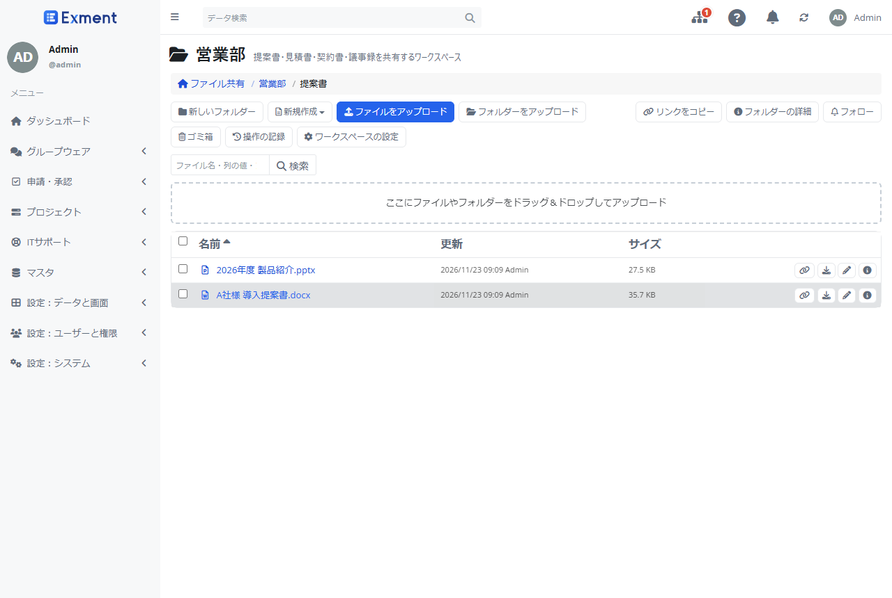
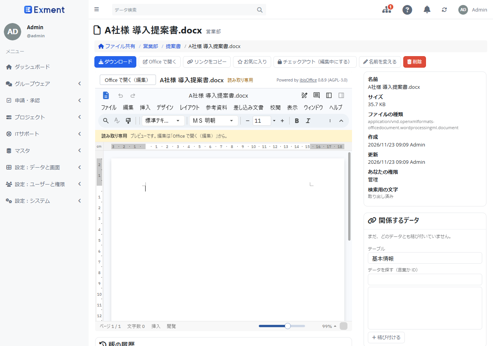

# 文件共享
在每个团队的工作区中放置文件夹和文件来共享。有按文件夹的权限、版本管理、预览和回收站。可以像 Box 或 SharePoint 的文档库那样使用。  
文件的内容放在 Exment 的文件保存位置（本地、S3、Azure、FTP 等，保持现在的设置）。

※这个功能可以在 Exment v7.2.1 及以后使用。<!-- TODO: 按文件共享进入 master 的版本修改 -->

## 开始使用
文件共享最初是“不使用”。系统管理员在“管理员设置”→“[功能管理](/zh/feature)”中把“文件共享”设为“使用”后，左侧菜单中会出现“文件共享”。可以使用的人（角色组）也可以在功能管理中选择。

## 工作区
工作区是放置团队文件的地方（相当于 SharePoint 的站点）。

- 用“新建工作区”创建。创建的人成为该工作区的管理员。谁可以创建，由 `.env` 的 `EXMENT_FILE_SERVER_WORKSPACE_CREATE` 决定（`admin`：只有系统管理员，`all`：任何人）。
- 在“工作区设置”中决定下面的内容。

| 项目 | 内容 |
| --- | --- |
| 名称、说明 | 工作区的名称和说明。 |
| 成员 | 用户、组织和他们的权限（查看、上传、编辑、管理）。需要有 1 个以上的管理员。 |
| 容量上限（GB） | 留空表示不限制。旧版本和回收站中的文件也计入容量。 |
| 回收站保留天数 | 过了之后永久删除。设为 0 时，在手动删除之前一直保留。 |
| 保留的版本数 | 1 个文件保留的旧版本的数量。 |
| 列（元数据） | 给这个工作区的文件加上的列。请看下面的“列（元数据）”。 |

首页显示可以打开的工作区的列表，以及“收藏”“最近更新的文件”“与我共享”。

## 文件夹和文件
- 用“新建文件夹”“上传文件”“上传文件夹”或者拖放来上传。大文件会分块发送，所以中途断开也可以接着发送。
- 对每个文件和文件夹，可以重命名、移动、复制、下载（多个时为 ZIP）、删除、收藏。
- 删除的内容会进入回收站。可以从回收站“还原”或“永久删除”。

## 权限
权限有 4 种。上面的权限可以做下面的权限能做的所有事。

| 权限 | 可以做的事 |
| --- | --- |
| 查看 | 查看、下载 |
| 上传 | 添加文件 |
| 编辑 | 重命名、移动、删除、新版本、创建共享链接 |
| 管理 | 更改权限、取消签出、审批 |

- 文件夹和文件继承上级文件夹（或工作区）的权限。
- 用“停止继承权限”，可以设成只属于该文件夹或文件的权限。用“继承上级权限”可以恢复。
- 系统管理员可以管理所有的工作区。

## 版本管理和签出
- 覆盖同名的文件，或者“上传新版本”，就会成为新的版本。可以从“版本历史”下载以前的版本，也可以用“还原到此版本”把以前版本的内容保存为新的版本。
- 设为“签出（开始编辑）”后，其他人不能更改和删除该文件。结束后设为“签入（结束编辑）”。有管理权限的人可以“取消签出”。

## 预览
图片、视频、音频、PDF、文本可以在画面上查看。Office 的文件（docx、xlsx、pptx）的显示方式因服务器的准备情况而不同。

| 服务器的准备 | Office 文件的显示方式 |
| --- | --- |
| 有 LibreOffice（`EXMENT_FILE_SERVER_SOFFICE_PATH`） | 转成 PDF 显示。 |
| 有官方插件“Groupware” | 用“在 Office 中打开”，可以在浏览器的 Office（ibisOffice）中以只读方式打开。如果也有 LibreOffice，用标签页切换。 |
| 两者都没有 | 只显示文件中的文字。要按原样查看，请下载。 |

如果用 Groupware 的 ibisOffice，不需要 LibreOffice 也不需要 Docker，在租用服务器上也可以使用。准备和 Web 服务器的设置请参阅 [Groupware](/zh/plugin_groupware)。

※html、svg 等，为了安全不在画面上显示，只能下载。

※通过接收链接从外部收到的文件，即使打开也不会生成预览和提取文字。只有在有管理权限的人点击“生成预览”时才生成。

## 外部共享链接
可以把文件和文件夹交给不登录的外部人员，也可以从外部人员那里接收文件。在文件画面的“外部共享链接”栏中创建链接。

| 链接类型 | 内容 | 可以创建的人 |
| --- | --- | --- |
| 共享链接（外部人员查看和下载） | 是文件夹时，里面的内容也可以看到。取消“允许下载”后，只能预览。 | 有编辑权限的人 |
| 接收链接（外部人员上传） | 外部人员把文件放进文件夹。看不到其他人的文件。同名的文件不会覆盖，而是命名为“名称 (2)”。 | 有编辑权限的人（从 7.2.1 起。以前只有上传权限的人创建的链接将无法打开） |

- 可以加上有效期、密码和可打开的次数。密码为 8 个字符以上（`EXMENT_FILE_SERVER_SHARE_PASSWORD_MIN`）。用“撤销”可以随时使链接失效。
- 无效的链接（过期、已撤销、达到次数上限等）都会显示“无法打开链接”。
- 新的共享链接的有效期默认是 30 天，最长 90 天（`EXMENT_FILE_SERVER_SHARE_DEFAULT_DAYS`、`EXMENT_FILE_SERVER_SHARE_MAX_DAYS`。设为 0 时，没有默认值、没有上限）。以前创建的没有期限的链接，在链接的列表中显示为“无期限”。
- 可以看到共享链接地址的，只有创建该链接的人和对该文件或文件夹有管理权限的人。
- 交给公司内部的人时，使用“复制内部链接”。只有有权查看该文件的人可以打开。
- 不想让人使用外部共享链接时，在 `.env` 中写入 `EXMENT_FILE_SERVER_EXTERNAL_SHARE=false`。有效期的上限可以用 `EXMENT_FILE_SERVER_SHARE_MAX_DAYS` 更改。
- 共享链接（`/share/...`）是交给外部人员的，所以平时不应用系统设置的 Web 的 IP 筛选。只想让公司内部打开时，在 `.env` 中写入 `EXMENT_FILE_SERVER_SHARE_WEB_IP_FILTER=true`。这是创建路由时读取的设置，所以使用 `php artisan route:cache` 的站点，请在更改后再执行一次。

## 列（元数据）
在工作区设置中，可以创建加在文件上的列（“客户”“类型”等）。

- 类型有文本、多行、数值、日期、单选、多选、是/否。可以决定是否必填、默认值、是否在列表中显示。
- 在列表中，可以按列筛选（也可以选“（空）”）、排序、分组。

## 与数据关联
在文件画面的“相关数据”中，可以与 Exment 的表的数据（客户等）关联。数据的详情画面上会出现“文件共享中的文件”栏。两边都只显示有查看权限的内容。

## 搜索
用“搜索”，可以按文件名、列的值、文件中的文字查找。只显示有查看权限的文件。

- 文件中的文字从文本、HTML、Office（docx、xlsx、pptx）、OpenDocument 中提取。PDF 在有 pdftotext（`EXMENT_FILE_SERVER_PDFTOTEXT_PATH`）时提取，图片和扫描的 PDF 在有 tesseract（`EXMENT_FILE_SERVER_OCR_PATH`）时提取。
- 平时用数据库查找。设为 `EXMENT_FILE_SERVER_MEILI=true` 后，用 [Meilisearch](/zh/additional_meilisearch) 查找（使用与数据的全文搜索不同的索引 `exment_files`）。

## 审批、保全和保留期限
<!-- TODO: P5（exment PR #1859）进入后确认 -->
| 功能 | 内容 |
| --- | --- |
| 审批 | 在文件夹的“规则”中设为“需要审批”后，放进去的文件会成为“等待审批”。在审批通过之前，能看到的只有上传的人和管理员。由有管理权限的人进行“审批通过”或“退回”。 |
| 保全 | 加在工作区、文件夹或文件上后，就不能删除。旧版本也不会消失。只有系统管理员可以加上和取消（有管理权限的人只能查看）。 |
| 保留期限 | 在工作区设置中决定天数后，文件在这段天数内不能删除。只有系统管理员可以决定和取消（有管理权限的人只能查看）。 |
| 可下载的人员 | 低于所定权限的人只能查看（见下面的“只能查看时”）。 |
| 水印 | 在预览上叠加显示查看者的姓名和日期时间。 |
| 审计日志 | 记录显示、下载、上传、删除、权限的更改、共享链接等。可以导出为 CSV。 |
| 关注、评论 | 关注的工作区、文件夹或文件有变化时，用铃铛和邮件通知。在评论中写 `@用户代码`，可以通知那个人。 |

### 只能查看时
对低于工作区的“可下载的人员”的人，以及取消了“允许下载”的共享链接，文件按下面的方式显示。

| 文件 | 显示方式 |
| --- | --- |
| 图片 | 用缩小的图片显示。 |
| Office、PDF | 有转换成 PDF 的文件时，用它显示。 |
| 文本、视频、音频 | 不显示。 |

每次查看都会留在审计日志中。

## 服务器的准备
- **每天的处理**：回收站的自动删除由 `php artisan exment:file-server-purge`（每天 3:30）执行。请设置[任务计划](/zh/additional_task_schedule)。
- **队列**：缩略图、预览、文字的提取用队列执行。
- **重新提取文字**：用 `php artisan exment:file-server-index`，提取还没有处理的文件的文字，并重新创建 Meilisearch 的索引。
- **其他软件**（都是没有也可以运行）：LibreOffice（Office 的预览）、pdftotext（PDF 的文字）、tesseract（OCR）、Meilisearch（快速搜索）。
- **不联网运行 LibreOffice**：Office 的文件有时会去读取外部的 URL。在 `EXMENT_FILE_SERVER_SOFFICE_PREFIX` 中写入加在 LibreOffice 前面的命令，就可以不联网进行转换（例：`unshare -rn`、`firejail --net=none --quiet`）。请先确认服务器上能不能使用该命令。
- **上传的上限**：大文件分块发送。1 个文件最大 2 GB（`EXMENT_FILE_SERVER_MAX_FILE_SIZE`），1 个人可以保持未完成的上传最多 20 个（`EXMENT_FILE_SERVER_MAX_UPLOADS`），合计最大 10 GB（`EXMENT_FILE_SERVER_MAX_UPLOAD_BYTES`）。未完成的上传也计入工作区的容量。60 分钟没有任何数据送到的上传不计入，在那个人下次开始上传时删除。

## 主要的设置（.env）
| 设置 | 默认 | 内容 |
| --- | --- | --- |
| `EXMENT_FILE_SERVER_WORKSPACE_CREATE` | `admin` | 可以创建工作区的人（`admin`、`all`） |
| `EXMENT_FILE_SERVER_MAX_FILE_SIZE` | `2147483648`（2 GB） | 1 个文件的大小上限（字节。0 为不限制。从 7.2.1 起为 2 GB） |
| `EXMENT_FILE_SERVER_MAX_UPLOADS` | `20` | 1 个人可以保持未完成的上传的数量 |
| `EXMENT_FILE_SERVER_MAX_UPLOAD_BYTES` | `10737418240`（10 GB） | 1 个人未完成的上传的合计（字节。0 为不限制） |
| `EXMENT_FILE_SERVER_EXTERNAL_SHARE` | `true` | 是否使用外部共享链接 |
| `EXMENT_FILE_SERVER_SHARE_DEFAULT_DAYS` | `30` | 新的共享链接的有效期的默认值（天。0 为没有默认值） |
| `EXMENT_FILE_SERVER_SHARE_MAX_DAYS` | `90` | 共享链接的有效期的上限（天。0 为不限制，也可以没有期限） |
| `EXMENT_FILE_SERVER_SHARE_PATH` | `share` | 共享链接的 URL 的开头部分 |
| `EXMENT_FILE_SERVER_SHARE_PASSWORD_MIN` | `8` | 共享链接的密码的最少字符数 |
| `EXMENT_FILE_SERVER_SHARE_WEB_IP_FILTER` | `false` | 是否对共享链接也应用 Web 的 IP 筛选 |
| `EXMENT_FILE_SERVER_SOFFICE_PATH` | 无 | LibreOffice（soffice）的位置 |
| `EXMENT_FILE_SERVER_SOFFICE_PREFIX` | 无 | 加在 LibreOffice 前面的命令（不联网运行） |
| `EXMENT_FILE_SERVER_PDFTOTEXT_PATH` | 无 | pdftotext 的位置 |
| `EXMENT_FILE_SERVER_OCR_PATH` | 无 | tesseract 的位置 |
| `EXMENT_FILE_SERVER_MEILI` | `false` | 是否用 Meilisearch 查找 |
| `EXMENT_FILE_SERVER_AUDIT` | `true` | 是否保留审计日志 |
| `EXMENT_FILE_SERVER_NOTIFY` | `true` | 是否发送关注的通知 |

## 相关项目
- [功能管理](/zh/feature)
- [文件保存位置的设置](/zh/additional_file_saveplace)
- [任务计划](/zh/additional_task_schedule)
- [使用全文搜索引擎(Meilisearch)](/zh/additional_meilisearch)
- [角色组与权限设置](/zh/role_group)
