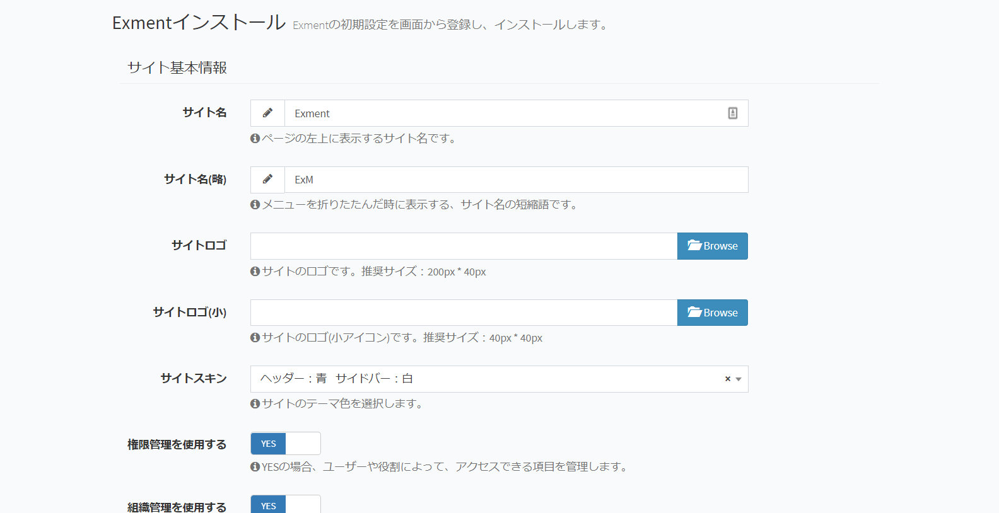

# 初始设置
这是安装之后最先进行的设置的步骤。决定站点的信息和第一个管理员的登录 ID 等。

步骤有下面 4 个。

1. 访问 Exment 的页面
2. 在初始设置页面输入必要的信息
3. 选择想使用的模板
4. 点击“提交”按钮

## 访问 URL
访问 Exment 的页面。  
http(s)://(您的站点URL)  

> ※这里的 URL 是不带“/admin”的标准设置（v7.2.1 以后新安装的站点）的情况。`.env` 的 `ADMIN_ROUTE_PREFIX` 有值时（用以前的版本安装的站点是“admin”），请在站点的 URL 后面加上这个值（例：`http(s)://(Exment的URL)/admin/oauth/token`）。详情请看[更改或删除 URL 中包含的“admin”](/zh/additional_prefix)。

## 初始设置页面
安装正确结束后，会显示 Exment 的初始设置页面。

请输入系统设置所需的信息。  
※各项目的详细说明请看[系统设置](/zh/system_setting)。

## 模板设置
Exment 中预先准备了模板。  
选择模板后，这个模板中包含的表、列、表单、菜单、权限会一起安装。  
也可以从这个页面上传在其他 Exment 中导出的模板。  
详情请看[模板](/zh/template)。

列表中会显示系统一开始就有的模板和以前导入过的模板。  
请选择想安装的模板。  

## 初始设置完成
输入必要的项目并点击“提交”按钮后，设置会被保存，就可以使用 Exment 了。

## 其他追加设置
做到这里，就可以开始使用 Exment 了。不过，要使用一部分功能，还需要追加设置。  
请确认下面的页面。  
- [追加设置](/zh/quickstart_more)
