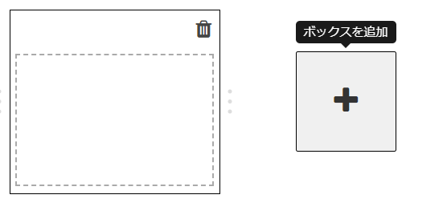
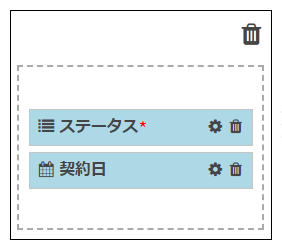

# 自定义表单
这是决定 Exment 的[数据表单页面](/zh/data_form)（输入数据的页面）中显示的项目及其排列方式的页面。可以更改项目的配置（区块的布局）、隐藏字段、数据联动设置等。  
这里设置的内容会反映到各表的[数据表单页面](/zh/data_form)中。

- 页面的打开方法：下面的“显示页面”“编辑表单”
- 项目的排列方式：下面的“自定义表单的设置项目”
- 复制从其他表选择的数据的值：下面的“数据联动设置”
- 按照选择的值筛选其他选项：下面的“关联筛选设置”
- 按条件切换使用的表单：下面的“表单优先级设置”

## 显示页面
- 在自定义表列表中，勾选要设置的表，点击右上角的“表详细设置”。  

> ※ 也可以从这个自定义表的数据列表页面或数据登记页面直接打开。这时也请点击右上角的“表详细设置”。  

- 在出现的表详细设置页面中，点击表单设置的图标，就会显示表单的列表。  
※每个表一开始就创建了 1 个默认的表单。


## 编辑表单
要修改表单时，点击这个表单的［编辑］链接。  


## 自定义表单的设置项目


### 表单基本设置
输入表单的基本信息。

- ##### 表单显示名称
输入表单的名称。  

- ##### 默认表单
要把这个表单设为默认表单时，请设为 YES。  
设置了[表单优先级设置](/zh/form?id=表单优先级设置)时，以它为优先。

- ##### 详情页面显示方式
选择在[数据详情页面](/zh/data_details)中显示项目的方式。可以按照在这个页面决定的行、列的布局显示，也可以显示为简单的纵向 1 列。  


- ##### 标题显示方式
决定怎样显示各项目的标题。  
※这是整个表单的设置。要按项目更改时，请更改各项目的设置。

### 表单块设置
设置表单的块。  
块是数据的集合，通常 1 个表有 1 个。  
不过，有 1:n 的关联设置时，子表的数据也可以在同一个页面中输入。请勾选子表块的“使用”来设置。


#### 表单块项目
※下面都是子表的设置项目。

- ##### 以表格形式显示表单  
以表格的形式显示子表的输入栏。

- ##### 优化子表数据的加载  
设为 YES 后，在显示编辑页面之后自动加载这个子表的行。在子表的行很多的数据中，可以缩短编辑页面显示出来之前的时间。默认值是 NO。  
编辑现有的数据时，可以在“以表格形式显示表单”为 YES 的一对多的块中使用。加载结束之前不能保存。  
把“以表格形式显示表单”设为 NO 并保存表单后，这个设置也会变为 NO。  
※从 v7.1.0 起可以使用。


- ##### 表单块名称  
显示在表单各块上的名称。  

- ##### 显示顺序  
有多个子表时，可以决定显示的顺序。  


#### 表单项目
选择并排列要显示在输入表单中的项目。  
项目可以从下面的“表单项目 候选项目”中选择。


表单中可以放置 1～4 列的区块。  
在这个区块中放置表单项目。


区块可以进行下面的操作。  

- 点击区块旁边的“+”按钮，会在现在的行中添加新的列。  


- 点击区块下面的“+”按钮，会添加新的行。（已经有下一行时，会在那一行中添加新的列）  


- 拖放区块右侧的空白，可以更改区块的大小。  


- 点击区块右上角的垃圾桶图标，会删除区块。  


通过增减区块的行和列、更改宽度，可以做出例如下面这样的布局。  

- 1 列 - 2 列


- 3 列 - 1 列


- 1 列 - 2 列 - 1 列


### 表单项目 候选项目  
可以添加到表单中的项目的候选。  
有“表列”和“其他”2 种。  


#### 表列  
自定义表中设置的自定义列的项目。  
拖放到“表单项目”的区块中，就会配置到数据表单中。动作随自定义列的类型和[表单项目详情](/zh/form?id=表单项目详情)的设置而不同，但通常可以编辑或显示项目的值。

#### 其他  
标题、说明文字、HTML 等，与数据没有联系、只显示在表单中的项目。  
拖放到“表单项目”的区块中，就会配置到数据表单中。

- ##### 标题：
在表单中以标题的形式显示。

- ##### 说明文字：
在表单中显示说明文字。不能使用 HTML。

- ##### HTML：
在表单中显示 HTML。  
※为了安全，不会输出 `<script>`、`<iframe>` 标签和 `id` 属性（v6.2.15 以后）。要在页面上运行脚本时，请使用[脚本插件](/zh/plugin_quickstart_script)。  

- ##### 扩展 HTML：
除了 HTML 之外，还可以使用以[参数](/zh/params)指定的格式的字符串。在绘制页面时，可以用已保存数据的值替换，生成 HTML。  
※与“HTML”一样，不会输出 `<script>`、`<iframe>` 标签和 `id` 属性（v6.2.15 以后）。  
例：
```
<h4>ID：${id}、公司代码：${value:company_code}</h4>
```
※只在绘制页面时替换列的值。请注意，在数据编辑页面中编辑目标列的值，这里的值也不会联动更改。  

- ##### 图片：
在表单中显示图片。

- ##### 分隔线：
在表单中显示分隔线。


#### 表单项目详情
添加到区块中的项目以下面这样的标签显示。  
- 在自定义列的设置中设为必填的项目，名称旁边带有红色的标记。  
- 点击标签右边的垃圾桶图标，会从区块中删除这个项目。  
- 点击标签右边的齿轮图标，会显示详细设置对话框。  




##### 标题显示形式
可以按项目决定标题的显示方式。
（比整个表单的设置优先）

##### 字段类型
决定在数据表单页面中的显示方式。有下面 4 种。

| 种类 | 在页面上的样子 | 用户更改值 | 从计算字段、数据联动设置使用 |
|---|---|---|---|
| 只读 | 以灰色显示 | 不可以 | 可以 |
| 仅显示 | 作为文本显示 | 不可以 | 不可以 |
| 隐藏字段 | 不显示（作为隐藏字段(hidden)添加） | - | 可以 |
| 隐藏 | 不显示（在保存之前，在系统内部添加） | - | - |

- 只读：  
勾选后，用户不能更改值。只能从系统、计算字段、[数据联动设置](/zh/form?id=数据联动设置)更改和获取值。  
设置后，在表单中像下面这样以灰色显示。  
  
- 仅显示：  
勾选后，用户不能更改值。从系统、计算字段、[数据联动设置](/zh/form?id=数据联动设置)也不能更改和获取值。  
设置后，在表单中像下面这样作为文本显示。  
  
- 隐藏字段：  
勾选后，项目不显示在页面上，作为隐藏字段(hidden)添加。  
想在计算字段、[数据联动设置](/zh/form?id=数据联动设置)中使用，但不想显示在页面上时，使用这个设置。  

- 隐藏：  
勾选后，项目不会添加到页面中。在保存数据之前，在系统内部添加。  
因为不存在于页面中，所以不能在计算字段和数据联动设置中使用。  
内部的参数值等不想被篡改或修改的项目，请使用这个设置。


##### 数据联动设置(项目)  
请参照[数据联动设置](/zh/form?id=数据联动设置)。  

##### 关联筛选设置(项目)  
请参照[关联筛选设置](/zh/form?id=关联筛选设置)。  


## 数据联动设置
表单中有选择其他表的数据的项目时，可以把选择的数据的内容复制到表单的其他项目中。  
例：选择“合同”表单内的“客户”时，把“客户”数据内的“客户名”的值复制到“合同”表单内的“客户名”中。


“合同”表单中有“客户”选项和“客户名”单行文本，  
  
 
选择“客户”时， 


“客户名”文本中会自动设置值  


<br />  

#### 步骤
- 打开自定义表单页面。  
点击表单项目中“客户名”的设置图标。  


- 打开的对话框中有“数据联动设置”项目。  


- 在“选择列”中，选择成为复制的契机（触发条件）的自定义列。  
**※ 可以选择同一个表单内列类型为“选项（从其他表中选择）”“用户”“组织”的列。**
这个例子中选择“客户”。  


- 选择“选择列”后，会出现第 2 个项目“选择链接列”的选项。  
以列表显示在“选择列”中选择的表的自定义列。  
这个例子中选择“客户名”。  


- 最后点击［设置］按钮。  
对话框关闭，［数据联动设置］按钮的旁边显示“已设置”。  


- 请点击页面下方的［提交］按钮，保存设置。


## 关联筛选设置
列类型为“选项（从其他表中选择）”“用户”“组织”时，按照同一个表单内其他项目的选择来筛选选项。只有目标表的父表或引用的表的列存在于同一个表单内时才能设置。  

#### 例
“客户信息”表和“负责人信息”表设置了 1:n 的关联，并且“合同信息”表中有“客户”列和“负责人”列。  
选择“客户”列时，想把“负责人”列的选项候选筛选为只有以所选“客户”为父数据的负责人。

  

有下面这样的数据，
  

在合同信息页面中，
 

在“客户”中选择“株式会社A”时，把所属株式会社A的负责人作为选项候选，
  

在“客户”中选择“株式会社B”时，把所属株式会社B的负责人作为选项候选。
  

#### 步骤
- 打开自定义表单页面。  
点击表单项目中“负责人”列的设置图标。  


- 打开的对话框中有“关联筛选设置”项目。  
选项中显示的是同一个表单中成为所选列的父的列的列表。  
这个例子中，“负责人”表的父表“客户”表的列会显示在选项中。  
※“关联筛选设置”按钮在自定义列为“选项（从其他表中选择）”“用户”“组织”时显示。


- 设置后，点击“设置”按钮。  


#### 关于低于 v3.3.1 的版本的规格
<span class="small">在低于 v3.3.1 的版本中，不显示这个设置页面，对所有具有 1:n 父子关系、引用关系的字段都进行选项的筛选。  
结果有时会引起不必要的筛选和意料之外的问题，所以在 v3.3.1 中添加了设置，可以选择是否进行筛选。  
从低于 v3.3.1 的版本更新到 v3.3.1 以上时，为了保持兼容性，会继承“对所有具有 1:n 父子关系、引用关系的字段都进行选项的筛选”这一设置。  
更新时的规格详情请参照[这里](/patch/relation_filter)（英语）。</span>


## 表单优先级设置
预先决定条件和优先度后，可以按条件切换在创建数据和数据详情页面中使用的表单。  

### 新建
从表单优先级设置右边的［新建］按钮创建。


### 设置页面


##### 目标表单  
选择符合条件时想使用的表单。

##### 优先顺序  
决定使用表单的优先顺序。
对符合多个表单显示条件的数据，用优先顺序高的表单显示页面。

##### 条件项目  
作为显示条件使用的列。

##### 筛选条件  
选择条件的内容。
可以选择的内容随“条件项目”中选择的列的类型（“日期”“用户”等）而变化。

##### 条件值  
输入与筛选条件比较的值。

##### ［删除］按钮  
删除表单的显示条件。

##### ［新建］按钮  
新增表单的显示条件。
