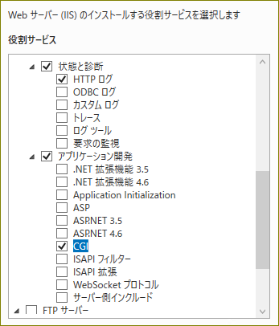
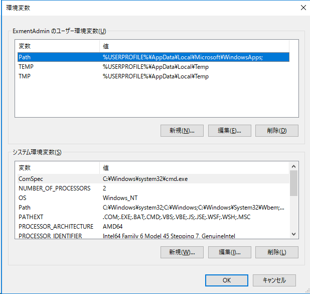
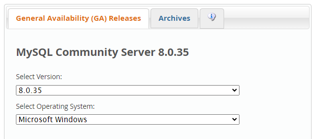
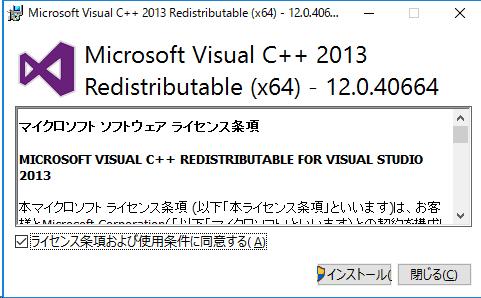
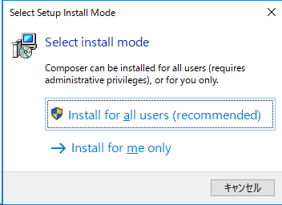
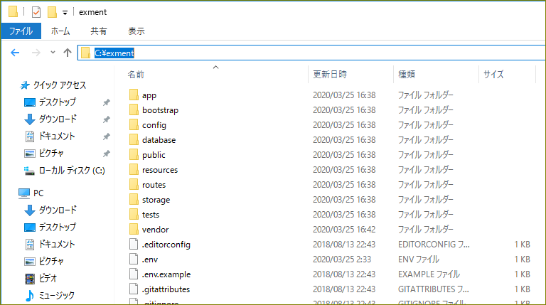
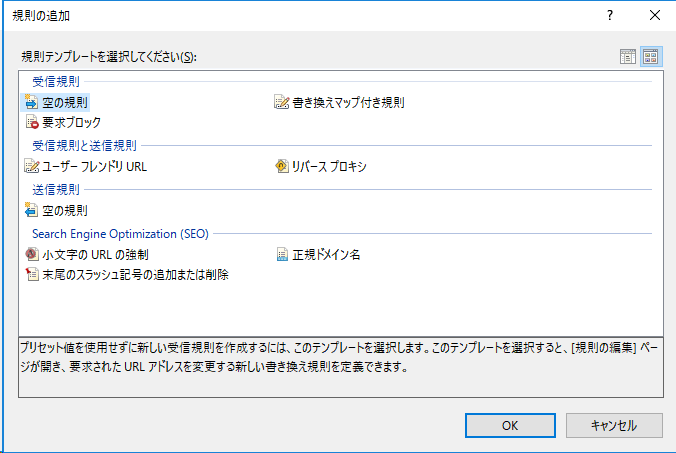
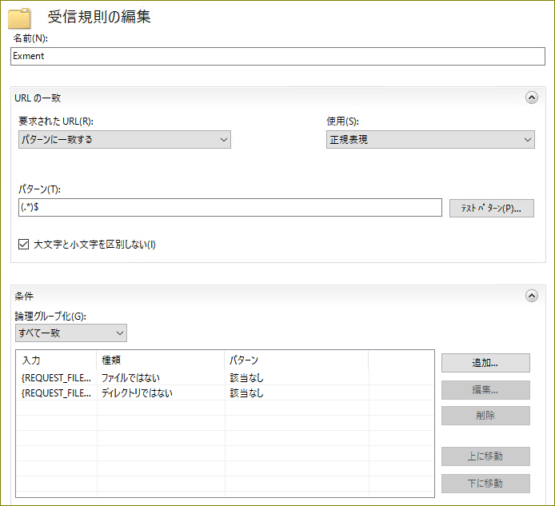
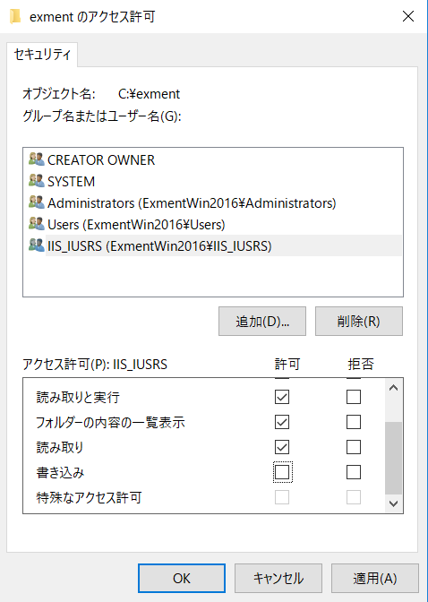

# 用 Windows Server 搭建环境
这是在 Windows Server 的 IIS（Windows 自带的 Web 服务器）上安装 Exment 的步骤。  
从安装 Web 服务器开始，从零搭建。

大致流程如下。

1. 安装 Web 服务器（IIS）
2. 准备 PHP
3. 安装 MySQL
4. 准备 IIS
5. 安装 Composer
6. 下载 Exment，做好运行的准备

## 环境
本页的步骤是在下面的环境中编写的。
- Windows Server 2019 Standard 日语版
- IIS 10
- PHP 8.2.X
- MySQL 8.4.X

为了验证而使用 Windows 10 时的不同之处，会在相应的地方说明。

## 注意事项

- 根据您使用的环境和版本，有时不能按本步骤设置。敬请谅解。

- 本页只写了让 Exment 在 Windows Server 上运行的步骤。  
Windows Server 的管理、创建数据库、命令等一般的 IT 知识没有写。敬请谅解。

- **本步骤需要管理员权限。请根据需要，用“以管理员身份运行”（或通过用户账户控制提升权限）来运行命令提示符、PowerShell 和可执行文件**。

## 用 Windows Server 安装的步骤

> 开始作业之前，建议先在 Windows Server 的资源管理器中设置为显示“文件扩展名”

### 安装 Web 服务器（IIS）
服务器上没有启用 IIS 功能时，首先安装 IIS 的功能。
1. 从服务器管理器的 \[管理\] 打开 \[添加角色和功能\] 向导  
   
2. \[安装类型\] 选择“基于角色或基于功能的安装”，\[服务器选择\] 选择要安装 IIS 的服务器（通常是正在操作的服务器），然后继续。
3. 在 \[服务器角色\] 中选择“Web 服务器(IIS)”，并添加显示出来的功能  
   
4. \[功能\]、\[Web 服务器角色(IIS)\] 页面保持原样，继续下一步
5. 在 \[角色服务\] 中展开 \[应用程序开发\]，勾选“CGI”，继续下一步  
     
   其他角色（认证、压缩等）请根据需要添加（Exment 本身的运行不需要添加）
6. 在 \[确认安装所选内容\] 中单击“安装”，等待安装完成
7. 安装完成后，启动浏览器 (Internet Explorer 等)，访问 http://localhost ，确认可以显示 IIS 的默认页面

> 安装到 Windows 10 时，请在 \[控制面板\] - \[程序\] -\[程序和功能\] - \[启用或关闭 Windows 功能] 中启用“Internet Information Services”，并在 \[应用程序开发功能\] 中启用“CGI”。

### 准备 PHP
下载并安装 PHP
1. 访问 https://windows.php.net/download/
2. 下载 \[PHP 8.2\] 的 \[VC15 x64 Non Thread Safe\] 的 ZIP 文件  
   > 在 Windows 10 环境中使用 32 位版 Windows 时，请下载 \[VC15 x86 Non Thread Safe \] 的 ZIP 文件
3. 右键单击下载的 ZIP 文件，显示属性，勾选 \[常规\] 选项卡的\[安全\] 中的“解除锁定”，单击 \[确定\]  
   
4. 把 ZIP 文件的内容解压到合适的文件夹（例 C:\PHP）
5. 设置用于运行 PHP 的环境变量  
   在 \[运行\] 中执行 sysdm.cpl，显示 \[系统属性\]
6. 在 \[高级\] 选项卡中打开 \[环境变量\]  
   
7. 在 \[系统变量\] 的列表中找到变量名为 "Path" 的项目并选择  
   
8. 单击 \[编辑\]，再单击 \[新建\]  
   
9.  输入解压 PHP 的文件夹的路径（例 C:\PHP），单击 3 次 \[确定\]  
    
10. 在命令提示符中执行  
    ```
    set path
    ```
    确认 PHP 的文件夹已经加入路径
11. 创建 PHP 的设置文件  
    复制解压 PHP 的文件夹中的“php.ini-development”文件，创建 php.ini 文件
12. 编辑并保存 php.ini 文件
    1.  把 "Paths and Directories" 部分的  
        ```
        ;extension_dir = "ext"
        ```
        改为
        ```
        extension_dir = "解压 PHP 的文件夹的路径\ext" (例 extension_dir = "C:\PHP\ext")
        ```
        (去掉行首的 ; ，取消注释)
    2. 把 "Dynamic Extension" 部分的
        ```
        ;extension=gd
        ;extension=openssl
        ;extension=pdo_mysql
        ```
        改为
        ```
        extension=gd
        extension=openssl
        extension=pdo_mysql
        ```
        (去掉行首的 ; ，取消注释)
    3.  把 "File Uploads" 部分的  
        ```
        ;upload_tmp_dir=
        ```
        改为
        ```
        upload_tmp_dir = "任意的工作用文件夹的路径" (例 upload_tmp_dir = "C:\Temp")
        ```
        (去掉行首的 ; ，取消注释)  
        ※指定的文件夹是上传文件时的临时保存位置。
    4. 在文件的末尾添加下面的内容。
        ```
        extension=php_fileinfo.dll
        ```

13. 在命令提示符中执行下面的命令，确认 PHP 可以运行  
    ```
    php -v
    ```
    

    出现找不到 Visual C++ 14.0 运行库的错误时，请从[最新支持的 Visual C++ 下载
](https://support.microsoft.com/help/2977003/the-latest-supported-visual-c-downloads)下载并安装适用于 Visual Studio 2015、2017 和 2019 的 Visual C++ 可再发行程序包 (vc_redist.x64.exe)  
    

### 安装 MySQL
安装 Exment 使用的 MySQL，并进行初始配置  
这里安装的是 MySQL 8.4.X

1. 访问 [MySQL Community Downloads](https://dev.mysql.com/downloads/mysql/) 页面
2. 单击 \[General Availability (GA) Releases\]  
   
3. 在 \[Select Version\] 中选择 "8.4.X"，在 \[Select Operating System\] 中选择 "Microsoft Windows"，在 \[Select OS Version\] 中选择 "Windows (x86, 64bit)"
     
   > 在 Windows 10 环境中使用 32 位版 Windows 时，请在 \[Select OS Version\] 中选择 "Windows (x86, 32bit)"
4. 单击 \[Other Downloads\] 的 "ZIP Archive" 一栏的 \[Download\] 按钮，下载 mysql-8.4.xx-winx64.zip 文件
   
5. 显示 \[Login Now or Sign Up for a free account.\] 时，单击最下面的 \[No thanks, just start my download.\]。下载开始
6. 右键单击下载的 ZIP 文件，显示属性，勾选 \[常规\] 选项卡的\[安全\] 中的“解除锁定”，单击 \[确定\]  
   
7. 把 ZIP 文件的内容解压到合适的文件夹（例 C:\MySQL）
8. 启动管理员命令提示符，移动到解压 ZIP 文件的文件夹中的 mysql-8.4.xx-winx64\bin 文件夹
   
9.  执行下面的命令，初始化 MySQL
    ```
    mysqld --initialize
    ```
    

    出现找不到 Visual C++ 12.0 运行库的错误时，请参考[最新支持的 Visual C++ 下载
](https://support.microsoft.com/help/2977003/the-latest-supported-visual-c-downloads)，从 \[Update for Visual C++ 2013 Redistributable Package\](https://support.microsoft.com/help/4032938/update-for-visual-c-2013-redistributable-package) 下载并安装与您的 Windows 语言相同的（本例中是日语版 (Japanese)）适用于 Visual Studio 2013 的 Microsoft Visual C++ 可再发行程序包 (vc_redist.x64.exe)  
    
10. 执行下面的命令，确认 MySQL 可以启动。显示 "mysqld: ready for connections." 就是正常启动了
    ```
    mysqld --console
    ```
    
11. 按 Ctrl + C，暂时停止 MySQL
12. 把 MySQL 安装为 Windows 的服务。安装为服务后，Windows 启动时会自动运行 MySQL
    ```
    mysqld --install
    ```
    
13. 为了马上启动 MySQL，执行下面的命令
    ```
    net start mysql
    ```
    
14. 确认使用 MySQL 所需的管理员 (root) 密码的初始值  
    解压 MySQL 的文件夹是 C:\MySQL 时，C:\MySQL\mysql-8.4.xx-winx64\data 中有扩展名为 .err 的文件，请用记事本等文本编辑器打开它  
    > 下图中的文件名是 ExmentServer2.err  
    
15. 文件开头附近有一行写着 "\[Note\] A temporary password is generated for root@localhost:" (下图的红色下划线)。写在它后面的字符串 (下图中是 1fyr*IXeC2%w) 就是初始密码。请记下这个密码
    
16. 回到管理员命令提示符，执行下面的命令，进行 MySQL 的初始设置
    ```
    mysql_secure_installation
    ```
    1. 会询问 "Enter password for user root:"，请输入记下的初始密码，按 Enter
    2. 会显示 "The existing password for the user account root has expired. Please set a new password."  
       会用 "New password:" 询问新密码，请输入新密码并按 Enter；会用 "Re-enter new password: 进行确认，请再次输入新密码并按 Enter
       > 请使用强度高、不容易被猜到的密码。建议满足下面的要求：8 个字符以上；使用大写字母/小写字母/数字/符号中的 3 种以上；不直接使用词典里有的单词
    3. 会确认是否使用 VALIDATE PASSWORD PLUGIN  
       已经设置了强度高、不容易被猜到的密码时，输入 "y" 以外的键，按 Enter
    4. 会询问 "Change the password for root ?"，请输入 "y" 以外的键，按 Enter
    5. 其余的确认全部输入 "y"，按 Enter
    6. 显示 "All done!" 时，初始设置完成
17. 执行下面的命令，登录 MySQL
    ```
    mysql -u root -p
    ```
18. 会用 "Enter password:" 询问密码，请输入刚才设置的密码，按 Enter
    
19. 显示 "MySQL>" 提示符后，依次执行下面的命令
    > 这里把 Exment 使用的 MySQL 用户设为 "exment_user"，密码设为 "M!p3~S$W7fLm"  
      实际的用户名和密码请自己决定 (密码请使用强度高、不容易被猜到的)  
      这个用户名和密码会在 Exment 的初始设置中使用
    ```
    CREATE DATABASE exment_database;
    CREATE USER 'exment_user' IDENTIFIED BY 'M!p3~S$W7fLm';
    GRANT ALL ON exment_database.* TO 'exment_user';
    FLUSH PRIVILEGES;
    ```
20. 输入下面的内容并按 Enter，从 MySQL 退出登录
    ```
    \q
    ```

### 准备 IIS
进行运行 Exment 所需的 IIS 准备
1. 安装 URL Rewrite 模块。  
   访问 https://www.iis.net/downloads/microsoft/url-rewrite ，单击 \[Install this extention\]
2. 会下载 urlrewrite2.exe，请运行它，按页面的提示进行安装
   1. 单击 \[安装\]  
      
   2.  单击 \[我接受\]  
      
   3.  安装开始  
      
   4.  单击 \[完成\]  
      
   5.  单击 \[退出\]  
      
3. 从服务器管理器的 \[工具\] 打开 \[Internet Information Services (IIS)管理器\]  
   
4. 在“连接”窗格中依次展开 \[(服务器名)\] - \[网站\]，选择 \[Default Web Site\]
5. 在功能视图中双击 \[处理程序映射\]
6. 在“操作”窗格中单击 \[添加模块映射\]
7. 在 \[添加模块映射\] 中按下面的内容输入，单击 \[确定\]  
   - 请求路径：*.php  
   - 模块：FastCgiModule  
   - 可执行文件：(解压 PHP 的文件夹的路径)\php-cgi.exe (例 C:\PHP\php-cgi.exe)  
   - 名称：任意 (例：PHP)  
   
8. 显示确认消息时，单击 \[是\]

### 安装 Composer
安装 Exment 所需的 PHP 库管理工具 (Composer)
1. 访问 [Composer 的下载页面 (https://getcomposer.org/download/)](https://getcomposer.org/download/)，从写着 "Download and run Composer-Setup.exe - it will install the latest composer version whenever it is executed" 的部分下载 Composer-Setup.exe  
   
2.  运行下载的 Composer-Setup.exe
3.  选择 "Install for all users"  
   
4.  不勾选 "Developer Mode"，继续下一步  
   
5. 确认 "Setting Check" 中显示的 PHP 路径正确，继续下一步  
   
6. 显示 "PHP Configration Error" 时，勾选 \[Create a php,ini file\] 或 \[Update this php.ini\]，继续下一步  
   
7. 在 "Proxy Settings" 中指定连接互联网时使用的代理。不使用代理时，直接继续下一步  
   
8. 会显示确认页面，请单击 \[Install\]  
   
9. 显示 "Information" 时，直接继续下一步  
    
10. 单击 \[Finish\] 完成  
    

### 下载 Exment 和运行准备

1. 从 Exment 安装步骤的页面 ([https://exment.net/docs/#/zh/quickstart](https://exment.net/docs/#/zh/quickstart)) 下载 Exment zip 文件 (exment.zip)
2. 右键单击下载的 ZIP 文件，显示属性，勾选 \[常规\] 选项卡的\[安全\] 中的“解除锁定”，单击 \[确定\]  
   
3. 把 ZIP 文件中 exment 文件夹的内容解压到合适的文件夹（例 C:\exment）  
     
   **绝对不要解压到“inetpub\wwwroot”文件夹的正下方。写有数据库设置值、邮件密码等的设置文件会从外部看到，造成严重的信息泄露**
4. 创建虚拟目录  
   打开 Internet Information Services (IIS)管理器，在 \[连接\] 窗格中依次展开 \[(服务器名)\] - \[网站\]，右键单击 \[Default Web Site\]，选择 \[添加虚拟目录\]  
   
5. 按下面的内容配置虚拟目录  
   例子中把别名 (访问 Exment 的 URL 的路径) 设为 "exment"  
   物理路径设置为解压 Exment 的 ZIP 文件的文件夹的路径 (例 C:\exment)
   - 别名： exment  
   - 物理路径：C:\Exment\public  
   
6. 把 "index.php" 添加到默认文件中  
   选择 \[Default Web Site\]，双击打开 \[默认文档\]  
   
7. 在 \[操作\] 窗格中单击 \[添加\]
8. 添加 index.php  
   
9.  在 Web.config 中添加 URL 重写 (Rewrite) 的规则  
   在 \[连接\] 窗格中选择在“4.”中添加的虚拟目录 (例子中是 exment)，双击打开 \[URL 重写\]  
   
10. 在 \[操作\] 窗格中单击 \[添加规则\]  
   
11. 在 \[添加规则\] 中选择 \[入站规则\] 的 \[空白规则\]，单击 \[确定\]  
   
12. 在 \[编辑入站规则\] 中按下面的内容创建规则  
    
    - 名称：任意的名称
    - \[匹配 URL\]
      - 请求的 URL：与模式匹配
      - 使用：正则表达式
      - 模式：(.*)$
    - 条件
      - 逻辑分组：全部匹配
      - 单击 \[添加\]，添加下面 2 个条件
        - 输入：{REQUEST_FILENAME}  
        类型：不是文件
        - 输入：{REQUEST_FILENAME}  
        类型：不是目录
    - 操作
      - 操作类型：重写
      - 操作属性
      - 重写 URL：index.php/{R:1}
      - 附加查询字符串：ON
      - 记录重写的 URL：OFF
    - 停止处理后续规则：ON
13. 在 \[操作\] 窗格中单击 \[应用\]
14. 显示“已成功保存更改”后，单击 \[返回规则\]

<!-- 后面的步骤需要确认 -->

15. 设置文件夹的访问权限，让 Laravel 可以写入
    给解压 Exment 的 ZIP 并配置了虚拟目录的文件夹，赋予 IIS 的运行用户 (IIS_IUSRS) 写入权限  
    > 例子中是 C:\exment
    
    

16. 给 IIS 运行用户 (IIS_IUSRS) 添加对 exment 文件夹的写入访问权限
    1. 右键单击 exment 文件夹，选择 \[属性\]
    2. 打开 \[安全\] 选项卡，单击 \[编辑\]
    3. 在 \[exment 的权限\] 中单击 \[添加\] 按钮，显示 \[选择用户或组\]
    4. 在 \[输入要选择的对象名称\] 栏中输入 IIS_IUSRS，单击 \[检查名称\]
    5. 显示变为 (计算机名)\IIS_IUSRS 后，单击 \[确定\]  
       
    6. 回到 \[exment 的权限\]，在 \[组或用户名\] 栏中单击 IIS_IUSRS，勾选 \[权限\] 栏中 \[写入\] 的 \[允许\]  
    
    1. 单击 2 次 \[确定\]，关闭属性

<!--
实际上，不只是 storage 文件夹，exment 文件夹中的其他文件和文件夹似乎也需要 IIS_IUSRS 的写入权限。
因为不清楚实际上哪些资源最少需要多少权限，所以在测试环境中，给整个 C:\exment 文件夹加上 IIS_IUSRS 的写入权限，确认了 Exment 的 Web 应用可以运行。
弄清最低限度的访问权限后，这一部分会相应修订。

14. 设置文件夹的访问权限，让 Laravel 可以写入
    > 给解压 Exment 的 ZIP 并配置了虚拟目录的文件夹 (例 C:\exment)，赋予 IIS 的运行用户 (IIS_IUSRS) 写入权限
15. 配置访问权限
    1. 右键单击 exment 文件夹，选择 \[属性\]
    2. 打开 \[安全\] 选项卡，单击 \[编辑\]
    3. 在 \[exment 的权限\] 中单击 \[添加\] 按钮，显示 \[选择用户或组\]
    4. 在 \[输入要选择的对象名称\] 栏中输入 IIS_IUSRS，单击 \[检查名称\]
    5. 显示变为 (计算机名)\IIS_IUSRS 后，单击 \[确定\]  
    6. 回到 \[exment 的权限\]，在 \[组或用户名\] 栏中单击 IIS_IUSRS，勾选 \[权限\] 栏中 \[写入\] 的 \[允许\]  
    7. 单击 2 次 \[确定\]，关闭属性
-->

17.  启动浏览器 (Chrome 或 Microsoft Edge)，访问 http://localhost/(虚拟目录的别名) (例 http://localhost/exment 。`ADMIN_ROUTE_PREFIX` 中有“admin”的站点是 http://localhost/exment/admin)  
    会显示 Exment 的安装页面。
> Exment 不支持在 Internet Explorer 中显示。访问 Exment 时请使用 Chrome 或 Microsoft Edge

   1. 确认 Language 和 Timezone（例子中 Language 是 \[日本語\]（日语），Timezone 是 \[(GMT+09:00)日本\]），单击 \[提交\]
   

   2. 输入已创建的数据库的相关设置，单击\[提交\]
   > 例子中，<br />数据库\[exment_database\] <br />用户名\[exment_user\] <br />密码\[M!p3~S$W7fLm\] 

   

   3. 单击 \[执行安装\]  
   
   安装正常完成时，会显示 Exment 初始设置页面。  
   初始设置请看[初始设置](/zh/first_setting)。

18.  安装完成后，解除给 exment 文件夹设置的访问权限

   1. 右键单击 exment 文件夹，选择 \[属性\]
   > 例子中是 C:\exment  
   2. 打开 \[安全\] 选项卡，单击 \[编辑\]
   3. 在 \[组或用户名\] 栏中选择 \[IIS_IUSRS\]
   4. 在 \[权限\] 中单击\[检查名称\]，取消勾选 \[权限\] 栏中 \[写入\] 的 \[允许\]
   
   5. 单击 2 次 \[确定\]，关闭属性   

19.  给几个文件夹添加写入访问权限。要添加的文件夹和文件如下。

| 种类 | 文件、文件夹名 | 需要它的功能 |
| ---- | ---- | ---- |
| 文件夹 | storage | 全部功能 |
| 文件夹 | bootstrap/cache | 全部功能 |
| 文件 | .env | 简易安装、还原 |
| 文件夹 | config | 简易安装、还原 |
| 文件夹 | app | 简易安装 |
| 文件夹 | public | 简易安装 |
| 文件夹 | resources | 简易安装 |

下面的例子是给 storage 文件夹添加权限的步骤。

   1. 右键单击 storage 文件夹，选择 \[属性\]
   > 例子中是 C:\exment\storage
   2. 打开 \[安全\] 选项卡，单击 \[编辑\]
   3. 在 \[storage 的权限\] 中单击 \[添加\] 按钮，显示 \[选择用户或组\]
   4. 在 \[输入要选择的对象名称\] 栏中输入 IIS_IUSRS，单击 \[检查名称\]
   5. 显示变为 (计算机名)\IIS_IUSRS 后，单击 \[确定\]  
       
   6. 回到 \[storage 的权限\]，在 \[组或用户名\] 栏中单击 IIS_IUSRS，勾选 \[权限\] 栏中 \[写入\] 的 \[允许\]  
    
   7. 单击 2 次 \[确定\]，关闭属性

20.  为了能临时保存上传的文件，给 php.ini 的 upload_tmp_dir 指定的文件夹添加写入访问权限
   1. 右键单击该文件夹，选择 \[属性\]
   > 例子中是 C:\Temp
   2. 打开 \[安全\] 选项卡，单击 \[编辑\]
   3. 在 \[Temp 的权限\] 中单击 \[添加\] 按钮，显示 \[选择用户或组\]
   4. 在 \[输入要选择的对象名称\] 栏中输入 IIS_IUSRS，单击 \[检查名称\]
   5. 显示变为 (计算机名)\IIS_IUSRS 后，单击 \[确定\]  
       
   6. 回到 \[Temp 的权限\]，在 \[组或用户名\] 栏中单击 IIS_IUSRS，勾选 \[权限\] 栏中 \[写入\] 的 \[允许\]  
    
   7. 单击 2 次 \[确定\]，关闭属性

   > 安装后的初始设置请看[初始设置](/zh/first_setting)

   
## PHP 版本升级时的处理
更改 PHP 的版本时，请按下面的步骤升级。  
※升级作业期间，无法访问 Exment。  
※下面的例子是从 PHP7.4 更新到 PHP8.2 的步骤。  
※根据环境、导入时期、版本和安装方法，升级方法可能不同。  

- 首先，停止 IIS。

- 备份现在使用的 PHP 的运行文件夹。更改文件夹的名称、复制到别的位置等，用喜欢的方法都可以。

- 下载新的 PHP。  

   1. 访问 https://windows.php.net/download/
   2. 下载 \[PHP 8.2\] 的 \[VC15 x64 Non Thread Safe\] 的 ZIP 文件  
      > 在 Windows 10 环境中使用 32 位版 Windows 时，请下载 \[VC15 x86 Non Thread Safe \] 的 ZIP 文件
   3. 把 ZIP 文件的内容解压到与以前的 PHP 相同的路径。  
   ※ 前提是环境变量中已经设置了 PATH。  

- 从备份的旧版本 PHP 文件夹，把 php.ini 文件复制到新版本的 PHP 文件夹。

- 需要时，修改 php.ini 文件。
   1. "Dynamic Extension" 部分的 GD 库被注释掉时，请启用它。
        ```
        ;extension=gd
        ```
        改为
        ```
        extension=gd
        ```
        (去掉行首的 ; ，取消注释)

   ※ 根据原来的 PHP 版本，有时写的是 extension=gd2。请改为 extension=gd。  

- 启动 IIS。  

- 用命令提示符等确认 PHP 的版本是 8.2.X。

~~~
php -v
~~~
