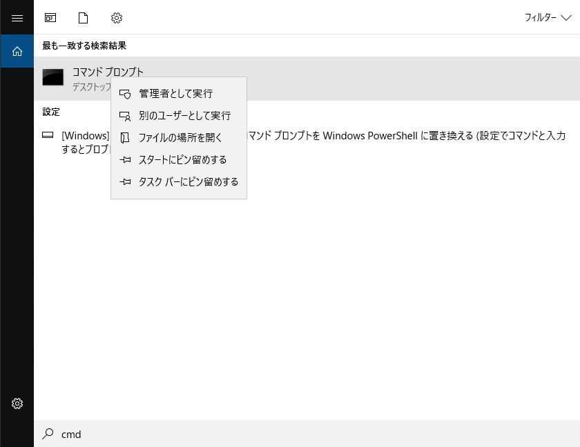
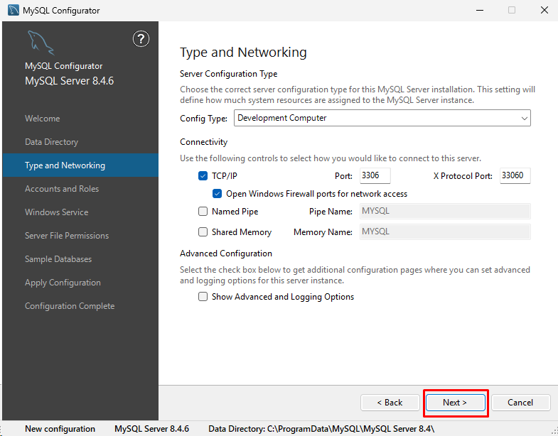
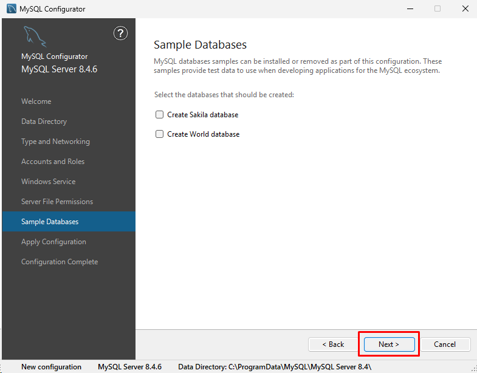
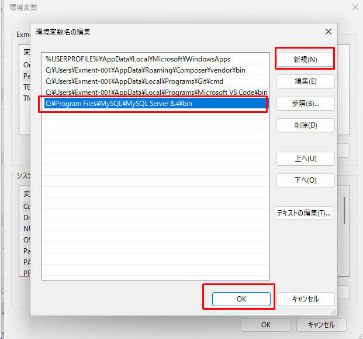

# MySQL 安装步骤
这是为了在 Exment 中使用 MySQL 而安装和设置 MySQL 的步骤。  
※步骤可能因操作系统、版本、安装时期等而不同。  

请根据您使用的服务器，看下面的其中一项。

| 服务器 | 要看的地方 |
| ---- | ---- |
| Windows | 下面的“MySQL 设置(Windows)” |
| Linux | 下面的“MySQL 设置(Linux)”（步骤按是否已有 MySQL5.7 分开） |

## MySQL 设置(Windows)

- 推荐：升级之前，请先做[数据库备份](https://dev.mysql.com/doc/refman/8.4/en/mysqldump-sql-format.html)。

- (MySQL 正在运行时) 以管理员身份打开命令提示符，停止 MySQL。  
在开始按钮右边的“搜索栏”中输入“命令提示符”。  
右键单击“最佳匹配”上面一行显示的“命令提示符”。  
从出现的菜单中选择“以管理员身份运行”。
   

~~~
net stop mysql57
net stop mysql80
~~~

- 打开下面的网站，下载 MySQL。  
※MySQL Installer 只为 MySQL 8.0 系列提供。MySQL 8.1 以后(包括 8.4)请用 MSI 或 ZIP 下载 MySQL Server。  
[MySQL Community Server Downloads](https://downloads.mysql.com/archives/community/)  

- 在 Select Version 中选择“8.4.X”，操作系统选择 Windows (x86, 64-bit)。  

- 下载下面的其中一个。
	- MSI Installer

- 运行下载的 MSI 文件，按页面的向导进行安装。
	- 在 Welcome 页面单击“Next”。

		
	- 同意 License Agreement，单击“Next”。

		
	- Setup Type 选择“Complete”。

		
	- 单击“Install”。

		
	- 安装完成后单击“Finish”。

		

- MSI 安装完成后，MySQL Server Configurator 会自动打开。
	- 在“Welcome to the MySQL Server Configurator”中单击“Next”。

		

- Data Directory 保持最初的值，单击“Next”。

	

- Type and Networking:
	- Config Type: Development Computer
	- Connectivity: TCP/IP (默认端口是 3306)
	- 单击“Next”。

		

- Accounts and Roles: 决定 root 用户的密码，单击“Next”。

	

- Windows Service: 决定服务名(例: MySQL84)，单击“Next”。

	

- Server File Permissions 保持最初的值，单击“Next”。

	

- Sample Databases 跳过，单击“Next”。

	

- 在 Apply Configuration 中单击“Execute”，完成后单击“Next”“Finish”。

	

- 修改 my.ini。(C:\ProgramData\MySQL\MySQL Server 8.4\my.ini)

~~~
# 把下面的内容添加到末尾

local-infile=1
~~~

- 重新启动 MySQL。(服务名因环境而不同)

~~~
net stop MySQL84
net start MySQL84
~~~

### 添加环境变量 

- 在资源管理器中右键单击“此电脑”，单击“属性”。

- 单击“高级系统设置”。

- 单击“环境变量”。  

- 单击“用户变量”中的“Path”，再单击“编辑”。  

- 有“C:\Program Files\MySQL\MySQL Server 5.7\bin”这一行时，删除它。

- 单击“新建”，添加下面一行。  
 “C:\Program Files\MySQL\MySQL Server 8.4\bin”   

- 输入后，把打开的对话框全部用“确定”关闭。  

## MySQL 设置(Linux)
这是在 Linux 上安装 MySQL 的步骤。  
※需要时，请在命令的开头加上 sudo。  
※安装到 CentOS8、RHEL8 等时，请使用 dnf 命令，而不是 yum。

步骤按是否已经装有 MySQL5.7 而不同。

| 现在的状态 | 要看的地方 |
| ---- | ---- |
| 装有 MySQL5.7 | “已有 MySQL5.7 时（从 MySQL5.7 更新到 MySQL8.4）” |
| 没有装 MySQL5.7 | “没有 MySQL5.7 时（新安装 MySQL8.4）” |

### 已有 MySQL5.7 时（从 MySQL5.7 更新到 MySQL8.4）
- 删除 MySQL5.7 的软件包。
~~~
sudo killall mysqld; sudo killall mysqld_safe;
sudo rpm -e --nodeps mysql57-community-release
sudo yum remove mysql mysql-server mysql-client mysql-common mysql-devel mysql-community-client-plugins -y
~~~

- 安装并启动 MySQL8.4。

※rpm 因操作系统的版本而不同。

例如，AlmaLinux9.5 时，
 

~~~
[root@localhost ~]# uname -a
Linux localhost.localdomain 5.14.0-503.11.1.el9_5.x86_64 #1 SMP PREEMPT_DYNAMIC Tue Nov 12 09:26:13 EST 2024 x86_64 x86_64 x86_64 GNU/Linux
~~~

如果是这样，
 

~~~
sudo rpm -ivh https://dev.mysql.com/get/mysql84-community-release-el9-2.noarch.rpm
~~~

就用上面的命令。
 

~~~
# CENTOS STREAM 时

rpm -ivh https://dev.mysql.com/get/mysql84-community-release-el9-2.noarch.rpm
rpm --import https://repo.mysql.com/RPM-GPG-KEY-mysql-2023
dnf clean packages
dnf update -y

# 安装并启动 mysql-community-server
dnf install mysql-community-server -y
systemctl start mysqld
systemctl enable mysqld
~~~

~~~
# CENTOS8 时
sudo rpm -ivh https://dev.mysql.com/get/mysql84-community-release-el8-2.noarch.rpm
sudo rpm --import https://repo.mysql.com/RPM-GPG-KEY-mysql-2023

# 执行这个命令，确认 mysql-community-server 是否存在
sudo yum search mysql-community-server

# 上面的命令显示“Error: Unable to find a match: mysql-community-server”这样表示不存在的消息时，请先执行下面的命令
sudo yum -y module disable mysql

# 安装并启动 mysql-community-server
sudo yum -y install mysql-community-server
sudo systemctl enable mysqld.service
~~~

- 修改 my.cnf。

~~~
vi /etc/my.cnf

# 把下面的内容添加到末尾

local-infile=1
~~~

- 启动 MySQL。

~~~
sudo systemctl start mysqld
~~~

### 没有 MySQL5.7 时（新安装 MySQL8.4）
- 安装并启动 MySQL8.4。

※rpm 因操作系统的版本而不同。

例如，AlmaLinux9.5 时，
 

~~~
[root@localhost ~]# uname -a
Linux localhost.localdomain 5.14.0-503.11.1.el9_5.x86_64 #1 SMP PREEMPT_DYNAMIC Tue Nov 12 09:26:13 EST 2024 x86_64 x86_64 x86_64 GNU/Linux
~~~

如果是这样，
 

~~~
sudo rpm -ivh https://dev.mysql.com/get/mysql84-community-release-el9-2.noarch.rpm
~~~

就用上面的命令。
 

~~~
# CENTOSSTREAM 时

rpm -ivh https://dev.mysql.com/get/mysql84-community-release-el9-2.noarch.rpm
rpm --import https://repo.mysql.com/RPM-GPG-KEY-mysql-2023
dnf clean packages
dnf update -y

# 安装并启动 mysql-community-server
dnf install mysql-community-server -y
systemctl start mysqld
systemctl enable mysqld
~~~

~~~
# CENTOS 8 时
sudo rpm -ivh https://dev.mysql.com/get/mysql84-community-release-el8-2.noarch.rpm
sudo rpm --import https://repo.mysql.com/RPM-GPG-KEY-mysql-2023

# 执行这个命令，确认 mysql-community-server 是否存在
sudo yum search mysql-community-server

# 上面的命令显示“Error: Unable to find a match: mysql-community-server”这样表示不存在的消息时，请先执行下面的命令
sudo yum -y module disable mysql

# 安装并启动 mysql-community-server
sudo yum -y install mysql-community-server
sudo systemctl enable mysqld.service
sudo systemctl start mysqld
~~~

- 确认 MySQL 的初始密码。

~~~
cat /var/log/mysqld.log | grep -i 'temporary password'

#会输出下面这样的日志，请确认密码
2025-03-25T04:35:28.567119Z 6 [Note] [MY-010454] [Server] A temporary password is generated for root@localhost: et5k>Y.b0eJ.
~~~

- (可选)关闭密码策略。

~~~
vi /etc/my.cnf

#添加下面的 validate_password
[mysqld]
validate_password=OFF
~~~

- 重新启动 MySQL。

~~~
sudo systemctl restart mysqld
~~~

- 进行 MySQL 的初始设置。执行下面的命令。

~~~
mysql_secure_installation

Enter password for user root: (输入刚才复制的密码)

New password: (输入新密码)
Re-enter new password: (输入新密码)

Change the password for root? : n

Remove anonymous users? : y #删除匿名用户账号
Disallow root login remotely? : y # 删除可以从本地主机以外访问的 root 账号
Remove test database and access to it? : y # 删除 test 数据库
Reload privilege tables now? : y #重新读取 privilege 表
~~~

- 登录 MySQL。

~~~
mysql -u root -p(密码)
~~~
- 修改 my.cnf。

~~~
vi /etc/my.cnf

# 把下面的内容添加到末尾

local-infile=1
~~~

- 重新启动 MySQL。

~~~
sudo systemctl restart mysqld
~~~

- 创建 Exment 用的数据库和用户。  
※这里把数据库名设为“exment_database”，用户设为“exment_user”。  
另外，把连接来源的 IP 地址设为“192.168.137.%”。

~~~
CREATE DATABASE exment_database;
CREATE USER 'exment_user'@'192.168.137.%' IDENTIFIED BY '(exment_user 用的密码)';
GRANT ALL ON exment_database.* TO 'exment_user'@'192.168.137.%';
FLUSH PRIVILEGES;
~~~

- 在防火墙的设置中，只允许从连接来源的 IP 地址访问 MySQL。  
※这里把连接来源的 IP 地址设为“192.168.137.%”。

~~~
firewall-cmd --permanent --new-zone=from_webserver
firewall-cmd --reload
firewall-cmd --permanent --zone=from_webserver --add-source="192.168.137.0/24"
firewall-cmd --permanent --zone=from_webserver --add-port=3306/tcp
firewall-cmd --zone=from_webserver --add-service=mysql
firewall-cmd --reload
~~~
