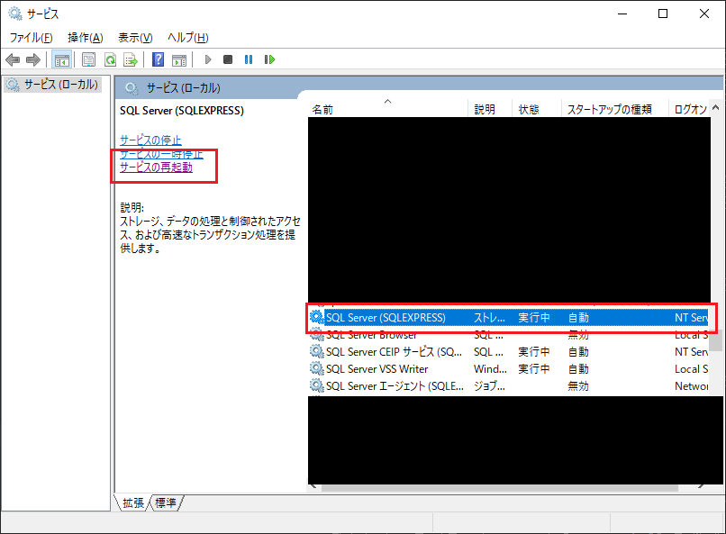
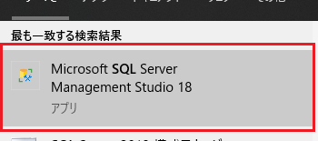
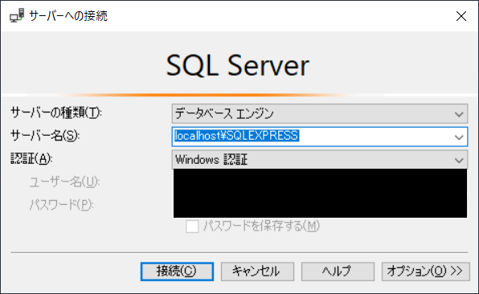
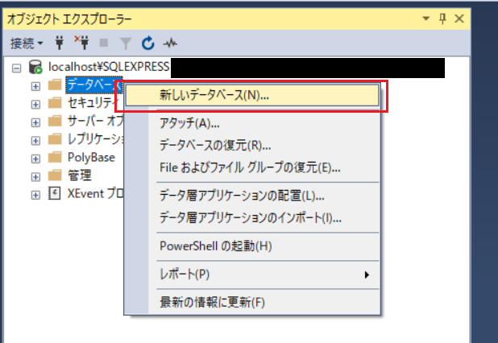
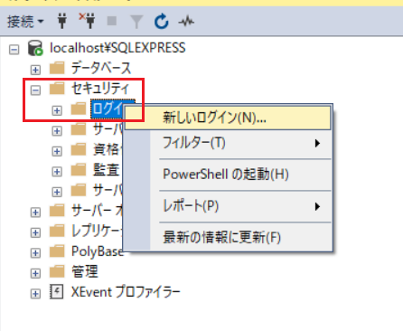

# SQL Server 安装步骤
这是把 SQL Server 用作 Exment 的数据库的步骤。

- <span class="red bold">※目前不支持备份、还原功能。</span>
- 根据操作系统、版本、安装的时期等，步骤可能不同。

## 步骤的流程
1. **准备 SQL Server**（安装、创建数据库和用户）… “SQL Server 设置”
2. **确认能否连接** … “连接确认”
3. **从 Exment 连接**（安装 PHP 的驱动程序，然后安装 Exment）… “Exment 设置”

## SQL Server 设置

### 安装 SQL Server
1. 从下面的网站下载 SQL Server。  
※版本类别（Edition）请根据用途、业务规模等选择。  
[下载 SQL Server](https://www.microsoft.com/en-us/sql-server/sql-server-downloads)  

2. 运行下载的文件，继续安装。  
  

3. 安装完成。

### 安装 SQL Server Management Studio（GUI 工具）
SQL Server Management Studio 是在图形界面上操作 SQL Server 的工具。

- 打开下面的网站。  
在“可用语言”中点击想使用的语言，下载并安装工具。  
https://docs.microsoft.com/en-us/sql/ssms/download-sql-server-management-studio-ssms?view=sql-server-ver15#available-languages


### 追加设置（Windows）
※目前已确认，在 Windows 上安装 SQL Server 时，需要下面的设置。

1. 从 Windows 的开始菜单打开“SQL Server 配置管理器”。  
  

2. 在左侧菜单中，点击“SQL Server 网络配置”→“(版本类别名)的协议”。然后右键点击“TCP/IP”，点击“启用”。  
  
  
  

3. 点击开始菜单的按钮，输入“服务”，运行显示出来的“服务”应用。  
  

4. 在服务列表中选择“SQL Server (版本类别名)”，点击“重新启动服务”。  
  


### 创建数据库、添加用户
1. 运行“SQL Server Management Studio”。  
  

2. 登录。  
  

#### 创建数据库
1. 在左侧菜单中，右键点击“数据库”文件夹，点击“新建数据库”。  
  

2. 输入任意的数据库名，点击“确定”。  
  

#### 添加用户
1. 在左侧菜单中，右键点击“安全性”→“登录名”，选择“新建登录名”。  
  

2. 输入登录名和密码，选择“SQL Server 身份验证”。建议取消勾选“强制实施密码策略”。（请遵守所属公司、组织等的策略。）  
    

3. 选择左上方的“用户映射”。  
在“映射到此登录名的用户”的数据库列表中，选择刚才创建的数据库。  
在“数据库角色成员身份”中选择下面的项目。
   - db_backupoperator
   - db_ddladmin
   - db_datawriter
   - db_datareader
   - public
   - dbcreator（※用于手动备份、还原数据。要手动备份、还原数据时请勾选。）

       

4. 全部完成后，点击“确定”。

#### 服务器登录设置
1. 在左侧菜单中，右键点击左上方的服务器，选择“属性”。  
 

2. 在“安全性”菜单中，“服务器身份验证”选择“SQL Server 和 Windows 身份验证模式”，点击“确定”。

3. 点击开始菜单的按钮，输入“服务”，运行显示出来的“服务”应用。  
  

4. 在“服务”应用中，再次选择“SQL Server (版本类别名)”，点击“重新启动服务”。  
  

#### 确认端口
- 在“SQL Server 配置管理器”中，右键点击“TCP/IP”，点击“属性”。  
然后打开“IP 地址”选项卡，确认最下面的“TCP 动态端口”的值。（之后在 Exment 的数据库设置中使用。）  
  
  


## 连接确认
确认能否连接到 SQL Server。

1. 运行“SQL Server Management Studio”。  
  

2. 用下面的内容登录。
    - 服务器名称：默认的服务器名称
    - 身份验证：SQL Server 身份验证
    - 用户名：所创建用户的用户名
    - 密码：所创建用户的密码

      

3. 确认可以正常登录。  
设置没有正确完成时，会出现错误。


## Exment 设置
搭建环境并进行设置，以便从 Exment 连接到 SQL Server。

### 安装驱动程序
安装驱动程序（从 PHP 连接 SQL Server 用的部件）。根据安装 Exment 的服务器的操作系统，步骤不同。

#### Windows
1. 执行下面的命令。  
结果中会显示文件路径，请记下来。

```
php -i | find "extension_dir"
# 结果示例
extension_dir => C:\xampp\php\ext => C:\xampp\php\ext
```


2. 从下面的网站下载从 PHP 连接 Microsoft SQL Server 用的驱动程序。  
https://docs.microsoft.com/en-us/sql/connect/php/download-drivers-php-sql-server?view=sql-server-ver15

3. 运行下载的 EXE 文件。会出现下面这样的对话框。  


4. 粘贴步骤 1 中记下的文件路径，点击“OK”。  


5. 连接 SQL Server 用的 dll 文件会放到 PHP 的扩展库文件夹中。  


6. 打开 php.ini 文件，在文件的最后写入下面的内容。  
※文件名请按照注释的内容更改。

```
extension=php_pdo_sqlsrv_82_ts_x64.dll
# “82”部分：所用 PHP 的版本。使用 PHP8.3 时为 83
# “ts”部分：执行命令“php -i | find "Thread Safety"”时，显示“enabled”就写“ts”，显示“disabled”就写“nts”
# “x64”部分：执行命令“php -v”时，第 1 行包含“x64”就写“x64”，否则写“x86”
```

7. 重新启动 PHP。这样，Windows 上的设置就完成了。


#### Linux

请按照[这里](https://docs.microsoft.com/en-us/sql/connect/php/installation-tutorial-linux-mac?view=sql-server-ver15)的步骤，在各自的操作系统上安装 ODBC 驱动程序和 PHP 驱动程序。


### Exment 设置
- 之后请按照[安装步骤](/zh/quickstart)继续安装。

- 在数据库设置的页面中，请输入下面的值。
    - 数据库类型 : SQL Server
    - 主机名 : 服务器名称
    - 端口 : 在 TCP/IP 页面中确认的端口号
    - 数据库 : 所创建的数据库名
    - 用户名 : 所创建的用户名
    - 密码 : 所创建用户的密码
