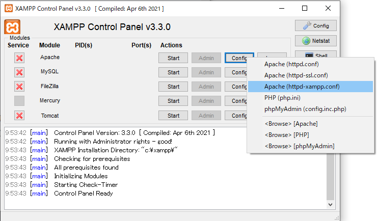

# 用 XAMPP 搭建环境
这是用 XAMPP 在 Windows 电脑上搭建 Exment 运行环境的步骤。  
XAMPP 是可以一次装好 PHP、Apache、MySQL 的软件。从头搭建开发用的环境时，推荐使用。

## 注意事项
- **用 XAMPP 安装的环境请只用于开发、验证。建议不要用作正式环境。** 

## 安装步骤
按下面的顺序进行。

1. 安装 XAMPP，启动 Apache 和 MySQL
2. 让 mysql 命令可以使用（环境变量）
3. 创建数据库
4. 创建 Exment 用的 URL（子域名设置）
5. 安装 Exment

### XAMPP 安装步骤
1. 从下面的网站下载 XAMPP。  
[下载 XAMPP](https://www.apachefriends.org/jp/download.html)

2. 请选择“PHP8.2”以上的版本下载。  

3. 继续安装 XAMPP。  

4. 中途会出现选择 XAMPP 组件的页面。选择 Apache、MySQL。  
“phpMyAdmin”也要勾选。  
※其他的请随意勾选  
然后点击“Next”。  

5. 之后按页面的提示进行，完成安装。

6. 安装完成后，启动 XAMPP 控制面板。  

7. 点击最上面“Apache”和“MySQL”行的“Start”。  

8. 出现防火墙的设置时，点击“允许”。  

9. 这样 Apache 就运行了。  

#### 【注意事项】
- 重新启动操作系统后，需要再次启动 XAMPP 控制面板，重新启动 Apache。

### 添加环境变量
要从命令提示符执行 mysql，需要在“环境变量”中添加路径。

1. 在资源管理器中右键点击“此电脑”，点击“属性”。  

2. 点击“高级系统设置”。  

3. 点击“环境变量”。  

4. 点击“用户变量”中的“Path”，再点击“编辑”。  

5. 点击“新建”，添加下面这一行。

~~~
C:\xampp\mysql\bin  
~~~

6. 输入后，用“确定”关闭所有打开的对话框。

##### 执行 XAMPP 中的 Mysql 时
- 执行 XAMPP 中的 Mysql 时，请在[安装 Exment](/zh/install_xampp?id=安装-Exment)的步骤中，把可执行文件所在文件夹的路径添加到 Exment 根目录的 .env 中。

~~~
#例  
EXMENT_MYSQL_BIN_DIR="C:/xampp/mysql/bin"
~~~

#### 创建数据库
1. 启动 XAMPP 控制面板，点击“MySQL”行的“Admin”。  

2. 点击左侧菜单的“新建”。  

3. 在“新建数据库”一行中，用英文和数字输入任意的数据库名，点击“创建”。  

这样，数据库就建好了。

### 子域名设置
在通常的设置下，把 Exment 的项目文件放到"C:\xampp\htdocs"文件夹中，就可以使用 Exment。  
但是，这样会有很大的问题。例如打开 [http://localhost/exment/.env](http://localhost/exment/.env) 这个 URL，包含数据库信息的设置文件就会显示在页面上。  
所以，强烈建议进行避免这个问题的设置。请按下面的步骤设置。

1. 在文件夹“C:\xampp”中创建文件夹“local”。  

2. 打开"C:\xampp\apache\conf\extra\httpd-vhosts.conf"。

3. 在文件的最后添加下面的内容。**※DocumentRoot 的末尾需要“/public”**  

~~~
<VirtualHost *:80>
    DocumentRoot "C:/xampp/htdocs"
    ServerName localhost
</VirtualHost>

<VirtualHost *:80>
  DocumentRoot "C:/xampp/local/exment/public"
  ServerName exment.localapp
</VirtualHost>

<Directory "C:\xampp\local\exment\public">
  Allow from all
  AllowOverride All
  Require all granted
</Directory>
~~~

4. 打开"C:\WINDOWS\system32\drivers\etc\hosts"，按下面这样编辑。  
※这个文件不能直接编辑。请复制到桌面等位置编辑后，再覆盖到原来的位置。  

~~~
127.0.0.1       localhost
127.0.0.1       exment.localapp
~~~

5. 在 XAMPP 控制面板中重新启动 Apache。请点击“Apache”行的“Stop”按钮后，再点击一次“Start”。  

6. 这样，就可以用下面的 URL 打开 Exment 了。  
http://exment.localapp

### 安装 Exment
按照 Exment 的[安装步骤](/zh/quickstart)安装 Exment。  
Exment 的安装通常在"C:\xampp\local"文件夹中进行。  
这里假设安装在"C:\xampp\local\exment"文件夹中。  

- 安装的中途有输入数据库设置的页面。请按下面这样输入。
    - 数据库类型：MariaDB
    - 主机名：127.0.0.1
    - 端口：3306
    - 数据库：（上面创建的数据库名）
    - 用户名：root
    - 密码：（留空）

## PHP 版本升级时的处理
更改 PHP 的版本时，请按下面的步骤进行。

- 版本升级的作业过程中，无法访问 Exment。
- 下面的例子是从 PHP7.4 更新到 PHP8.2 的步骤。这是不更新整个 XAMPP、只替换 PHP 的方法。
- 根据环境、导入的时期、版本和安装方法，步骤可能不同。

1. 作为作业的准备，停止 Apache 和 MySQL，退出 XAMPP 控制面板。

2. 备份现在使用的 XAMPP 中的 PHP 文件夹（默认是C:\xampp\php）和 Apache 文件夹（默认是C:\xampp\apache）。给文件夹改名、复制到别的位置等，用您喜欢的方法即可。

3. 以 ZIP 格式下载新的 XAMPP。  

   1. 访问[下载 XAMPP](https://www.apachefriends.org/jp/download.html)
   2. 根据操作系统和想使用的 PHP 版本下载文件。  
      > 这时请不要选择 installer.exe，而要选择 zip 文件。（有能解压的环境时，7z 文件也可以）
      

   3. 解压 ZIP 文件，把解压出来的文件夹正下方的 PHP 文件夹和 Apache 文件夹复制到 XAMPP 下。  

4. 需要时，修改 php.ini 文件。  
※更改过原来的 ini 文件时，新的 ini 文件也需要做同样的更改。请比较备份的 php.ini 和新的 php.ini，添加设置值等。  

5. 启动 XAMPP 控制面板。

6. 按 Apache 的 config 按钮，从下拉列表中选择“Apache(httpd-xampp.conf)”。 
   

7. 编辑 httpd-xampp.conf。 
   1. 先把"php7_module"全部替换为"php_module"。
   2. 把剩下的"php7"全部替换为"php8"。
   

8. 按 Shell 按钮打开命令窗口，确认 PHP 的版本已经变新。

~~~
php -v
~~~

9. 点击“Apache”和“MySQL”行的“Start”。  

   > “Apache”在“Start”时可能会发生错误。  
   这时请打开同一行右侧的“Logs”→“Apache(error.log)”。  
   日志的最新一行输出了“PHP Warning: 'vcruntime140.dll'...”时，需要安装“Visual C++ 可再发行程序包”。  
   访问 [Microsoft 的下载网站](https://visualstudio.microsoft.com/downloads/)，滚动到最下面，打开“Other Tools, Frameworks, and Redistributables”（其他工具、框架和可再发行组件）。	  
   点击“Microsoft Visual C++ Redistributable for Visual Studio 2022”的下载按钮取得安装程序，然后运行。  
