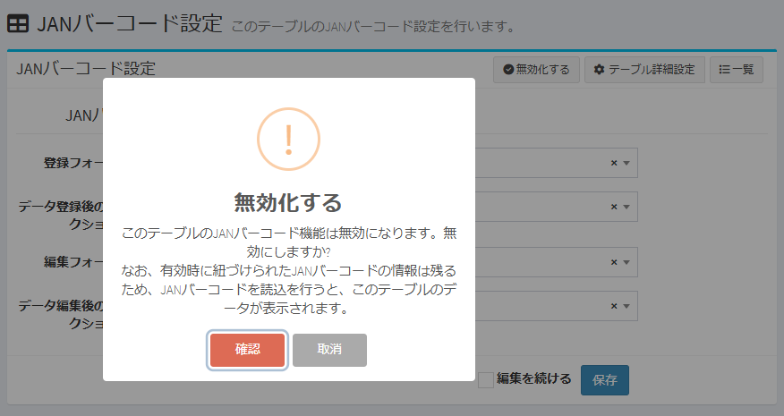

# JAN 条形码设置
本页说明按表决定扫描 JAN 条形码时的动作（打开哪个表单、保存后显示哪个页面）的页面。

设置的流程如下。

1. 打开 JAN 条形码设置页面
2. 设置并保存
3. 点击“启用”按钮

## JAN 条形码功能的概要
JAN 条形码功能的概要，请参阅[官方网站的文章](https://exment.net/release_v6-2-0/)。

## 打开页面
- 在自定义表列表中，勾选要设置的表，点击右上角的“表详细设置”。  

> ※ 也可以从该自定义表的数据列表页面或数据登记页面直接跳转。这时也请点击右上角的“表详细设置”。  

- 在表详细设置页面，点击 JAN 条形码设置的图标，就会显示 JAN 条形码设置页面。  

## JAN 条形码的设置项目

### JAN 条形码扫描
设置扫描 JAN 条形码时的动作。 

- #### 登记表单  
选择扫描 JAN 条形码后打开的登记表单。  
可以从该表已登记的自定义表单中选择。 

- #### 数据登记后的操作  
选择登记数据后显示的页面。  
可以从 TOP 页面、列表页面、详情页面、编辑页面、启动相机页面中选择。

- #### 编辑表单
选择扫描 JAN 条形码后打开的编辑表单。  
可以从该表已登记的自定义表单中选择。

- #### 数据编辑后的操作
选择编辑数据后显示的页面。  
可以从 TOP 页面、列表页面、详情页面、编辑页面、启动相机页面中选择。

设置后，点击“保存”按钮。  

### 启用 JAN 条形码设置  
- 要在该表中使用 JAN 条形码功能，需要“启用”。请先保存一次，然后点击页面右上角的“启用”按钮。  
- 二维码和 JAN 条形码只能启用其中1个。  
启用了二维码时，JAN 条形码功能的“启用”按钮不显示，无法启用。同样，启用了 JAN 条形码时，无法启用二维码。  

### 禁用 JAN 条形码设置  
- 不再用 JAN 条形码管理时，或想在其他表中用 JAN 条形码管理时，请点击页面右上角的“禁用”按钮。  
- 启用期间关联的 JAN 条形码信息会保留。因此，扫描 JAN 条形码时，会显示此表的数据。  

## 从 Exment 启动相机页面
- 可以从 Exment 的仪表板启动用于扫描二维码／JAN 条形码的相机页面。  

- 在仪表板中添加项目“二维码／JAN 条形码”的步骤，请参阅[仪表板](/zh/dashboard)。
