# LINE 关联
这是把 Exment 和公司的 LINE 官方账号连接起来的功能。  
可以在 LINE 上接收 Exment 的通知。还可以通过 LINE 收到的通知卡片上的按钮，执行工作流的操作（批准等）。  
本页说明连接所需的设置，以及通知的创建方法。

- 通过 LINE 和邮件确认员工安全的功能，请参阅[安全确认](/zh/safety_check)。
- LINE 关联从 v7.0.0 起可以使用。

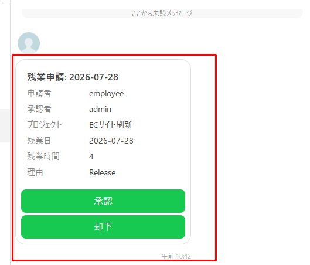

## LINE 关联可以做的事
- **LINE 账号关联**：每位用户把自己的 LINE 账号和 Exment 的用户关联起来。要在 LINE 上接收通知，必须先完成这一关联。
- **LINE 通知**：在[通知](/zh/notify)的执行操作中选择“LINE”后，会向 LINE 发送消息。除了文本，也可以用卡片形式（Flex Message）发送。
- **从 LINE 执行工作流**：在通知卡片上显示“批准”“驳回”等操作的按钮。按下按钮，就可以直接从 LINE 执行操作。
- **LINE 发送记录**：记录通过 LINE 通知和安全确认发送的消息，无论成功还是失败。

## 设置的流程
按以下顺序设置。只有第 5 步由接收通知的每位用户自己进行。

| 步骤 | 内容 | 操作者 |
| --- | --- | --- |
| 1 | [准备 LINE 官方账号](/zh/line?id=LINE-官方账号的准备) | 管理员 |
| 2 | [把频道的信息填入 Exment 的系统设置](/zh/line?id=系统设置) | 管理员 |
| 3 | [在 LINE 中登记 Webhook URL](/zh/line?id=Webhook-的设置) | 管理员 |
| 4 | [设置任务计划](/zh/additional_task_schedule)（使用“时间经过”的通知时） | 服务器管理员 |
| 5 | [关联 LINE 账号](/zh/line?id=LINE-账号关联) | 每位用户 |
| 6 | [创建 LINE Flex 模板](/zh/line?id=LINE-Flex-模板)（用卡片形式发送时） | 管理员 |
| 7 | [设置通知](/zh/line?id=LINE-通知的设置) | 管理员 |

## 运行要求
- 需要一个启用了 Messaging API（由程序收发 LINE 消息的机制）的 LINE 官方账号。来自 Exment 的消息从这个账号发出。
- LINE 的服务器必须能访问 Exment 的 Webhook URL。请用可以从互联网访问、并设置了有效 SSL 证书的“https://”URL 公开 Exment。
- 使用触发条件为“时间经过”的通知时，需要设置[任务计划](/zh/additional_task_schedule)。

> LINE 官方账号按收费方案不同，每月可发送的消息数有上限。  
从 Exment 发送的通知，按每位接收人 1 条计算。对用户操作的回复（“LINE 账号关联成功！”等）不计入。  
详情请确认 LINE 官方账号的收费方案。

## LINE 官方账号的准备

### 启用 Messaging API
1. 在 [LINE Official Account Manager](https://manager.line.biz) 中创建 LINE 官方账号。也可以使用已有的账号。
2. 在“设置”→“Messaging API”中启用 Messaging API。选择（或创建）提供者后，会为 LINE 官方账号创建 Messaging API 的频道。

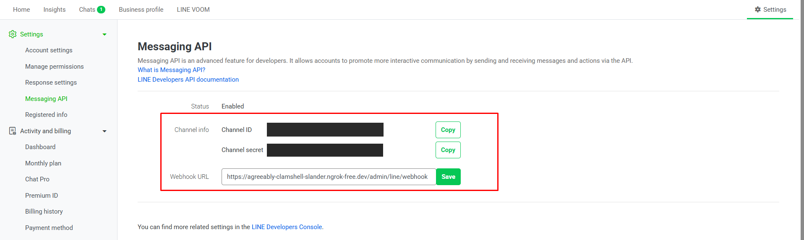

### 确认频道的信息
确认以下 3 个要在 Exment 中设置的值，并记下来。

| 值 | 确认的位置 | 用途 |
| --- | --- | --- |
| 频道密钥（Channel secret） | LINE Official Account Manager 的“设置”→“Messaging API”，或 [LINE Developers 控制台](https://developers.line.biz/console/)的“频道基本设置”（Basic settings）选项卡 | 验证 LINE 发来的数据（Webhook）的签名 |
| 频道访问令牌（长期） | 在 LINE Developers 控制台中选择频道，在“Messaging API 设置”（Messaging API）选项卡的“频道访问令牌”（Channel access token）处点击［发行］（Issue） | 发送消息 |
| 基本 ID（Basic ID） | LINE Official Account Manager 的账号名称旁边，或 LINE Developers 控制台“Messaging API 设置”选项卡的“机器人的基本 ID”（Bot basic ID）。是以“@”开头的 ID | 生成账号关联用的二维码 |

※请妥善保管频道密钥和频道访问令牌，不要让第三方知道。

### 回应设置
- 在 LINE Official Account Manager 的“设置”→“回应设置”中，把“Webhook”设为开。
- 如果设置了自动回应消息，建议停用。Exment 会回复用户发来的文本消息。如果自动回应消息仍然有效，除了 Exment 的回复之外，还会另外发送自动回应消息。

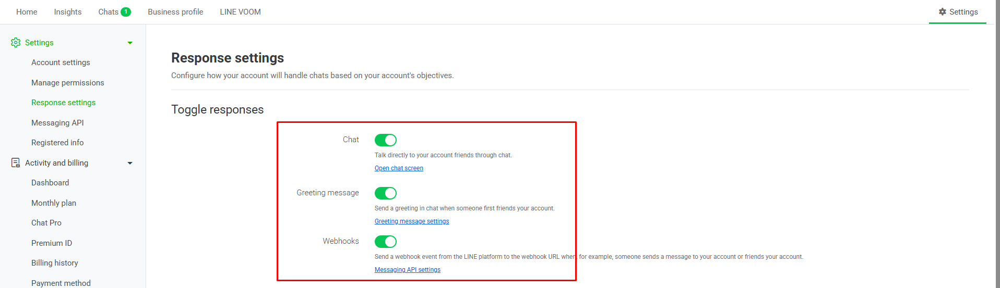

## 系统设置
把确认到的 3 个值填入 Exment。

**(1) 打开系统设置的详细设置**

点击左侧菜单的“管理员设置”→“系统设置”，用右上角的按钮切换到［详细设置］。  
也可以通过以下 URL 打开。

~~~
http(s)://(Exment的URL)/system?advanced=1
~~~

> ※此 URL 是不带“/admin”的标准设置（v7.2.1 及以上版本新安装的站点）时的写法。`.env` 的 `ADMIN_ROUTE_PREFIX` 有值时（用以前的版本安装的站点为“admin”），请在站点的 URL 后面加上该值（例：`http(s)://(Exment的URL)/admin/system?advanced=1`）。详情请参阅[更改、删除 URL 中包含的“admin”](/zh/additional_prefix)。

**(2) 填写“LINE 设置”**

在“LINE 设置”中填写以下项目，然后点击［保存］。

| 项目 | 内容 |
| --- | --- |
| 频道访问令牌 | 填入在 LINE Developers 控制台中发行的频道访问令牌（长期）。 |
| 频道密钥 | 填入频道密钥。 |
| LINE 官方账号 Basic ID | 从“@”开始填入基本 ID。 |
| Webhook URL | 显示要在 LINE 中登记的 Webhook URL。不能输入。 |

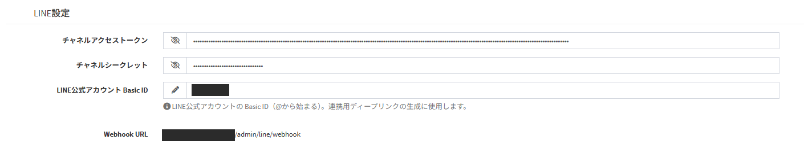

- 频道访问令牌和频道密钥在保存后以掩码显示。
- 这些值也可以在“.env”文件中设置。两边都有时，以系统设置页面中保存的值为准。详情请参阅[设置值](/zh/line?id=设置值)。

## Webhook 的设置
Webhook 是由 LINE 把 LINE 上发生的事通知给 Exment 的机制。用户发送关联码、按下通知卡片上的按钮时，其内容会发送到 Exment。

1. 在 LINE Developers 控制台中选择频道，打开“Messaging API 设置”（Messaging API）选项卡。
2. 点击“Webhook URL”的［编辑］（Edit），粘贴系统设置的“LINE 设置”中显示的 Webhook URL，然后点击［更新］（Update）。
3. 把“使用 Webhook”（Use webhook）设为开。
4. 点击［验证］（Verify），确认显示“成功”（Success）。

Webhook URL 的格式如下。

~~~
https://(Exment的URL)/line/webhook
~~~

- Webhook URL 也可以在 LINE Official Account Manager 的“设置”→“Messaging API”中设置。
- Webhook URL 只能登记以“https://”开头、并设置了有效 SSL 证书的 URL。
- Exment 的 [IP 过滤设置](/zh/additional_ip_filter)不适用于 Webhook URL。用防火墙等限制访问时，请设置为允许 LINE 的服务器访问。

## LINE 账号关联
在 LINE 上接收通知的用户，各自把自己的 LINE 账号和 Exment 的用户关联起来。  
**不会向没有关联 LINE 账号的用户发送 LINE 通知。** 使用 LINE 通知之前，请让用户先完成关联。

### 进行关联
**(1) 打开“LINE 关联”页面**

登录 Exment，打开右上角的用户菜单（自己的名字），点击［LINE 关联］。

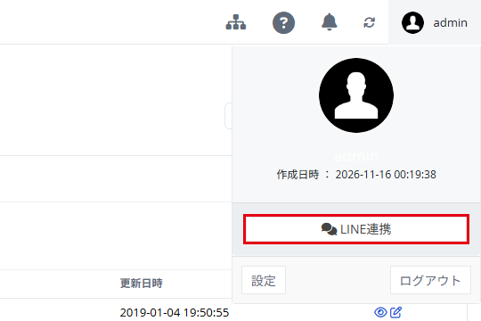

也可以通过以下 URL 打开。

~~~
http(s)://(Exment的URL)/line/link
~~~

- 从 v7.1.0 起，“LINE 关联”不在左侧菜单中，而显示在右上角的用户菜单中。只有在[系统设置](/zh/line?id=系统设置)中设置了 LINE 官方账号的基本 ID 时才会显示。
- 在 v7.0 中，从左侧菜单最上方的“LINE 关联”打开（更新到 v7.1.0 时，最上方的这个菜单会被删除。自己移动过的菜单会保留）。

**(2) 显示二维码**

点击［生成二维码］。会显示关联用的二维码。

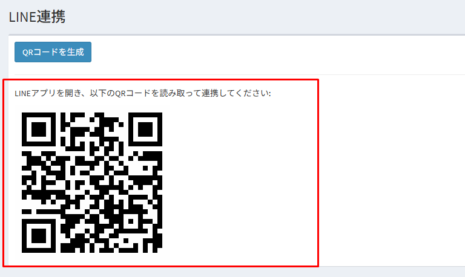

**(3) 用 LINE 应用扫描并发送**

- 用智能手机的 LINE 应用扫描二维码。  
会打开与 LINE 官方账号的聊天页面，并且已经输入好“LINK (关联码)”。  
※如果还没有把 LINE 官方账号加为好友，请按页面的提示加为好友。

- 直接发送这条消息。收到“LINE 账号关联成功！”的回复，关联就完成了。

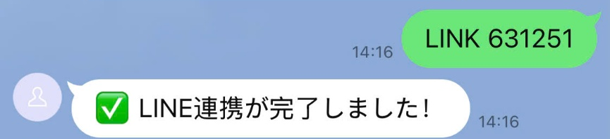

**(4) 确认已经关联**

重新打开“LINE 关联”页面，会显示“已关联 LINE 账号”。

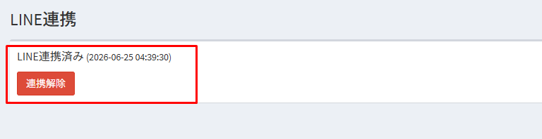

**无法顺利关联时**

- **关联码的期限**：关联码的有效期限，初始设置为 10 分钟。过期时，请再次点击［生成二维码］。
- **1 个 LINE 账号只能和 1 位用户关联**。从已经关联的 LINE 账号发送关联码时，会收到回复“此 LINE 账号已与其他账号关联。如需更改，请先在网页上解除关联。”。但是，如果关联的用户已被删除，以前的关联会自动解除，可以和别的用户关联。
- **错误关联码的次数**：初始设置下，最多可以发送 5 次错误的关联码。从第一次发送错误的关联码起 10 分钟（初始设置）内错了 5 次，在这 10 分钟过去之前无法关联。在此期间，即使发送正确的关联码，也会收到回复“关联码无效或已过期。请确认后重试。”。

### 解除关联
在“LINE 关联”页面中点击［解除关联］。  
更换了智能手机或 LINE 账号时，请先解除关联，再重新关联。

## LINE Flex 模板
用卡片形式（Flex Message）发送 LINE 通知时，用这个模板决定卡片的内容。  
在通知设置中不选择模板时，发送的是文本消息（不需要模板）。

### 创建模板
**(1) 打开列表页面**

访问以下 URL，打开“LINE Flexテンプレート”（LINE Flex 模板）的数据列表页面。  
要添加到左侧菜单时，请在[菜单](/zh/menu)中选择菜单类型“表”来添加。

~~~
http(s)://(Exment的URL)/data/line_flex_template
~~~

**(2) 创建模板**

点击［新建］，填写以下项目并保存。

| 项目 | 内容 |
| --- | --- |
| Flexキー（Flex 键） | 用来识别模板的键（例：ot_request）。“safety_check”用于[安全确认](/zh/safety_check)，请不要使用。 |
| テンプレート名（模板名称） | 模板的名称。显示在通知设置的“LINE Flex 模板”的选项中。 |
| タイトル（标题） | 卡片的标题。可以使用变量。为空时显示数据的标题。 |
| 本文項目（正文项目） | 显示在卡片正文中的项目。每行 1 个项目，用“显示名 = 值”的形式填写。 |
| 説明（说明） | 模板的说明。不会显示在 LINE 上。 |

- 新建时，“タイトル”（标题）和“本文項目”（正文项目）中已经填好了面向工作流执行通知的初始值（状态、操作名称等）。用于数据创建、更新的通知等时，请修改内容。
- “安全确认”模板（Flexキー为“safety_check”）会在安装[安全确认](/zh/safety_check)时自动创建。请不要在通知设置的“LINE Flex 模板”中选择它。也请不要编辑或删除它。

### 正文项目的写法
每行写 1 个项目。在“=”的左边填显示名，右边填值。值中可以使用变量。  
下面是加班申请卡片的例子。

~~~
申请人 = ${created_user}
批准人 = ${value:approver}
项目 = ${value:project}
加班日期 = ${value:ot_date}
加班时间 = ${value:ot_hours}
理由 = ${value:reason}
~~~

- 值为空的行不会显示在卡片上。
- “本文項目”（正文项目）为空时，在工作流执行的通知中，会显示状态、操作名称等标准项目。

### 可以使用的变量
可以使用[参数变量](/zh/params)。主要的变量如下。

| 变量 | 内容 |
| --- | --- |
| ${value} | 数据的标题 |
| ${value:(列名)} | 数据的列的值（例：${value:approver}） |
| ${created_user} | 创建数据的用户名 |
| ${table_view_name} | 表的显示名称 |
| ${workflow:status_name} | 执行操作后的状态名称 ※1 |
| ${workflow:status_from_name} | 执行操作前的状态名称 ※1 |
| ${workflow:action_name} | 执行的操作名称 ※1 |
| ${workflow:action_user} | 执行操作的用户 ※1 |
| ${workflow:comment} | 执行操作时填写的评论 ※1 |
| ${notify_target_column_key} | “目标日期列”的列名 ※2 |
| ${notify_target_column_value} | “目标日期列”的值 ※2 |

※1 只能在触发条件为“工作流”的通知中使用。  
※2 只能在触发条件为“时间经过”的通知中使用。

### 卡片的按钮
卡片的按钮即使不在模板中设置，也会自动添加。

| 按钮 | 显示的条件 |
| --- | --- |
| 工作流的操作（“批准”“驳回”等） | 满足以下所有条件时显示。 - 数据设置了工作流，并且有接收人可以执行的操作 - 接收人还没有执行该操作 - 操作的“评论”不是“必填” - 执行操作后不需要选择下一处理用户（下一状态中没有可执行用户为“由上一操作的执行用户选择”的操作）※只对“进入下一状态的条件”为“1 人以上执行”的操作进行判断。其他操作请参阅[工作流的设置](/zh/line?id=工作流的设置)。 |
| 查看详情 | Exment 的 URL 为“https://”时显示。按下后打开数据的详细页面。 |

详情请参阅[从 LINE 执行工作流的操作](/zh/line?id=从-LINE-执行工作流的操作)。

## LINE 通知的设置
在[通知](/zh/notify)设置页面的“通知操作设置”中，设置以下项目。  
通知设置页面的打开方法，请参阅[通知](/zh/notify)。

| 项目 | 内容 |
| --- | --- |
| 执行操作 | 选择“LINE”。 |
| 通知对象 | 选择要发送通知的用户（必填）。可以选择“用户”列（显示为“自定义列：(列名)”）、“指定用户”“指定组织”“创建人”等。 |
| LINE Flex 模板 | 用卡片形式发送时，选择 [LINE Flex 模板](/zh/line?id=LINE-Flex-模板)。为空时用文本发送。 |

- 用文本发送时，消息由“通知模板”的标题和正文生成。
- 选择“指定组织”时，会发送给属于该组织的所有用户。
- 通知对象中没有关联 LINE 账号的用户不会收到。这时不会报错，也不会记录在 [LINE 发送记录](/zh/line?id=LINE-发送记录)中。
- LINE 通知在数据保存等处理结束后立即发送。不使用[通知处理的延迟执行](/zh/additional_queue)（队列）。
- 发送失败时不会自动重新发送。发送结果可以在 [LINE 发送记录](/zh/line?id=LINE-发送记录)中确认。

### 例 1：在创建、更新数据时通知
- 触发条件：“数据新建/更新”
- 通知条件设置：勾选“新建”“更新”
- 执行操作：“LINE”
- 通知对象：“自定义列：负责人”
- LINE Flex 模板：创建好的模板

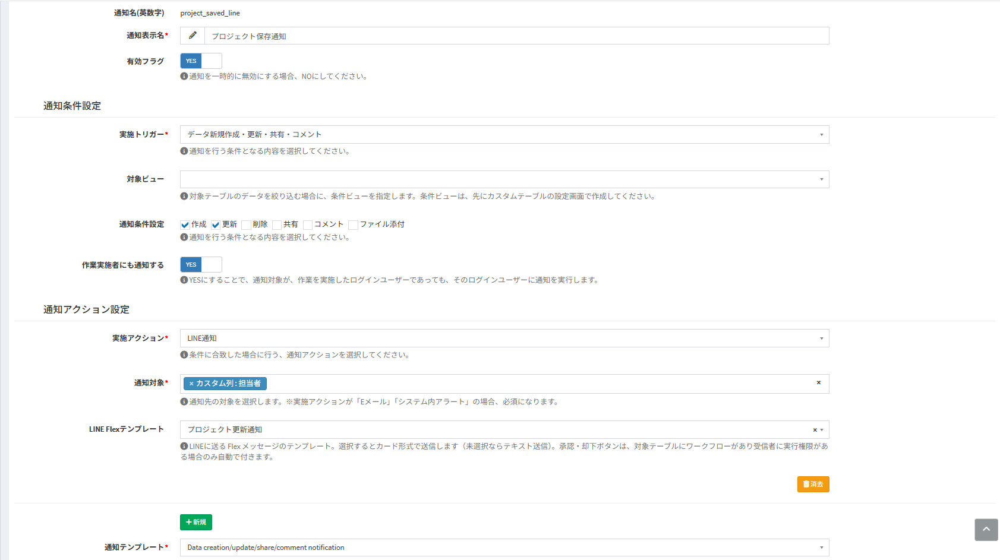

数据保存后，LINE 会收到如下的卡片。

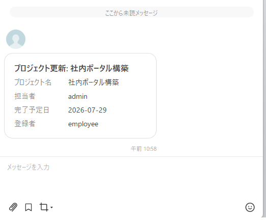

※初始设置下，不会通知保存数据的用户本人。也要通知自己时，请把“也通知操作执行人”设为 YES。

### 例 2：通知组织的成员
在“通知对象”中选择“指定组织”，在“收件人组织”中选择组织。  
会发送给属于该组织的用户中已关联 LINE 账号的用户。

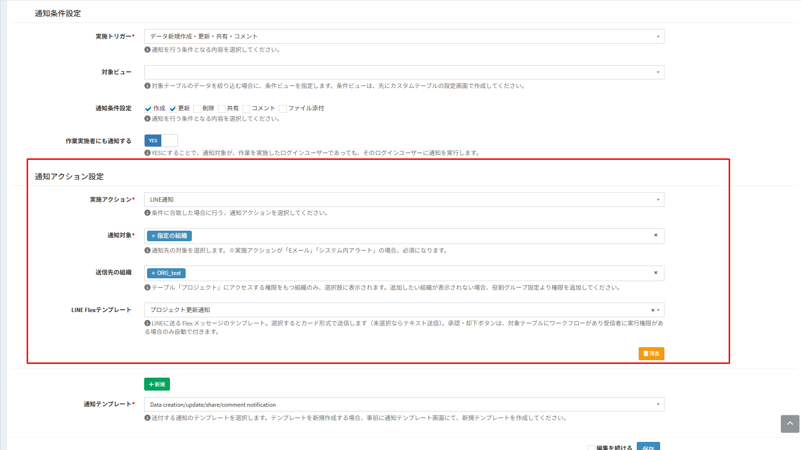

※选项中只显示对该表有访问权限的组织。

### 例 3：在期限的前一天提醒
- 触发条件：“时间经过”
- 目标日期列：作为基准的日期列（例：预定完成日）
- 通知日期：“1”
- 通知前后：“之前”
- 通知时间：发送通知的时刻（0～23）
- 执行操作：“LINE”

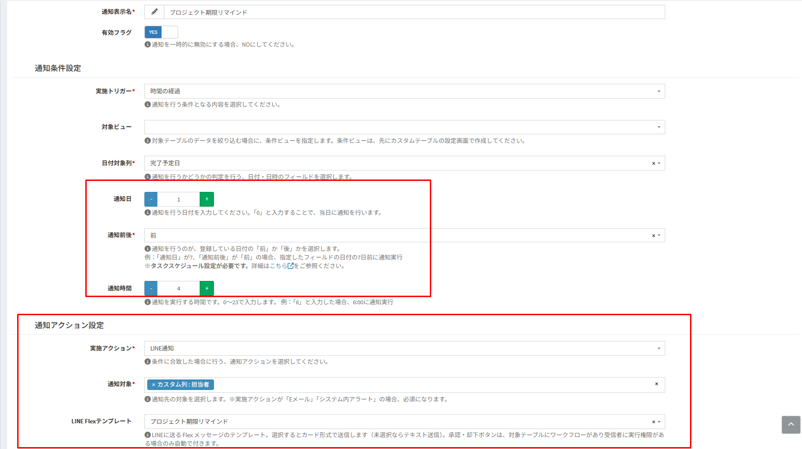

到了指定的时刻，会收到如下的卡片。

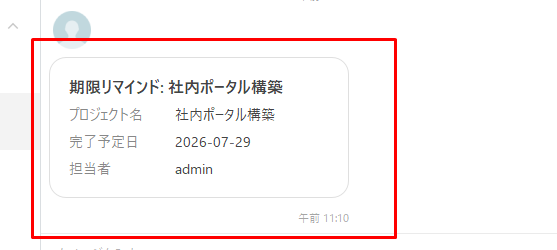

- 要执行“时间经过”的通知，需要设置[任务计划](/zh/additional_task_schedule)。通知在“通知时间”指定时刻的 00 分执行。
- 为了确认设置而想立即执行时，请执行以下命令。无论“通知时间”如何设置，都会执行通知。

~~~
php artisan exment:notify --name=(通知名称（英文数字）)
~~~

- 反复执行命令等情况下，要避免重复发送同一条提醒，请设置设置值“LINE_DEDUPE_MINUTES”。详情请参阅[设置值](/zh/line?id=设置值)。

## 从 LINE 执行工作流的操作
可以通过 LINE 收到的通知卡片上的按钮，执行工作流的操作。  
这里用批准人在 LINE 上批准加班申请的例子来说明。工作流的设置方法请参阅[工作流设置](/zh/workflow_setting)。

要做的是以下 3 件事。

1. 把工作流的操作设置为可以从 LINE 执行（[工作流的设置](/zh/line?id=工作流的设置)）
2. 设置向批准人发送 LINE 通知（下文“通知的设置”）
3. 按下收到的卡片上的按钮（下文“从 LINE 批准”）

### 工作流的设置
在工作流设置的“操作设置”中，把要从 LINE 执行的操作设置如下。

- 可执行用户：执行操作的用户（例：用“预先设置”指定表的“批准人”列）
- 评论：“可选”或“不使用”

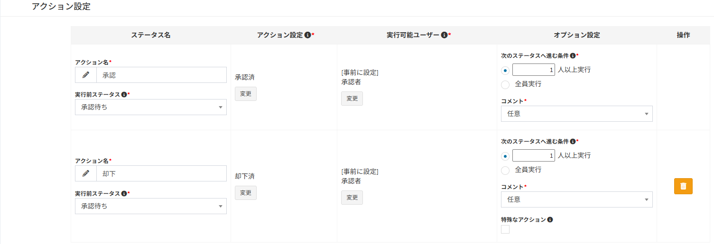

**不能从 LINE 执行的操作**

以下操作请在 Exment 的页面上执行。

- **“评论”为“必填”的操作**：LINE 的卡片上不显示按钮。因为需要填写评论。
- **执行后需要选择下一处理用户的操作**（下一状态中有可执行用户为“由上一操作的执行用户选择”的操作时）：根据“进入下一状态的条件”，情况如下。

| “进入下一状态的条件” | LINE 的卡片 |
| --- | --- |
| “1 人以上执行” | 不显示按钮。 |
| 2 人以上，或“全员执行” | 显示按钮。状态不会前进的执行（例：需要 3 人批准时的第 1 人、第 2 人）可以从 LINE 执行。在状态会前进的执行（例：第 3 人）时按下按钮，操作不会执行，并收到回复“此操作需要选择下一位处理用户。请在网页上处理。”。 |

### 通知的设置
设置向批准人发送 LINE 通知的通知设置。**请务必选择“LINE Flex 模板”**。用文本发送时不会显示按钮。

- **在创建数据时通知**：在表的通知设置中，设置触发条件“数据新建/更新”、通知条件设置“新建”、通知对象“自定义列：批准人”、执行操作“LINE”。
- **在执行操作时通知下一处理用户**：在工作流的通知设置中，设置执行操作“LINE”、通知对象“下一位处理用户”。

### 从 LINE 批准
**(1)** 申请人选择批准人，创建加班申请的数据。

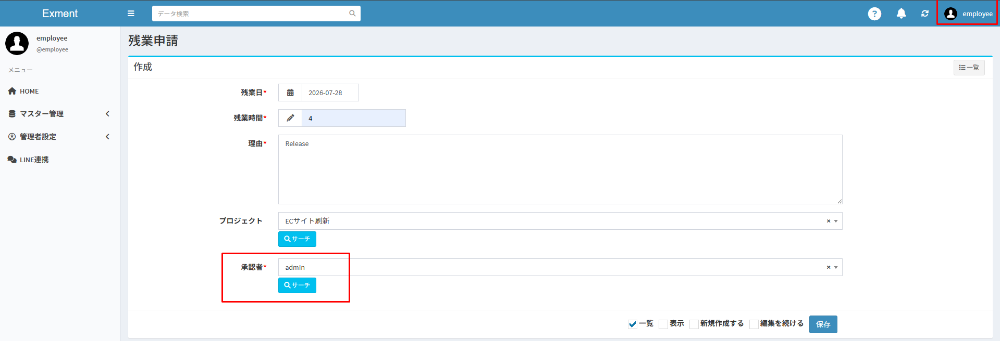

**(2)** 批准人的 LINE 会收到带有“批准”“驳回”按钮的卡片。  
按下按钮后，操作被执行，并收到回复“已处理：批准”。

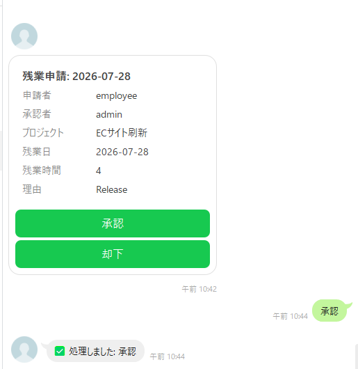

**(3)** Exment 中数据的状态被更新。

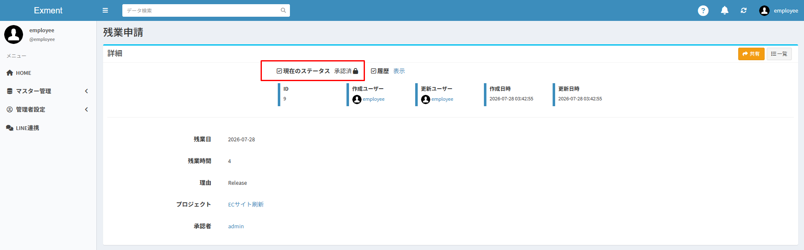

操作以关联了 LINE 账号的用户的身份执行。按下按钮时，会重新确认该用户能否执行操作。

无法执行时，会收到如下回复。

| 回复 | 原因 |
| --- | --- |
| “此操作不可用，或已处理完毕。” | 其他用户已经处理、同一操作已经执行过等，无法执行操作的情况。 |
| “此操作需要选择下一位处理用户。请在网页上处理。” | 需要选择下一处理用户的情况。请在 Exment 的页面上执行。 |
| “此操作需要输入评论。请在网页上处理。” | 发送卡片之后，把操作的“评论”改成了“必填”的情况。 |
| “此账号尚未启用登录。” | 没有设置为登录用户的用户，不能从 LINE 执行操作。 |

## LINE 发送记录
通过 LINE 通知和[安全确认](/zh/safety_check)发送的消息，无论成功还是失败，都记录在“LINE送信履歴”（LINE 发送记录）表中。  
对用户操作的回复（“LINE 账号关联成功！”“已处理：批准”等）不会记录。  
访问以下 URL 可以显示列表。

~~~
http(s)://(Exment的URL)/data/line_send_log
~~~

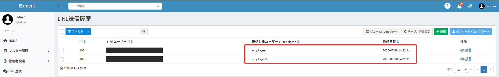

| 列 | 内容 |
| --- | --- |
| LINEユーザーID（LINE 用户 ID） | 发送目标的 LINE 用户 ID。 |
| メッセージ種別（消息类型） | “text”（文本）或“flex”（卡片）。 |
| 送信Flexテンプレート（发送的 Flex 模板） | 发送卡片时使用的 LINE Flex 模板。 |
| 件名（标题） | 消息的标题。卡片时为卡片的标题。 |
| 本文（正文） | 发送到 LINE 的消息数据（JSON 格式）。卡片时会记录 Flex Message 的全部内容。 |
| 送信対象ユーザー（发送对象用户） | 发送目标的 Exment 用户。 |
| 送信日時（发送时间） | 发送消息的日期和时间。 |
| 送信結果（发送结果） | “success”（成功）或“failed”（失败）。 |
| エラー内容（错误内容） | 发送失败时的原因（例：“HTTP 400 …”）。 |

- 不会向没有关联 LINE 账号的用户发送，所以也不会有记录。通知没有送达时，请先确认 LINE 账号的关联。
- 列表中显示的列可以在[自定义视图](/zh/view)中更改。

## 设置值
可以在“.env”文件中更改以下设置。详情请参阅[设置值一览](/zh/config)。

| 设置键 | 默认值 | 内容 |
| --- | --- | --- |
| LINE_CHANNEL_ACCESS_TOKEN | (无) | 频道访问令牌。以系统设置页面中保存的值为准。 |
| LINE_CHANNEL_SECRET | (无) | 频道密钥。以系统设置页面中保存的值为准。 |
| LINE_OA_BASIC_ID | (无) | 基本 ID。以系统设置页面中保存的值为准。 |
| LINE_DEDUPE_MINUTES | 0 | 在“时间经过”的 LINE 通知中，就同一条数据向同一位用户发送 LINE 消息之后，在这段时间（分钟）内不再发送。通过其他通知设置发送的消息、发送失败的消息也算在内。为 0 时此功能无效。 |
| LINE_LINK_CODE_TTL_MINUTES | 10 | 关联码的有效期限（分钟）。 |
| LINE_LINK_MAX_ATTEMPTS | 5 | 可以发送错误关联码的次数。超过这个次数后，一段时间内无法关联。 |
| LINE_LINK_ATTEMPT_DECAY_MINUTES | 10 | 统计错误关联码发送次数的时间（分钟）。从第一次发送错误的关联码起，在这段时间内错了“LINE_LINK_MAX_ATTEMPTS”的次数，在这段时间过去之前无法关联。 |
| LINE_HTTP_TIMEOUT | 10 | 与 LINE 的服务器通信时的超时时间（秒）。 |
| LINE_API_BASE | https://api.line.me | LINE Messaging API 的 URL。通常请不要更改。 |

※因“LINE_DEDUPE_MINUTES”而没有发送的通知，不会记录在 LINE 发送记录中。会在“storage/logs/laravel.log”中记录“LINE reminder skipped by dedupe”。

## 无法正常运行时
| 现象 | 主要原因 | 处理方法 |
| --- | --- | --- |
| Webhook 的［验证］不成功 | - Webhook URL 不是“https://”，或 SSL 证书无效 - 无法从互联网访问 Exment - 频道密钥不正确 | 请确认 Webhook URL 和服务器的公开设置，以及系统设置的“频道密钥”。 |
| 发送了关联码，却收不到回复 | - “使用 Webhook”为关 - Webhook URL 不正确 | 请确认 [Webhook 的设置](/zh/line?id=Webhook-的设置)。 |
| 点击［生成二维码］时，显示“尚未设置 LINE 官方账号的基本 ID。请在“设置：系统”的“系统设置”中进行设置。” | 没有设置基本 ID | 请填写系统设置的“LINE 官方账号 Basic ID”。 |
| 收到回复“关联码无效或已过期。请确认后重试。” | - 关联码已过期，或关联码有误 - 连续发送了错误的关联码，暂时无法关联 | 请点击［生成二维码］，扫描新的二维码。暂时无法关联时，请过一段时间（初始设置为 10 分钟）后再发送。 |
| 收到回复“此 LINE 账号已与其他账号关联。如需更改，请先在网页上解除关联。” | 该 LINE 账号已经和 Exment 的用户关联 | 用已关联的用户登录 Exment，在“LINE 关联”页面点击［解除关联］，然后重新关联。 |
| 收到回复“如需关联账号，请发送：LINK &lt;code&gt;。” | 没有关联 LINE 账号的用户发送了关联码以外的消息 | 请按[LINE 账号关联](/zh/line?id=LINE-账号关联)的步骤，扫描二维码进行关联。 |
| 收到回复“无效的命令。” | 已关联 LINE 账号的用户发送了关联码以外的消息 | 这不是异常。Exment 不会回应关联码以外的消息。关于安全确认的补充回复，请参阅[安全确认](/zh/safety_check)。 |
| LINE 通知没有送达，LINE 发送记录中也没有记录 | 通知对象的用户没有关联 LINE 账号 | 请让用户进行 [LINE 账号关联](/zh/line?id=LINE-账号关联)。 |
| LINE 发送记录的发送结果为“failed” | - 频道访问令牌不正确或无效 - 用户屏蔽了 LINE 官方账号 - 达到了每月发送数的上限 | 请确认“エラー内容”（错误内容）。重新发行了频道访问令牌时，请重新填入系统设置。 |
| 卡片上不显示“批准”“驳回”按钮 | - 操作的“评论”为“必填” - 在“进入下一状态的条件”为“1 人以上执行”的操作中，执行后需要选择下一处理用户（下一状态中有“由上一操作的执行用户选择”的操作） - 接收人不能执行该操作，或已经执行过 - 数据已经处理完毕 - 没有选择 LINE Flex 模板 | 请确认[从 LINE 执行工作流的操作](/zh/line?id=从-LINE-执行工作流的操作)。 |
| “时间经过”的 LINE 通知没有发送 | - 任务计划没有运行 - “通知时间”与服务器的时间不一致 - 因“LINE_DEDUPE_MINUTES”而没有发送 | 请确认[任务计划](/zh/additional_task_schedule)。也可以用“php artisan exment:notify”执行通知来确认。 |
| 不显示“查看详情”按钮 | Exment 的 URL 不是“https://” | 请用“https://”的 URL 运行 Exment。 |
