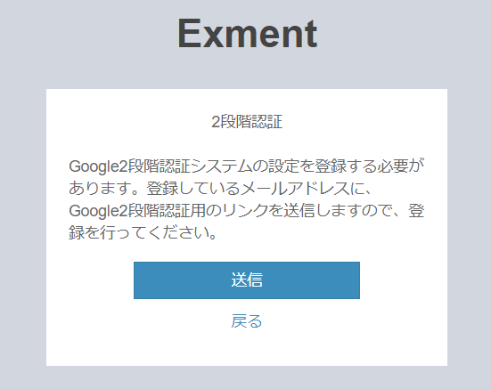
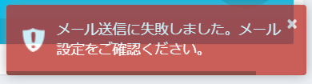

# 双重验证 系统设置
Exment 支持双重验证（在密码之后再输入 1 个验证码来登录的机制）。  
本页是系统管理员让双重验证可以使用的设置步骤。

步骤如下。

1. （只在使用 Google 身份验证器时）安装库
2. 在“.env”文件中添加设置
3. 在登录设置页面进行邮件的设置并保存
4. 把“使用双重验证”设为 YES，并选择方式
5. 接收验证码并输入，然后保存

## 双重验证的方式
现在可以使用的双重验证方式有下面 2 种。  

##### 电子邮件
用 ID/密码登录后，登记的邮件地址会收到验证码的邮件。  
在页面上输入这个验证码，登录就完成了。

##### Google 身份验证器
用 ID/密码登录后，使用 Google 身份验证器进行双重验证。

## 前提事项
- Exment 的双重验证不是按用户设置，而是对整个系统设置。  

- 要使用双重验证，系统必须能发送邮件。方式选择“Google 身份验证器”时也一样。

- 方式为“Google 身份验证器”时，用户第一次登录时，会向登记的邮件地址发送用于登记 Google 身份验证器的邮件。  
  
点击收到的邮件中的链接，用户可以自己进行双重验证的设置。  
设置 1 次后，从第 2 次起只要输入 Google 身份验证器上显示的验证码就可以了。  

## 设置方法
这是双重验证的设置步骤。

- 使用的方式为“Google 身份验证器”时，在项目的根文件夹中执行下面的命令。

~~~
composer require pragmarx/google2fa
~~~

> v7.0.0 以后，simplesoftwareio/simple-qrcode 作为 Exment 的依赖库自动安装，不需要另外添加。

- 打开项目根文件夹的“.env”文件，按下面这样追加。  
※设置文件的修改方法请看[设置值一览](/zh/config)。

~~~
EXMENT_LOGIN_USE_2FACTOR=true
~~~

- 用管理员账号打开登录设置页面。

- 首先进行邮件的设置。请输入邮件发送的设置值。详情请看[系统设置](/zh/system_setting)的“系统邮件设置”。  
输入后，先点击 1 次［提交］保存。  

- 然后，显示登录设置页面下方的“双重验证”。  
  

- 把“使用双重验证”设为“YES”。  
设为 YES 后，会显示其余的设置项目。  
  

- 在“默认验证方式”中选择双重验证使用的方式（“电子邮件”或“Google 身份验证器”）。  

- 点击［发送验证码］按钮，会向现在登录的账号发送验证码。  
请把收到的邮件中写的验证码输入到“验证码”项目中。
  
  

※点击［发送验证码］按钮时，有时会出现下面图片这样的错误。  
这个错误在从低于 v1.4.0 的版本更新时出现。  
这时，请按照[这里的步骤](/update/v1_4)（英语）导入通知模板。  
  

※有时也会出现邮件发送的错误。  
在邮件发送的设置不正确时出现。
这时，请看[系统设置](/zh/system_setting)的“系统邮件设置”并修改设置。
  

- 最后，请点击［提交］保存设置。

## 停用设置
因为某种原因想强制停用双重验证时，请进行下面的设置。

- 打开项目文件夹的“.env”文件，按下面这样追加。  
※设置文件的修改方法请看[设置值一览](/zh/config)。

~~~
EXMENT_LOGIN_USE_2FACTOR=false
~~~

进行这个设置后，即使在页面上设为“使用双重验证”，双重验证也会停用。
  
  
[←返回登录设置](/zh/login_setting)
