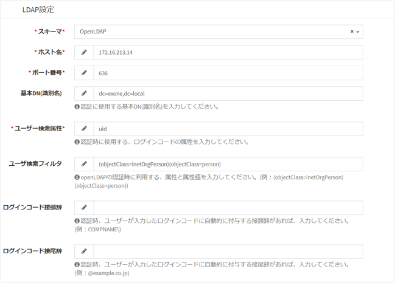

# 单点登录（LDAP）
这是使用 LDAP 的单点登录（SSO）的设置方法。  
在 Exment 中，可以在[登录设置](/zh/login_setting)中添加单点登录。添加后，不用管理 Exment 专用的登录密码，就可以用提供商（这里是 LDAP 服务器）的 ID 和密码登录。

设置按下面 2 个顺序进行。

1. **服务器的准备**（安装 PHP 的扩展功能和库）… “服务器和提供商的设置”
2. **在页面上设置**（在登录设置页面中添加提供商）… “在页面上设置”

#### 注意事项
- **本手册是面向熟悉 LDAP 的人的步骤。各提供商的设置方法等，请参考各自的资料。**


## 服务器和提供商的设置
在登录设置页面中添加提供商之前，需要在服务器上执行命令，安装扩展功能。

### Windows 的情况

1. 打开 php.ini 文件。  
※php.ini 文件的位置因服务器的安装方式而不同。

2. 添加下面的内容。

```
extension=ldap
```

3. 重新启动 PHP。

4. 执行下面的命令。

```
composer require directorytree/ldaprecord
```
※这是 Exment v7.0.0 以后使用的库。使用 Exment v6.x 以前的版本时，请改为执行“composer require adldap2/adldap2-laravel”。  


### Linux（CentOS）的情况

> 因为需要添加软件包，在租用服务器等上有时不能导入。

1. 执行下面的命令，安装软件包。  
※请先完成[用 Linux 搭建环境](/zh/install_linux)等页面中进行的 epel 更新和 rpm 安装。

```
sudo dnf install php-ldap
```

2. 打开 php.ini 文件。  
※php.ini 文件的位置因服务器的安装方式而不同。

3. 添加下面的内容。

```
extension=ldap.so
```


4. 执行下面的命令。

```
composer require directorytree/ldaprecord
sudo service httpd restart
```
※这是 Exment v7.0.0 以后使用的库。使用 Exment v6.x 以前的版本时，请改为执行“composer require adldap2/adldap2-laravel”。  


## 在页面上设置
服务器的设置完成后，在[登录设置页面](/zh/login_setting)中添加提供商。

1. 用管理员账户打开系统设置页面。  
从页面右上方的“登录设置”按钮打开登录设置页面。  
  

2. 按新建按钮，创建登录设置。要输入的项目如下。

- **LDAP 名称（字母数字）** : 请用英文和数字输入，不要与其他的重复。

### LDAP 设置
请输入 LDAP 的设置。  
（Active Directory 的情况）
  

（openLDAP 的情况）
  

### 映射设置
需要让提供商返回的字段名与 Exment 的“用户”表的字段名对应起来。  

  

请输入提供商返回的字段名。

  

写法有 3 种。

| 写法 | 什么时候用 | 例 |
|---|---|---|
| 直接写字段名 | 直接使用 1 个字段 | |
| 用逗号分隔写多个 | 有几个候选，从前面开始按顺序使用有值的那个 | seimei,username |
| 用 ${字段名} 的形式写多个 | 把多个字段组合起来使用 | ${last_name} ${first_name} |

#### 直接填写字段名
直接写提供商返回的字段名。
  

#### 用逗号分隔填写多个字段名
想使用的字段有几个候选时，把提供商返回的字段名用逗号分隔来写。  
从逗号分隔的最前面开始按顺序找值，有值就使用那个值。  
（例：希望尽量使用姓名字段“seimei”，但它在提供商一侧不是必填项，所以“seimei”有值就用它，没有就用“username”作为用户名 → 填写 seimei,username）
  

#### 用 ${字段名} 的形式填写多个字段名
这是想把提供商返回的多个用户信息组合起来，作为 Exment 的用户信息使用时的写法。请用 ${字段名} 的形式写多个字段。  
（例：提供商没有“姓名”字段，但分别有“姓(last_name)”“名(first_name)”字段，所以组合成“姓 名”来使用 → 填写 ${last_name} ${first_name}）
  


### 用户设置
设置如何处理登录的用户。

  

#### 账户搜索列
设置用 SSO 取得的账户的哪一列来查找 Exment 的账户。

#### 新建用户
- YES 时：登录的用户在 Exment 中不存在时，用登录信息新建 Exment 的用户。
- NO 时：需要先在 Exment 中创建用户。登录的用户在 Exment 中不存在时，会显示错误。

#### 角色组设置
YES 时，新建 Exment 的用户时可以关联到角色组。  

#### 更新用户信息
YES 时，再次登录时会更新用户名等用户信息。


- 数据保存 1 次以上后，会显示“启用”按钮和“登录测试”按钮。

- 把启用标志设为 YES 后，登录页面上会显示 SSO 认证用的按钮。  

（Active Directory 的情况）

  

（openLDAP 的情况）

  


### 登录按钮设置
设置登录页面上显示的登录按钮。  

  


### 启用和登录测试
- 数据保存 1 次以上后，会显示“启用”按钮和“登录测试”按钮。

  

#### 启用
- 执行启用后，登录页面上会显示 SSO 认证用的按钮。  
※不想显示通常的“登录”按钮时，请在[登录设置](/zh/login_setting)中把“显示默认登录”设为“NO”。  
  


#### 登录测试
- 点击“登录测试”按钮，可以用设置的登录信息进行登录测试。即使没有启用登录设置，也可以测试。  

  


- 点击“登录”按钮，可以测试设置是否正确。  
结果显示在“执行结果”项目中。

  

  
  
[←返回登录设置](/zh/login_setting)
