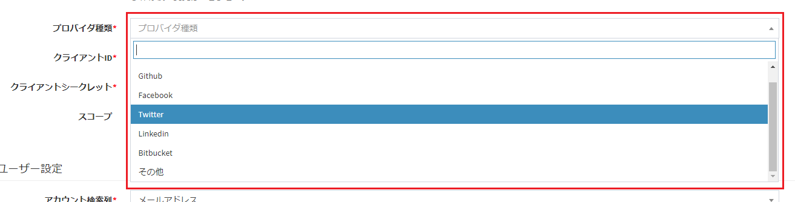
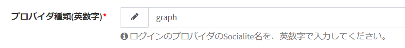

# 单点登录（OAuth）
这是使用 OAuth 的单点登录（SSO）的设置方法。设置后，可以用 Google、Microsoft 等的账户登录 Exment。  
在 Exment 中，可以在[登录设置](/zh/login_setting)中添加单点登录。添加后，不用管理 Exment 专用的登录密码，就可以用提供商（Google 等负责登录的服务）的 ID 和密码登录。

设置按下面 2 个顺序进行。

1. **服务器和提供商的准备**（在提供商一侧创建应用程序，需要时安装库）… “服务器和各提供商的设置”
2. **在页面上设置**（在登录设置页面中添加提供商）… “在页面上设置”

1 的步骤因使用的提供商而不同。

| 使用的提供商 | 看哪里 |
|---|---|
| Google、Facebook、Twitter、GitHub、LinkedIn、Bitbucket | (1) Socialite 标准提供的提供商 |
| Office365、Microsoft Graph | (2) Exment 扩展提供的提供商 |
| 其他 | (3) 自己准备提供商 |

#### 注意事项
- Exment 用 [Socialite](https://github.com/laravel/socialite) 实现单点登录处理。
- **本手册是面向熟悉 OAuth 的人的步骤。各提供商的 Client ID、Client Secret 的创建方法等，请参考各自的资料。**
- <span class="red">在 v3.0.16 以下不能用 Google 登录的用户，请按[这里的步骤](/patch/sso_google)（英语）处理。</span>

#### 参考链接
- [在开源 Web 数据库“Exment”中支持用 Google 账户进行 SSO](https://qiita.com/hirossyi73/items/70dcc35305a96abace08)（日语）


## 服务器和各提供商的设置
在登录设置页面中添加提供商之前，需要在服务器上执行命令，安装扩展功能。

### (1) Socialite 标准提供的提供商
- Socialite 标准提供的提供商如下。（括号中的字符串在之后指定 service 时使用）
    - Google (google)
    - Facebook (facebook)
    - Twitter (twitter)
    - GitHub (github)
    - LinkedIn (linkedin)
    - Bitbucket (bitbucket)

- 在各提供商中创建 Exment 用的应用程序。  
※callback URL 如下。  
http(s)://(Exment的URL)/auth/login/(socialite的provider名)/callback  

    - 例1 GitHub 时：http(s)://(Exment的URL)/auth/login/github/callback  
    - 例2 Facebook 时：http(s)://(Exment的URL)/auth/login/facebook/callback  
    - 例3 Google 时：http(s)://(Exment的URL)/auth/login/google/callback  

> ※这里的 URL 是不带“/admin”的标准设置（v7.2.1 以后新安装的站点）的情况。`.env` 的 `ADMIN_ROUTE_PREFIX` 有值时（用以前的版本安装的站点是“admin”），请在站点的 URL 后面加上这个值（例：`http(s)://(Exment的URL)/admin/auth/login/google/callback`）。详情请看[更改或删除 URL 中包含的“admin”](/zh/additional_prefix)。

- 在 Exment 的根目录执行下面的命令。

~~~
composer require laravel/socialite=~5.1
~~~
※在 Exment v7.0.0 以后，“laravel/socialite”会作为 Exment 的依赖库自动安装，所以不需要执行这个命令。

- 进行[在页面上设置](/zh/login_oauth?id=在页面上设置)。


### (2) Exment 扩展提供的提供商
- 一部分提供商作为 Exment 的扩展提供。（括号中的字符串在之后指定 service 时使用）
    - Office365、Microsoft Graph (graph)

- 在各提供商中创建 Exment 用的应用程序。  
※callback URL 如下。  
http(s)://(Exment的URL)/auth/login/(socialite的provider名)/callback  

    - 例 Office365 时：http(s)://(Exment的URL)/auth/login/graph/callback

- 在 Exment 的根目录执行下面的命令。

~~~
composer require exceedone/microsoft-graph
~~~

- 进行[在页面上设置](/zh/login_oauth?id=在页面上设置)。


### (3) 自己准备提供商
(1)(2) 中没有的提供商，用 [Socialite Providers](https://socialiteproviders.github.io/) 添加非官方的提供商。  
非官方的提供商中也没有取得头像（用户的图片）的处理。想取得头像时，要添加处理。（可选）  
  
※有几个步骤。详情请看[自定义提供商的创建方法](/zh/login_oauth?id=自定义提供商的创建方法)。

- 步骤完成后，进行[在页面上设置](/zh/login_oauth?id=在页面上设置)。


## 在页面上设置
服务器的设置完成后，在[登录设置页面](/zh/login_setting)中添加提供商。

1. 用管理员账户打开系统设置页面。  
从页面右上方的“登录设置”按钮打开登录设置页面。  
  

2. 按新建按钮，创建登录设置。要输入的项目如下。

### 提供商类型
  

- 在“服务器和各提供商的设置”中选择了 (1) 的提供商时，请选择那个提供商的名称。  

- 在“服务器和各提供商的设置”中选择了 (2)(3) 的提供商时，请选择“其他”。  
选择“其他”后显示的“提供商名称（字母数字）”中，请输入 Socialite 指定的提供商类型的英文数字。  
例 Microsoft Graph 时："graph"

  


### 客户端 ID、客户端密钥
请输入提供商提供的字符串。

### 范围
只是登录的话，基本上没有明确的用途。在[取得访问令牌](/zh/login_oauth?id=取得访问令牌)中取得访问令牌时，建议设置。

### 选项设置
按照所选的提供商类型进行选项的设置。
（选择了没有选项设置的提供商类型时，不显示。）

#### 提供商类型为“其他”时
 

##### 单点登出
从 Exment 登出时，也从用 SSO 登录的提供商登出。<span class="red">※目前不支持 Okta。</span>

<!---
  OAuth、Saml 中写相同的内容
-->
### 用户设置
设置如何处理登录的用户。

  

#### 账户搜索列
设置用 SSO 取得的账户的哪一列来查找 Exment 的账户。

#### 新建用户
- YES 时：登录的用户在 Exment 中不存在时，用登录信息新建 Exment 的用户。
- NO 时：需要先在 Exment 中创建用户。登录的用户在 Exment 中不存在时，会显示错误。

#### 角色组设置
YES 时，新建 Exment 的用户时可以关联到角色组。  

#### 更新用户信息
YES 时，再次登录时会更新用户名等用户信息。


- 数据保存 1 次以上后，会显示“启用”按钮和“登录测试”按钮。

- 把启用标志设为 YES 后，登录页面上会显示 SSO 认证用的按钮。  
※通常，输入用户 ID 和密码的默认登录表单也会一起显示。在 [SSO 设置](/zh/system_setting)中，也可以像图片那样不显示。  


### 登录按钮设置
设置登录页面上显示的登录按钮。  
※即使不做这个设置，上面“(1) Socialite 标准提供的提供商”中的提供商也会以各自的格式显示。

  


### 启用和登录测试
- 数据保存 1 次以上后，会显示“启用”按钮和“登录测试”按钮。

  

#### 启用
- 执行启用后，登录页面上会显示 SSO 认证用的按钮。  
  

#### 登录测试
- 点击“登录测试”按钮，可以用设置的登录信息进行登录测试。即使没有启用登录设置，也可以测试。  
**这时，请把“测试用重定向 URL”中显示的 URL 临时添加到提供商的 OAuth 认证设置的回调 URL 中，或者临时改成这个 URL。**

  


- 点击“登录”按钮，可以测试设置是否正确。  
结果显示在“执行结果”项目中。


### 取得访问令牌

- 登录之后要取得访问令牌和刷新令牌时，请用下面的方法取得。

~~~ php
use Exceedone\Exment\Services\Login\LoginService;

$access_token = LoginService::getAccessToken();
$refresh_token = LoginService::getRefreshToken();
~~~


## 自定义提供商的创建方法
这是进行 (3) 的步骤时的详细步骤。添加 [Socialite Providers](https://socialiteproviders.github.io/) 指定的软件包。  
另外，创建用来取得头像的自定义提供商。（可选）

| 步骤 | 是否需要 |
|---|---|
| 设置、添加提供商 | 必须 |
| 为取得头像进行开发 | 可选 |
| 添加服务提供者 | 必须 |
| 添加选项设置 | 有些提供商必须 |
| 进行页面设置 | 必须 |

### （必须）设置、添加提供商
- 在各提供商中创建 Exment 用的应用程序。  
※callback URL 如下。  
http(s)://(Exment的URL)/auth/login/(socialite的provider名)/callback  

    - 例 Microsoft Graph 时：http(s)://(Exment的URL)/auth/login/graph/callback

- 在 Exment 的根目录执行下面的命令。

~~~
composer require laravel/socialite=~5.1
~~~
※在 Exment v7.0.0 以后，“laravel/socialite”会作为 Exment 的依赖库自动安装，所以不需要执行这个命令。

- 添加 [Socialite Providers](https://socialiteproviders.github.io/) 指定的软件包。  

    - 例：Microsoft Graph 时

~~~
composer require socialiteproviders/microsoft-graph
~~~

### （可选）为取得头像进行开发
※创建这个自定义提供商是为了取得头像的可选步骤。不需要取得头像时，不用创建。

- 为了取得头像，在文件夹“app/Socialite”中创建 2 个继承现有提供商的类。※没有文件夹“app/Socialite”时，请创建。  
第 1 个是 MicrosoftGraphProvider.php。implements 接口 ProviderAvatar，并实现 getAvatar。  
请在 getAvatar 方法中写取得头像用的 API 处理。取得用的 URL 和端点，请在各 OAuth 提供商处确认。  
下面的例子是 Microsoft Graph 的步骤。

~~~ php
<?php

namespace App\Socialite;

use Exceedone\Exment\Auth\ProviderAvatar;
use SocialiteProviders\Graph\Provider;

class MicrosoftGraphProvider extends Provider implements ProviderAvatar
{
    /**
     * Get avatar stream
     * @param mixed $token
     * @return string
     */
    public function getAvatar($token = null){
        try
        {
            $client = $this->getHttpClient();
            $response = $client->get('https://graph.microsoft.com/v1.0/me/photo/$value', [
                'headers' => [
                    'Authorization' => 'Bearer '.$token,
                    'Content-Type' => 'application/json;odata.metadata=minimal;odata.streaming=true'
                ],
                'http_errors' => false,
            ]);

            if($response->getStatusCode() == 404){
                return null;
            }

            return $response->getBody()->getContents();

        }
        catch (Exception $exception)
        {
            return null;
        }
        return null;
    }
}

~~~ 

- 第 2 个是 GraphExtendSocialite.php。指定创建的 MicrosoftGraphProvider。

~~~ php
<?php

namespace App\Socialite;

use SocialiteProviders\Manager\SocialiteWasCalled;

class GraphExtendSocialite
{
    /**
     * Execute the provider.
     */
    public function handle(SocialiteWasCalled $socialiteWasCalled)
    {
        $socialiteWasCalled->extendSocialite(
            'graph', __NAMESPACE__.'\MicrosoftGraphProvider'
        );
    }
}

~~~ 

### （必须）添加服务提供者
- 在文件 app/Providers/EventServiceProvider.php 中写入添加的提供商，添加服务提供者。  
※是否为取得头像做了自定义开发，写的内容不同。  
另外，“@handle”中写的类名，多数情况下写在 [Socialite Providers](https://socialiteproviders.github.io/) 中所添加提供商的手册里。请确认。

~~~ php

// 例：Microsoft Graph 时

protected $listen = [
    ///// 为取得头像做了自定义开发时
    'App\Events\Event' => [
        'App\Listeners\EventListener',
    ],
    
    /// 添加
    \SocialiteProviders\Manager\SocialiteWasCalled::class => [
        '\App\Socialite\GraphExtendSocialite@handle', ///// 为取得头像做了自定义开发时
        // 'SocialiteProviders\\Graph\\GraphExtendSocialite@handle', ///// 通常的取得方式时，取消这一行的注释来写
    ],
];

~~~
~~~php

// 例：EntraID 时

protected $listen = [
    // ... other listeners
    \SocialiteProviders\Manager\SocialiteWasCalled::class => [
        // ... other providers
        \SocialiteProviders\Microsoft\MicrosoftExtendSocialite::class.'@handle',
    ],
];

~~~

※在 Exment v7.0.0 以后新安装时（用 Laravel12 创建的项目），不存在“app/Providers/EventServiceProvider.php”。这时，请在“app/Providers/AppServiceProvider.php”的 boot 方法中按下面这样写。

~~~php

// 例：EntraID 时

public function boot(): void
{
    \Illuminate\Support\Facades\Event::listen(
        \SocialiteProviders\Manager\SocialiteWasCalled::class,
        [\SocialiteProviders\Microsoft\MicrosoftExtendSocialite::class, 'handle']
    );
}

~~~


### （有些提供商必须）添加选项设置
有些 OAuth 登录的提供商需要追加设置。  

  
例：[OKTA](https://github.com/SocialiteProviders/Okta) 时
- 打开 config/services.php，添加下面的内容。

``` php
'okta' => [    
  'base_url' => env('OKTA_BASE_URL'), 
],
```

- 打开 .env 文件，添加下面的内容。

```
OKTA_BASE_URL='https://<OKTA的域名>'
```

> 本来，Socialite 要求 config/services.php 的 "client_id"、"client_secret"、"redirect" 设置值是必填的，而 Exment 的 OAuth 认证会自动加上在页面上设置的值。  
想输入提供商特有的设置值时，请像上面那样在 config/services.php 中添加值。


### （必须）进行页面设置

- 服务器一侧的设置全部完成后，进行[在页面上设置](/zh/login_oauth?id=在页面上设置)。

  
  
[←返回登录设置](/zh/login_setting)
