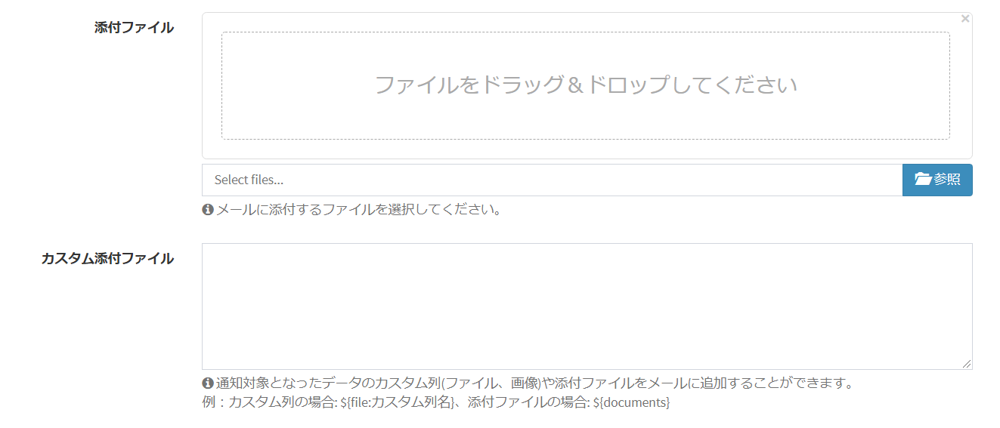

# 通知模板
本页说明如何设置 Exment 发送的邮件和通知的主题、正文等的样板（通知模板）。  
创建的模板在[通知设置](/zh/notify)等处选择使用。  

> 从 v3.6.0 起，名称从“邮件模板”改成了“通知模板”。  
在低于 v3.6.0 的版本安装的站点，部分画面的名称仍然是“邮件模板”。

## 管理方法
### 显示页面
- 在左侧菜单中选择通知模板的菜单（“邮件模板”）。  
或者访问下面的 URL。  
http(s)://(Exment的URL)/data/mail_template  
这样就会显示通知模板画面。  
  

> ※这个 URL 是不带“/admin”的标准设置（v7.2.1 及以后新安装的站点）下的 URL。如果 `.env` 的 `ADMIN_ROUTE_PREFIX` 有值（用以前的版本安装的站点是“admin”），请在站点 URL 的后面加上这个值（例：`http(s)://(Exment的URL)/admin/data/mail_template`）。详情请参阅[更改或删除 URL 中的“admin”](/zh/additional_prefix)。

### 新增模板
1. 在“通知模板”画面，点击页面右上角的［新增］按钮。

2. 显示通知模板的新增画面。

3. 输入必要的内容。  

### 保存
填写设置后，请点击［保存］。

### 编辑
要编辑模板时，请点击该行的［编辑］链接。  

### 删除
想删除模板时，请点击相应行的［删除］链接。  

**※但是，已经在通知画面设置的模板不能删除。**

## 附件与自定义附件
用邮件通知时，可以把设置在通知模板中的文件作为附件发送。  
※现在只在邮件通知时有效。  
  

#### 附件
这里登记的文件，每次邮件通知时都作为固定的附件发送。

#### 自定义附件
在这里设置参数后，会用邮件通知发送各条数据中登记的下面这些种类的文件。  

■自定义列的类型：“文件”“图片”  
参数设置：${file:自定义列名}  

■自定义列“选项（从其他表中选择）”中所选数据的“文件”“图片”列  
参数设置：${file:select_table:选项的自定义列名.引用表的文件列名}  
例：要附加在列“customer”(引用客户表)中所选客户的列“contract_file”的文件时  
${file:select_table:customer.contract_file}  
※没有选择数据或列不存在时，不会附加任何文件。
  
■登记在数据详情画面上的（下面图片所示位置的）附件  
参数设置：${documents}  
  

## 变量的规则
在“邮件主题”“邮件正文”和“发件人显示名称”中可以使用变量。  
使用变量，可以把登记的数据、系统名称等放进主题和正文。  

### 变量列表
参数变量请查看下面的页面。  
[参数变量](/zh/params)
