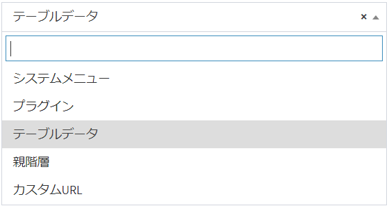
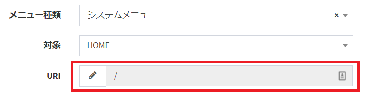

# 菜单
本页说明如何添加、排序、编辑、删除画面左侧显示的菜单。

| 想做的事 | 查看的位置 |
|---|---|
| 在菜单中添加项目 | 新增菜单 |
| 更改菜单的顺序 | 排序 |
| 让上级节点只显示给指定角色组的人 | 可见的角色组 |
| 更新之后，把菜单整理成 v7.2.1 起的标准顺序 | 按标准顺序整理 |

## 概要
登录后，画面左侧会显示菜单。  
菜单中可以添加打开“系统准备的页面”“插件页面”“各个表的页面”“任意 URL”的项目。  
※菜单项目只显示登录用户可以显示的页面。


※从 v7.1.0 起，系统管理员使用的“安全确认”“登录设置”“API 应用设置”“系统性能日志”显示在“管理员设置”之中。“LINE 关联”不在左侧菜单，而是显示在右上角的用户菜单中（[LINE 关联](/zh/line)）。从 v7.0 更新时，只有菜单在最上层时才会移动。自己移动过的菜单保持不变。


### v7.2.1 起的菜单顺序
从 v7.2.1 起，左侧菜单按工作的分类（上级节点）归在一起。顺序与[功能地图](https://exment.net/en/feature-map/)相同。

```
仪表板
协同办公 ▸ 文件共享、邮件（Groupware）
申请与审批 ▸ 待办任务、审批申请（签呈）、费用报销 …（内置模板“申请包”）
项目 ▸ 项目管理（官方插件）
IT 支持 ▸ IT 支持（官方插件）
主数据 ▸ 基本信息、组织、用户、通知信息
设置：数据与页面 ▸ 自定义表、Studio、菜单、工作流、邮件模板、通知、显示预设、模板
设置：用户与权限 ▸ 登录用户、角色组、登录设置、API 设置、操作日志
设置：系统 ▸ 系统设置、功能管理、插件、备份、性能调优、维护模式
```

- 新安装的站点是这个形式。
- 从 v7.1 及以前更新的站点，只有 Exment 放置后没有动过的菜单会移动（管理员设置的内容保持 Exment 的顺序、“主数据管理”仍在从上数第 3 个、文件共享仍在最上层时）。自己移动过的菜单、自己起的名称、插件的菜单保持不变。管理员设置中放有其他菜单的站点，不会拆分管理员设置。
- 官方插件（项目管理、IT 支持、Groupware）和内置模板，把菜单放在各自的分类下面（没有分类时会创建）。只有在最上层的菜单会移动。
- 里面没有可以显示的菜单的分类不会显示（在[功能管理](/zh/feature)中关闭的功能的菜单不会显示）。

#### 按标准顺序整理
更新后顺序没有变化的站点（排过菜单顺序的站点、管理员设置中有其他菜单的站点），可以用“菜单”画面的［按标准顺序整理］整理成上面的形式。
- 点击后，会显示哪个菜单移动到哪里的列表。确认之后点击［整理］。
- 移动的只有 Exment 和官方插件的菜单。自己创建的菜单、表的菜单和其他的菜单，按原来的顺序留在原来的位置（原来在管理员设置中的，放到“设置：系统”的最后）。不会删除任何菜单。
- “HOME”“主数据管理”“管理员设置”的名称，只有在仍是 Exment 所起的名称时，才改成“仪表板”“主数据”“设置：系统”。
- 会保留整理前的菜单，所以可以用同一画面的［撤销］恢复。
- 只有系统管理员可以使用。


## 菜单管理
说明菜单的添加、排序、编辑和删除方法。  

### 显示列表画面
在左侧菜单中点击“菜单”。  
或者访问下面的 URL。  
这样就会显示菜单设置画面。  
http(s)://(Exment的URL)/auth/menu  
画面上会显示当前系统中已登记的菜单列表。


> ※这个 URL 是不带“/admin”的标准设置（v7.2.1 及以后新安装的站点）下的 URL。如果 `.env` 的 `ADMIN_ROUTE_PREFIX` 有值（用以前的版本安装的站点是“admin”），请在站点 URL 的后面加上这个值（例：`http(s)://(Exment的URL)/admin/auth/menu`）。详情请参阅[更改或删除 URL 中的“admin”](/zh/additional_prefix)。

### 新增菜单
在“菜单”的列表画面，在页面右侧的“新增”框中输入必要的内容。  


#### 父级菜单
选择作为要添加的菜单的上级的项目。要在最上层添加菜单时，请选择“ROOT”。


#### 菜单类型
从下面选择要添加的菜单的类型。
- <span class="heading_smaller_than_h5">系统菜单</span>  
想添加 Exment 准备的菜单项目时选择。  

- <span class="heading_smaller_than_h5">插件</span>  
想把用户上传的插件显示在菜单中时选择。  

- <span class="heading_smaller_than_h5">表数据</span>  
想把以列表显示自定义表数据的画面显示在菜单中时选择。  

- <span class="heading_smaller_than_h5">上级节点</span>  
要在该菜单的下面列出下级菜单时选择。  

- <span class="heading_smaller_than_h5">自定义 URL</span>  
要把任意的 URL 添加到菜单时选择。


#### 对象
选择要添加的菜单的项目。显示的项目因“菜单类型”而不同。
- 菜单类型是“系统菜单”时：显示 Exment 准备的页面的列表。


- 菜单类型是“插件”时：显示用户上传的插件的列表。
- 菜单类型是“表数据”时：显示自定义表的列表。


- 菜单类型是“上级节点”“自定义 URL”时：不能选择。


#### URI
点击时打开的 URI。
- 菜单类型是“系统菜单”“插件”“表数据”“上级节点”时：只是显示。不需要填写。  


- 菜单类型是“自定义 URL”时：请填写点击时打开的 URI。  
※实际打开的页面的 URL 如下。
http(s)://(Exment的URL)/(填写的URI)


> 在低于 v3.0.2 的版本进行首次安装的站点，URI 可以登记的字符数上限设成了不到 50 个字符。要登记超过这个字符数的 URI 时，请按[缺陷修正 菜单的 URL 字符数最多 50 个字符](/patch/menu_uri_length)（英语）处理。


#### 菜单名称
用半角英文数字填写菜单的名称。不能使用和其他菜单相同的名称。  
这是不显示在画面上的项目。
- 菜单类型是“系统菜单”“插件”“表数据”时：选择“对象”后会自动填写。  
※同样的菜单项目已经登记时，名称重复，不能保存。请更改值。


- 菜单类型是“上级节点”“自定义 URL”时：请用任意的半角英文数字填写，不要和其他的值重复。  


#### 菜单显示名称
填写显示在左侧菜单中的名称。  
※菜单类型是“系统菜单”“插件”“表数据”时，选择“对象”后会自动填写。  

#### 图标
填写显示在左侧菜单中的图标。  
※菜单类型是“系统菜单”“插件”“表数据”时，选择“对象”后会自动填写。  

#### 可见的角色组
（v7.2.1 及以后。只在菜单类型是“上级节点”时）  
这个上级节点连同里面的菜单，只显示给所选角色组的人。留空时，和以前一样显示给所有人（里面的菜单按各自的权限显示）。对系统管理员始终显示。  
例如可以把“申请与审批”只显示给申请人和审批人，把“财务”分类只显示给财务负责人。  
※只是区分显示，权限不会改变。里面的表和画面可以按各自的权限打开。  
※导出到模板时，角色组用名称写出。导入的站点有同名的角色组时，会关联到它。

### 保存
填写设置后，请点击［提交］。  
※保存之后，重新加载浏览器或者再次访问 Exment，项目就会反映到左侧菜单。

### 排序
已保存的菜单项目的顺序可以在列表画面更改。

1. 拖放项目来调整顺序。
2. 完成后，请点击［保存］。
  


### 编辑
要编辑菜单时，请点击该行的［编辑］链接。  


### 删除
要删除菜单时，请点击该行的［删除］链接。  


> 在 v7.2.1 之前安装的站点，**操作日志列表**不显示在菜单项目中。需要时请从列表进行设置。在 v7.2.1 及以后新安装的站点，它显示在“设置：用户与权限”中。
