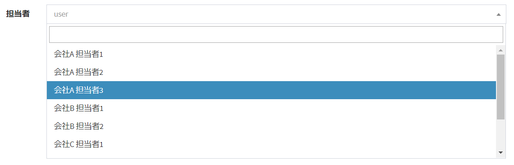
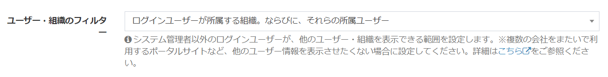

# 面向外部门户网站的设置(构建多个组织的用户登录的系统时)
这项设置让选择和显示用户、组织的地方，**“只显示登录用户所属的组织，以及这些组织的所属用户”**。  
不同公司的人登录同一个 Exment 时（面向外部的门户网站等），建议使用这项设置。

设置本身只需要更改系统设置中的 1 个项目。想先了解步骤的人，请看下面的“[设置方法](/zh/multiuser?id=设置方法)”。

## 背景
Exment 原本主要设想了下面这些用途。  

- 企业内、组织内的信息共享  
- 集团公司之间的信息共享
- 公开 REST API，作为 Web 数据库保存数据

在这些用途中，即使能看到谁在使用、登录了哪些组织和公司，也不会有大问题。能看到反而更自然。  

但是，在下面这样的用途中，**“可以取得其他用户的信息”**有时会成为问题。  

- 给不是集团公司的、完全不同的企业分别发放 Exment 账号，用 1 个 Web 数据库管理数据。
- 以个人为单位发放 Exment 账号，把系统构建成门户网站。

在这样的用途中，**能够查看和取得各用户所属公司以外的用户信息、公司和组织信息，有时会成为问题。**  
  

举个例子，假设构成了下面这样的 Exment。  

- 在某个 Exment 环境中，供应商公司 A、B、C 的负责人都可以登录。
- 各供应商的负责人对表“产品信息”有“编辑负责的数据”权限，输入自己公司负责的产品信息。
- 表“产品信息”中有自定义列“负责人”。在“负责人”列中设置该产品在自己公司的负责人。

如果保持通常的设置，**表“产品信息”的自定义列“负责人”的候选中，会显示供应商公司 A、B、C 所有的负责人。**    
这是因为，Exment 的“用户”列在通常的设置下，会把所有有权限的用户都列为选项。  
  
  
  
因此，有时会希望**“对各组织的登录用户，只显示该用户所属的组织和用户”**。  
  
本页说明进行下面 2 件事的步骤。
- 让登录用户所属的组织以外的组织不能显示。
- 同时，让属于这些组织的用户以外的用户不能显示。

## 设置方法
1. 进入系统设置画面，点击画面右上角的“详细设置”按钮。
2. 把“组织设置”的“用户与组织筛选”一项改成合适的设置。

  

可以选择的设置，因该 Exment 的“使用组织管理”设置是否为 YES 而不同。

### 设置值(使用组织的设置时)
无论选哪一项，登录用户能取得的只有“可以取得的组织”和“属于这些组织的用户”（“不筛选”除外）。

#### 不筛选
- 默认值。不按登录用户筛选组织和用户。

#### 登录用户所属的组织及其上下级组织，以及这些组织的所属用户
- 登录用户只能取得自己所属的组织及其上下级组织的信息。
- 只能取得属于这些组织的用户的信息。

#### 登录用户所属的组织及其上级组织，以及这些组织的所属用户
- 登录用户只能取得自己所属的组织及其上级组织的信息。
- 只能取得属于这些组织的用户的信息。

#### 登录用户所属的组织及其下级组织，以及这些组织的所属用户
- 登录用户只能取得自己所属的组织及其下级组织的信息。
- 只能取得属于这些组织的用户的信息。

#### 登录用户所属的组织，以及该组织的所属用户
- 登录用户只能取得自己所属的组织的信息。
- 只能取得属于这些组织的用户的信息。

### 设置值(不使用组织的设置时)
#### 不筛选
- 默认值。不按登录用户筛选用户。

#### 仅登录用户
- 不能取得登录用户以外的用户信息。

## 进行这项设置后的行为
进行这项设置后，画面会像下面这样变化。  

- **数据编辑页面**：自定义列“组织”的选项，只剩下登录用户可以取得的组织。  
自定义列“用户”的选项，也只剩下登录用户可以取得的用户。

  

- **查看数据**：列中有登录用户不能取得的用户或组织时，不显示用户或组织的链接，而是显示“（没有权限）”。  
※这不是让对象数据本身不能查看的功能。它只是不显示用户和组织。  
出现这个显示时，数据可能也被共享给了本来不是对象的用户或组织。请确认[数据的权限设置](/zh/permission)。

  

- **数据共享画面**：选项只剩下登录用户可以取得的组织和用户。

  

- 只有下面的用户，不管属于哪个组织，都可以取得所有的组织和用户。
    - 系统管理员
    - 在[角色组设置](/zh/role_group)中拥有“获取全部用户和组织”权限的登录用户

