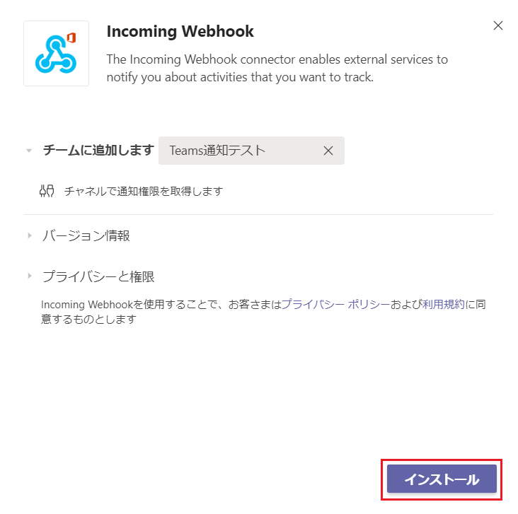
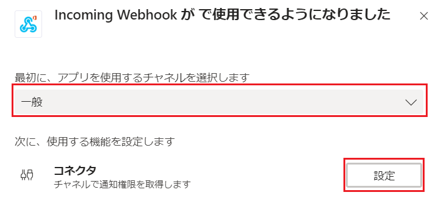
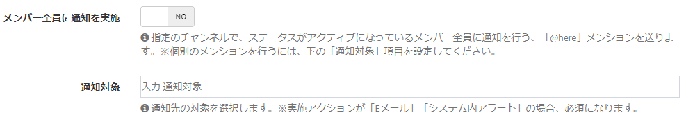

# 通知到 Webhook 时的设置
要向 Slack 或 Microsoft Teams 发送通知，需要“Webhook URL”。Webhook URL 是用来接收通知的专用 URL。  
本页说明 Webhook URL 的取得方法，以及在 Slack 中提及（@）特定的人所需的设置。

| 想做的事 | 看哪里 |
|---|---|
| 通知到 Slack | [Slack 取得步骤](/zh/notify_webhook?id=Slack-取得步骤) |
| 通知到 Microsoft Teams | [Microsoft Teams 取得步骤](/zh/notify_webhook?id=Microsoft-Teams-取得步骤) |
| 在 Slack 的通知中提及用户 | [Slack ID 设置方法](/zh/notify_webhook?id=Slack-ID-设置方法) |

## Slack 取得步骤
1. 打开下面的 URL。  
https://slack.com/services/new/incoming-webhook  

2. 选择通知目标的频道。  
然后点击“添加 Incoming Webhook 集成”。  
  

3. Webhook URL 生成后，复制它。  
  

4. 把复制的 Webhook URL 粘贴到 Exment 的通知设置中。

## Microsoft Teams 取得步骤
1. 打开 Teams，点击要通知的团队的“管理团队”。  
  

2. 点击“应用”选项卡。  

3. 点击“更多应用”选项卡。  

4. 点击“Incoming Webhook”。  

5. 点击“安装”。  

6. 选择要通知的频道。然后点击“设置”。  

7. 输入通知中使用的名称，点击“创建”。  

8. Webhook 的 URL 生成后，复制 URL，点击“完成”。  

9. 把复制的 Webhook URL 粘贴到 Exment 的通知设置中。

## Slack ID 设置方法
这是想在 Slack 中提及特定的人（专门叫那个人）时的设置。  
创建一个存放每个用户的 Slack ID 的列，然后在系统设置中选择这个列。只需在最初做 1 次。

1. 在[自定义表](/zh/table)设置中，点击“用户”表的“自定义列设置”链接。  
 

2. 在用户表的[自定义列](/zh/column)设置中，添加下面的自定义列。
    - 列名（英文和数字）、列显示名称：任意的名称
    - 列类型：“单行文本”

     

3. 在[系统设置](/zh/system_setting)页面的“详细设置”中，“Slack ID 设置列（用户）”选择刚才添加的 Slack ID 列。  
 

4. 在用户数据的编辑页面中，输入各个用户的 Slack ID。通知这个用户时，会带上提及。  
※ 在 Slack 的页面上确认用户 ID 的方法，请看[这里](https://auto-worker.com/blog/?p=27)（日语）。  
 

这样，就可以从通知设置页面，对用户数据中输入的 Slack ID 加上提及。  
在通知设置页面中，通知对象的显示会变成下面这样。（上：没有设置 Slack ID 时，下：设置后）

 
 

