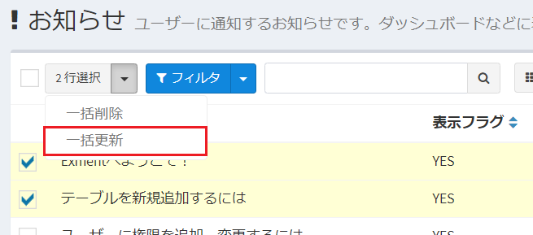

# 批量更新设置
这是在指定的时机（触发条件），例如“点击按钮时”“新建数据时”，一起改写数据的值的设置。  
例如，可以这样使用。  

- 在表“任务信息”的数据详情页面显示“完成”按钮，点击后把自定义列“状态”的值设为完成。
- 更新数据时，把自定义列“负责人”的值自动设为登录用户。

设置的流程如下。

1. 打开批量更新设置的页面（“设置页面”）
2. 点击［新建］，决定何时（更新时机）、把哪一列、设为什么值，然后保存（“新增”“填写项目的详细说明”）
3. 在指定的时机执行更新（“执行更新”）

> 此功能在 v3.5.0 之前叫做“数据批量更新”。从 v3.5.0 起扩展了功能。  
想用更复杂的条件或内容更新时，请创建[插件(按钮)](/zh/plugin_quickstart_button)或[插件(事件)](/zh/plugin_quickstart_event)。

## 更新时机的种类

- ##### 在列表页面勾选时

  

数据列表页面会增加按钮。  
勾选列表页面的复选框，然后点击按钮，就会按设置的内容更新勾选的数据。

- ##### 在数据详情页面点击按钮时

  

数据详情页面会显示按钮。  
点击按钮后，按设置的内容更新数据。

- ##### 新建数据时
用户通过页面、API、导入等新建数据时，按设置的内容更新数据。

- ##### 更新数据时
用户通过页面、API、导入等更新数据时，按设置的内容追加更新数据。

## 设置页面
1. 在自定义表列表中，勾选1个要设置的表，点击右上角的“表详细设置”。  

  

- 或者，从菜单中选择要设置的表，然后同样点击右上角的“表详细设置”。  
※需要事先把该表显示在菜单中。  

  

2. 然后，打开该自定义表的“批量更新设置”。

  

3. 显示批量更新设置页面。

  

## 新增
1. 在“批量更新设置”页面，点击页面右上角的［新建］按钮。

2. 显示批量更新设置的新增页面。输入必要的内容。

  

## 保存
输入设置后，请点击［提交］。

## 编辑
要编辑批量更新设置，请点击该行的［编辑］链接。  

## 删除
要删除批量更新设置，请点击该行的［删除］链接。  

## 填写项目的详细说明

### 基本设置

  

- ##### 处理名称
此批量更新设置的名称。

- ##### 更新时机
选择何时更新数据。  
请参照本页上方的“更新时机的种类”选择。

- ##### 按钮标签
显示在页面按钮上的文字。  
※只在“更新时机”为“在列表页面勾选并点击按钮时”“在数据详情页面点击按钮时”时显示。

- ##### 按钮图标
显示在页面按钮上的图标。  
※只在“更新时机”为“在数据详情页面点击按钮时”时显示。

- ##### 按钮 HTML class
加在页面按钮上的 HTML 的 class。  
※只在“更新时机”为“在数据详情页面点击按钮时”时显示。

- ##### 对工作流锁定的数据也显示按钮
通常，工作流状态为“禁止编辑数据”的数据，数据详情页面不显示按钮。  
设为 YES 后，这样的数据也会显示按钮。默认值为 NO。  
只有拥有该数据编辑权限的用户才会看到按钮。  
※只在“更新时机”为“在数据详情页面点击按钮时”时显示。

- ##### 启用标志
想暂时停用批量更新设置时，或想先保存还没做完的设置时，请把“启用标志”设为 NO。  

### 更新列设置

  

设置要更新的列和更新值。  

- ##### 目标列
选择要更新的列。  

- ##### 更新类型
目标列的自定义列类型为“日期”“时间”“日期和时间”“用户”“组织”时，可以选择“固定值”或“系统值”。  
其他情况下只有“固定值”。

- ##### 更新值
    - 更新类型为“固定值”时，请输入要更新成的值。
    - 更新类型为“系统值”时，根据目标列的自定义列类型，显示以下选项。

| 目标列的自定义列类型 | 选项 |
|---|---|
| “日期”“时间”“日期和时间” | “执行日期时间” |
| “用户” | “登录用户”“创建者” |
| “组织” | “所属组织” |

### 更新条件

  

指定可以执行此更新设置的数据的条件。只有满足条件时，才能执行更新。  
※1个条件都没有设置时，所有数据都可以执行更新。  

### 输入对话框设置

  

执行更新时显示对话框，让用户可以手动输入目标列的更新值。  
※只在“更新时机”为“在列表页面勾选并点击按钮时”“在数据详情页面点击按钮时”时可以选择。

## 执行更新
设置完成后，会在设置项目“更新时机”指定的时机执行更新。  

### 更新内容
- 把数据的值设为设置项目“更新列设置”中指定的值。  
不过，更新类型为“系统值”时，会变为以下的值。  

    - 更新值为“执行日期时间”时，设置执行该更新处理的日期时间
    - 更新值为“登录用户”时，设置执行该更新处理的登录用户的ID
    - 更新值为“创建者”时，设置创建该数据的用户的ID
    - 更新值为“所属组织”时，设置执行该更新处理的登录用户所属组织的ID  
    ※登录用户属于多个组织，而要更新的列没有设置“允许多选”时，第1个组织会保存到该数据中。

- 在设置项目“输入对话框设置”中选择了目标表列时，会显示输入更新值的对话框。  

  

    
### 更新条件
- 不满足“更新条件”中设置的条件的数据，不能执行更新。  
- “更新时机”为“在列表页面勾选并点击按钮时”时，如果勾选了不满足条件的数据并点击更新按钮，会显示错误。这时，其他满足条件的数据也不会更新。

