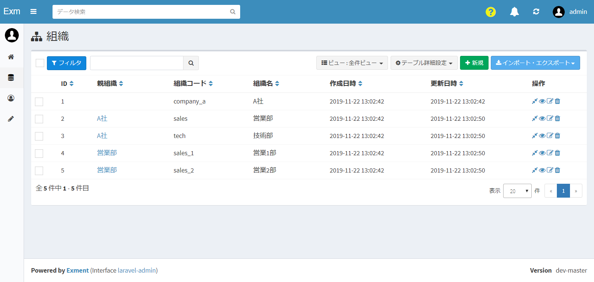
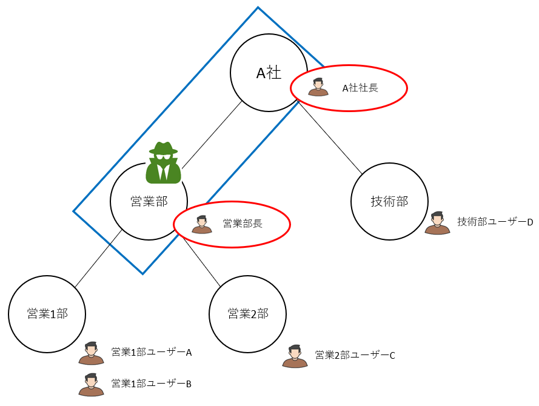
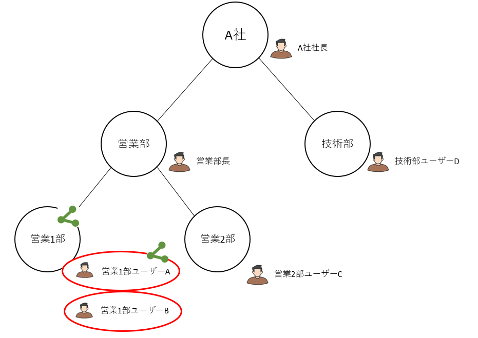

# 组织
本页说明如何把公司的部门、科室等“组织”登录到 Exment 并进行管理。  
登录组织之后，就可以按组织来决定权限、表单、工作流和数据的共享。

> 在设置组织之前，建议先阅读 [Exment 中角色与权限的概要](/zh/permission)页面。

本页的内容如下。

| 想了解的内容 | 查看的位置 |
|---|---|
| 登录、修改、删除组织 | 组织管理 |
| 登录的组织在哪里使用 | 组织的使用位置 |
| 上级组织、下级组织包含到什么范围 | 关于组织层级 |

## 组织管理
说明组织的登录、编辑和删除方法。

### 显示列表画面
在左侧菜单中点击“组织”。  
或者访问下面的 URL。  
这样就会显示组织管理画面。  
http(s)://(Exment的URL)/data/organization  
画面上会显示当前系统中已登录的组织列表。
  

> ※这个 URL 是不带“/admin”的标准设置（v7.2.1 及以后新安装的站点）下的 URL。如果 `.env` 的 `ADMIN_ROUTE_PREFIX` 有值（用以前的版本安装的站点是“admin”），请在站点 URL 的后面加上这个值（例：`http(s)://(Exment的URL)/admin/data/organization`）。详情请参阅[更改或删除 URL 中的“admin”](/zh/additional_prefix)。
  
※在[设置值](/zh/config)中设为“EXMENT_SHOW_ORGANIZATION_TREE=true”，就会显示层级。

### 新增组织
1. 在“组织”的列表画面，点击页面右上角的［新增］按钮。
2. 显示新增画面后，输入必要的内容。  
※“上级组织”一项，请选择该组织的上一级组织。

### 保存
输入完成后，请点击［提交］。

### 编辑
要修改组织时，请点击该行的［编辑］链接。  

### 删除
要删除组织时，请点击该行的［删除］链接。  

## 组织的使用位置
登录的组织可以在下面的位置使用。

| 使用的位置 | 可以做的事 |
|---|---|
| 角色组 | 决定属于该组织的用户能不能访问页面 |
| 多表单切换 | 让属于该组织的用户使用指定的表单 |
| 工作流 | 属于该组织的用户可以执行工作流的操作 |
| 自定义数据的共享 | 属于该组织的用户可以编辑和查看共享的数据 |

#### 角色组 
可以在角色组中设置组织。

- 通过这项设置，可以控制属于该组织的用户能不能访问页面。  
下面的图片中，上面是用户可以访问的情况，下面是用户不能访问的情况。

#### 多表单切换 
可以在多表单切换的条件中设置组织。  
登录用户属于该组织时，就会使用这个表单。

#### 工作流 
可以在工作流的处理用户设置中设置组织。  
登录用户属于该组织时，可以执行工作流的操作。

#### 自定义数据的共享 
可以把组织设置为自定义数据的共享对象。  
登录用户属于该组织时，会被分配自定义数据的权限，可以编辑和查看数据。

## 关于组织层级
在 Exment 中，可以像下图这样给组织设置上下级的层级。

### (面向高级用户)层级的种类
组织有层级时，“属于该组织的用户”包含到什么范围，从下面 4 种中选择。  
这里以“**营业部**”为基准举例说明。

| 种类 | 包含的组织 | 例（以营业部为基准时） |
|---|---|---|
| 用户所属的组织 | 只有对象组织 | 营业部长 |
| 包含上级组织 | 对象组织和它的上级组织 | 营业部长、A公司社长 |
| 包含下级组织 | 对象组织和它的下级组织 | 营业部长、营业1部用户A、营业2部用户B |
| 包含上下级组织 | 对象组织和它的上级、下级组织 | 营业部长、A公司社长、营业1部用户A、营业2部用户B |

#### 用户所属的组织

只包含属于对象组织本身的用户。  
在这个例子中，属于营业部的只有“营业部长”。

#### 包含上级组织

包含对象组织和它的上级组织。  
在这个例子中，包括属于营业部的“营业部长”，以及属于其上级“A公司”的“A公司社长”。

#### 包含下级组织

包含对象组织和它的下级组织。  
在这个例子中，包括属于营业部的“营业部长”，以及属于其下级“营业1部”“营业2部”的“营业1部用户A”“营业2部用户B”。

#### 包含上下级组织

包含对象组织和它的上下级组织。  
在这个例子中，包括属于营业部的“营业部长”、属于其上级“A公司”的“A公司社长”，以及属于其下级“营业1部”“营业2部”的“营业1部用户A”“营业2部用户B”。

<h4 id="kaisou_syurui">(面向高级用户)层级种类的设置</h4>

层级包含到什么范围，在“系统设置” > “组织设置”中设置。

- 只有“角色组”和“自定义数据的共享”可以设置层级。
- “表单优先级设置”和“工作流”只以用户所属的组织为对象。

### 数据共享设置
使用[自定义数据的数据共享设置](/zh/data_details)，其他组织也可以访问该数据。

#### 共享自定义数据时的有效范围
- 把数据共享给组织时，属于该组织的用户可以访问。
- 属于上级组织、下级组织的用户能不能访问，由上面的“层级种类的设置 > 组织层级设置（数据）”决定。
- 其他系列的组织不能访问。

<h4 id="kyouyu_jidou">(面向高级用户)保存数据时自动共享</h4>

新建自定义数据时，会自动给所创建的数据加上共享设置。

- 标准情况下，只给“登录用户”加上共享设置。
- 更改设置后，也会给登录用户所属的组织加上共享设置。
- 这项设置在“系统设置” > “组织设置”中进行。

各项设置的内容如下。

##### (1)仅登录用户
新建自定义数据时，只共享给登录用户。  
- **例**：“营业1部用户A”新建数据时，只有用户“营业1部用户A”可以访问。  

##### (2)登录用户及其所属组织
新建自定义数据时，共享给登录用户和**所属的组织**。  
- **例**：“营业1部用户A”新建数据时，共享给用户“营业1部用户A”和组织“营业1部”。  
→结果，属于组织“营业1部”的用户“营业1部用户B”也可以访问

