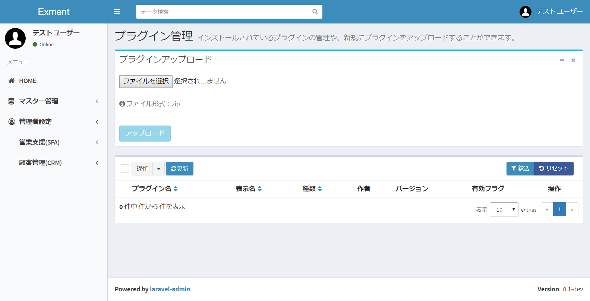
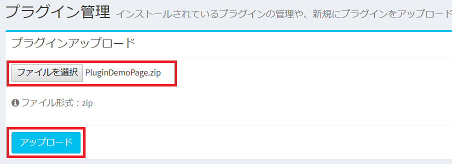
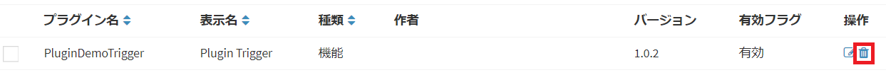
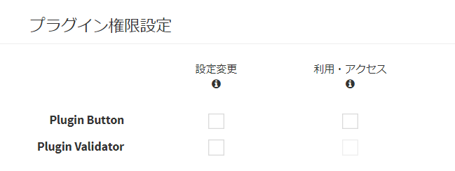

# 插件
插件是用来给 Exment 增加功能的程序。
本页说明插件的种类，以及上传、设置、删除和权限的操作方法。

- 想马上了解安装方法的读者，请参阅“[管理方法](/zh/plugin?id=管理方法)”。
- Exceed One 开发的官方插件，请参阅[官方插件](/zh/plugin_official)。
- 要自己开发插件的读者，请参阅[插件开发方法](/zh/plugin_quickstart)。

## 什么是插件
只靠 Exment 的标准功能不能满足业务需要时，可以在页面上上传程序（zip 文件）来添加功能。这就是“插件”。  
插件目前有以下种类。    

- [按钮](/zh/plugin?id=按钮)
- [事件](/zh/plugin?id=事件)
- [页面](/zh/plugin?id=页面)
- [仪表板](/zh/plugin?id=仪表板)
- [视图](/zh/plugin?id=视图)
- [CRUD 页面](/zh/plugin?id=CRUD-页面)
- [批处理](/zh/plugin?id=批处理)
- [API](/zh/plugin?id=API)
- [验证](/zh/plugin?id=验证)
- [脚本](/zh/plugin?id=脚本)
- [样式](/zh/plugin?id=样式)
- [导入](/zh/plugin?id=导入)
- [导出](/zh/plugin?id=导出)
- [文档输出](/zh/plugin?id=文档输出)
- [Docurain(PDF 输出)](/zh/plugin?id=docurain)
- [触发器 ※不推荐](/zh/plugin?id=触发器)

#### 按钮
可以在 Exment 的列表页面或表单页面上添加按钮，在点击时进行处理。  
※实现方法请参阅[这里](/zh/plugin_quickstart_button)。  
  
可以显示按钮的位置有以下 4 处。    
##### 列表页面的菜单按钮
在数据列表页面的上方添加按钮，在点击时触发事件。

##### 数据详情的菜单按钮
在数据详细页面的上方添加按钮，在点击时触发事件。

##### 表单的菜单按钮（新建时）
在数据新建页面的上方添加按钮，在点击时触发事件。

##### 表单的菜单按钮（编辑时）
在数据更新页面的上方添加按钮，在点击时触发事件。

   

#### 事件
在 Exment 的页面上进行特定操作时执行，可以进行更新值等处理。  
※实现方法请参阅[这里](/zh/plugin_quickstart_event)。  
  
特定操作指的是以下操作。    

- ##### 页面加载前  
在页面加载处理的最开始启动处理。（并不是先于所有处理）  

- ##### 保存前  
在即将保存数据之前启动处理。  

- ##### 保存后  
在保存数据之后启动处理。  

- ##### 删除后  
在删除数据之后启动处理。  

- ##### 工作流执行前  
在即将执行工作流之前启动处理。  

- ##### 工作流执行后  
在执行工作流之后启动处理。  

- ##### 通知前  
在即将执行通知之前启动处理。  

- ##### 通知后  
在执行通知之后启动处理。  

#### 页面
可以在 Exment 中创建新的页面。  
想使用和标准功能完全不同的页面时，请使用这一种。  
※实现方法请参阅[这里](/zh/plugin_quickstart_page)。    

   

#### 仪表板
可以在 Exment 的仪表板中创建新的页面。  
想把自己的页面用作仪表板的项目时，请使用这一种。 
※实现方法请参阅[这里](/zh/plugin_quickstart_dashboard)。

   

#### 视图
可以为 Exment 的自定义数据列表页面创建并添加新的设计和自己的功能。  
想使用和标准提供的视图（列表、汇总、日历视图）完全不同的功能时，请使用这一种。  
※实现方法请参阅[这里](/zh/plugin_quickstart_view)。  

   

#### CRUD 页面
用和 Exment 的列表、详细、新建、更新、删除几乎相同的页面结构创建新的页面。  
可以不把外部的数据导入 Exment，而在 Exment 的页面上管理。也可以对应多个端点。    
※实现方法请参阅[这里](/zh/plugin_quickstart_crud)。  

   

#### 批处理
想自动执行定期的处理时可以使用。  
想一次执行特定的处理（如批量更新状态）时也可以使用。    
※实现方法请参阅[这里](/zh/plugin_quickstart_batch)。

#### API
可以在 Exment 中创建新的 API。  
要添加 [API 参考](https://exment.net/reference/ja/webapi.html)（日语）中没有的功能时，请使用这一种。  
※实现方法请参阅[这里](/zh/plugin_quickstart_api)。

#### 脚本
可以执行自己的脚本（javascript）。  
目前支持的是显示数据列表页面时、显示数据详细页面时、显示数据新建页面和更新页面时。  
※实现方法请参阅[这里](/zh/plugin_quickstart_script)。

   

#### 样式
可以设置自己的样式（样式表、css），更改设计。  
※实现方法请参阅[这里](/zh/plugin_quickstart_style)。

   

#### 验证
想自己实现自定义表的验证（输入值的检查）时可以使用。  
要实现复杂的检查、项目之间关联的检查时，请使用这一种。    
※实现方法请参阅[这里](/zh/plugin_quickstart_validate)。

   

#### 导入
想自己实现自定义数据的导入处理时可以使用。  
要导入自有格式的文件、实现特殊的转换处理时，请使用这一种。  
※实现方法请参阅[这里](/zh/plugin_quickstart_import)。

   

#### 导出
想自己实现自定义数据列表的导出时可以使用。  
要导出自有格式的文件、实现特殊的转换处理时，请使用这一种。  
输出格式除了 Excel 之外，也可以用其他格式输出。  
※实现方法请参阅[这里](/zh/plugin_quickstart_export)。

   

#### 文档输出
可以制作报价单、单据等自己的文档资料。  
作为基础的模板是 Excel 格式，输出也是 Excel 格式。    
※实现方法请参阅[这里](/zh/plugin_quickstart_document)。
※要以 PDF 格式输出时，请考虑 [Docurain 插件](/zh/plugin_quickstart_docurain)。  

   

<h4 id="docurain"><a href="#/zh/plugin?id=docurain" data-id="Docurain(PDF 输出)" class="anchor">Docurain(PDF 输出)</a></h4>

使用只需 Excel 和 json 就能开发单据的云端单据引擎 **Docurain** 输出 PDF。  
作为基础的模板是 Excel 格式，输出是 PDF 格式。    
※实现方法请参阅[这里](/zh/plugin_quickstart_docurain)。

#### 触发器
※从 v3.2.0 起不再推荐使用。  
今后请用“按钮”或“事件”来实现。

## 官方插件
这些是 Exceed One 开发并提供支持的官方插件。可以从 GitHub 的 [exceedone/exment-plugins](https://github.com/exceedone/exment-plugins) 下载。  
安装方法请参阅[官方插件](/zh/plugin_official)。

| 插件 | 可以做的事 |
| --- | --- |
| [项目管理](/zh/plugin_pm) | 项目和课题（工单）的管理。课题的树形显示、里程碑、看板、甘特图、Wiki、评论、通知等 |
| [IT 支持](/zh/plugin_it_support) | 服务台。用工单管理来自邮件、受理表单和电话的请求，并与客户共享进展，客户无需登录 |
| [Groupware](/zh/plugin_groupware) | Web 邮件，以及在浏览器中打开、编辑文件共享里的 Office 文件 |

## 管理方法
### 显示页面
- 在左侧菜单中选择“插件”。  
或者访问以下 URL。  
http(s)://(Exment的URL)/plugin  
会显示插件页面。    
  

> ※此 URL 是不带“/admin”的标准设置（v7.2.1 及以上版本新安装的站点）时的写法。`.env` 的 `ADMIN_ROUTE_PREFIX` 有值时（用以前的版本安装的站点为“admin”），请在站点的 URL 后面加上该值（例：`http(s)://(Exment的URL)/admin/plugin`）。详情请参阅[更改、删除 URL 中包含的“admin”](/zh/additional_prefix)。

### 上传插件
1. 点击［选择文件］，选择插件的 zip 文件。
2. 点击［上传］。
3. 完成后，页面下方的列表中会显示插件的信息。

    

### 插件管理
更改插件的启用和停用、插件的触发条件、页面的 URI 等信息。  
请在列表中点击要更改的插件所在行的［编辑］链接。  
  

会显示插件管理页面。    
  

### 管理项目

##### 启用
切换是否在系统中使用该插件。  
设为 YES 时启用。设为 NO 时停用，不会在系统中执行。    
※上传插件时默认为 YES。但是，插件类型为“批处理”时，上传时默认为 NO。

##### 目标表
指定执行插件的目标自定义表。  
显示所设置的表的页面时，会执行插件。  

##### 执行触发条件
设置在进行哪种操作时执行插件。
进行所设置的操作时，会执行插件。    

##### 按钮标签
显示“列表页面的菜单按钮”或“表单的菜单按钮”时，设置显示在按钮上的标签。

##### 按钮图标
显示“列表页面的菜单按钮”或“表单的菜单按钮”时，设置显示在按钮上的图标。

##### 按钮的 HTML class
显示“列表页面的菜单按钮”或“表单的菜单按钮”时，设置附加到按钮 HTML 上的 class。

## 删除插件
要删除插件，请在列表页面中点击该插件所在行的［删除］链接。  
  
※执行［删除］后，插件的文件本身会被删除。  
只是想暂时停用时，请不要删除，而把“启用”设为 NO。    

## 角色权限管理

可以用权限把能更改插件设置的用户、组织，和能使用插件的用户、组织分开。  
例如，可以进行以下设置。

- 只有特定的部门或上级才能访问插件的页面
- 只有特定的部门或上级才能进行文档输出

### 管理方法

#### 通过角色组管理
- 访问[角色组设置](/zh/role_group)的页面。  
- 在“插件权限设置”的项目中，设置要管理的插件的权限。  

  

##### 权限一览
- **更改设置** : 对于带有设置项的插件，可以更改该插件的设置。  
※不能删除或上传插件。要进行删除时，请添加“管理所有插件”。
- **使用/访问** : 可以实际使用插件，或访问其页面。控制的内容因插件的种类而不同。    
    - **按钮、文档输出** ： 控制页面上按钮的显示和隐藏。
    - **页面、仪表板** ： 切换能否访问页面。
    - **API** ： 切换能否执行 API。(不能访问时，会发生 403 错误。)
    - **导入、导出** ： 控制能否执行数据的导入、导出。
    - **其他** : 不能通过角色组进行控制。对所有用户都会执行。
    
#### 插件单独的管理
这是不使用角色组，让所有用户都能使用该插件的方法。

- 打开插件的编辑页面。

- 把“所有用户可用”设为 YES 并保存。    
(只有插件的种类为按钮、文档输出、页面、仪表板、API、导入、导出时，才显示此项目。)

  

- 无论角色组如何设置，所有用户都可以使用、访问该插件。  

> 为了向后兼容，在 v3.2.0 之前的版本中上传的插件，这个“所有用户可用”为 YES。  
在 v3.2.0 及以上版本中上传的插件，默认为 NO。

## 其他
关于插件的开发方法，请参阅[插件开发方法](/zh/plugin_quickstart)。
