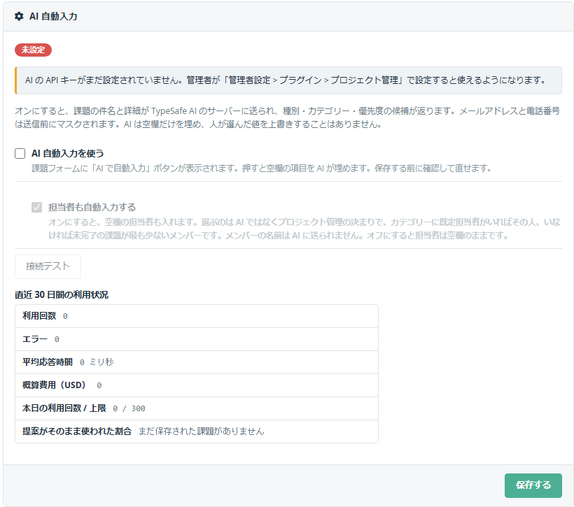
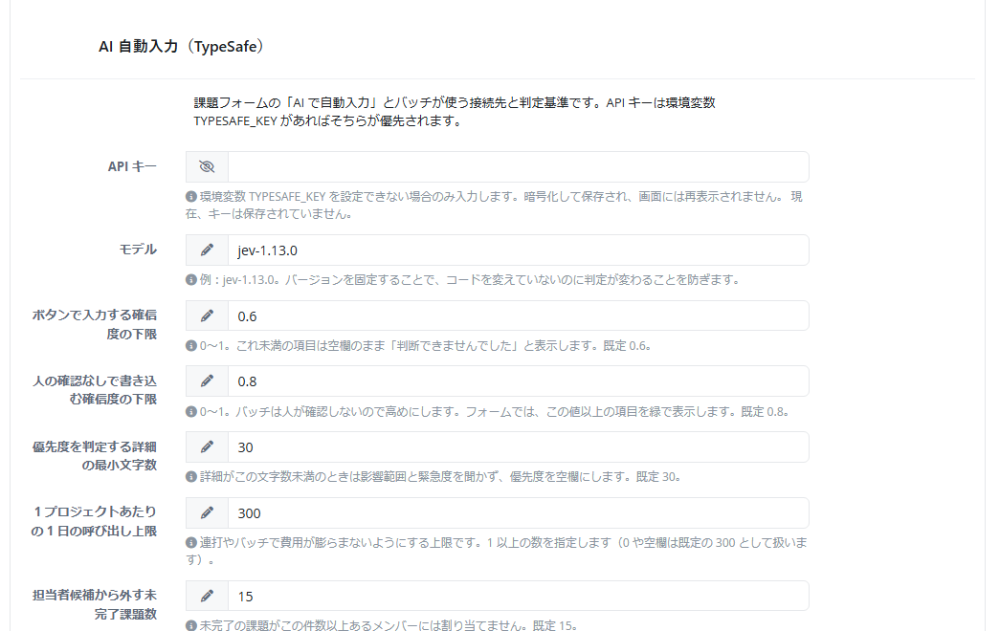

# 项目管理（官方插件）

“项目管理”（プロジェクト管理）是由 Exceed One 开发、测试并提供支持的 Exment **官方插件**。  
可以在 Exment 的表上管理项目和工单（课题）。可以免费使用。

- 源代码和说明：[exceedone/exment-plugins（project-management）](https://github.com/exceedone/exment-plugins/tree/main/project-management)
- 许可证：GPL-3.0（与 Exment 相同）
- 介绍页面：[项目管理（exment.net）](https://exment.net/en/project-management/)
- 插件列表中显示的名称：Exment Plugin PM（プロジェクト管理）。zip 和内部名称为 `ExmentPM`（1.2.0 及以前为 `PmPortal`，1.3.0 为 `ExmentPluginPM`）。


## 可以做的事

| 功能 | 内容 |
| --- | --- |
| 项目 | 按项目汇集课题、看板、甘特图、Wiki 和文件。成员分为管理者、成员、查看者 3 种（使用 Exment 的角色组）。 |
| 课题 | 列表（筛选、快速筛选）、父子的树形显示、在列表中直接编辑、批量更新、附件。正文可以用 Markdown 书写，也可以粘贴图片。保存之后，不重新加载整个页面，而是当场重新绘制列表和详细内容（从 1.6.5 起）。 父子课题最多可叠 5 层（从 1.7.18 起 / 需要 Exment 7.2.6）。 |
| 课题的角色 | 除了负责人之外，还可以设置副负责人、管理者、审阅者，以及难度（容易、普通、困难）。课题的详细内容中也会显示提出者。副负责人、管理者、审阅者也和负责人一样会收到更新的通知（从 1.6.0 起）。 |
| 里程碑 | 按里程碑管理课题，以及燃尽图。 |
| 看板、甘特图 | 用按状态划分的看板或甘特图显示课题。 |
| Wiki、文件 | 用 Wiki 和文件共享项目的资料。 「ファイル」标签页可以显示 Exment 文件服务器的工作区（从 1.7.18 起 / 需要 Exment 7.2.6）。 |
| Word、Excel、PowerPoint | 在课题、评论、Wiki、项目的文件上点击“表示”（显示），不用下载就可以在页面中打开。有编辑权限的人还可以直接编辑、保存（从 1.7.0、1.7.1 起。需要 [Groupware](https://github.com/exceedone/exment-plugins/tree/main/groupware) 0.4.0 及以上版本和支持 WebGPU 的浏览器）。没有安装时，和以前一样是下载。 |
| 评论 | 可以在课题上写评论。可以指定要通知的用户（提及），也可以请求确认（审阅）。 |
| 已读、未读 | 可以知道谁读过课题。还没有看过的课题，在列表中会带颜色。 |
| 通知 | 页面上铃铛的通知，以及在登记课题、评论时或用“メールで知らせる”（用邮件通知）按钮发送的邮件（邮件用 Exment 的邮件设置发送）。 每个人还可以选择用邮件、Teams 或两者接收（从 1.7.18 起 / 需要 Exment 7.2.6）。 |
| 设置 | 在“⚙ 設定”（设置）中进行门户的设置和数据结构的更新。系统管理员可以使用“データ移行”（数据迁移）：把项目连同评论、变更历史、附件一起导出为 ZIP，再导入到另一个 Exment（先只做确认，然后再写入）。导入的课题上还会显示迁移来源的课题键、URL、登记者以及自定义属性（从 1.5.0 起）。 |

## 运行要求
- Exment 7.0 及以上版本（PHP 8.2 及以上版本）
- 使用邮件通知功能时，需要设置 Exment 的邮件发送（[邮件发送设置](/zh/mailsend_setting)）。只使用铃铛通知时不需要设置。
- 页面只有日语。

## 安装
※Exment v7.2.1 及以上版本中，项目管理随 Exment 一起提供。不需要下载和上传，在“管理员设置”→“功能管理”的“免费官方插件”中点击“使用（安装）”即可。之后请进入“[3. 初始设置](/zh/plugin_pm?id=3.-初始设置)”。刚从功能管理安装时，左侧菜单中还没有“プロジェクト管理”（项目管理），它会在初始设置之后出现。详情请参阅[官方插件](/zh/plugin_official)。


### 1. 下载
从 GitHub 的 [Releases](https://github.com/exceedone/exment-plugins/releases) 下载最新的 zip。不要解压。

- 最新版是 [Releases](https://github.com/exceedone/exment-plugins/releases) 的“ExmentPM-v（版本）”中的 `ExmentPM-（版本）.zip`。

※请不要使用绿色的“Code → Download ZIP”按钮。那是整个仓库的 zip，Exment 无法读取。

※使用 Exment SaaS（`*.exments.com`）时不需要下载。请参阅 [Exment SaaS 的情况](/zh/plugin_pm?id=Exment-SaaS-的情况)。

### 2. 上传
- 用系统管理员登录 Exment。
- 打开“管理员设置”→“插件”，在“上传插件”中选择下载的 zip，点击“上传”。详情请参阅[插件](/zh/plugin)。


- 下方的列表中出现“ExmentPM”，上传就完成了。这时还没有创建表和菜单。

### 3. 初始设置
- 用系统管理员打开 `/plugins/exment_pm`（在 URL 带有“/admin”的站点上为 `/admin/plugins/exment_pm`）。
- 会显示“初期セットアップ”（初始设置）的页面。确认将要创建的表的列表，点击“テーブルを作成する”（创建表）。


- 已经有同名的表时，会显示为红色。填入“テーブル名の接頭辞”（表名的前缀，例：`pm2_`），就可以用别的名称创建表。页面上显示的名称不变。
- 完成后，会打开项目管理的仪表板。左侧菜单中会增加 1 个“プロジェクト管理”（项目管理）（从 1.4.1 起）。平时从这里打开。
- 初始设置还会创建以下内容。
    - 角色组：プロジェクト管理者グループ（项目管理者组）、プロジェクトメンバーグループ（项目成员组）、プロジェクト閲覧者グループ（项目查看者组）
    - 通知：課題の登録・更新通知（课题的登记、更新通知，铃铛）
    - 优先级：至急（紧急）、高（高）、中（中）、低（低）；完成理由：対応済み（已处理）、対応しない（不处理）、無効（无效）、重複（重复）、再現しない（无法重现）、保留（搁置）

※初始设置只有系统管理员可以进行。  
※不会创建示例项目和课题。

## 开始时的设置

第一次使用时，按以下顺序设置。

1. 把使用的人加入角色组
2. 创建项目
3. 把成员加入项目
4. 按项目调整状态、类别等（不调整也可以使用）
5. 确认通知

### 1. 把使用的人加入角色组
使用项目管理的人必须属于某一个角色组。不属于的人，菜单中不会出现“プロジェクト管理”（项目管理），打开时会显示“権限がありません。”（没有权限。）（系统管理员不加入也可以使用）。

在“管理员设置”→“角色组”中，把用户或组织加入初始设置时创建的以下组。详情请参阅[角色组](/zh/role_group)。

| 角色组 | 名称（字母数字） | 可以做的事 |
| --- | --- | --- |
| プロジェクト管理者グループ（项目管理者组） | `pm_admin_group` | 可以查看、修改所有项目和课题。也可以修改状态、类别、优先级等的列表。 |
| プロジェクトメンバーグループ（项目成员组） | `pm_member_group` | 可以在参加的项目中添加、编辑课题。 |
| プロジェクト閲覧者グループ（项目查看者组） | `pm_viewer_group` | 只能查看参加的项目。 |


※只加入角色组，还看不到项目。请同时进行“3. 把成员加入项目”。

### 2. 创建项目
- 在项目管理的仪表板上点击“＋プロジェクトの追加”（添加项目）（页面上方的“プロジェクト”（项目）菜单中也有）。
- 填入“プロジェクト名”（项目名称）和“プロジェクトキー”（项目键），点击“作成する”（创建）。
    - 项目键会加在课题编号的前面（例：`WEB` 时为 `WEB-1`）。以大写英文字母开头，只能使用大写英文字母、数字和 `_`，最多 32 个字符。
    - 选择“親プロジェクト”（父项目），可以把项目做成层级。


- 创建后，会打开该项目的“設定”（设置）选项卡。创建的人成为项目经理（负责人）。

※能创建项目的，是可以向项目的表中添加数据的人（系统管理员、项目管理者组等）。

### 3. 把成员加入项目
在项目的“設定”（设置）选项卡 →“参加ユーザー”（参加用户）中决定谁参加，然后点击“保存する”（保存）。

| 项目 | 内容 |
| --- | --- |
| プロジェクトマネージャ（项目经理） | 项目的负责人。可以添加、编辑课题，以及更改项目的设置。 |
| メンバー（編集）（成员（编辑）） | 可以添加、编辑课题。 |
| 参照メンバー（閲覧）（参照成员（查看）） | 只能查看。 |
| メンバー組織（編集）・参照組織（閲覧）（成员组织（编辑）、参照组织（查看）） | 加入组织（团队）后，该组织的所有人以相同的权限参加。 |


- 从列表中移除的人，从保存的时候起，就不能打开该项目（包括课题和 Wiki）了。
- 系统管理员和项目管理者组的人，即使不在这个列表中，也可以打开所有项目。
- 能更改项目设置的，是项目经理和项目管理者组的人（以及系统管理员）。

### 4. 状态、类别等的列表（主数据）
课题中可选项目的列表可以直接使用。可以按项目修改名称、颜色和排列顺序。

| 列表 | 决定的单位 | 修改的位置 | 初始值 |
| --- | --- | --- | --- |
| 状態（状态） | 每个项目 | 项目的“設定”（设置）→“状態”（状态） | 未対応（未处理）、処理中（处理中）、レビュー中（审阅中）、処理済み（已处理）、完了（完成） |
| 種別（类别） | 每个项目 | 项目的“設定”（设置）→“種別”（类别） | タスク（任务）、バグ（缺陷）、要望（需求）、改善（改进）、その他（其他） |
| カテゴリー（分类） | 每个项目 | 项目的“設定”（设置）→“カテゴリー”（分类） | （无） |
| マイルストーン（里程碑） | 每个项目 | 项目的“設定”（设置）→“マイルストーン”（里程碑） | （无） |
| 優先度（优先级） | 所有项目通用 | ⚙ 项目管理的设置 →“課題の選択肢”（课题的选项） | 至急（紧急）、高（高）、中（中）、低（低） |
| 完了理由（完成理由） | 所有项目通用 | ⚙ 项目管理的设置 →“課題の選択肢”（课题的选项） | 対応済み（已处理）、対応しない（不处理）、無効（无效）、重複（重复）、再現しない（无法重现）、保留（搁置） |

- 勾选状态的“完了扱い”（视为完成）后，处于该状态的课题在燃尽图和是否过期的判断中按“完成”计算。
- 正在使用的行不能删除。


**⚙ 项目管理的设置**从项目管理页面右上角的“⚙ 設定”（设置）打开。这是所有项目通用的设置页面，只有系统管理员可以打开（其他人看不到“⚙ 設定”）。


### 5. 通知
通知有页面右上角的铃铛和邮件 2 种。

**铃铛（什么都不做也会收到）**
- 课题被登记、更新或有了评论时，负责人、“お知らせ先”（通知对象）的人、创建课题的人会收到。做出变更的本人不会收到。
- 写评论时在“お知らせしたい人”（要通知的人）中选择的人，以及“ウォッチ”（关注）该课题的人也会收到。
- 在评论中加上 `@` 写成员的名字，那个人会收到（提及）。
- 勾选“確認を依頼する”（请求确认）后，所选的人会收到“【確認依頼】”（【请求确认】）的通知。对方点击“確認しました”（已确认）后，写评论的人会收到。
- 没有查看课题权限的人不会收到。


**邮件（发送时选择）**  
邮件不会自动发送。用以下任一种方法发送。
- 登记课题或评论时勾选“メールでも知らせる”（也用邮件通知）。会把同样的内容也用邮件发给接收铃铛通知的人。
- 在课题页面的“…その他”（…其他）→“メールで知らせる”（用邮件通知）中选择发送对象，点击“送信”（发送）。只发给有查看课题权限的人。邮件带有正文的摘录和课题的链接。


- 邮件用 Exment 的邮件发送设置发送。请先完成[邮件发送设置](/zh/mailsend_setting)。
- 用户没有电子邮件地址时，不会发给那个人。
- 铃铛的通知“課題の登録・更新通知”（课题的登记、更新通知）可以在 Exment 的[通知设置](/zh/notify)页面中查看。

### 6. AI 和 Git 的联动（只在使用时）
两者初始都是关闭的。不使用也可以正常使用项目管理。

**AI 自动输入**  
课题页面上会出现“AI で自動入力”（用 AI 自动输入）按钮。点击后，AI 会填写空着的“種別”（类别）、“カテゴリー”（分类）、“優先度”（优先级）。保存之前，人可以确认并修改。
- AI 使用 TypeSafe（外部服务）。课题的标题和详细内容会发送到 TypeSafe 的服务器。电子邮件地址和电话号码在发送前会被隐藏。
- 系统管理员在“管理员设置”→“插件”→“Exment Plugin PM”的设置页面的“AI 自動入力（TypeSafe）”（AI 自动输入）中填入 API 密钥（服务器上有环境变量 `TYPESAFE_KEY` 时，使用该变量）。
- 在项目的“設定”（设置）→“AI 自動入力”（AI 自动输入）中勾选“AI 自動入力を使う”（使用 AI 自动输入）并保存。可以用“接続テスト”（连接测试）确认能否连接。
- 打开“担当者も自動入力する”（负责人也自动输入）后，也会填入空着的负责人。负责人不是由 AI 选择，而是按规则选择（分类的默认负责人；没有时，选未完成课题最少的成员）。





**Git 仓库**  
为每个项目创建 Git 的仓库（Gitea、Forgejo），使其可以使用。
- 服务器的管理员把 Git 服务器的连接目标设置到服务器的环境变量中（`PMPORTAL_GIT_PROVIDER`、`PMPORTAL_GIT_API_URL`、`PMPORTAL_GIT_API_TOKEN` 等）。不能在页面上设置。
- 在项目的“設定”（设置）→“Git リポジトリ”（Git 仓库）中点击“Git を有効にする”（启用 Git），由项目经理填入“リポジトリ名”（仓库名称），点击“リポジトリの作成をリクエスト”（请求创建仓库）。没有设置 Git 服务器时，会一直停留在“作成待ち”（等待创建）。
- 仓库创建好之后，每个人自己点击“HTTP クローン用パスワードを発行”（发行 HTTP 克隆用密码），领取密码。密码只显示 1 次。


## 使用方法
这里按 1.7.18 的页面说明。打开项目后，会出现“ホーム”（主页）、“ボード”（看板）、“課題”（课题）、“ガントチャート”（甘特图）、“バーンダウン”（燃尽图）、“Wiki”、“ファイル”（文件）、“設定”（设置）选项卡。Wiki、文件、图表（甘特图、燃尽图）和父子课题，可以在项目的“設定”（设置）→“利用する機能”（使用的功能）中停用。停用后只是隐藏选项卡，数据不会消失。

### 课题
**列表（“課題”（课题）选项卡）**
- 在最上面一行按状态筛选（“すべて”（全部）、“完了以外”（完成以外）以及项目的各个状态。也会显示条数）。
- 用其下方的快速筛选，可以筛选出“期限切れ”（已过期）、“今日・明日”（今天、明天）、“自分が作成”（自己创建）、“ウォッチ中”（关注中）、“未読”（未读）、“確認待ち”（等待确认）的课题。
- 也可以按关键字、负责人、类别、里程碑、分类、已读、未读、优先级、“自分の課題”（自己的课题）筛选。用“検索条件を保存”（保存搜索条件），下次也用同样的条件打开。也可以在“保存した条件”（保存的条件）中起名保存。
- 用“CSV”下载筛选出的所有课题。
- 选中行后，可以一起修改（“一括更新”（批量更新））。也可以在列表中当场修改。
- 完成 30 天以上的课题会从列表中隐藏（归档）。用“表示する”（显示）可以显示出来。

**创建课题**
- 从上方的“課題の追加”（添加课题）创建。课题的编号为项目键加数字（例：`WEB-1`）。

**正文、评论、附件**
- 正文和评论按项目的“テキスト整形のルール”（文本格式规则）（Markdown 或 Backlog記法（Backlog 标记法）。初始为 Markdown）书写。有标题、粗体、列表、清单、表格、链接等按钮，以及“プレビュー”（预览）。
- 用 `Ctrl+V` 粘贴图片后，会直接作为附件。文件可以拖放，或用“ファイルを添付”（添加附件）添加。
- 从课题页面下方的“コメントを追加”（添加评论）写评论。可以在写评论的同时，用“状態を変更”（更改状态）或“課題を変更”（更改课题）修改项目。用 `Ctrl+Enter` 登记。
- 用 `@` 可以选择成员，用 `#` 选择课题，用 `~` 选择附件并插入。
- “コメント・変更履歴”（评论、变更历史）可以切换为“コメントのみ”（只看评论）。

**已读和未读**
- 还没读的课题在列表中显示为未读（粗体）。打开课题后就变成已读。右键点击一行，可以手动标为已读或未读。在课题页面可以看到谁读过。
- 从 1.7.18 起：从列表打开的课题，回到列表后仍是已读。你标记的状态（打开，或手动标记）即使列表刷新，也会保留 1 分钟。之后以服务器的回答为准。

### 父课题和子课题
- 在课题的编辑中点击“親課題を設定”（设置父课题），按键或标题搜索并选择。也可以从课题页面的“子課題を追加”（添加子课题）创建。
- 父课题的页面上会出现“子課題”（子课题）栏，可以知道完成了几条。列表的“ツリー”（树形）中也按父子排列。
- 只有同一个项目的课题可以作为父课题。
- 父子课题最多可叠 **5 层**（课题、它的子课题、子课题的子课题 ...）（从 1.7.18 起 / 需要 Exment 7.2.6）。以前只有 1 层。
- 层数是插件的设置：在插件设置的「課題」（课题）>「課題の階層の数」（层数）中设置，范围 2 到 10，初始值为 5。
- 只有两种情况不能设为父课题：会形成循环（放到自己的子课题之下），或者该课题（或其下最深的课题）超过层数。提示信息会说明是哪一种。选择父课题的画面只显示可以选的课题。
- 有子课题的课题，也可以移到同一项目的其他课题之下。子课题一起移动（只限仍在层数以内时）。移到其他项目，仍然不行。
- 减少层数后，已经更深的课题保持原样。只在新设置父课题时检查。
- 列表的「ツリー」（树）显示所有层（缩进、折叠）。有子课题的课题，在自己的进度旁边显示「子の進捗」（子课题的进度）N%。它是下面没有子课题的课题的进度平均值（已完成算 100%）。只用于显示，不保存。
- 甘特图在 Exment 7.2.6 中会缩进显示更深的层。看板不变（卡片显示父课题）。
- 有子课题的课题，不能删除，也不能移动到其他项目。请先去掉子课题的父课题。
- 在项目中停用“親子課題”（父子课题）后，不能设置父课题。

### 看板、甘特图、里程碑、燃尽图
- **看板**：把课题按状态排成列。拖动卡片后，状态会改变。列根据项目的状态列表生成。使用的是 Exment 的[看板视图](/zh/view_kanban)。
- **甘特图**：用横条显示从开始日到期限日的时间。颜色表示状态，进展用进度率表示，按里程碑归类。使用的是 Exment 的[甘特图视图](/zh/view_gantt)。
- 看板和甘特图使用初始设置时创建的课题视图（“カンバン（状態別）”（看板（按状态））、“ガントチャート”（甘特图））。删除视图后，选项卡上会显示创建方法的说明。
- **里程碑**：在项目的“設定”（设置）→“マイルストーン”（里程碑）中创建，并设置到课题上。“ホーム”（主页）上会显示每个里程碑剩余的天数。
- **燃尽图**：选择里程碑后，用计划线、实际线和预测显示剩余课题的数量。也会显示按现在的进度能否赶上期限。没有设置了里程碑的课题时，不会显示。按完成计算的，是“完了扱い”（视为完成）的状态。

### 通知
- 铃铛和邮件的规则，请参阅上方的“5. 通知”。铃铛什么都不做也会收到，邮件用“メールでも知らせる”（也用邮件通知）或“メールで知らせる”（用邮件通知）发送。
- **也可用邮件、Teams（每个人自己选）**（从 1.7.18 起；Teams 需要 Exment 7.2.6）：在门户顶部栏的「通知」中，每个人可以选择，除了铃铛之外，课题的通知（新课题、变更、评论）是否也用邮件、Teams 或两者接收。还没选择的人，按插件设置「受け取り方の初めの値」（接收方式的初始值）处理（最初只有铃铛）。
- 邮件和 Teams 的样子相同：标题中有粗体的课题键（課題が更新されました（KEY））、课题的链接、主题，以及用编号列表列出的变更内容。邮件按 Exment 的邮件设置，为 HTML（附文本部分）或纯文本。「メールでも知らせる」（也用邮件通知）和以前一样，向收到铃铛的所有人发送相同样式的邮件。
- Teams 需要 Exment 7.2.6 或更高版本。请在[功能管理](/zh/feature)中打开“Teams 通知（个人聊天）”，并在系统设置中填写 Teams 工作流的地址（参见“[通知到 Teams 个人聊天](/zh/notify_teams)”）。较旧的 Exment 只能用邮件。

### 文件和 Wiki
- **文件**：可以在 1 个列表中查看课题、Wiki、项目的附件（名称、更新者、更新日期、位置）。拖放到这里的文件，会作为项目的附件保存。
- **文件服务器的工作区**（从 1.7.18 起 / 需要 Exment 7.2.6）：「ファイル」标签页可以不只显示附件列表，而是使用项目的工作区。这是 Exment 的[文件服务器](/zh/file_server)（文件夹、上传、共享链接、版本、搜索、复制链接、用 Office 打开）。它是[功能管理](/zh/feature)中的「プロジェクト管理のファイル（ファイルサーバー）」，在系统管理员打开之前不能使用。文件服务器功能必须可用。
- 项目管理员在项目的「設定」（设置）>「ファイルサーバー」（文件服务器）中创建工作区，或选择自己管理的工作区。一个项目一个工作区。在只有系统管理员能创建工作区的站点，由系统管理员创建并把管理权限授予项目管理员，再由项目管理员选择。
- 最上层的权限跟随项目：管理员管理，成员和成员组织编辑，查看者和查看组织查看。项目的人员每次变化时会重新设置，也可以用「権限をプロジェクトに合わせ直す」（按项目重新设置权限）按钮重新设置。在文件服务器中单独给文件夹设置的权限保持不变。
- 标签页直接显示文件服务器的页面。用「ファイルサーバーで開く」（在文件服务器中打开）可以大屏打开。课题、Wiki、项目的附件仍像以前一样列在其下，不会移动。解除关联后，工作区和文件不会被删除。
- 安装了 [Groupware](https://github.com/exceedone/exment-plugins/tree/main/groupware) 时，Word、Excel、PowerPoint 可以用“表示”（显示）打开（请参阅“可以做的事”的表）。
- **Wiki**：用“追加”（添加）创建项目的页面。有父页面的页面，会在左侧列表中以树形排在父页面下面。有“編集”（编辑）、“履歴”（历史）、“添付”（附件），也可以加标签。

### 从 Backlog 导入（ExmentPMBacklog）
用另一个插件“Exment Plugin PM Backlog 連携”（Backlog 联动）（`ExmentPMBacklog`，0.2.0），按设定的间隔把 Backlog 项目的课题导入到项目管理的项目中。以 Backlog 为准，是从 Backlog 到 Exment 的单向导入（在 Exment 中修改的内容，会被 Backlog 的内容覆盖）。

- 需要的条件：项目管理（ExmentPM）1.7.7 及以上版本。要按设定的间隔运行，需要[任务计划](/zh/additional_task_schedule)。
- 安装方法：在“管理员设置”→“插件”中上传 [Releases](https://github.com/exceedone/exment-plugins/releases) 的“ExmentPMBacklog-v（版本）”中的 zip。
- 开始的位置：`/plugins/exment_pm_backlog`（“Backlog 連携”（Backlog 联动））。只有系统管理员可以使用。
    1. 在“つながりを追加”（添加连接）中，填入 Backlog 空间的 URL、API 密钥、项目键、导入目标的 Exment 项目、间隔（5 分钟以上，初始为 30 分钟）。API 密钥加密后保存，不在页面上显示。
    2. 在“割り付け”（对应）中，把 Backlog 的状态、类别、优先级、分类、里程碑、完成理由和用户，对应到 Exment 的项目上。也可以使用“読み直して、足りない状態・種別・カテゴリー・マイルストーンを作る”（重新读取，创建缺少的状态、类别、分类、里程碑）。用户按电子邮件地址对应，对应不上的人在页面上选择。
    3. 用“今すぐ同期”（立即同步）（每次最多 100 条）试一下，没有问题就打开“決まった間隔で自動に取り込む”（按设定的间隔自动导入）。
- 导入的内容：课题（标题、详细内容、状态、类别、优先级、分类、里程碑、负责人、开始日、期限日、预计和实际的时间、完成理由、父课题、自定义属性）、评论、附件（最多 20MB）。创建时间、更新时间、登记者使用 Backlog 的内容。Backlog 的登记者等也会保留在课题的“移行元”（迁移来源）中。
- 导入时不发出通知。
- 不在 Exment 中的负责人，或不是项目成员的负责人，会设为空，并把名称保留在“移行元の担当者”（迁移来源的负责人）中。
- 在 Backlog 中删除的课题，不会从 Exment 中删除，而是留下评论。
- 同步开始失败时和恢复正常时，用铃铛通知系统管理员。

## 更新
- 下载新版本的 zip，按和安装相同的步骤上传。插件会被替换，数据原样保留。
- 用系统管理员打开项目管理的“⚙ 設定”（设置），查看“データ構造の更新”（数据结构的更新）。需要更新时，只有管理员会在页面上方看到“データ構造の更新があります”（有数据结构的更新）（从 1.6.4 起）。点击后会打开设置页面。
    - 显示“すでに最新の構造です。”（已经是最新的结构。）时，什么都不用做。
    - 显示“データ構造の更新が必要です。”（需要更新数据结构。）时，请先备份数据库，再点击“更新を実行する”（执行更新）。这个更新无法撤销。


※在 Exment SaaS 上，也请参阅 [Exment SaaS 的情况](/zh/plugin_pm?id=Exment-SaaS-的情况)。

### 升级到 1.4.0 时（已安装 PmPortal、ExmentPluginPM 的情况）
在 1.4.0 中，内部名称改为 `ExmentPM`，地址改为 `/plugins/exment_pm`。在已经安装了 PmPortal（1.2.0 及以前）或 ExmentPluginPM（1.3.0）的 Exment 上，直接上传 zip 会显示“UUID 存在，但插件名称不正确”并停止。请只进行 1 次 [README 的“ExmentPM への移行”（迁移到 ExmentPM）](https://github.com/exceedone/exment-plugins/blob/main/project-management/README.md#moving-to-exmentpm-from-pmportal-or-exmentpluginpm--exmentpm-への移行)中的步骤。指向旧地址（`/plugins/pm_portal/...`）的链接和书签将无法打开。

※在 Exment SaaS 上，由运营方统一进行，使用者不需要操作。

※从 v1.2.0 起，数据迁移的功能已包含在本插件中。在以前的版本中另外安装了数据迁移插件时，更新后可以在“管理员设置”→“插件”中删除。

## 从其他 Exment 迁移
可以把项目连同课题、Wiki、评论、变更历史、附件一起迁移到另一个 Exment。  
在迁移来源和迁移目标两边都使用“⚙ 项目管理的设置”的“データ移行”（数据迁移）。**只有系统管理员**可以使用。


### 开始之前
- 在迁移来源和迁移目标两边都安装本插件，并完成初始设置。尽量使用相同的版本。
- 迁移目标的项目、课题、Wiki、里程碑、分类等的表必须是**空的**（因为要原样沿用编号）。这是迁移到新准备的 Exment 的用法。
- 先在迁移目标中创建好用户。
- 数据库只支持 MySQL 和 MariaDB。
- 备份迁移目标的数据库。

### 1. 导出（在迁移来源执行）
- 勾选要迁移的项目。父子项目要连父项目一起选择。
- 点击“ZIP を書き出す”（导出 ZIP），会下载 `pm-migrate-日期-时刻.zip`。
- 不会导出 Git 的密码和 AI 的记录。

### 2. 导入（在迁移目标执行）
1. 在“移行ファイル(ZIP)”（迁移文件(ZIP)）中选择导出的 ZIP。
2. 在“ユーザー対応表”（用户对应表）中，写明迁移来源的用户对应迁移目标的哪个用户。每行 1 人，写成 `旧用户代码=新用户代码`。`*=用户代码` 的行用于所有没有写到的人。
    ```
    yamada=t.yamada
    sato=h.sato
    *=admin
    ```
    负责人、成员、写评论的人、变更历史的执行者等会在这里被替换。写了迁移目标中没有的用户代码时会出错。
3. 在“マスター（ステータス・課題種別・優先度・完了理由）”（主数据（状态、课题类别、优先级、完成理由））中，选择迁移目标中有内容不同的行时的处理方式。
    - 移行先に違う内容の行があれば止める（迁移目标中有内容不同的行时停止）（初始值）
    - 移行先の行を削除して、移行元の内容で置き換える（删除迁移目标的行，用迁移来源的内容替换）
4. 点击“確認のみ（書き込まない）”（仅确认（不写入））。会显示计划写入的条数，以及错误和注意事项。
5. 没有问题时，勾选“移行先のデータベースのバックアップを取り、…確認しました”（已备份迁移目标的数据库，…已确认），点击“実行（書き込む）”（执行（写入））。
    - 有错误时不会写入。
    - 中途失败时，会全部撤销。

※评论中写的 `@用户名` 不会被改写。  
※组织的权限不会迁移。请在迁移目标中确认项目的“参加ユーザー”（参加用户）。

## Exment SaaS 的情况
在 Exment SaaS（`*.exments.com`）上，不需要下载和上传 zip。

1. 租户的系统管理员在“管理员设置”→“[功能管理](/zh/feature)”的“免费官方插件”中，点击项目管理的“使用（安装）”。安装和初始设置（创建表）会自动完成。
2. 打开左侧菜单的“プロジェクト管理”（项目管理）（`/plugins/exment_pm`）。之后和[开始时的设置](/zh/plugin_pm?id=开始时的设置)相同。

- 地址为 `https://（租户名）.exments.com/plugins/exment_pm`（不带 `/admin`）。
- 升级到新版本由运营方进行。升级到新版本时，运营方会连数据结构的更新一起完成，所以租户的管理员不需要点击“更新を実行する”（执行更新）。

## 常见问题和容易卡住的地方

### 菜单中不出现“プロジェクト管理”（项目管理），或显示“権限がありません。”（没有权限。）
该用户不属于项目管理的角色组。请由系统管理员在“管理员设置”→“角色组”中，把用户加入プロジェクト管理者グループ（项目管理者组）、プロジェクトメンバーグループ（项目成员组）、プロジェクト閲覧者グループ（项目查看者组）中的某一个（[把使用的人加入角色组](/zh/plugin_pm?id=1.-把使用的人加入角色组)）。

### 页面可以打开，但看不到项目
没有加入该项目的“参加ユーザー”（参加用户）。请由项目经理或系统管理员在“設定”（设置）→“参加ユーザー”（参加用户）中加入并保存。

### 菜单中有 2 个“プロジェクト管理”（项目管理）
新安装 1.4.0 及以前的版本时，还会创建一个用来打开内部的表（项目、课题、里程碑、分类）的文件夹“プロジェクト管理”（项目管理）。更新到 1.4.1 并点击“データ構造の更新”（数据结构的更新）后，插件创建的这个文件夹和菜单会被移除（管理员添加的菜单会保留）。表的页面和数据原样保留。

### 找不到“⚙ 設定”（设置）
“⚙ 設定”（项目管理的设置）只对系统管理员显示。每个项目的设置在项目的“設定”（设置）选项卡中进行。

### 更新之后页面不正常，或不出现新功能
请确认“⚙ 設定”（设置）→“データ構造の更新”（数据结构的更新）。显示“データ構造の更新が必要です。”（需要更新数据结构。）时，请先备份，再点击“更新を実行する”（执行更新）。从 1.6.4 起，需要更新时，只有管理员会在页面上方看到“データ構造の更新があります”（有数据结构的更新）。

### 收不到邮件
- 邮件不会自动发送。请勾选“メールでも知らせる”（也用邮件通知），或用“メールで知らせる”（用邮件通知）发送。
- 请确认 Exment 的[邮件发送设置](/zh/mailsend_setting)是否完成，以及对方用户是否有电子邮件地址。

### 初始设置时，表显示为红色
已经有同名的表。请填入“テーブル名の接頭辞”（表名的前缀），用别的名称创建。

### 升级到 1.4.0 后，以前的链接打不开
在 1.4.0 中，地址从 `/plugins/pm_portal` 改为 `/plugins/exment_pm`（在 URL 带有“/admin”的站点上，从 `/admin/plugins/pm_portal` 改为 `/admin/plugins/exment_pm`）。指向旧地址的链接和书签会显示“404 not found”。菜单、铃铛和新发送的邮件使用新的地址。写在课题正文、评论、Wiki 中的链接，可以用 [README](https://github.com/exceedone/exment-plugins/blob/main/project-management/README.md) 的 `tools/rewrite-old-links.php` 改写。

### 插件的名称不一样（PmPortal、ExmentPluginPM）
是同一个插件。名称按 PmPortal（1.2.0 及以前）→ ExmentPluginPM（1.3.0）→ ExmentPM（从 1.4.0 起）变化。要把仍以旧名称安装的 Exment 升级到 1.4.0 时，请参阅[升级到 1.4.0 时](/zh/plugin_pm?id=升级到-1.4.0-时（已安装-PmPortal、ExmentPluginPM-的情况）)。

## 相关项目
- [插件](/zh/plugin)
- [角色组](/zh/role_group)
- [邮件发送设置](/zh/mailsend_setting)
- [通知](/zh/notify)
- [README（GitHub）](https://github.com/exceedone/exment-plugins/blob/main/project-management/README.md)
