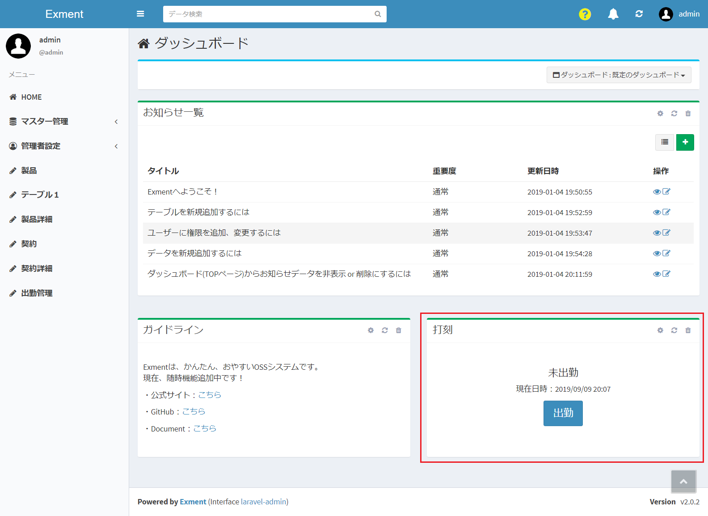

## 插件(仪表板)
可以在 Exment 的仪表板中创建新的页面。  
想把自己的页面用作仪表板的项目时，请使用这一种。  
本页以上下班打卡的按钮为例，说明插件(仪表板)的创建方法。  

## 前言
Exment 的插件页面使用 PHP 框架 [Laravel](http://laravel.jp/) 以及管理页面库 [exment-admin-core](https://github.com/exceedone/exment-admin-core)（以 laravel-admin / open-admin 为基础的库，v6.x 及以前为 laravel-admin）开发。  
开发页面时，特别建议由具备 Laravel 知识的人来开发。

## 创建方法

### 示例
这里作为示例，创建以下页面。
- 创建用来管理用户上下班的表。    
- 在仪表板上显示上下班、休息开始、休息结束的按钮。   
- 点击按钮后，把点击的时刻设置到数据中。
  
   

※请事先导入[这里](https://exment.net/downloads/sample/template/dakoku.zip)的模板。

- 示例插件见[这里](https://github.com/exment-git/plugin-sample/tree/main/dashboard/Dakoku)  

### 创建 config.json
- 创建以下的 config.json 文件。  

~~~ json

{
    "plugin_name": "Dakoku",
    "plugin_view_name" : "打卡",
    "description": "这是用来在仪表板上打卡的插件。",
    "uuid":  "691a24f2-2c7a-42c5-8cff-23c5277f6f22",
    "author":  "Kajitori",
    "version": "1.0.0",
    "plugin_type": "dashboard",
    "route": [
        {
            "uri": "post",
            "method": [
                "post"
            ],
            "function": "post"
        }
    ]
}

~~~

- plugin_name 请用半角英文数字填写。
- uuid 是 32 个字符加连字符、共 36 个字符的字符串。用来使插件唯一。  
请通过以下 URL 等生成。  
https://www.famkruithof.net/uuid/uuidgen
- plugin_type 请填写 dashboard。  
- route 以列表定义要执行的 URL 的端点、其 HTTP 方法，以及 Controller 内的方法。
    - uri：用于显示页面的 uri。实际的 URL 为“http(s)://(Exment的URL)/dashboardbox/plugin/(在插件管理页面中设置的URL)/(仪表板项目的ID)/(指定的uri)”。  
    - method：HTTP 方法。请用 get,post,put,delete 填写。
    - function：要执行的 Controller 内的方法
- route 中请务必包含 uri 为空（""）的一项。从菜单跳转到插件的页面时，会访问这个端点。

> ※此 URL 是不带“/admin”的标准设置（v7.2.1 及以上版本新安装的站点）时的写法。`.env` 的 `ADMIN_ROUTE_PREFIX` 有值时（用以前的版本安装的站点为“admin”），请在站点的 URL 后面加上该值（例：`http(s)://(Exment的URL)/admin/dashboardbox/plugin/(在插件管理页面中设置的URL)/(仪表板项目的ID)/(指定的uri)`）。详情请参阅[更改、删除 URL 中包含的“admin”](/zh/additional_prefix)。

### 创建 Plugin 文件

#### 创建主要逻辑
创建如下的 PHP 文件。文件名请设为“Plugin.php”。

~~~ php
<?php

//(1)
namespace App\Plugins\Dakoku;

use Exceedone\Exment\Services\Plugin\PluginDashboardBase;
use Exceedone\Exment\Model\CustomTable;

class Plugin extends PluginDashboardBase
{
    /**
     *
     * @return Content|\Illuminate\Http\Response
     */
    public function body()
    {
        if(is_null(CustomTable::getEloquent('dakoku'))){
            return '尚未安装打卡表。';
        }
        
        $dakoku = $this->getDakoku();
        $status = $this->getStatus($dakoku);
        $params = $this->getStatusParams($status);

        // (3)
        return view('exment_dakoku::dakoku', [
            'dakoku' => $dakoku,
            'params' => $params,
            'action' => $this->getDashboardUri('post'),
        ]);
    }

    /**
     * 提交
     *
     * @return void
     */
    public function post()
    {
        $dakoku = $this->getDakoku();
        
        $now = \Carbon\Carbon::now();

        if(!isset($dakoku)){
            $dakoku = CustomTable::getEloquent('dakoku')->getValueModel();
            $dakoku->setValue('target_date', $now->toDateString());
        }

        $status = null;
        switch(request()->get('action')){
            // 上班
            case 'syukkin':
                $dakoku->setValue('syukkin_time', $now);
                $status = 1;
                break;
            // 休息开始
            case 'kyuukei_start':
                $dakoku->setValue('kyuukei_start_time', $now);
                $status = 11;
                break;
            // 休息结束
            case 'kyuukei_end':
                $dakoku->setValue('kyuukei_end_time', $now);
                $status = 21;
                break;
            // 下班
            case 'taikin':
                $dakoku->setValue('taikin_time', $now);
                $status = 99;
                break;
        }
        if(isset($status)){
            $dakoku->setValue('status', $status);
        }
        $dakoku->save();

        admin_toastr(trans('admin.save_succeeded'));
        return back();
    }

    /**
     * 获取当前的考勤状况
     *
     * @return void
     */
    protected function getDakoku(){
        $table = CustomTable::getEloquent('dakoku');
        if(!isset($table)){
            return null;
        }
        
        
        // 获取当前时刻
        $now = \Carbon\Carbon::now();

        // 早于基准时间时，按前一天处理
        if($now->hour <= 4){
            $now = $now->addDay(-1);
        }

        // 获取对应的打卡记录
        $query = getModelName('dakoku')::query();
        $query->where('value->target_date', $now->toDateString())
            ->where('created_user_id', \Exment::user()->base_user_id);

        $dakoku = $query->first();

        return $dakoku;
    }

    /**
     * 获取状态
     *
     * @param [type] $dakoku
     * @return int
     */
    protected function getStatus($dakoku){
        if(!isset($dakoku) || is_null($dakoku->getValue('syukkin_time'))){
            return 0;
        }

        return $dakoku->getValue('status');
    }

    protected function getStatusParams($status){
        switch($status){
            case 0:
                return 
                [
                    'status_text' => '未上班',
                    'buttons' => [
                        [
                        'button_text' => '上班',
                        'action_name' => 'syukkin',
                        ]
                    ]
                ];
            // 上班
            case 1:
                return  
                [
                    'status_text' => '上班中',
                    'buttons' => [
                        [
                            'button_text' => '休息',
                            'action_name' => 'kyuukei_start',
                        ], 
                        [
                            'button_text' => '下班',
                            'action_name' => 'taikin',
                        ], 
                    ]
                ];
        
            case 11:
                return 
                [
                    'status_text' => '休息中',
                    'buttons' => [
                        [
                            'button_text' => '休息结束',
                            'action_name' => 'kyuukei_end',
                        ], 
                    ]
                ];
            case 21:
                return 
                [
                    'status_text' => '上班中',
                    'buttons' => [
                        [
                            'button_text' => '休息结束',
                            'action_name' => 'kyuukei_syuryo',
                        ], 
                    ]
                ]; 
                
            case 99:
                return 
                [
                    'status_text' => '下班',
                    'buttons' => [
                    ]
                ];
        }
    }
}
~~~
- (1) namespace 请设为 **App\Plugins\\(插件名称的帕斯卡命名)** 。[详情见这里](/zh/plugin_quickstart)  
另外，类名请设为“Plugin”，并继承 PluginDashboardBase。

- (2) 类内的 public 方法名，是 config.json 的 function 中记载的名称。  

- (3) 使用视图时，请在视图名称前加上前缀“exment_（插件名称的蛇形命名）::”。  

- (4) 想获取插件的端点时，请使用函数“$this->getDashboardUri('端点名')”。  
※想获取 URL 的完整路径时，请使用 admin_url($this->getDashboardUri('端点名'))。

#### (可选)关于视图
要把视图分离出来时，请把 blade 文件保存在文件夹“resources/views”之下。  

#### (可选)关于 css、js 和其他静态文件
- css 文件请放在文件夹“public/css”中。  
- js 文件请放在文件夹“public/js”中。  
- 其他文件（图片文件等）请放在文件夹“public/assets”中。  

### 压缩为 zip
以上述 2 个文件作为最小构成，压缩为 zip。  
zip 文件名请设为“(plugin_name).zip”。  
- Dakoku.zip
    - config.json
    - Plugin.php
    - (其他需要的 PHP 文件、图片文件等)

### 其他
- 想显示特定 ID 值的数据详细内容时，请在 config.json 的 route 中添加如下的内容。  
可以像“{id}”这样指定 uri。  

~~~ json

{
    "route": [
        {
            "uri": "show_details/{id}",
            "method": [
                "get"
            ],
            "function": "show_details"
        }
    ]
}

~~~

## 反映到仪表板
要把上传的插件显示在仪表板上，请进行以下步骤。  

1. 点击仪表板的“新建”。  
上传了种类为“仪表板”的插件时，选项中会显示“插件”。    
   

2. 填入显示名称和目标插件，然后提交。
   

3. 仪表板上会显示所选的项目。  
   

### 示例插件
[打卡管理](https://github.com/exment-git/plugin-sample/tree/main/dashboard/Dakoku)  
※请导入[这里的模板](https://exment.net/downloads/sample/template/dakoku.zip)。
