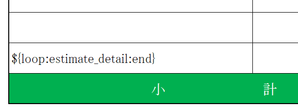

# 插件(文档输出)
这种插件可以输出报价单、单据等独自的文档资料。
作为基础的模板用 Excel 格式制作。输出的文件也是 Excel 格式。

   

> 以 PDF 格式输出，请参阅[文档输出(Docurain)](/zh/plugin_quickstart_docurain)。

## 创建方法

### 创建 config.json
- 创建以下的 config.json 文件。  

~~~ json
{
    "plugin_name": "PluginDemoDocument",
    "uuid": "1e7881d0-324f-11e9-b56e-0800200c9a66",
    "plugin_view_name": "Plugin Document",
    "description": "进行文档输出的测试。",
    "author": "(Your Name)",
    "version": "1.0.0",
    "plugin_type": "document",
    "filename": "报价单_${ymdhms}",
    "target_tables": "estimate",
    "label": "输出报价单",
    "icon": "fa-files-o",
    "button_class": "btn-success"
}
~~~

- plugin_name 请用半角英文数字填写。
- uuid 是用来区分插件的字符串。32 个字符加连字符，共 36 个字符。请不要和其他插件的值相同。  
可以通过以下 URL 等生成。  
https://www.famkruithof.net/uuid/uuidgen
- plugin_type 请填写 document。  
- file_name 是输出时的文件名。可以使用[参数变量](/zh/params)。
- target_tables 是作为输出对象的表。有多个时，请用逗号分隔输入。
- label 是用于文档输出的按钮的标签。
- icon 是用于文档输出的按钮的图标。
- button_class 是用于文档输出的按钮的类。

※target_tables、label、icon、button_class 以后可以在插件的设置页面中更改。

### 创建模板 Excel 文件
创建作为文档基础的模板文件。  
模板文件是 Excel 格式（xlsx）。输出的文件同样是 Excel 格式（xlsx）。  
※模板 Excel 文件的文件名请设为“document.xlsx”。  
※写在模板文件中的参数，请看下面的“参数”。

#### 参数
这是在模板的 Excel 文件中设置的参数。
在 Excel 的单元格中输入固定格式的变量后，输出文档时，会输出系统中登记的值。
##### 基本规则
- 按“**${变量名}**”的规则，输入到 Excel 的单元格中。  
例：“${year}”“${month}”“${value:estimate_code}”  
  

- 同一个单元格中可以设置多个参数。  

- Excel 中可以事先设置函数。※部分函数可能无法正常运行。请务必确认运行情况。  

- 可以设置的参数变量，请确认以下页面。  
[参数变量](/zh/params)

##### 子表数据的列表输出方法
根据文档的种类，有时需要把对象数据的子表的数据输出到一览表中。
例：登记报价日和客户信息的“报价”，以及登记所报价产品的列表的“报价明细”  
  
把数据列表输出到这个表中的步骤如下。

1. 在要输出的表的第 1 行第 1 列，设置以下参数。
**“${loop:(子表的表名):start}”**  
例：${loop:estimate_detail:start}  
  

2. 在要输出的表的第 2 行中，想输出的项目的各列，设置以下参数。
**“${loop-item:(子表的表名):(子表的列名)}”**  
例：${loop-item:estimate_detail:product_detail_name}  
  

3. 在要输出的表的最后一行第 1 列，设置以下参数。
**“${loop:(子表的表名):end}”**  
例：${loop:estimate_detail:end}  
  

##### 其他限制
- PhpSpreadSheet 的最新版（截至 2022/02/25）1.22.0 不支持以下内容。请不要包含在模板中。  
    - 插入的图形
    - 图表
    - 进行了“套用表格格式”的表

- 输出的文件中不包含图像时，请确认[故障排除](/zh/troubleshooting)的“以 Excel 为模板输出文档时，图片输出失败”。

### 创建 PHP 文件(可选)
- 普通的文档输出，只要准备好设置了参数变量的 document.xlsx 就足够了。
只有想进行特殊的数据加工，或者想输出 Exment 以外的数据时，才需要创建 PHP 文件。名称为“Plugin.php”。
**※不需要特殊处理时，不需要这个 Plugin.php 文件。**

~~~ php
<?php
namespace App\Plugins\PluginDemoDocument; // (PluginDemoDocument:插件名)

use Exceedone\Exment\Model\Define;
use Exceedone\Exment\Model\System;
use Exceedone\Exment\Services\Plugin\PluginDocumentBase;

class Plugin extends PluginDocumentBase
{
    /**
     * 在执行文档的变量替换之前被调用的函数
     *
     * @param SpreadSheet $spreadsheet
     * @return void
     */
    protected function called($spreadsheet)
    {
        // 想在执行文档的变量替换之前执行独自的处理时，写在这里
    }

    /**
     * 在执行文档的变量替换之后被调用的函数
     *
     * @param SpreadSheet $spreadsheet
     * @return void
     */
    protected function saving($spreadsheet)
    {
        // 选择第 1 个工作表
        $sheet = $spreadsheet->getSheet(0);
        // 在 B1 单元格中设置站点名
        $sheet->setCellValue('B1', System::site_name());

        // 获取 Exment 的最新信息
        $items = $this->getItems();

        foreach ($items as $idx => $item) {
            // 从第 4 行开始输出
            $row = $idx + 4;
            // 把日期输出到 A? 单元格
            $date = \Carbon\Carbon::parse(array_get($item, 'date'))->format(config('admin.date_format'));
            $sheet->setCellValue("A$row", $date);
            // 把链接输出到 B? 单元格
            $link = array_get($item, 'link');
            $sheet->setCellValue("B$row", $link);
            // 把标题输出到 C? 单元格
            $title = array_get($item, 'title.rendered');
            $sheet->setCellValue("C$row", $title);
        }
    }

    /**
     * 从 API 获取 Exment 的最新信息
     *
     * @return array exment news items array
     */
    protected function getItems()
    {
        $client = new \GuzzleHttp\Client();
        $response = $client->request('GET', Define::EXMENT_NEWS_API_URL, [
            'http_errors' => false,
            'query' => $this->getQuery(),
            'timeout' => 3, // Response timeout
            'connect_timeout' => 3, // Connection timeout
        ]);

        $contents = $response->getBody()->getContents();
        if ($response->getStatusCode() != 200) {
            return [];
        }
        return json_decode_ex($contents, true);
    }

    /**
     * 传给 API 的查询条件
     *
     * @return array query string array
     */
    protected function getQuery()
    {
        $request = request();

        // get querystring
        $query = [
            'categories' => 6,
            'per_page' => System::datalist_pager_count() ?? 5,
            'page' => $request->get('page') ?? 1,
        ];

        return $query;
    }

    /**
    * (支持 v3.4.3)判断是否在页面中显示按钮。默认为 true
    * 
    * @return bool true: 显示 false 不显示
    */
    public function enableRender(){
        // 自定义列的值“view_flg”为“1”时显示按钮
        return $this->custom_value->getValue('view_flg')  == 1;
    }
}

~~~

- namespace 请设为 **App\Plugins\\(插件名的帕斯卡命名)** 。[详情请参阅这里](/zh/plugin_quickstart)

- 加入独自处理的地方，是以下 2 个函数。这些函数通过参数接收电子表格。可以访问这个电子表格，在单元格中设置值。  
※电子表格的详细使用方法，请参阅 [PhpSpreadsheet 的文档](https://phpspreadsheet.readthedocs.io/en/latest/)。
    - 在替换参数变量之前进行处理时：实现“called”方法。
    - 在替换参数变量之后进行处理时：实现“saving”方法。

- Plugin 类继承了类 PluginDocumentBase。  
PluginDocumentBase 拥有调用来源的自定义表 $custom_table、表的值 $custom_value 等属性，  
在 execute 函数被调用的时候，这些属性中会代入值。  
属性的详情请参阅[插件参考](/zh/plugin_reference)。  

- (支持 v3.4.3) 想使用已登记的数据来控制按钮的显示、隐藏时，实现方法 "enableRender"。  
要显示按钮时请返回 true，想隐藏时请返回 false。（默认为 true。）

### 压缩为 zip
以上述文件为最小结构，压缩为 zip。  
zip 文件名请设为“(plugin_name).zip”。  
- PluginDemoDocument.zip
    - config.json
    - document.xlsx
    - Plugin.php(可选)
    - (其他需要的 PHP 文件、图像文件等)

### 上传
上传插件。  
※上传方法请参阅[插件](/zh/plugin)。  

### 执行文档输出
所有设置正确完成后，数据的显示页面中会显示按钮。
  
  
点击按钮后，“附件”中会显示列表。
 

### 示例插件
[用户信息输出](https://github.com/exment-git/plugin-sample/tree/main/document/document_demo_user)  
※在用户信息页面中，会显示“用户信息输出”按钮。  

### 产品插件
[请款单的 PDF 输出](https://github.com/exment-git/plugin-product/tree/main/document/PluginInvoiceDocument)  
※用模板把请款单以 EXCEL 格式输出。同时把 EXCEL 文件转换为 PDF。
