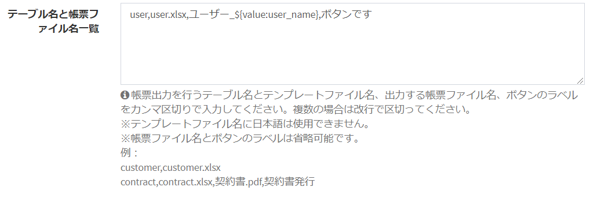
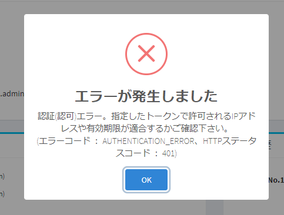

# 文档输出(Docurain)
这是使用云端单据引擎 **Docurain**，把单据输出为 PDF 的方法。Docurain 只用 Excel 和 json 就能开发单据。

> 以 Excel 格式输出，请参阅[插件(文档输出)](/zh/plugin_quickstart_document)。

## 什么是 Docurain
Docurain 是只用 Excel 和 json 就能开发单据的云端单据引擎。  
可以根据 Excel 文件的模板，制作各种布局的单据。也支持 PDF 格式的输出。
[Docurain 的网站在这里](https://docurain.jp/)

> Docurain 是由 Root42 株式会社开发、运营的服务。
使用时需要许可证令牌。费用按单据输出的次数计量收费。（可以发放试用令牌。）
Exment 的开发、运营公司 Kajitori 株式会社，是 Docurain 的代理商。试用的要求、申请和咨询，请通过[这里](https://exment.net/docurain)提出。

## 执行方法
1. 下载 [Docurain 插件](https://github.com/exment-git/plugin-sample/tree/main/docurain/Docurain)。

2. 作为 Exment 的插件上传。
步骤请参阅[上传插件](/zh/plugin)。

3. 上传后，点击 Docurain 插件的行，进入插件设置页面。

  

4. 输入以下内容。

- 目标表：执行 Docurain 的对象表

  

- 令牌：Docurain 执行令牌。令牌的发放，请通过[咨询](https://exment.net/inquiry)联系

  

- 表名和单据文件名列表： 请用逗号分隔，输入进行单据输出的表名、模板文件名、要输出的单据文件名、按钮的标签。有多个时，请用换行分隔。
※模板文件名不能使用日语。（单据文件名和按钮标签可以使用）  
※省略单据文件名时，使用模板文件名。  
※省略按钮的标签时，使用插件通用设置的标签。  
※单据文件名中可以包含日期等[参数](/zh/params)。

  

5. 在解压后的文件夹内的“documents”文件夹中，放置作为单据基础的 Excel 文件。
用 Docurain 制作多个单据时，请把多个 Excel 文件放在 documents 中。
※文件夹路径为“(项目根文件夹)/storage/app/plugins/Docurain/documents”。
※单据的制作方法，请确认下面的“创建模板 Excel 文件”。

  
  

6. 到这里的设置完成后，在“目标表”中选择的表中会显示按钮。

  

7. 点击按钮后，就会生成单据。

  

### 创建模板 Excel 文件
创建作为单据基础的 Excel 文件。  
※Excel 文件的名称不能使用日语。扩展名请务必使用 xlsx。  
※模板文件的参数，和普通的 Exment 参数的写法不同。需要 Docurain 专用的写法。

#### 参数
这是在模板的 Excel 文件中设置的参数。
在 Excel 的单元格中输入固定格式的变量后，输出单据时，会转换为各种值。

##### 系统值
| 项目 | 说明 |
| ---- | ---- |
| %{system.site_name} | 系统的站点名 |
| %{system.site_name_short} | 系统的站点名(简称) |
| %{system.system_mail_from} | 系统的发件人 |
| %{system.system_url} | 系统的首页 URL |
| %{system.login_url} | 系统的登录 URL |

##### 数据
| 项目 | 说明 |
| ---- | ---- |
| %{id} | 设置对象数据的 ID。(例：123) |
| %{suuid} | 设置对象数据的 suuid(Short UUID. 20 位的随机字符串))。 |
| %{value_url} | 设置显示对象数据的链接。 |
| %{value.(列名)} | 设置对象数据的列的值。(例：对用户数据填写 %{value.user_code} 时，设置用户代码) |
| %{select_table.(列名).(引用目标表的列名)} | 和“列名”对应的列是“选项（从其他表中选择）”“用户”“组织”时，设置引用目标的列的值。(例：“合同信息(contract)”表中有“客户(client)”列，引用了“客户信息(client)”表时，设置 %{select_table.client.client_code}，就可以显示“客户信息(client)”表的客户代码(client_code)) |
| %{parent.(引用目标表的列名)} | 设置父表的列的值。(例：从“合同明细信息(contract_detail)”表引用作为父表的“合同信息(contract)”表的合同代码(contract_code)时，填写 %{parent.contract_code}，就会设置合同代码) |
| $ENTITY.children.(子表名) | 使用“#foreach”等块语法设置子表的信息。子表的信息有时存在多条，所以不能像 %{children.(子表名).(子表的列名)} 这样设置。下面说明了一个例子。 |

#### 设置示例
##### 基本规则
- 可以使用一般的 EXCEL 函数和格式设置。  
- A 列是专门用来编写逻辑的列。在这里编写 #if、#foreach、#set 等块语法。

##### ※模板的一个例子   

- 输出上述模板后得到的 PDF。   

#### 下载示例模板
[用户信息](https://exment.net/downloads/product/plugin/Docurain/user.xlsx)  
[产品版本信息](https://exment.net/downloads/product/plugin/Docurain/product_version.xlsx)  
[合同信息](https://exment.net/downloads/product/plugin/Docurain/contract.xlsx)  
※要使用产品版本信息和合同信息，需要事先导入“产品销售企业模板”。

### 关于错误
- 执行输出后，有时会显示错误。
这时请确认错误的内容并处理。

- “HTTP 状态码”为“413”的错误，需要在 Docurain 的云服务一侧更改服务的允许值。
这时请通过[这里](https://exment.net/docurain)咨询。
