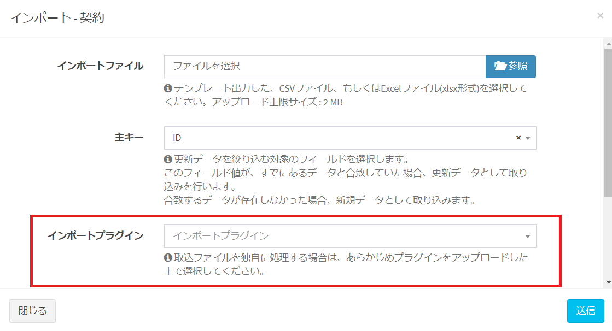

# 插件(导入)
这种插件可以独自实现向自定义数据的导入处理。
要把现有系统输出的文件等导入 Exment 时，推荐使用。

   

## 创建方法
以“把报价单（Excel）导入合同表和合同明细表”的插件为例，说明创建步骤。

- 假设报价单的表头部分写有合同表的信息，明细部分写有合同明细表的信息。
- 作为前提，需要具备 PHP、框架 [Laravel](http://laravel.jp/)，以及用 PHP 操作 Excel 的库 [PhpSpreadsheet](https://github.com/PHPOffice/PhpSpreadsheet) 的知识。

### 创建 config.json
- 创建以下的 config.json 文件。  

~~~ json
{
    "uuid": "b5c0a5d2-2716-4161-98d0-b490c1ebc521",
    "plugin_name": "PluginImportContract",
    "plugin_view_name": "合同数据的导入",
    "description": "用独自的逻辑导入合同数据。",
    "author":  "Kajitori",
    "version": "1.0.0",
    "plugin_type": "import",
    "target_tables": "contract",
    "label": "合同导入",
    "icon": "fa-files-o"
}
~~~

- plugin_name : 插件名。请用半角英文数字填写。
- uuid : 用来区分插件的字符串。32 个字符加连字符，共 36 个字符。请不要和其他插件的值相同。  
可以通过以下 URL 等生成。  
https://www.famkruithof.net/uuid/uuidgen
- plugin_type : 请填写 import。  
- target_tables : 请填写导入对象的表名。  

※target_tables 以后可以在页面中更改。指定了多个时，各个表的导入对话框中都会显示插件的选择栏。  

### 创建 PHP 文件
- 创建如下的 PHP 文件。名称请设为“Plugin.php”。

~~~ php
<?php
namespace App\Plugins\Pluginimportcontract;

use Exceedone\Exment\Services\Plugin\PluginImportBase;
use PhpOffice\PhpSpreadsheet\IOFactory;

class Plugin extends PluginImportBase{
    /**
     * execute
     */
    public function execute() {
        $path = $this->file->getRealPath();

        $reader = $this->createReader();
        $spreadsheet = $reader->load($path);

        // 用 Sheet1 的 B4 单元格的内容读取合同表
        $sheet = $spreadsheet->getSheetByName('Sheet1');
        $client_name = getCellValue('B4', $sheet, true);
        $client = getModelName('client')::where('value->client_name', $client_name)->first();

        // 用 Sheet1 的表头部分所写的信息编辑合同数据
        // status 设置固定值:1
        $contract = [
            'value->contract_code' => getCellValue('B3', $sheet, true),
            'value->client' => $client->id,
            'value->status' => '1',
            'value->contract_date' => getCellValue('D4', $sheet, true),
        ];
        // 向合同表添加记录
        $record = getModelName('contract')::create($contract);

        // 根据 Sheet1 的第 7 行～第 15 行所写的明细信息，输出合同明细数据
        for ($i = 7; $i <= 15; $i++) {
            // 从 A 列获取产品版本代码
            $product_version_code = getCellValue("A$i", $sheet, true);
            // 没有设置产品版本代码时，跳到下一行
            if (!isset($product_version_code)) break;
            // 用产品版本代码读取产品版本表
            $product_version = getModelName('product_version')
                ::where('value->product_version_code', $product_version_code)->first();
            // 未能获取产品版本表时，跳到下一行
            if (!isset($product_version)) continue;
            // 根据明细行和产品版本表编辑合同明细数据
            $contract_detail = [
                'parent_id' => $record->id,
                'parent_type' => 'contract',
                'value->product_version_id' => $product_version->id,
                'value->fixed_price' => getCellValue("B$i", $sheet, true),
                'value->num' => getCellValue("C$i", $sheet, true),
                'value->zeinuki_price' => getCellValue("D$i", $sheet, true),
            ];
            // 向合同明细表添加记录
            getModelName('contract_detail')::create($contract_detail);
        }

        return true;
    }

    /**
     * create reader
     */
    protected function createReader()
    {
        return IOFactory::createReader('Xlsx');
    }
    
}
~~~
- namespace 请设为 **App\Plugins\\(插件名的帕斯卡命名)** 。[详情请参阅这里](/zh/plugin_quickstart)

- Plugin 类需要继承类 PluginImportBase。  

### 压缩为 zip
以上述 2 个文件为最小结构，压缩为 zip。  
- PluginImportContract.zip
    - config.json
    - Plugin.php

### 上传
上传插件。  
※上传方法请参阅[插件](/zh/plugin)。  

### 导入的执行方法
1. 在插件管理页面中登记的 target_tables 的页面中，打开导入对话框。会显示导入插件的选择栏。
2. 选择已登记的插件，按下提交按钮。按 Plugin.php 的 execute 函数的内容执行导入处理。
  

### 示例插件
※要使用这个示例插件，请在模板设置中添加“产品销售企业模板”。
[合同数据的导入插件](https://github.com/exment-git/plugin-sample/tree/main/import/PluginImportContract)  
[合同数据的导入文件](https://exment.net/downloads/sample/plugin/PluginImportContract/contract_sample.xlsx)  

