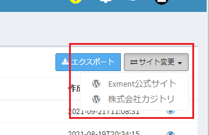
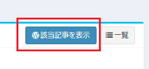

# 插件参考(CRUD页面)
本页面面向开发插件(CRUD页面)的人员。  
这里列出在 CRUD 页面的类中可以使用的函数和属性。

**函数标记的含义**

| 标记 | 含义 |
| ---- | ---- |
| ★ | 几乎一定需要定义 |
| ☆ | 视情况需要定义 |

- 本页面是 CRUD 页面专用的。其他类型的插件，请参阅[插件参考](/zh/plugin_reference)。
- 自定义表、自定义列、自定义数据的函数，请参阅[函数参考](/zh/func_reference)。
- 这里主要列出由插件开发人员定义的内容。由系统使用、不希望开发人员更改的内容已省略。
- 管理页面库的类，按 Exment v7.0.0 及以后的命名空间(“ExmentAdminCore\Admin”)书写。使用 v6.x 及以前版本时，请替换为“Encore\Admin”。详情请参阅[更新步骤 v7.0.0](/update/v7_0_0)（英语）。

## PluginCrudBase
插件(CRUD页面)的抽象类。开发 CRUD 页面插件时，请继承此类。  

- namespace Exceedone\Exment\Services\Plugin
- trait Exceedone\Exment\Services\Plugin\PluginBase
- trait Exceedone\Exment\Services\Plugin\PluginPageTrait

##### 属性

| 名称 | 类型 | 说明 |
| ---- | ---- | ---- |
| title | string | 显示在各页面上的标题 |
| description | string | 显示在各页面上的说明文字 |
| icon | string | 显示在各页面上的图标 |


### 函数列表

#### ★getFieldDefinitions
以关联数组获取列定义的函数。  
- 请务必添加 1 个 "primary" => true 的键。(目前不支持复合键)  
- "key" 是用于获取数据、设置 HTML 各元素的 name 等的项目名。请用英文和数字输入。  
- "label" 用作列表页面等的项目名。  
- "grid" 请为列表页面中要显示的项目设置。请按显示顺序填写整数。
- "show" 请为详情页面中要显示的项目设置。请按显示顺序填写整数。
- "create" 请为新建页面中要显示的项目设置。请按显示顺序填写整数。
- "edit" 请为编辑页面中要显示的项目设置。请按显示顺序填写整数。


##### 参数
无


##### 返回值
| 类型 | 说明 |
| ---- | ---- |
| array | 列定义的数组 |


##### 示例
``` php
/**
     * (2) 获取列定义
     * Get fields definitions
     *
     * @return array|Collection
     */
    public function getFieldDefinitions()
    {
        return [
            ['key' => 'id', 'label' => 'ID', 'primary' => true, 'grid' => 1, 'show' => 1],
            ['key' => 'title', 'label' => '标题', 'grid' => 2, 'show' => 2, 'create' => 1, 'edit' => 1],
            ['key' => 'date', 'label' => '创建时间', 'grid' => 3, 'show' => 3, 'create' => 2, 'edit' => 2],
            ['key' => 'content', 'label' => '正文', 'show' => 4, 'create' => 3, 'edit' => 3],
        ];
    }
```

---


#### getAuthType
返回 CRUD 页面的认证类型字符串。  
※除了 Exment 的登录之外，还可以设置访问此 CRUD 页面所需的认证。请根据要访问的服务的类型设置认证类型。


##### 认证类型
| 返回的字符串 | 类型 | 说明 |
| ---- | ---- | ---- |
| (null) | 无认证 | 不进行 CRUD 页面专用的认证。这是默认值。 |
| key | 访问密钥 | 在插件的设置页面中设置访问密钥。未输入访问密钥时，会显示错误。 |
| id_password | ID 和密码 | 在插件的设置页面中设置 ID 和密码。未输入 ID 和密码时，会显示错误。 |
| oauth | OAuth | 在登录设置页面中进行 OAuth 设置。用户访问 CRUD 页面时，进行 OAuth 登录。只有 OAuth 登录成功时，才能访问 CRUD 页面。同时，也可以使用访问令牌。 |


##### 参数
无

##### 返回值
| 类型 | 说明 |
| ---- | ---- |
| ?string | 表示认证类型的字符串 |


##### 示例
``` php
    /**
     * Get auth type.
     * Please set null or "key" or "id_password" or "oauth".
     *
     * @return string|null
     */
    public function getAuthType() : ?string
    {
        return 'oauth';
    }
```

---


#### enablePaginate
指定是否以分页形式显示数据列表。  
要获取数据的服务支持分页形式（数据总数、指定页码获取数据、按页获取数据）时，请返回 true。不支持时，请返回 false。

##### 参数
无


##### 返回值
| 类型 | 说明 |
| ---- | ---- |
| boolean | 是否支持分页形式。默认值：true |


##### 示例
``` php
     /**
     * Whether use paginate
     * Default: true
     *
     * @return bool
     */
    public function enablePaginate() : bool
    {
        return true;
    }
```

---


#### ★getPaginate
以分页形式获取数据列表的函数。  
请以 \Illuminate\Pagination\LengthAwarePaginator 形式返回获取的数据。  
另外，列表的各元素应为关联数组，该关联数组的键值应与 getFieldDefinitions 中设置的键值相同。  
※函数 enablePaginate 为 true 时请实现。


##### 参数
| 名称 | 类型 | 说明 |
| ---- | ---- | ---- |
| $options | array | 显示列表页面时使用的选项 |
| $options['per_page'] | int | 每页显示的条数 |
| $options['page'] | int | 页码 |
| $options['query'] | string | 进行搜索时的搜索字符串 |


##### 返回值
| 类型 | 说明 |
| ---- | ---- |
| LengthAwarePaginator | 搜索结果模型 |


##### 示例
``` php
    /**
     * (3) 获取数据列表(Paginate)
     * Get data paginate
     *
     * @return LengthAwarePaginator
     */
    public function getPaginate(array $options = []) : ?LengthAwarePaginator
    {
        $client = new Client([
            'base_uri' => $this->getSiteUrl(),
        ]);

        $query = [
            'per_page' => $options['per_page'] ?? 20,
            'page' => $options['page'] ?? 1
        ];

        if(array_has($options, 'query')){
            $query['search'] = array_get($options, 'query');
        }

        $response = $client->get('wp-json/wp/v2/posts', ['query' => $query]);

        $json = json_decode((string)$response->getBody());

        $result = collect($json)->map(function($j){
            $j = json_decode(json_encode($j), true);
            return (object)[
                'id' => array_get($j, 'id'),
                'title' => array_get($j, 'title.rendered'),
                'content' => array_get($j, 'content.rendered'),
                'date' => array_get($j, 'date'),
            ];
        });
        
        return new LengthAwarePaginator(
            $result, 
            array_get($response->getHeaders(), 'X-WP-Total')[0], 
            $query['per_page'],
            $query['page'],
            [
                'path' => $this->getFullUrl(),
            ]
        );
    }
```


---

#### ☆getList
获取数据列表的函数。  
请以 Collection 形式返回获取的数据。  
另外，列表的各元素应为关联数组，该关联数组的键值应与 getFieldDefinitions 中设置的键值相同。  
※函数 enablePaginate 为 false 时请实现。


##### 参数
| 名称 | 类型 | 说明 |
| ---- | ---- | ---- |
| $options | array | 显示列表页面时使用的选项 |
| $options['query'] | string | 进行搜索时的搜索字符串 |


##### 返回值
| 类型 | 说明 |
| ---- | ---- |
| \Illuminate\Support\Collection | 结果列表 |


##### 示例
``` php
    /**
     * (3) 获取数据列表
     * Get data list
     *
     * @return Collection
     */
    public function getList(array $options = []) : Collection
    {
        $client = new Client([
            'base_uri' => $this->getSiteUrl(),
        ]);

        if(array_has($options, 'query')){
            $query['search'] = array_get($options, 'query');
        }

        $token = $this->getOauthAccessToken();
        $response = $client->get('v1.0/me/todo/lists', [
            'query' => $query, 
            'headers' => [
                'Authorization' => "Bearer $token",
                'Accept'        => 'application/json',
            ]
        ]);

        $json = json_decode((string)$response->getBody());

        $result = collect($json->value)->map(function($j){
            $j = json_decode(json_encode($j), true);
            return (object)[
                'id' => array_get($j, 'id'),
                'displayName' => array_get($j, 'displayName'),
            ];
        });

        return $result;
    }
```


---


#### getChunkCount
返回以分页形式获取数据列表时一次获取的条数。  

##### 参数
无


##### 返回值
| 类型 | 说明 |
| ---- | ---- |
| int | 一次获取的条数。默认值：1000 |


##### 示例
``` php
    /**
     * Get max chunk count.
     *
     * @return int
     */
    public function getChunkCount() : int
    {
        return 1000;
    }
```


---

#### ★getData
获取指定 ID 的 1 条数据并返回。  
另外，数据的各元素应为关联数组，该关联数组的键值应与 getFieldDefinitions 中设置的键值相同。  

##### 参数
| 名称 | 类型 | 说明 |
| ---- | ---- | ---- |
| $id | string | 数据的键值 |
| $options | array | 目前未使用。保留参数。 |


##### 返回值
| 类型 | 说明 |
| ---- | ---- |
| array 或 Collection | 获取的数据 |


##### 示例
``` php
    /**
     * (3) 获取数据详情(1 条数据)
     * read single data
     *
     * @return array|Collection
     */
    public function getData($id, array $options = [])
    {
        $client = new Client([
            'base_uri' => $this->getSiteUrl(),
        ]);
        $response = $client->request('GET', "wp-json/wp/v2/posts/{$id}");
        $json = json_decode((string)$response->getBody());
        
        $j = json_decode(json_encode($json), true);
        return (object)[
            'id' => array_get($j, 'id'),
            'title' => array_get($j, 'title.rendered'),
            'content' => array_get($j, 'content.rendered'),
            'date' => array_get($j, 'date'),
        ];
    }
```


---

#### ★postCreate
执行数据的新建。  
返回值请返回所创建数据的键值。  

##### 参数
| 名称 | 类型 | 说明 |
| ---- | ---- | ---- |
| $posts | array | 用户输入的数据。关联数组。 |
| $options | array | 目前未使用。保留参数。 |


##### 返回值
| 类型 | 说明 |
| ---- | ---- |
| string | 请返回所创建数据的键值 |


##### 示例
``` php
    /**
     * post create value
     *
     * @return mixed
     */
    public function postCreate(array $posts, array $options = [])
    {
        $client = new Client([
            'base_uri' => $this->getSiteUrl(),
        ]);

        // create Authorization header 
        $id_password = $this->getAuthIdPassword();
        $Authorization = "Basic " . base64_encode("{$id_password['id']}:{$id_password['password']}");

        $response = $client->request('POST', "wp-json/wp/v2/posts", [
            'headers' => [
                'Authorization' => $Authorization,
                //'Content-Type' => 'application/json',
            ],
            'form_params' => [
                'title' => array_get($posts, 'title'),
                'content' => array_get($posts, 'content'),
                'status' => 'publish',
            ],
        ]);
        $json = json_decode((string)$response->getBody());
        $j = json_decode(json_encode($json), true);
        return array_get($j, 'id');
    }

```


---

#### ★putEdit
执行数据的编辑。  
返回值请返回所编辑数据的键值。  

##### 参数
| 名称 | 类型 | 说明 |
| ---- | ---- | ---- |
| $id | string | 要编辑的对象的键值 |
| $posts | array | 用户输入的数据。关联数组。 |
| $options | array | 目前未使用。保留参数。 |


##### 返回值
| 类型 | 说明 |
| ---- | ---- |
| string | 请返回所更新数据的键值 |


##### 示例
``` php
    /**
     * edit posted value
     *
     * @return mixed
     */
    public function putEdit($id, array $posts, array $options = [])
    {
        $client = new Client([
            'base_uri' => $this->getSiteUrl(),
        ]);

        // create Authorization header 
        $id_password = $this->getAuthIdPassword();
        $Authorization = "Basic " . base64_encode("{$id_password['id']}:{$id_password['password']}");

        $response = $client->request('POST', "wp-json/wp/v2/posts/{$id}", [
            'headers' => [
                'Authorization' => $Authorization,
                //'Content-Type' => 'application/json',
            ],
            'form_params' => [
                'title' => array_get($posts, 'title'),
                'content' => array_get($posts, 'content'),
                'status' => 'publish',
            ],
        ]);
        $json = json_decode((string)$response->getBody());
        $j = json_decode(json_encode($json), true);
        return array_get($j, 'id');
    }

```


---

#### ★delete
执行数据的删除。  

##### 参数
| 名称 | 类型 | 说明 |
| ---- | ---- | ---- |
| $id | string | 要删除的对象的键值 |
| $options | array | 目前未使用。保留参数。 |


##### 返回值
无


##### 示例
``` php
    /**
     * delete value
     *
     * @param $id string
     * @return mixed
     */
    public function delete($id, array $options = [])
    {
        $client = new Client([
            'base_uri' => $this->getSiteUrl(),
        ]);

        // create Authorization header 
        $id_password = $this->getAuthIdPassword();
        $Authorization = "Basic " . base64_encode("{$id_password['id']}:{$id_password['password']}");

        $response = $client->request('DELETE', "wp-json/wp/v2/posts/{$id}", [
            'headers' => [
                'Authorization' => $Authorization,
                //'Content-Type' => 'application/json',
            ],
        ]);
    }
```


---

#### enableCreate
判断是否可以新建，并以 boolean 类型返回。  
所联动的服务不支持新建时，或不让某些用户新建时，请返回 false。

##### 参数
| 名称 | 类型 | 说明 |
| ---- | ---- | ---- |
| $options | array | 目前未使用。保留参数。 |


##### 返回值
| 类型 | 说明 |
| ---- | ---- |
| boolean | 可以新建时返回 true。默认值：true |

---


#### enableEditAll
判断是否可以编辑，并以 boolean 类型返回。  
所联动的服务不支持编辑时，或不让某些用户编辑时，请返回 false。

##### 参数
| 名称 | 类型 | 说明 |
| ---- | ---- | ---- |
| $options | array | 目前未使用。保留参数。 |


##### 返回值
| 类型 | 说明 |
| ---- | ---- |
| boolean | 可以编辑时返回 true。默认值：true |

---


#### enableEdit
判断是否可以对指定的数据进行编辑，并以 boolean 类型返回。  
所联动的服务不支持编辑时，或不让某些用户编辑时，请返回 false。

##### 参数
| 名称 | 类型 | 说明 |
| ---- | ---- | ---- |
| $value | mixed | 与 ID 对应的值。 |
| $options | array | 目前未使用。保留参数。 |


##### 返回值
| 类型 | 说明 |
| ---- | ---- |
| boolean | 可以编辑时返回 true。默认值：true |

---


#### enableDeleteAll
判断是否可以删除数据，并以 boolean 类型返回。  
所联动的服务不支持删除时，或不让某些用户删除时，请返回 false。

##### 参数
| 名称 | 类型 | 说明 |
| ---- | ---- | ---- |
| $options | array | 目前未使用。保留参数。 |


##### 返回值
| 类型 | 说明 |
| ---- | ---- |
| boolean | 可以删除时返回 true。默认值：true |

---

#### enableDelete
判断是否可以对指定的数据进行删除，并以 boolean 类型返回。  
所联动的服务不支持删除时，或不让某些用户删除时，请返回 false。

##### 参数
| 名称 | 类型 | 说明 |
| ---- | ---- | ---- |
| $value | mixed | 与 ID 对应的值。 |
| $options | array | 目前未使用。保留参数。 |


##### 返回值
| 类型 | 说明 |
| ---- | ---- |
| boolean | 可以删除时返回 true。默认值：true |

---


#### enableExport
判断是否可以导出数据，并以 boolean 类型返回。  
数据导出有时会获取服务的全部数据。因此，请注意大量数据的获取等问题。

##### 参数
| 名称 | 类型 | 说明 |
| ---- | ---- | ---- |
| $options | array | 目前未使用。保留参数。 |


##### 返回值
| 类型 | 说明 |
| ---- | ---- |
| boolean | 可以导出数据时返回 true。默认值：false |

---


#### enableFreewordSearch
判断是否可以搜索数据，并以 boolean 类型返回。  

##### 参数
| 名称 | 类型 | 说明 |
| ---- | ---- | ---- |
| $options | array | 目前未使用。保留参数。 |


##### 返回值
| 类型 | 说明 |
| ---- | ---- |
| boolean | 可以搜索数据时返回 true。默认值：false |

---


#### callbackGridTool
想在 GRID(数据列表)页面的右上方显示自己的按钮等时定义。

##### 参数

| 名称 | 类型 | 说明 |
| ---- | ---- | ---- |
| $tools | \ExmentAdminCore\Admin\Widgets\Grid\Tools | 工具 |


##### 返回值
无


##### 示例
``` php
    /**
     * Callback tools. If add event, definition.
     * ※本例：显示 WordPress 列表按钮，切换要获取数据的 WordPress
     *
     * @param $tools
     * @return void
     */
    public function callbackGridTool($tools)
    {
        $menulist = [];

        foreach ($this->getSiteDefinitions() as $site) {
            $menulist[] = [
                'href' => admin_urls('plugins', $this->plugin->getOption('uri'), array_get($site, 'endpoint')),
                'label' => array_get($site, 'label'),
                'icon' => 'fa-wordpress',
            ];
        }
        $tools->prepend(view('exment::tools.menu-button', [
            'button_label' => '切换站点',
            'menulist' => $menulist,
        ])->render(), 'right');
    }

```

  

---


#### callbackShowTool
想在 SHOW(数据详情)页面的右上方显示自己的按钮等时定义。

##### 参数

| 名称 | 类型 | 说明 |
| ---- | ---- | ---- |
| $id | string | 键值 |
| $box | \ExmentAdminCore\Admin\Widgets\Box | Box |


##### 返回值
无


##### 示例
``` php
    /**
     * Callback show page tools. If add event, definition.
     *
     * @param Box $box
     * @return void
     */
    public function callbackShowTool($id, Box $box)
    {
        $box->tools(view('exment::tools.button', [
            'href' => $this->getSiteUrl() . "?p={$id}",
            'label' => '显示该文章',
            'icon' => 'fa-wordpress',
            'btn_class' => 'btn-primary',
            'target' => '_blank',
        ])->render());
    }
```

  

---


#### callbackFormTool
想在 CREATE(新建数据)页面或 EDIT(编辑数据)页面的右上方显示自己的按钮等时定义。

##### 参数

| 名称 | 类型 | 说明 |
| ---- | ---- | ---- |
| $id | string | 键值 |
| $box | \ExmentAdminCore\Admin\Widgets\Box | Box |


##### 返回值
无


##### 示例
``` php
    /**
     * Callback create or edit page tools. If add event, definition.
     *
     * @param Box $box
     * @return void
     */
    public function callbackFormTool($id, Box $box)
    {
        $box->tools(view('exment::tools.button', [
            'href' => $this->getSiteUrl() . "?p={$id}",
            'label' => '显示该文章',
            'icon' => 'fa-wordpress',
            'btn_class' => 'btn-primary',
            'target' => '_blank',
        ])->render());
    }
```

  

---


#### setForm
在 CREATE(新建数据)页面或 EDIT(编辑数据)页面中，要自行制作数据的输入表单时编写。  
※写法基本上是管理页面库“exment-admin-core”的[表单](https://github.com/exceedone/exment-admin-core/blob/master/docs/en/model-form-fields.md)的添加方式(与其原型 [laravel-admin 的表单](https://laravel-admin.org/docs/en/model-form-fields)相同)。输入方法请查看相应的页面。  
※不定义本函数时(返回 null 时)，在 getFieldDefinitions 函数中，CREATE 页面定义了 "create" 项目的列、EDIT 页面定义了 "edit" 项目的列，会以单行文本形式显示。


##### 参数
| 名称 | 类型 | 说明 |
| ---- | ---- | ---- |
| $form | \ExmentAdminCore\Admin\Widgets\Form | 输入表单 |
| $isCreate | bool | 新建时为 true |
| $options | array | 目前未使用。保留参数。 |


##### 返回值
| 类型 | 说明 |
| ---- | ---- |
| ?\ExmentAdminCore\Admin\Widgets\Form | 制作好的表单。返回 null 时，根据 getFieldDefinitions 函数的定义制作输入表单。 |


##### 示例
``` php
    /**
     * set form info
     *
     * @return Form|null
     */
    public function setForm(Form $form, bool $isCreate, array $options = []) : ?Form
    {
        if(!$isCreate){
            $form->display('ID');    
        }
        $form->text('Name');

        // 获取国家列表
        $countries = \DB::connection('world')->table('country') ->pluck('Name', 'Code');
        $form->select('CountryCode')->options($countries);
        
        $form->number('Population');

        return $form;
    }
```

---


#### validate
在 CREATE(新建数据)页面或 EDIT(编辑数据)页面中，要在保存数据之前定义验证时使用的函数。

##### 参数

| 名称 | 类型 | 说明 |
| ---- | ---- | ---- |
| $form | \ExmentAdminCore\Admin\Widgets\Form | 输入表单 |
| $values | array | 用户的输入值 |
| $isCreate | bool | 新建时为 true |
| $id | string | 键值 |


##### 返回值
| 类型 | 说明 |
| ---- | ---- |
| 以下之一<br/>array<br/>\Illuminate\Support\MessageBag<br/>\Exceedone\Exment\Validator\ExmentCustomValidator | 验证结果 |


##### 示例
``` php
    // ※例 1。在 setForm 函数中为表单添加验证的方法。
    // ※为方便起见，示例写在 validate 函数内，但采用本例时，请不要定义 validate 函数。
    /**
     * set form info
     *
     * @return Form|null
     */
    public function setForm(Form $form, bool $isCreate, array $options = []) : ?Form
    {
        if(!$isCreate){
            $form->display('ID');    
        }
        $form->text('Name')
            ->rules(['max:10']); // 新增

        // 获取国家列表
        $countries = \DB::connection('world')->table('country')->pluck('Name', 'Code');
        $form->select('CountryCode')->options($countries);
        
        $form->number('Population')
            ->rules([new \Exceedone\Exment\Validator\NumberMinRule(10)]);  // 新增

        return $form;
    }


    // ※例 2。使用 Laravel 验证的方法。
    /**
     * Validate form
     *
     * @param WidgetForm $form
     * @return array|MessageBag|ExmentCustomValidator
     */
    public function validate(WidgetForm $form, array $values, bool $isCreate, $id)
    {
        $validator = \Validator::make($values, 
        // 定义各字段的规则
        [
            'Name' => 'max:10',
            'Population' => new \Exceedone\Exment\Validator\NumberMinRule(10),
        ], 
        // (可选)更改各规则的消息时
        [
            'max' => ':attribute的长度不能超过10个字符。',
            'min' => ':attribute请输入10以上的值',
        ], 
        // (可选)更改各字段的名称时
        [
            'Name' => '名称',
            'Population' => '人口(估计)',
        ]);
        return $validator;
    }
    

    // ※例 3。逐项验证的方法。
    // 有错误时，返回以字段名为键、以错误消息为值的数组。
    /**
     * Validate form
     *
     * @param WidgetForm $form
     * @return array|MessageBag|ExmentCustomValidator
     */
    public function validate(WidgetForm $form, array $values, bool $isCreate, $id)
    {
        $errors = [];

        // 判断是否在 10 个字符以内
        $Name = array_get($values, 'Name');
        if(!is_nullorempty($Name) && mb_strlen($Name) > 10){
            $errors['Name'] = '名称的长度不能超过10个字符。';
        }
        
        // 判断是否为 10 以上
        $Population = array_get($values, 'Population');
        if(!is_nullorempty($Population) && intval($Population) < 10){
            $errors['Population'] = '人口(估计)请输入10以上的值';
        }
        
        return $errors;
    }
```

---

