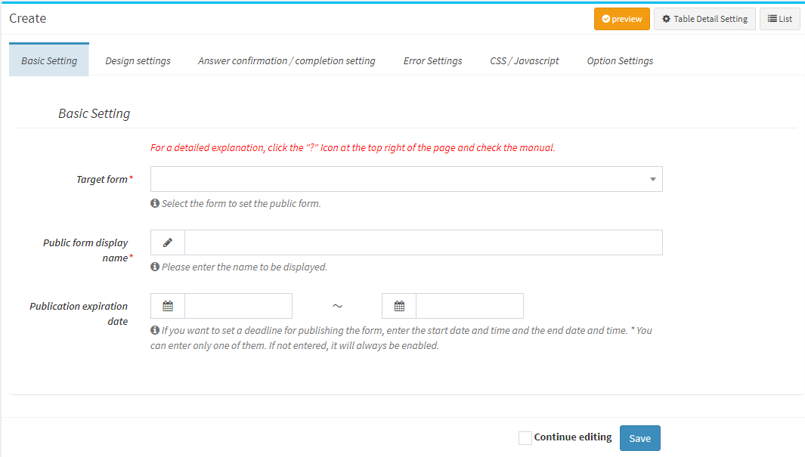
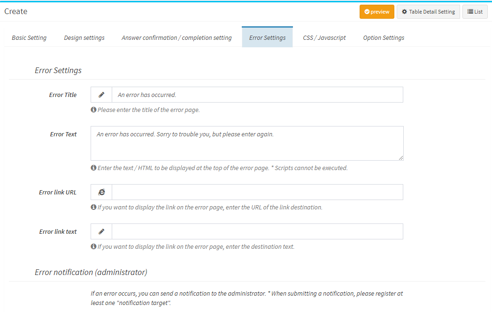

# 公开表单设置
本页说明如何设置没有登录的人（普通用户）也可以输入数据的“公开表单”。  
可以创建问卷、咨询表单、申请表单等，共享 URL，向外部广泛公开。

- 通常的[数据表单画面](/zh/data_form)，需要事先准备用户，让对方用 ID 和密码登录。
- 公开表单不需要登录，任何人都可以输入数据。

## 关于公开表单设置的行为

<span class="red bold">通过公开表单输入的数据，创建用户和更新用户都会记为登记该公开表单设置的用户。</span>  
在数据输入画面取得或搜索其他表的选项时，所用的角色和权限也是登记公开表单设置的用户的角色和权限。  
  
因此，请避免由系统管理员登记公开表单。  
建议按后面的“<a href="#/zh/publicform?id=role_user">进行公开表单设置的用户与角色组的设置</a>”的步骤，设置新的用户和角色组。   
  
另外，下面的表不能设置公开表单。  
- “用户”“组织”等主数据表
- 在表设置中设为“仅可登记一条”的表


## 设置的流程
按下面的顺序设置。详细的步骤请看下面的“设置步骤”。

1. 执行命令。(只在使用 Google reCAPTCHA 时)
2. 在系统设置画面，让公开表单可以使用。
3. 在[自定义表单设置](/zh/form)中，设置表单上显示的项目、标题等。
4. 登记进行公开表单设置的用户和角色组。
5. 用该用户登录，进行公开表单设置（设计、确认画面、Google Analytics 等）。
6. 启用公开表单。会发行 URL。

## 设置步骤

### 1. 执行命令
只在公开表单中使用 Google reCAPTCHA（防止机器人提交的机制）时执行。  
请在项目的根文件夹执行与所用的 Exment 版本对应的命令。  
※从 v7.0.0 起，Google reCAPTCHA 的库使用“google/recaptcha”。Exment v6.x 及以前使用“arcanedev/no-captcha”。  

- Exment v7.0.0 及以后

```
composer require google/recaptcha=^1.3.1
```

- Exment v6.x 及以前

```
composer require arcanedev/no-captcha=^10.1
```

### 2. 系统设置画面
- 进入[系统设置画面](/zh/system_setting)的“STEP2 详细设置”，把“使用公开表单”设为 YES。  
※默认是 NO。这是为了让使用者明确地选择使用公开表单。  


- 使用 Google reCAPTCHA 时，请把“Google reCAPTCHA”一项设为 V2 或 V3。  
选择后会显示站点密钥和私密密钥的项目。请设置从 [Google reCAPTCHA 的管理页面](http://www.google.com/recaptcha/admin)复制的值。  
※设置后，在各公开表单设置画面选择是否使用 Google reCAPTCHA。  
※选择 V3 时的分数阈值，可以在[设置值](/zh/config)中更改(默认值 0.5)。


### 3. 自定义表单设置
- 在[自定义表单设置](/zh/form)中，设置表单上显示的项目、标题等。步骤基本上和通常的表单设置相同。  
※这项设置也可以由管理员等公开表单设置用户以外的人进行。

<h3 id="role_user"><a href="#/zh/publicform#role_user" data-id="role_user" class="anchor"><span>4. 进行公开表单设置的用户与角色组的设置</span></a></h3>
登记进行公开表单设置的用户和角色组。  
从公开表单提交的数据，会被当作这个用户登记和更新的数据。

- 新建[角色组设置](/zh/role_group)。
    - 添加“公开表单管理”权限。
	- 对想要设置公开表单的表添加编辑权限。
    - 同时，也添加该公开表单要访问的表的查看权限。  

- 例：打算设置“咨询”表的公开表单，并且咨询表引用了“产品”“分类”表的所有数据时：  
    - “咨询”表的“公开表单管理”“编辑负责的数据”权限
    - “产品”“分类”表的“查看所有数据”权限


- 添加管理公开表单的用户。
    - 角色组选择上面创建的角色组。

- 请用上面创建的用户登录，打开公开表单设置画面，登记公开表单。


### 5. 公开表单设置

- 在自定义表列表中，勾选 1 个想要设置的表，点击右上角的“表详细设置”。  

> ※ 也可以从对象自定义表的数据列表画面或数据登记画面打开。这时也请点击右上角的“表详细设置”。  

- 在显示的表详细设置画面，点击表单设置的图标。


- 表单列表画面的下方有“公开表单设置”框。  
请点击这个框右上角的“＋新增”按钮。


- 公开表单设置画面打开。请设置必要的项目。设置的内容如下。

#### 设置内容 - 基本设置


- ##### 目标表单
选择要设置为公开表单的表单。请选择在上面的“自定义表单设置”中创建的表单。

- ##### 公开表单显示名称
请输入在列表画面等处显示的显示名称。

- ##### 公开有效期
要决定公开表单的期间时，请输入开始日期时间和结束日期时间。  
※也可以只输入“开始日期时间”或只输入“结束日期时间”。两个都不输入时，一直有效。  
※在公开有效期之外，这个公开表单不能使用。


#### 设置内容 - 设计设置


设置是否使用页眉和页脚、Logo 图片和文字、表单的背景色等设计要素。  


#### 设置内容 - 回答确认/完成设置
这是用户输入完表单之后显示的“回答确认画面”和“完成画面”的设置。决定是否使用，以及标题和文字。


- ##### 使用回答确认
为 YES 时，用户的画面按下面的流程切换。

```
输入画面 → 确认画面 → 完成画面(登记数据)
```

※为 NO 时，用户的画面按下面的流程切换。

```
输入画面 → 完成画面(登记数据)
```

- ##### 确认标题
请输入回答确认画面的标题文字。

- ##### 确认文本
请输入显示在确认画面页面上方的文本或 HTML。  
※可以使用[参数](/zh/params)。不能执行脚本。


- ##### 完成标题
请输入完成画面的标题文字。

- ##### 完成文本
请输入显示在完成画面页面上方的文本或 HTML。  
※可以使用[参数](/zh/params)。不能执行脚本。

- ##### 完成链接 URL
可以在完成画面上显示链接。想在输入后转到别的画面时，请输入要转到的 URL。  
※没有输入“完成链接文本”时，输入的 URL 会直接作为链接的文字显示。

- ##### 完成链接文本
可以在完成画面上显示链接。想在输入后转到别的画面时，请输入作为链接显示在画面上的文字。  


#### 完成通知（普通用户）
可以在登记完成后，向输入数据的普通用户发送邮件。

- 因为是给没有登录的普通用户的通知，所以通知方法只有发送电子邮件。
- 通知对象只有普通用户填写的电子邮件地址。
- 要使用这个功能，自定义表中需要有列类型为“电子邮件”的列。

- ##### 向普通用户发送完成通知
设为 YES 后，完成通知生效。 

- ##### 通知模板
请选择发给普通用户的通知模板。需要事先在[通知模板设置](/zh/mail)中创建新的模板。  
※通知中可以使用[变量(参数)](/zh/params)。使用变量，可以把登记的数据、系统名称、用户的输入值等加到主题和正文中。  

- ##### 通知对象
请选择设置了作为通知对象的邮件地址的自定义列。  
例：输入项目中有“回复用邮件地址”列时，把这一列选为通知对象，数据输入完成后就会向该邮件地址发送通知。  


#### 完成通知（管理员）
可以在数据输入完成后，向管理员发送通知。  
※虽然写的是“管理员”，但除了管理员以外，也可以通知 Exment 中登记的用户、Slack 等。

- ##### 向管理员发送完成通知
设为 YES 后，完成通知生效。 

- ##### 通知模板
请选择发给管理员的通知模板。需要事先在[通知模板设置](/zh/mail)中创建新的模板。  
※通知中可以使用[变量(参数)](/zh/params)。使用变量，可以把登记的数据、系统名称、用户的输入值等加到主题和正文中。  

- ##### 通知对象
请选择通知对象。  
※通知对象的项目和设置方法，请查看[通知操作设置](/zh/notify)。


#### 设置内容 - 错误设置
控制发生错误时的行为。




- ##### 错误标题
请输入错误画面的标题文字。

- ##### 错误文本
请输入显示在错误画面页面上方的文本或 HTML。  

- ##### 错误链接 URL
可以在错误画面上显示链接。想在发生错误时转到别的画面时，请输入要转到的 URL。  
※没有输入“错误链接文本”时，输入的 URL 会直接作为链接的文字显示。

- ##### 错误链接文本
可以在错误画面上显示链接。要在发生错误时显示到别的画面的链接时，请输入显示在画面上的文字。  

#### 错误通知
发生错误时，可以通知管理员。  
※虽然写的是“管理员”，但除了管理员以外，也可以通知 Exment 中登记的用户、Slack 等。

- ##### 发送错误通知
设为 YES 后，发生错误时会通知管理员。

- ##### 通知模板
请选择发给管理员的模板。需要事先在[通知模板设置](/zh/mail)中创建新的模板。  
※通知中可以使用[变量(参数)](/zh/params)。使用变量，可以把登记的数据、系统名称、用户的输入值、错误内容等加到主题和正文中。  

- ##### 通知对象
请选择通知对象。  
※通知对象的项目和设置方法，请查看[通知操作设置](/zh/notify)。


#### CSS / Javascript
可以添加自己的 CSS 和 Javascript。


- ##### 自定义 CSS
请直接写入想使用的 CSS。  
※不需要 &lt;style&gt; 标签。请只写 css 的内容。

- ##### 插件（CSS）
要让已安装的插件(CSS)也反映到公开表单时，请选择插件的名称。

- ##### 自定义 Javascript
请直接写入想使用的 Javascript。  
※不需要 &lt;script&gt; 标签。请只写 Javascript 的内容。  
※Javascript 会添加到下面的 jquery 之内。

``` javascript
<script data-exec-on-popstate>
    $(function () {
        (添加的代码)
    });
</script>
```

- ##### 插件（Javascript）
要让已安装的插件(Javascript)也反映到公开表单时，请选择插件的名称。


#### 设置内容 - 选项设置
进行其他的选项设置。


- ##### 允许通过 URL 设置初始值
设为 YES 后，可以把 URL 查询字符串的值作为表单的初始值。详情请查看[通过URL设置初始值](/zh/publicform?id=通过url设置初始值)。

- ##### Google Analytics
要在表单中设置 Google Analytics 时，请输入以“UA-”或“G-”开头的 Google Analytics 标签。

- ##### 使用 Google reCAPTCHA
使用 Google reCAPTCHA 时，请设为 YES。  
※只有在系统设置画面输入了 Google reCaptcha 的密钥时才有效。


#### 预览
- 可以按正在设置的内容显示公开表单的预览。  
※表单没有保存也可以预览。

- 点击画面右上角的“预览”按钮，会在另一个窗口显示公开表单的预览画面。  
※另一个窗口是用 javascript 打开的。根据浏览器的设置，弹出窗口可能会被拦截。这时请解除拦截，再点击一次按钮。


#### 启用公开表单
- 要把表单公开给普通用户，需要“启用”。请先保存一次，再打开编辑画面，点击页面右上角的“启用”按钮。  


- 要公开的表单引用了其他表时，普通用户就可以读取这些表的数据。  
会显示下面这样的确认消息，请充分确认要访问的表有没有问题。  


- “访问其他表”主要是指下面这些情况。
    - 公开表单中有列类型为“选项（从其他表中选择）”“用户”等的项目时，数据会作为候选选项被显示和搜索。
    - 公开表单是 1:n 的子表时，父表的数据会作为选项被显示和搜索。


#### 启用后显示 URL 等
- 启用公开表单后，基本设置中会增加下面的项目。

- ##### 公开表单 URL
显示公开表单的 URL。请复制这个 URL，通过邮件或自己公司的网站等共享给普通用户。  
※点击这个项目可以复制 URL。

- ##### 执行用户
登记公开表单的用户。通过这个公开表单登记和查看数据，全部以这个用户的权限进行。  
※即使别的用户更新了公开表单设置，执行用户也不会改变。要更改时，请用别的用户登录，创建新的公开表单设置。


### 6. 使用公开表单
- 访问上面复制的 URL，就会显示公开表单。  


- 公开表单设置没有“启用”、在有效期之外，或者 URL 有错误时，会显示下面的错误。  


### 7. 使用模板
使用模板，可以继承已创建的公开表单的设置值，创建新的公开表单。
>下面的项目需要手动设置。<br />· 页眉 Logo<br />· Google Analytics<br />· 使用 Google reCAPTCHA

#### 导出
点击公开表单设置画面的［模板：导出］，正在打开的公开表单会作为模板导出。


#### 从模板创建
点击自定义表单设置画面的公开表单设置中的［+从模板创建］。


##### 目标表单
选择用模板创建公开表单时作为对象的表单。

##### 公开表单显示名称
输入要创建的公开表单在画面上的显示名称。

##### 上传
选择用来创建公开表单的模板。


## 其他详细设置

### 通过URL设置初始值
- 把“允许通过 URL 设置初始值”设为 YES 后，就可以在公开表单的 URL 中写入项目的初始值。  
公司名称、分类等，已经知道适合对方的值时，事先放进 URL 里，可以减少输入的工夫。

#### 添加方法
设置下面这样的查询字符串。

```
http://(到公开表单为止的URL)?value.(自定义列名)=(初始值)

对多个列设置时，第 2 个及以后的 value 用 & 连接。
http://(到公开表单为止的URL)?value.(自定义列名)=(初始值)&value.(自定义列名)=(初始值)


# 例
http://localhost/publicform/c4f31330-7a75-11eb-a8b0-279816836d79?value.title=你好

http://localhost/publicform/c4f31330-7a75-11eb-a8b0-279816836d79?value.client_name=ABC股份有限公司&value.category=初期导入
```

- 例：有下面这样的表单时  


- 在这个表单的 URL 后面加上下面的查询字符串，打开表单时就会设置初始值。

```
http://localhost/publicform/ab3d55e4-1afc-d1de-ac1b-bc64c51d4d7d?value.title=关于咨询&value.body=这里是正文。
```


#### 想让自定义列“选项(从其他表中选择)”“用户”“组织”只能用 suuid(20位的随机字符串)设置初始值时
自定义列“选项(从其他表中选择)”“用户”“组织”（下面只写作“选项(从其他表中选择)”）的初始值，通常用 ID(整数的连续编号)指定。  
但是，ID 是连续编号，所以拿到公开表单的人改写 URL 的参数，就能很容易地猜到其他的值。  
想让这些列的初始值不用 ID 而用 suuid(20位的随机字符串)指定时，请按下面的方法设置。  

- 在 [Exment 设置值列表](/zh/config)中，进行“在公开表单的‘通过URL设置初始值’中，不允许 ID，只允许 suuid”的设置。  

``` .env
EXMENT_PUBLICFORM_URLPARAM_SUUID=true
```

- 通过这项设置，“选项(从其他表中选择)”列的初始值只允许 suuid。

- 另外，suuid 请用下面的方法确认。
    - 在视图的“选择显示列”中选择系统ID（20位）
    - 导出数据

### 更改 URL 中的“publicform”
- 这里是更改公开表单的 URL 中包含的 "publicform" 字符串的步骤。  
※这个字符串对所有的公开表单都相同。不能按表单分别更改。

#### 更改步骤

- 更改时，进行[设置值的更改](/zh/config)。

- 在 Exment 的根目录打开“.env”文件。

- 添加下面的值。

~~~
### 把“publicform”改成别的名称时
EXMENT_PUBLICFORM_ROUTE_PREFIX=afiewqbfwehghwb
# http://localhost/afiewqbfwehghwb/(UUID) 成为公开表单的 URL
~~~

※另外，本手册全部以“publicform”为前提记述，请谅解。


### 公开表单特有的行为
这里是其他的公开表单特有的行为。  

- 自定义列“选项（从其他表中选择）”“用户”“组织”等处显示的“搜索”按钮，在公开表单中不显示。  

- 在表详细设置的“通知设置”中可以登记的、触发条件为“数据新建”的通知，在公开表单中不会发送。  
这是因为公开表单设置中另外有“面向普通用户”“面向管理员”的通知，为了避免和它们重复发送。
