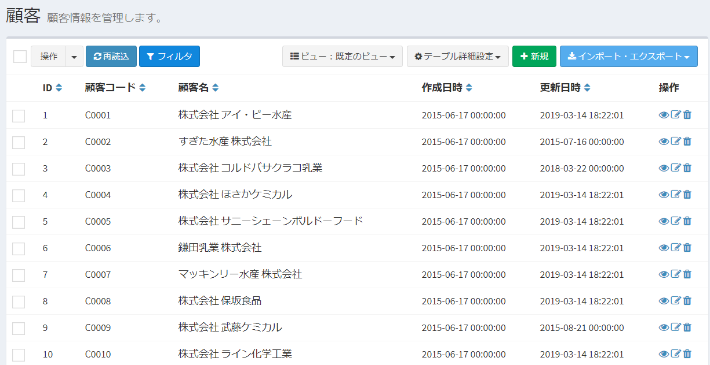
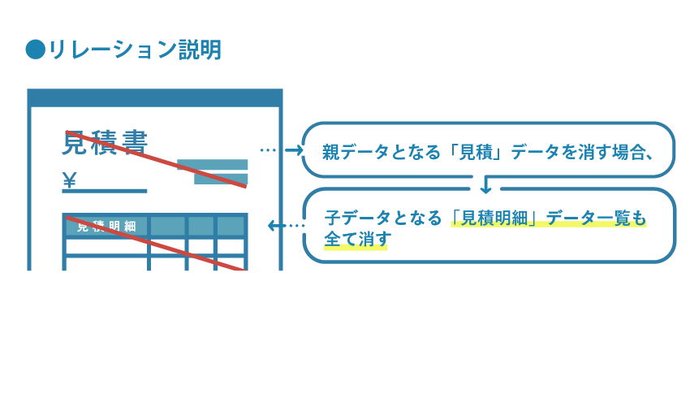

# 关联设置
表和表的数据之间，有时存在联系（关联）。  
例：
- 报价和它的报价明细信息  
- 公司的组织和所属这个组织的用户  

本页说明怎样设置表之间的联系。

- 先决定“用哪种方法连接”（下面的“Exment 中关联的概念”）。
- 只想了解页面上的操作时，请看下面的“关联设置的操作方法”。

## Exment 中关联的概念
在 Exment 中连接表的想法有些复杂。  
需要了解“1. 关联的种类”和“2. 设置方法”这 2 点。  
在页面上设置之前，请阅读下面的内容。

### 1. 关联的种类
数据的联系通常有下面 2 种。  
#### 一对多
父表的 1 条数据上，作为明细连接着子表的多条数据   

- 例：报价和它的报价明细  
“报价”表中登记“报价日”“客户信息”“标题”。“报价明细”中，把这个报价的品名、数量、金额作为明细登记多条  

- 例：合同和这个合同的主负责人  
1 个用户有时会成为多个合同的主负责人，所以用户和合同是一对多的关系  

#### 多对多
多个表（父表）的数据上关联着子表的多条数据  

- 例：组织和所属这个组织的用户  
用户有时会所属多个组织（兼任等），所以是多对多的关系  
  

首先考虑想连接的数据是上面的哪一种。  

### 2.“(1)关联表设置”和“(2)自定义列的选项（从其他表中选择）”
在 Exment 中连接数据的方法有“(1)关联表”和“(2)选项（从其他表中选择）”这 2 种。  

##### (1)关联表设置
本页说明的方法。
从“自定义表”页面点击［关联设置］按钮来登记。    

##### (2)自定义列的选项（从其他表中选择）
在[自定义列](/zh/column)页面设置的方法。  
自定义列的列类型之一是“选项（从其他表中选择）”。创建这种类型的列。  

进行这个设置后，在[数据表单页面](/zh/data_form)中就可以从其他表选择值。  
例（客户是测试数据）：

>作为选项显示在列表中的文字，可以在[自定义表设置](/zh/table)的标题显示列设置中更改。

### 决定关联的设置方法
使用 (1) 还是 (2)，是容易拿不定主意的地方。
请按下面的标准决定。

| 关联的种类 | 适用的情况 | 使用的方法 |
|---|---|---|
| 一对多 | 父和子始终是一组。删除父数据时，把子数据也删除是正确的（例：报价和报价明细） | (1)关联设置 |
| 一对多 | 不一定始终是一组。即使删除被引用的数据，把引用它的数据也删除是有问题的（例：报价和主负责人） | (2)自定义列的选项（从其他表中选择） |
| 多对多 | 基本上用这个 | (1)关联设置 |

#### 1. 关联的种类为“一对多”时
请按下面 2 个标准决定。
1. **父数据和子数据是否始终是一组、关系紧密**  
例如“报价”表和“报价明细”表中，报价明细的数据始终有报价的数据，成为一组。  
这种时候，用“(1)关联设置”连接。  
另一方面，“报价”表和这个报价的“主负责人”，作为数据的引用对象是连接着的，但并不是始终成为一组。  
这种时候，用“(2)自定义列的选项（从其他表中选择）”连接。  

2. **删除父数据时，删除子数据是否始终正确**  
例如“报价”表和“报价明细”表中，删除父数据“报价”时，把子数据“报价明细”也全部删除是正确的动作。  
这种时候，用“(1)关联设置”连接。  

另一方面，“报价”表和这个报价的“主负责人”，不能因为删除了“主负责人”的数据，就把这个人担任主负责人的“报价”数据全部删除，这是有问题的。  
这种时候，用“(2)自定义列的选项（从其他表中选择）”连接。  

#### 2. 关联的种类为“多对多”时
基本上请用“(1)关联设置”连接。  
用“(2)自定义列的选项（从其他表中选择）”并“允许多选”也可以应对，但有不利于数据搜索等问题。  

   
到这里，就决定了用哪种方法连接表。  
下面是进行“(1)关联表设置”时的步骤。  

## 关联设置的操作方法

### 显示页面
- 在自定义表列表中，只勾选 1 个想设置的表，点击右上角的“表详细设置”。  

- 或者，从菜单选择想设置的表之后，同样点击右上角的“表详细设置”。  
※需要先进行把这个表显示在菜单中的设置。  

- 在出现的表详细设置页面中，点击关联设置的图标。

- 这样就会显示这个自定义表的关联设置的列表。  

### 新增
- 在“关联设置”页面中，点击页面右上角的［新建］按钮。

- 选择要连接的子表和关联的种类，然后点击“提交”。
  

### 编辑
想编辑关联时，请点击相应行的［编辑］链接。  
  

### 删除
想删除关联时，请点击相应行的［删除］链接。  

