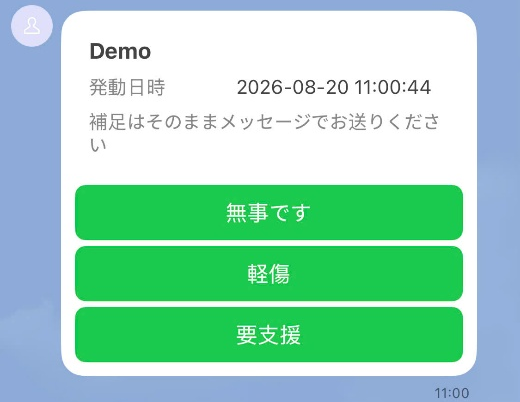
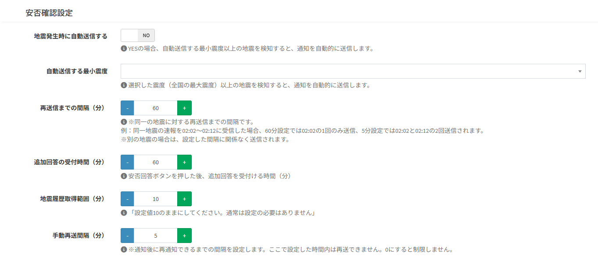
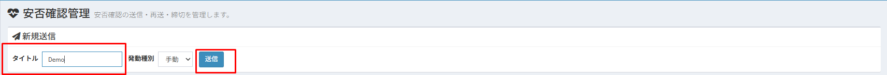
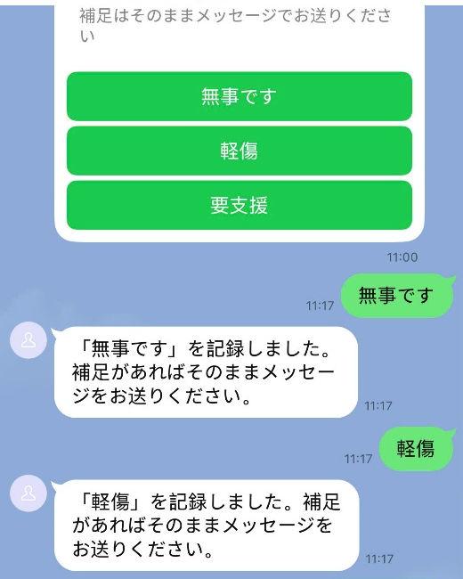
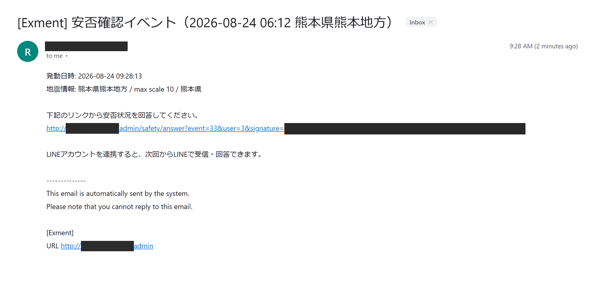
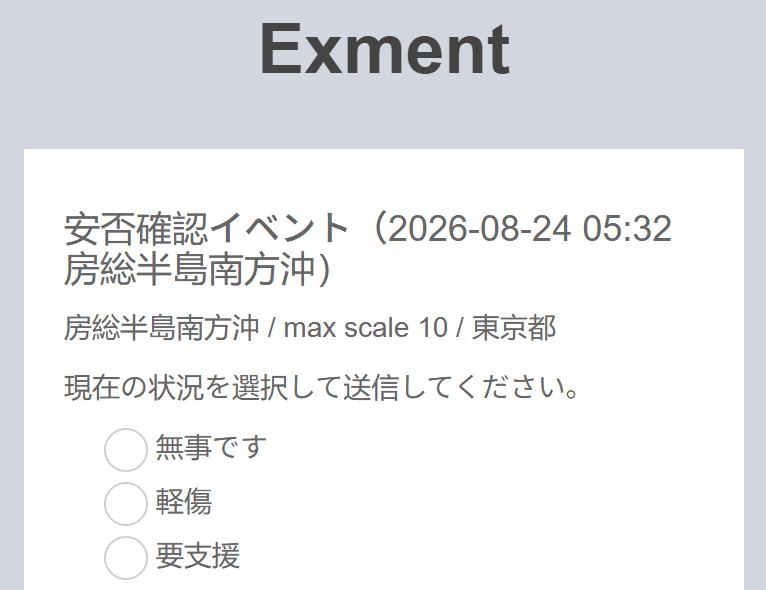
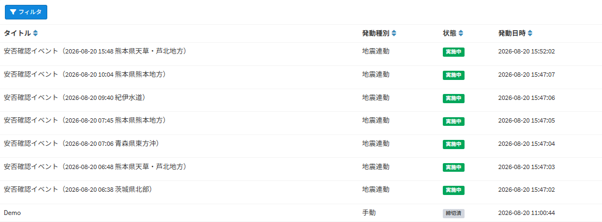
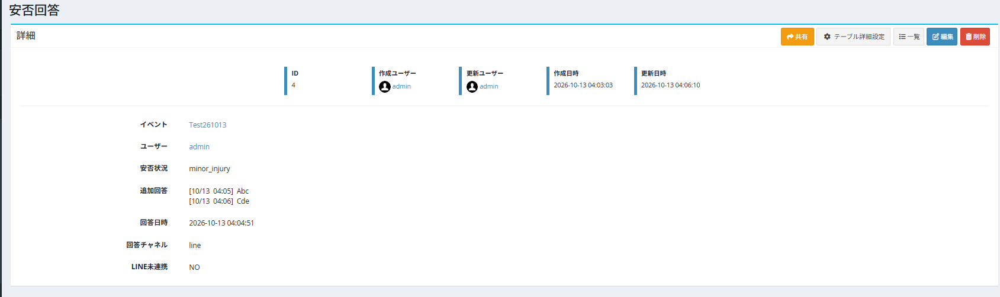
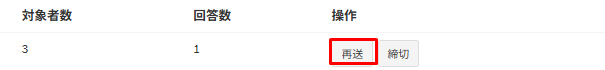
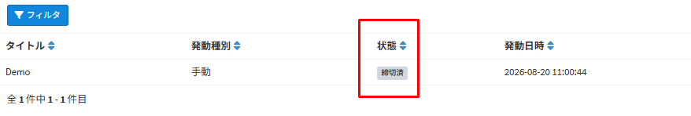

# 安全确认
这是在地震、台风等紧急情况下，通过 LINE 和邮件询问员工是否平安的功能。  
管理员可以在页面上发送。也可以在发生设定震度以上的地震时自动发送。  
回复情况可以在安全确认管理页面和安全确认回复表中确认。  
※安全确认从 v7.0.0 起可以使用。

到开始使用为止的流程如下。

1. 进行[事前准备](/zh/safety_check?id=事前准备)（LINE、邮件、任务计划）。
2. 进行[安全确认设置](/zh/safety_check?id=安全确认设置)（是否在地震时自动发送等）。
3. [发送安全确认](/zh/safety_check?id=发送安全确认)。
4. 员工进行[回复](/zh/safety_check?id=回复)。
5. [确认回复情况](/zh/safety_check?id=确认回复情况)，必要时进行[重新发送、截止](/zh/safety_check?id=重新发送、截止)。

## 安全确认的机制
- 每发送一次安全确认，就会创建 1 条“安全确认事件”的数据。
- 同时，会为所有用户创建安全状况为“not_answered”（未回复）的“安全确认回复”数据。
- 通过以下方法发送给各用户。LINE 和邮件都收到的用户，从哪一边回复都可以。

| 发送方法 | 发送的对象 | 回复方法 |
| --- | --- | --- |
| LINE | [已关联 LINE 账号](/zh/line)的用户 | 卡片上的“平安”“轻伤”“需要帮助”按钮 |
| 邮件 | 登记了电子邮件地址的用户（包括已关联 LINE 账号的用户） | 从邮件中的链接打开的回复页面（无需登录） |

※既没有关联 LINE 账号、也没有登记电子邮件地址的用户，不会收到。

### 触发类型
安全确认有以下几种触发类型。

| 触发类型 | 内容 |
| --- | --- |
| 手动 | 管理员从安全确认管理页面发送。可以用于地震、台风、火灾等各种紧急情况。 |
| 演练 | 用和手动相同的方法发送。发送的消息标题开头会加上“【演练】”。 |
| 地震联动 | 发生设定震度以上的地震时自动发送。 |

## 事前准备
需要的准备因用法而不同。

| 用法 | 需要的准备 |
| --- | --- |
| **通过 LINE 发送时** | 进行 [LINE 关联](/zh/line)的设置（准备 LINE 官方账号、系统设置的“LINE 设置”、Webhook 的设置），并请各用户关联 LINE 账号。 |
| **通过邮件发送时** | 进行[邮件发送设置](/zh/mailsend_setting)。同时请确认[邮件的设置](/zh/safety_check?id=邮件的设置)。 |
| **发生地震时自动发送时** | 需要设置[任务计划](/zh/additional_task_schedule)。另外，Exment 的服务器必须能访问获取地震信息的 API（https://api.p2pquake.net）。 |

※只有拥有系统管理员权限的用户才能使用安全确认管理页面。

## 安装
安全确认使用的表和菜单，会在安装、更新 Exment 时自动创建。  
在已有的环境中，请按[更新](/zh/update)的步骤执行“php artisan exment:update”。

会创建以下内容。

| 种类 | 名称 | 内容 |
| --- | --- | --- |
| 表 | 安全确认事件 | 每发送一次安全确认，创建 1 条数据。 |
| 表 | 安全确认回复 | 每次安全确认、每位用户各创建 1 条数据。 |
| 菜单 | 安全确认 | 进行安全确认的发送、重新发送、截止的页面。 |
| 通知模板 | 安全确认邮件 | 安全确认邮件的模板。 |
| LINE Flex 模板 | 安全确认 | Flexキー（Flex 键）为“safety_check”。安全确认的 LINE 卡片内容是固定的，所以编辑这个模板也不会改变卡片。请不要在通知设置中选择它，也不要编辑或删除它。 |

※没有创建时，请执行“php artisan exment:patchdata line_safety_check”。

## 安全确认设置
1. 点击左侧菜单的“管理员设置”→“系统设置”，用右上角的按钮切换到［详细设置］。
2. 在“安全确认设置”（“LINE 设置”的下方）中设置以下项目，然后点击［保存］。

| 项目 | 内容 |
| --- | --- |
| 发生地震时自动发送 | 为 YES 时，发生“自动发送的最小震度”以上的地震，就会自动发送安全确认。为 NO 时，只能从安全确认管理页面发送。 初始值：NO |
| 自动发送的最小震度 | 从震度 4、震度 5 弱、震度 5 强、震度 6 弱、震度 6 强、震度 7 中选择作为自动发送基准的震度。按地震信息中全国的最大震度判断。不能按地区筛选。 初始值：震度 5 弱 |
| 重新发送间隔（分钟） | 对同一次地震不再自动发送的时间（分钟）。一次地震会发布速报、详细、订正等多条地震信息。对同一次地震发送之后，在这段时间内收到的信息不会再发送。如果是另一次地震，则不受这段时间限制，照常发送。 初始值：60 |
| 追加回复受理时间（分钟） | 在 LINE 上按下回复按钮之后，把接着发送的消息作为“补充回复”记录的时间（分钟）。每发送一次补充回复，受理时间都会延长。 初始值：60 |
| 地震历史获取范围（分钟） | 发布后超过这段时间（分钟）的地震信息不会自动发送。可以防止在刚启用功能时、或任务计划停止之后，因过去的地震而一齐发送。通常请保持“10”不变。 初始值：10 |
| 手动重发间隔（分钟） | 执行［重新发送］之后，到可以执行下一次［重新发送］为止的时间（分钟）。为 0 时不限制。 初始值：5 |

※“手动重发间隔（分钟）”以外的数值项目，保存为 0 或空时，使用初始值。

## 邮件的设置

### 回复用链接
安全确认的邮件中，会写有用来打开回复页面的链接（回复用链接）。请注意以下 2 点。

- **使用员工能打开的 URL**：回复用链接由 Exment 的 URL 生成。
    - 发生地震时的自动发送，使用“.env”文件的“APP_URL”。请把“APP_URL”设置为员工在公司外也能访问的 URL。
    - 从页面发送时，也请用员工能访问的 URL 打开 Exment 后再发送。
- **更改“APP_KEY”后，已发送的链接会失效**：回复用链接带有使用“.env”文件的“APP_KEY”生成的签名。发送邮件之后更改了“APP_KEY”时，请用［重新发送］发送新的链接。

### 邮件的模板
邮件的标题和正文，可以在[通知模板](/zh/mail)的“安全确认邮件”中更改。初始值如下。

~~~
标题：
[${system:site_name}] ${safety_title}

正文：
${safety_body}

请通过以下链接回复您的安全状况。
${answer_url}

关联 LINE 账号后，下次即可通过 LINE 接收和回复。
~~~

| 变量 | 内容 |
| --- | --- |
| ${safety_title} | 安全确认的标题。演练时，开头会加上“【演练】”。 |
| ${safety_body} | 触发时间和地震信息（地震联动时）。 |
| ${answer_url} | 回复用链接。 |

※从正文中删除“${answer_url}”后，就无法从邮件回复了。请务必保留。

## 发送安全确认

### 打开页面
点击左侧菜单的“管理员设置”→“安全确认”（在 v7.0 中位于左侧菜单的最上方）。也可以通过以下 URL 打开。

~~~
http(s)://(Exment的URL)/safety_check
~~~

> ※此 URL 是不带“/admin”的标准设置（v7.2.1 及以上版本新安装的站点）时的写法。`.env` 的 `ADMIN_ROUTE_PREFIX` 有值时（用以前的版本安装的站点为“admin”），请在站点的 URL 后面加上该值（例：`http(s)://(Exment的URL)/admin/safety_check`）。详情请参阅[更改、删除 URL 中包含的“admin”](/zh/additional_prefix)。

### 以手动、演练方式发送
1. 在“新建发送”的“标题”中输入安全确认的标题（例：台风 15 号 安全确认）。
2. 在“触发类型”中选择“手动”或“演练”。
3. 点击［发送］。会显示“已开始发送安全确认。”，列表中会增加一条“进行中”的安全确认。
4. 发送在页面显示之后进行。发送完成后，列表的“发送数”“对象人数”会更新。请重新加载页面确认。

- **“演练”也会发送给所有用户**。也会计入 LINE 的消息数。
- **请不要反复点击［发送］**。在同一用户之前执行的发送完成之前（最长 10 分钟），不能发送新的安全确认。显示“正在发送中。请稍候并刷新页面。”时，说明正在处理之前的发送。请稍等后刷新页面。
- 用户数多时，发送完成可能需要一些时间。

**使用通知处理的延迟执行（队列）时**

- 发送处理本身不使用队列工作进程，直接执行。
- 设置了[通知处理的延迟执行](/zh/additional_queue)时，LINE 和邮件的投递由队列执行，所以需要让队列工作进程保持运行。
- 由队列执行时，发送失败的消息会自动重新发送（包括第一次发送在内，最多尝试 3 次）。LINE 只在因 LINE 服务器繁忙（HTTP 429）或服务器错误（HTTP 5xx）而失败时才重新发送。

### 发生地震时自动发送
把“安全确认设置”的“发生地震时自动发送”设为 YES 后，Exment 每分钟从 P2P 地震信息的 API 获取日本气象厅的地震信息。  
有满足以下所有条件的地震信息时，会自动发送触发类型为“地震联动”的安全确认。

- 全国的最大震度在“自动发送的最小震度”以上
- 地震信息发布后，没有超过“地震历史获取范围（分钟）”
- 对同一次地震，在“重新发送间隔（分钟）”以内没有发送过

- 自动发送的安全确认的标题为“安全确认事件（(发生时间) (震源地)）”。
- 用震源地确定之前的信息（震度速报）发送时，震源地显示为“震源调查中”。之后收到的信息确定了震源地时，标题会更新（不会重新发送）。

※自动发送需要设置[任务计划](/zh/additional_task_schedule)。任务计划会每分钟执行命令“exment:safetywatch”。

## 回复
这是用户回复的步骤。请用于向员工说明。

### 通过 LINE 回复
已关联 LINE 账号的用户，会收到带有“平安”“轻伤”“需要帮助”按钮的卡片。

- **回复**：按下其中一个按钮。会收到类似“已记录“平安”。如有补充信息，请直接以消息发送。”的回复。
- **更改回复**：再按一次别的按钮。记录的是最后按下的按钮的内容。
- **补充说明情况**：按下按钮之后，接着发送消息。会收到回复“已添加补充回复。”，消息被记录为“补充回复”。

※补充回复请在按下按钮之后、或上一次发送补充回复之后的“追加回复受理时间（分钟）”（初始设置为 60 分钟）以内发送。超过受理时间时，请再按一次按钮后发送。

### 通过邮件回复
登记了电子邮件地址的用户，会收到写有回复用链接的邮件。

1. 点击邮件中的链接。无需登录，就会打开回复页面。
2. 选择当前的状况（“平安”“轻伤”“需要帮助”），根据需要填写“补充回复（可选）”，然后点击［提交］。

3. 显示“已收到您的回复”，回复就完成了。

- 重新打开同一个链接，会显示当前的回复。在安全确认截止之前，可以更改回复。
- 回复用链接没有有效期限。安全确认截止后，就不能回复了。
- **请不要把安全确认的邮件转发给他人**。只要知道链接，任何人都能以该用户的身份回复。
- 即使设置了 [IP 过滤设置](/zh/additional_ip_filter)，回复页面也可以从公司外打开。

回复页面上有时会显示以下消息。

| 消息 | 内容 |
| --- | --- |
| 此安全确认已截止。 | 安全确认已经截止，不能回复。 |
| 此链接无效。请联系管理员。 | 链接不正确。链接缺了一部分、或发送邮件之后更改了“APP_KEY”时显示。 |

## 确认回复情况

### 安全确认管理页面
在安全确认管理页面的列表中，可以确认每次安全确认的情况。

| 列 | 内容 |
| --- | --- |
| 标题 | 安全确认的标题。 |
| 触发类型 | “手动”“演练”“地震联动”之一。 |
| 状态 | “进行中”或“已截止”。 |
| 触发时间 | 发送安全确认的日期和时间。 |
| 发送数 | 第一次发送时，至少发送了 LINE 或邮件其中一种的用户数。［重新发送］不会改变这个数。 |
| 对象人数 | 成为安全确认对象的用户数。 |
| 回复数 | 已回复的用户数。 |
| 操作 | ［重新发送］［截止］按钮。已截止的安全确认上不显示。 |

### 安全确认回复表
每位用户的回复，可以在“安全确认回复”表中确认。  
安全确认回复表不显示在左侧菜单中。请访问以下 URL。

~~~
http(s)://(Exment的URL)/data/safety_check_answer
~~~

| 列 | 内容 |
| --- | --- |
| 事件 | 回复所针对的安全确认。 |
| 用户 | 进行回复的用户。 |
| 安全状况 | “not_answered”（未回复）、“safe”（平安）、“minor_injury”（轻伤）、“need_help”（需要帮助）之一。 |
| 补充回复 | 补充回复的内容。每次发送都会带上发送时间（月/日 时:分）追加记录。 |
| 回复时间 | 最后一次回复的日期和时间。 |
| 回复渠道 | 回复时使用的方法。“line”或“mail”。 |
| 未关联 LINE | 发送时没有关联 LINE 账号的，为 YES。 |

※即使“未关联 LINE”为 YES，也可能已经通过邮件回复。要确认 LINE 和邮件都没有收到的用户时，请确认“未关联 LINE”为 YES 且没有登记电子邮件地址的用户。

#### 视图的创建示例
在安全确认回复表中创建[自定义视图](/zh/view)，可以更方便地确认情况。

- **未回复者的列表**：创建视图（列表视图），在视图筛选条件中设置“安全状况”为“not_answered”的条件。加上“事件”的条件，就可以筛选到特定的安全确认。
- **各安全状况的人数**：创建汇总视图，按“安全状况”分组，显示条数。

## 重新发送、截止
在安全确认管理页面的列表中，可以对每次安全确认执行［重新发送］［截止］。

### 重新发送
点击［重新发送］，在确认对话框中点击［确认］。会显示“已开始重新发送。”。

- **只向还没有回复的用户**重新发送 LINE 和邮件。不会发送给已回复的用户。
- 第一次发送之后新增的用户也会收到，“对象人数”会更新。
- 重新发送也在页面显示之后进行。

- 从上一次［重新发送］起，经过“手动重发间隔（分钟）”（初始设置为 5 分钟）之前，不能重新发送。会显示类似“重新发送请间隔至少 5 分钟。”的消息。
- “发送数”保持第一次发送时的值。最新的回复情况请通过“回复数”或安全确认回复表确认。

### 截止
点击［截止］，在确认对话框中点击［确认］。  
状态变为“已截止”，此后无论从 LINE 还是邮件都不能回复。已记录的回复会保留。

- **已截止的安全确认不能再恢复为“进行中”**。要再次确认安全时，请重新发送新的安全确认。
- 截止之后按下 LINE 的按钮或打开邮件的链接，会显示“此安全确认已截止。”。

## 无法正常运行时
| 现象 | 主要原因 | 处理方法 |
| --- | --- | --- |
| 安全确认管理页面上显示“安全确认的表不存在或不完整。” | 更新或安全确认的表的创建没有完成 | 请执行“php artisan migrate”。仍然显示时，请执行“php artisan exment:patchdata line_safety_check”。 |
| 发生了地震，却没有自动发送 | - “发生地震时自动发送”为 NO - 任务计划没有运行 - 全国的最大震度低于“自动发送的最小震度” - 地震信息比“地震历史获取范围（分钟）”更早 | 请确认设置和[任务计划](/zh/additional_task_schedule)。请在“storage/logs/laravel.log”中确认包含“safety check”的日志。 |
| 发送后过了一段时间，列表的“发送数”“对象人数”仍没有更新 | - 发送处理还没有完成 - 发送处理中发生了错误 | 请稍等后重新加载页面。仍没有更新时，请在“storage/logs/laravel.log”中确认“safety check send failed”“safety check LINE dispatch failed”等包含“safety check”的日志。 |
| 收不到邮件 | - 邮件发送设置不正确 - 用户没有登记电子邮件地址 | 请用系统设置的发送测试邮件，确认能否发送邮件。请在“storage/logs/laravel.log”中确认包含“safety check mail”的日志。 |
| 打开邮件的链接时，显示“此链接无效。” | - 发送邮件之后更改了“APP_KEY” - 链接缺了一部分 | 请用［重新发送］发送新的链接。 |
| 打不开邮件的链接 | 回复用链接的 URL 无法从公司外访问（localhost、公司内的 IP 地址等） | 请确认[回复用链接](/zh/safety_check?id=回复用链接)，并用［重新发送］发送新的链接。 |
| 在 LINE 上发送消息时，收到回复“无效的命令。” | - 没有按回复按钮 - 超过了“追加回复受理时间（分钟）” - 安全确认已经截止 | 请按下回复按钮之后，接着发送消息。也可以在邮件的回复页面中填写补充回复。 |
