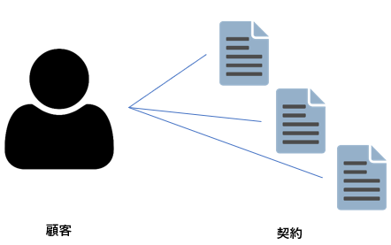
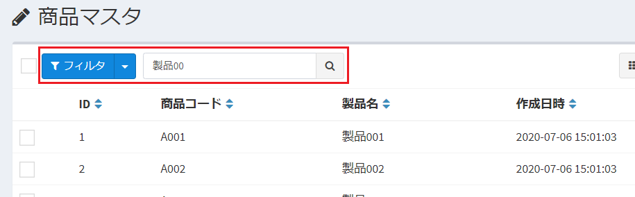
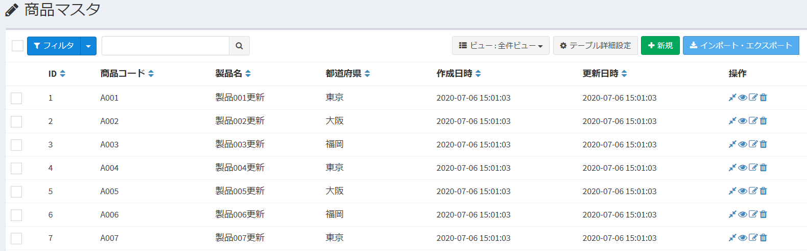
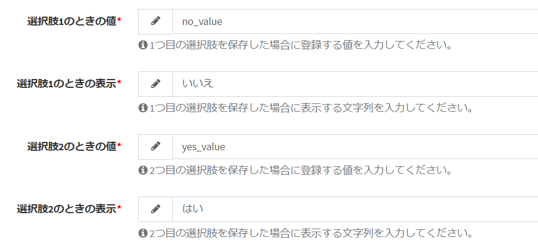

# 搜索
本页说明查找 Exment 数据的方法。查找的方法大致有2种。

| 查找的方法 | 查找的范围 |
|---|---|
| 页面上方的搜索栏 | 设为搜索对象的所有表 |
| 数据列表页面的搜索（搜索栏、筛选） | 当前打开的表 |

- **搜索一开始是前方一致**（查找以输入的文字开头的数据）。改为部分一致的方法，请看下面的“把数据搜索切换为部分一致”。

## 用搜索栏搜索（关键字搜索）
各页面的上方有搜索栏。  
  
在这个搜索栏中输入词语，就可以搜索登记在 Exment 中的数据。  
搜索有“词语搜索”和“关联数据搜索”2种。  

### 词语搜索
普通的搜索。包含（前方一致）输入的词语的数据会出现在结果中。  
  

在搜索栏中输入词语，直接点击搜索按钮，就会搜索。  
先显示成为搜索对象的表的列表，然后查找符合的数据。

**成为搜索对象的内容**

- 表：在自定义表设置中“可搜索”为 YES 的表。  

- 自定义列：在自定义列设置中“搜索索引”为 YES，并且“关键字搜索对象”也为 YES 的列。  
※1个“搜索索引”为 YES 的自定义列都没有的表，不会出现在搜索结果中。  

> 从 v3.4.0 起，作为成为搜索对象的条件，需要“关键字搜索对象”为 YES。  
在那之前，是用“搜索索引”为 YES 的所有列搜索。但是，设置了10～20个搜索索引时，性能可能会下降，所以改为可以缩小关键字搜索的对象。

- 只搜索用户有查看权限的表。  

- **默认的搜索设置是前方一致。** 这是为了搜索的速度。  
想改为部分一致时，请看下面的“把数据搜索切换为部分一致”。

**搜索结果**

搜索结果的数据上会显示［查看］［编辑］［关联数据搜索］的图标。  
    
点击［关联数据搜索］图标，就会进行下面的“关联数据搜索”。  

### 关联数据搜索
关联数据搜索是查找与某条数据相关联的数据的功能。  
例如有“客户”表时，有时想查看与该客户相关联的“合同”的数据列表。  
  
这时，使用这个“关联数据搜索”，就可以用列表查看与客户相关联的合同数据。  

在以下情况下会进行关联数据搜索。  
- 在搜索栏中输入词语，并选择了出现的候选时  
  
>作为候选显示在列表中的文字，可以在[标题显示列设置](/zh/table)中更改。

- 进行词语搜索，并选择了结果中显示的［关联数据搜索］图标时  
  
  
关联数据搜索的列表中显示的，是按以下条件相关联的数据。  
- 在自定义列的“选项”中，选择了搜索中所选数据的数据(不过，需要在自定义列设置中把“搜索索引”设为 YES)  
- 在关联设置中，作为 1:n 或 n:n，把搜索中所选数据登记为父的数据  
  
在关联数据搜索中，所选数据本身和符合上述条件的关联数据会以列表显示。  
在下面的例子中，所选客户“株式会社ABC”的数据，以及与该客户相关的合同，以列表显示。  
  

## 数据列表页面的搜索
在数据列表页面也可以搜索。
方法有用搜索栏搜索，以及指定列进行筛选搜索2种。

  

### 用搜索栏搜索（关键字搜索）
在这个搜索栏中输入词语，就可以搜索当前显示的表中的数据。  

  

在搜索栏中输入词语，直接点击搜索按钮，就会搜索。  

  

- 关键字搜索是与当前所选的自定义视图不同的功能。  
查找的范围是该表的全部数据。以所有关键字搜索列为对象进行搜索。  
因此，结果不是按当前所选的自定义视图，而是按全部数据视图的形式显示。

- 成为搜索对象的自定义列，是在自定义列设置中“搜索索引”为 YES，并且“关键字搜索对象”也为 YES 的列。  

> 从 v3.4.0 起，作为成为搜索对象的条件，需要“关键字搜索对象”为 YES。  
在那之前，是用“搜索索引”为 YES 的所有列搜索。但是，设置了10～20个搜索索引时，性能可能会下降，所以改为可以缩小关键字搜索的对象。

- **默认的搜索设置是前方一致。** 这是为了搜索的速度。  
想改为部分一致时，请看下面的“把数据搜索切换为部分一致”。

### 指定列进行筛选搜索
点击“筛选”按钮，会显示用于指定列进行详细搜索的框。

  

  

- 作为搜索列的项目显示的内容如下。
    1. ID、创建时间、更新时间
    2. 设置了工作流的表中，“工作流状态”和“自己是负责人的数据”的筛选
    3. 设置了以该表为子的关联时，显示筛选父数据的选项
    4. 该表中，自定义列设置的“搜索索引”为 YES 的自定义列

※其中，1和2可以在系统设置的详细设置页面设为不显示。

  

## 补充事项

### 把数据搜索切换为部分一致
数据的词语搜索，默认是前方一致。  
这是为了加快搜索。部分一致时，搜索的速度不够快。  
  
不过，可以切换为部分一致。  
请在菜单“管理员设置 > 系统设置(详细设置)”中，把“数据搜索方式”改为部分一致。  
  
  

这样，搜索就变为部分一致。  
※这项设置可能会使搜索变慢，敬请谅解。

### 使用全文搜索引擎(Meilisearch)
在数据件数多的环境中，用部分一致搜索时，搜索可能会变慢。  
这时，使用全文搜索引擎“Meilisearch”，可以快速搜索。  
详情请确认[全文搜索引擎(Meilisearch)](/zh/additional_meilisearch)。

### 关于不同自定义列类型的关键字搜索规格
关键字搜索可以查找的，基本上只有数据库中的值。  
不过，对于部分自定义列，系统会先改写用户输入的搜索值，然后再搜索。  
其规格写在下面。

> 目前不支持像 Google 搜索那样，输入半角空格对多个列进行 AND 搜索。

#### 选项（值和文本）
可以用设置值“值”中设置的值，或设置值“文本”中设置的值搜索。

  

  

#### 选项（从其他表中选择）
可以用“标题列”中设置的文字搜索。  

例：  
- 有“商品主数据”。  

  

- 在该“商品主数据”中，“表设置(扩展设置)”的“标题列设置”中设置了“商品代码”。  

  

- 在表“商品库存信息”中，添加以该“商品主数据”为引用对象的列“商品主数据”。  

  

- 这样设置时，在关键字搜索中输入商品代码“A001”，就会显示以商品主数据“A001”为引用对象的“商品库存信息”的列表。

  

#### YES/NO
可以用 0/1 或 NO/YES 的字符串搜索。  
（因为要用“0”“1”“NO”“YES”这样到处都有的字符串搜索，所以不太建议设为“关键字搜索”的对象。）

#### 二选一
可以用选项的值或标题搜索。  

  
  

