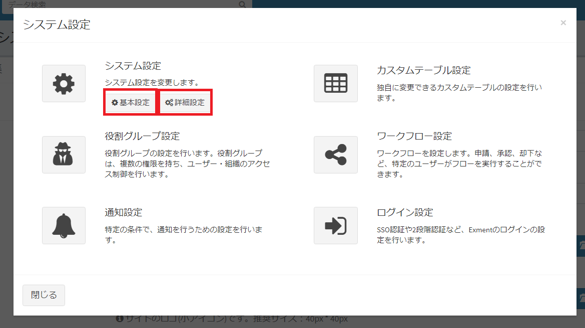

# 系统设置
这是进行与 Exment 整个系统有关的设置的页面，例如站点的名称、徽标、设计，以及权限的用法等。  
本页按从上到下的顺序说明页面上的项目。邮件、LINE、IP 筛选等，有通往各自页面的链接。  

## 设置页面
点击菜单的“系统设置”。  
显示系统设置的页面。  
系统设置分为［基本设置］和［详细设置］。  
点击右上角的按钮，在出现的对话框中选择，就可以切换。

  
  

## 网站基本信息
决定站点的名称、徽标、菜单的形式等站点的基本信息。

- Exment 的菜单布局（菜单的形式）有“默认”和“小图标”两种。  
区别请看下面的图片。  
- 一开始显示的菜单布局在[网站菜单布局](/zh/system_setting?id=网站菜单布局)中决定。点击图片中红框的地方，也可以随时切换。

默认
  

小图标
  

#### 网站名称 ※必填
- 菜单布局为“默认”时，显示在页面左上角的站点名称。  
- 初始值是“Exment”。  

#### 网站名称（简称） ※必填
- 菜单布局为“小图标”时，显示在左上角的站点名称。
- 初始值是“Exm”。  

#### 网站徽标
- 菜单布局为“默认”时，显示在页面左上角的站点徽标。  
- 请点击［浏览］按钮，选择想使用的图片。  
- 推荐尺寸：200px * 40px  

※设置了网站徽标后，菜单布局为“默认”时，左上角会显示网站徽标，而不是网站名称。

#### 网站徽标（小）
- 菜单布局为“小图标”时，显示在页面左上角的站点徽标。  
- 请点击［浏览］按钮，选择想使用的图片。  
- 推荐尺寸：40px * 40px  

※设置了网站徽标（小）后，菜单布局为“小图标”时，左上角会显示网站徽标（小），而不是网站名称。

#### 网站图标（ico）  
- 如下面的图片所示，这是浏览站点时和添加书签时使用的图标图片。  
- 请点击［浏览］按钮，选择想使用的图片。  
- 推荐尺寸：16px * 16px  

  

#### 网站皮肤
- 站点的主题色。从下面的组合中选择页眉和侧边栏的颜色。  
- 页眉（初始设置是蓝色）：蓝色、黄色、绿色、紫色、红色、白色
- 侧边栏（初始设置是白色）：黑色、白色

※[页面设计](/zh/system_setting?id=页面设计)为“现代”时，页眉和侧边栏保持白色和灰色，选择的颜色成为“强调色”（重要的按钮、链接、选中的菜单、正在输入的栏的边框等）。蓝色以外的颜色，会在页眉的上边缘显示一条该颜色的细线。带“-light”的颜色与不带的颜色是相同的强调色。  
※v7.1.0 以后，保存后马上生效。v7.0 以前，保存后重新加载 WEB 页面才会生效。

#### 网站菜单布局
- 从“默认”和“小图标”中选择站点菜单的布局。  
各自的例子请看上面的图片。
- 初始值是“默认”。  

※保存后，重新加载 WEB 页面才会生效。

#### 页面设计
- 从“现代”和“经典”中选择登录页面和管理页面的设计。
    - 现代：以白色和灰色为基础的新设计。
    - 经典：与 v7.0 以前相同的设计。
- 初始值是“现代”。

※从 v7.1.0 起可以使用。  
※更新到 v7.1.0 后，页面设计会变为“现代”。想恢复以前的设计时，请在这个项目中选择“经典”并保存。  
※“现代”中，页眉和侧边栏以白色和灰色为基础显示，在[网站皮肤](/zh/system_setting?id=网站皮肤)中选择的颜色成为强调色。网站徽标设置了图片时，徽标后面会带有强调色的背景。  
※“现代”的数据列表中，操作列（查看、编辑、删除）显示在复选框的右边（左侧）。  
※在服务器的设置（.env 文件的“EXMENT_UI_DESIGN”）中固定了设计时，以服务器的设置为准。这时不能更改这个项目，并显示“（已由服务器设置固定）”。详情请参照[设置值一览](/zh/config)。  
※保存后马上生效。显示错乱时，请在浏览器中按 Ctrl+F5（强制刷新）。

#### 使用 API
- 设为“YES”后，可以使用 API。
- 初始值是“NO”。

#### 允许服务器外部通信
- 设为 YES 后，可以进行与外部服务器通信的处理（只接收数据），例如 Exment 最新版本的通知。
- 初始值是“YES”。  

#### 使用权限管理
- 设置为 YES 时，可以设置[对整个系统的权限和各自定义表的权限](/zh/role_group)。  
- 为 YES 时，可以指定用户来授予权限。
- 初始值是“YES”。  

#### 使用组织管理
- 设置为 YES 时，在[使用权限管理](/zh/system_setting?id=使用权限管理)的基础上，可以指定组织来授予权限。  
- 初始值是“YES”。  

#### 启用系统性能日志
- 设为 YES 后，会把慢的页面操作记录到“系统性能日志”中。
- 记录的内容是页面的 URL（搜索等的值用“***”隐藏）、用户、处理时间、SQL。SQL 不嵌入值，按“?”原样记录。
- 初始值是“NO”。

设为 YES 后，会显示下面 3 个项目（v7.1.0 以后）。

| 项目 | 内容 | 初始值 |
| --- | --- | --- |
| 性能日志：慢页面的秒数 | 页面的处理花费的时间达到这个秒数以上时记录。设为 0 时，不按这个条件记录。 | 3 |
| 性能日志：慢 SQL 的秒数 | 1 条 SQL 花费的时间达到这个秒数以上时记录。设为 0 时，不按这个条件记录。 | 1 |
| 性能日志：每小时记录上限 | 1 小时内记录条数的上限。超过上限的部分不记录。设为 0 时没有上限。 | 100 |

※把“慢页面的秒数”和“慢 SQL 的秒数”都设为 0 时，会记录所有操作（与 v7.0 以前的动作相同）。请只在调查时这样做。从 v7.0 以前就把日志设为 ON 的环境，更新后仍然是这种“全部记录”。  
※要查看日志，请打开左侧菜单的“管理员设置”→“系统性能日志”。  
※v7.0.3 以后，设为 YES 并保存后，日志的表和菜单（在“管理员设置”中）会自动创建。不需要安装模板。  
※v7.0.2 以前，请安装模板（[Template zip file](https://exment.net/template/system_logs.zip)），并执行 `php artisan exment:update`。

#### 系统管理员
- 可以设置成为系统管理员的用户。
- 初始值是安装 Exment 时进行初始设置的用户。

#### 数据列表的显示条数
- 在数据列表的页面中，一开始显示的数据条数。  
  从“10 条”“20 条”“30 条”“50 条”“100 条”中选择一个。
- 初始值是“20 条”。  

#### 搜索和仪表板的显示条数
- 进行[关键字搜索](/zh/search)时，以及在[仪表板的数据列表](/zh/dashboard)中，一开始显示的数据条数。  
从“5 条”“10 条”“20 条”中选择一个。  
- 初始值是“5 条”。  

#### 日期时间显示格式
- 日期的显示格式可以从 3 种（“默认（Y-m-d H:i:s）”“自定义（Y/m/d H:i:s）”“本地（Y年m月d日 H时i分s秒）”）中选择。初始值是“默认（Y-m-d H:i:s）”。

#### 数据搜索方式
- 从“前方一致”（开头相同）和“部分一致”（中间包含）中选择已登记数据的搜索方式。
- 初始值是“前方一致”。

#### 隐藏数据列表的筛选
- 勾选的项目不会再显示在数据列表页面的筛选中。

#### 系统项目显示位置
- 决定在数据编辑页面和数据详情页面中显示系统项目的位置。  
- 可以从“显示在顶部”“显示在底部”“隐藏”中选择。初始值是“显示在顶部”。  

#### 数据保存后的默认跳转页面
- [数据登记](/zh/data_form)页面中，有用来选择保存数据后转到哪个页面的复选框。可以让这个复选框一开始就处于勾选状态。

#### 页眉用户信息显示内容
- 可以决定页眉的用户信息中显示的内容。留空时不显示。
- 可以从用户表的自定义列和创建时间中选择。

#### 用户可选择的语言
- 用户在右上角的菜单、登录页面、登录用户设置中可以选择的语言（v7.2.4 以后）。留空时，可以选择已安装的所有语言。站点的语言始终可以选择。
- 详情请看[每个用户的语言和时区](/zh/user_locale)。

#### 用户未选择语言时使用浏览器的语言
- 设为 YES 后，对没有选择语言的用户，用浏览器的语言（从用户可选择的语言中）显示页面。设为 NO 后，用站点的语言显示（v7.2.4 以后）。
- 初始值是“YES”。想让所有人都保持站点的语言时，请设为 NO。

## 组织设置
决定在权限和共享的设置中，把组织包含到什么范围。

#### 组织层级设置（角色组）
-  在角色组的“用户/组织设置”中设置了组织时，决定把这个组织的上级和下级组织包含到什么范围。
- 初始值设置为“包含所属组织的上下级层级”。

#### 组织层级设置（数据）
- 在各自定义数据的共享设置中设置了组织时，决定把这个组织的上级和下级组织包含到什么范围。
- 初始值设置为“仅共享数据的组织的用户”。

#### 数据共享设置
-  决定用户新建数据时，自动共享的对象是只有这个用户，还是也包含所属的组织。
- 初始值是“仅登录用户”。

## 系统邮件设置
这是从系统发送邮件用的设置。  
从页面设置时，输入 SMTP 的设置值。  
详情请看[邮件发送设置](/zh/mailsend_setting)。

## LINE 设置
在［详细设置］的“LINE 设置”中，设置 [LINE 关联](/zh/line)中使用的 LINE 官方账号的信息（频道访问令牌、频道密钥、Basic ID）。  
详情请看 [LINE 关联](/zh/line)的系统设置。

## 安全确认设置
在［详细设置］的“安全确认设置”中，设置[安全确认](/zh/safety_check)的地震发生时自动发送等。  
详情请看[安全确认](/zh/safety_check)的安全确认设置。

## IP 筛选设置
用固定 IP（例：12.3.5.6）或范围指定格式（例：123.4.5.0/24）设置允许通信的 IP 地址。  
未设置时，允许所有 IP 地址。
详情请看[IP 筛选](/zh/additional_ip_filter)。

## 密码策略

> 已移到[登录设置](/zh/login_setting)。

## SSO 设置

> 已移到[登录设置（SSO）](/zh/login_sso)。
