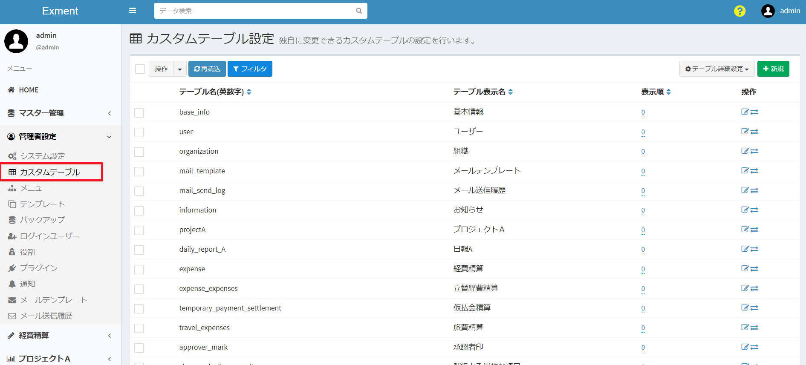
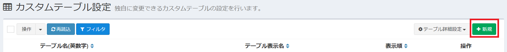
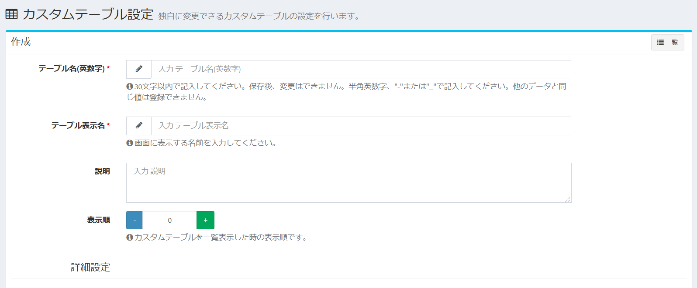
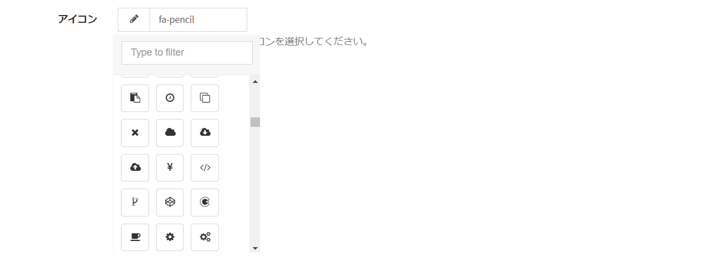
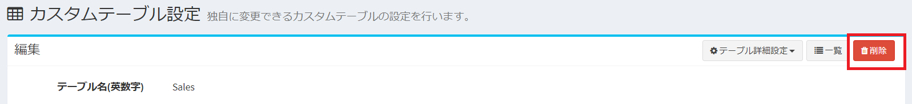
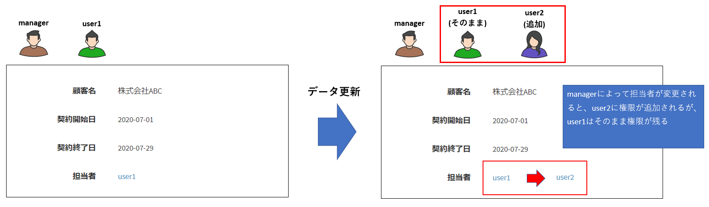

# 自定义表设置
在 Exment 中，数据放在“自定义表”（表）中管理。按客户、报价、任务等想管理的东西分别创建表。  
本页说明创建、修改、删除表的方法，以及每个表的设置（数据中可以使用的功能、权限等）。

- 第一次创建表时：请按下面的“新建”→“设置项目的详细说明”→“保存”的顺序阅读。
- 重复检查、显示在搜索候选中的文字等使用多个列的设置：请看下面的“扩展设置”。

## 列表
点击菜单的“自定义表”。  
显示现有自定义表的列表。  

※“基本信息”“用户”“组织”“通知模板”“邮件发送历史”“公告”  
这些表从安装 Exment 时起就已经存在。  
用模板导入的表也会显示在这个列表中。  

## 新建

- 点击列表页面右上角的［新建］按钮。
  
  
- 显示创建表的页面，请输入必要的项目。项目的说明在下面的“设置项目的详细说明”中。

## 设置项目的详细说明

#### 表名（英文和数字） ※必填
- 表示表的名称。（例：user , information , estimate ）  
- 这里决定的英文和数字会用于打开表时的 URL 等。（例：http(s)://(Exment的URL)/data/user）  
- 可以使用的是半角英文字母、数字和符号 "-"、"_"。
- 不能使用其他表已经使用的表名。  
- 表名的字符数请在 30 个字符以内，表名的开头请指定英文字母。  
- 只能在新建表时决定。保存之后不能更改。  

> ※这里的 URL 是不带“/admin”的标准设置（v7.2.1 以后新安装的站点）的情况。`.env` 的 `ADMIN_ROUTE_PREFIX` 有值时（用以前的版本安装的站点是“admin”），请在站点的 URL 后面加上这个值（例：`http(s)://(Exment的URL)/admin/oauth/token`）。详情请看[更改或删除 URL 中包含的“admin”](/zh/additional_prefix)。

#### 表显示名称 ※必填
- 显示在页面上的名称。也可以使用中文。（例：用户、公告、报价）  

  

#### 说明
- 关于表的说明。

- 输入的说明会像下面的图片那样，在数据页面中显示在表显示名称的右边。  

#### 显示顺序
- 自定义表设置的列表页面中的显示顺序。  
- 请用半角输入，或用左右的［－］［＋］按钮指定数字。

#### 颜色
- 决定表的颜色。这个颜色用于搜索时的候选（建议）等。

- 点击现在的颜色，会显示选择颜色的页面。

#### 图标
- 决定表的图标。这个图标显示在菜单和搜索结果中。  

- 点击现在的图标，会显示选择图标的页面。

#### 可搜索
- 决定从搜索栏进行[搜索](/zh/search)时，是否把这个表作为搜索的对象。默认值是 YES。  
想隐藏的表等不想显示在搜索结果中时，请设为 NO。

#### 将 ID 用作标签
- 在搜索栏显示的搜索候选中，可以在标签的开头加上数据的 ID。详情请看[标题显示列设置](/zh/table?id=标题显示列设置)。默认值是 NO。  

#### 仅可登记一条
- 不登记多条数据、只能登记 1 条数据的表，请设为 YES。默认值是 NO。  

#### 使用附件
- 要让表的数据可以上传[附件](/zh/data_details)时，请设为 YES。默认值是 YES。  

#### 使用评论
- 要让表的数据可以写[评论](/zh/data_details)时，请设为 YES。默认值是 YES。  

#### 使用数据变更历史
- 想把谁、以什么内容更新了数据作为修订（历史）留下时，请设为 YES。默认值是 YES。  

#### 变更历史版本数
- “使用数据变更历史”为 YES 时，用整数输入变更历史保留到多少个（版本数）。  
输入“200”时，第 201 次更新会删除第 1 次的变更历史。默认值是 100。  

#### 优化列表显示
- 设为 YES 后，先显示数据列表的页面，然后自动加载行。在条数或列很多的表中，可以缩短列表页面显示出来之前的时间。默认值是 NO。
- 这是把行的绘制放到后面进行的设置。不会减少对数据库的查询。
- 设置在重新打开数据列表后生效。

※从 v7.1.0 起可以使用。

#### 所有用户均可编辑

> 关于表的权限的概要，请先确认[Exment 中角色和权限的概要](/zh/permission)页面。

- 设为 YES 后，所有用户都可以编辑这个表的所有数据。不需要为每个用户授予权限。默认值是 NO。  

#### 所有用户均可查看

> 关于表的权限的概要，请先确认[Exment 中角色和权限的概要](/zh/permission)页面。

- 设为 YES 后，所有用户都可以查看这个表的所有数据。不需要为每个用户授予权限。默认值是 NO。  

※安装 Exment 时，只有“公告”表的“所有用户均可查看”初始设置为 YES。这是为了让所有用户都能查看公告信息。  
另一方面，能编辑公告信息的只有管理员。

#### 所有用户均可引用

> 关于表的权限的概要，请先确认[Exment 中角色和权限的概要](/zh/permission)页面。

- 设为 YES 后，所有用户都可以引用这个表的所有数据。不需要为每个用户授予权限。默认值是 NO。  

※只把“所有用户均可引用”设为 YES 时，这个表不能显示在菜单和列表页面中，但可以从其他表引用。  

例：“消费税”表不需要让一般用户看列表页面，但需要让他们把“消费税”作为选项来选择。这样的表请把“所有用户均可引用”设为 YES。  

#### 可通过父数据的权限查看

> 关于表的权限的概要，请先确认[Exment 中角色和权限的概要](/zh/permission)页面。

- 设为 YES 后，可以用父数据（一对多）的权限查看数据。不过，需要对这个表本身拥有负责人的查看等权限。默认值是 NO。  

※ 只在一对多关联的子表中显示的选项。  

※ 即使拥有父数据的编辑权限，也不能编辑子数据。只能查看。  

#### 需要父数据的编辑权限

> 关于表的权限的概要，请先确认[Exment 中角色和权限的概要](/zh/permission)页面。

- 设为 YES 后，要编辑这个表的数据，需要父数据（一对多）的编辑权限。默认值是 YES。  

※ 只在一对多关联的子表中显示的选项。  

#### 添加到菜单
- 设为 YES 后，在保存表的同时，把这个表添加到菜单中。默认值是 NO。  

※只在新建表时显示的项目。添加到菜单之后要更改菜单的设置时，请在[菜单](/zh/menu)页面进行。  

#### 添加到的父菜单
- 把“添加到菜单”设为 YES 后显示的项目。请选择要添加的菜单的父菜单名。  

例：新建“手册”表时，父菜单选择“管理员设置”，就会像图片那样，“手册”表的菜单出现在“管理员设置”中的最下面。

#### 添加到通知
- 设为 YES 后，在保存表的同时添加通知的设置。这是在新建、更新、共享数据和评论时，向有权限的用户进行系统内通知的设置。  

※只在新建表时显示的项目。添加到通知之后要更改通知的设置时，请在[通知](/zh/notify)页面进行。  

## 保存
- 点击［提交］按钮后，设置会被保存，并按这些内容创建表。

- 新建表时，保存之后会转到[自定义列列表页面](/zh/column)。  
请接着登记自定义列。

## 编辑
- 请在自定义表列表中点击想修改的表的［编辑］按钮。  
转到编辑页面，可以更改设置。  

## 删除
- 想删除表时，请先按与上面的“编辑”相同的步骤打开编辑页面。

- 然后，请点击编辑页面右上角的［删除］按钮。

  

- 显示下面图片这样的确认页面。在文本区域中输入 delete me 并点击［确认］按钮，表就会被删除。  
**※不过，下面种类的表不能删除。 ・系统安装的表 ・在关联中被设置为子表的表**

## 扩展设置
可以进行使用表中多个列的设置（重复检查、列之间的比较、标题、数据的自动共享等）。

- 请在自定义表列表中点击想设置的表的［扩展设置］按钮。  

- 转到设置页面。

  

### 复合唯一键设置
把多个列合起来作为唯一键（不允许重复的组合）后，新登记数据时，可以防止相同组合的值被重复登记。  

- 请选择 2～3 种想按组合防止重复的列。
- 新登记数据时，在选择的所有列中，要登记的值都与已登记的值相同时，会出错。  

例：像下面的图片那样把“下次预定日”“名字”设为唯一键，就可以防止在同一个下次预定日登记多条相同的名字。  

※只想用 1 种列防止重复时，请在[自定义列设置](/zh/column)中把该列的唯一设为 YES。

※ 在 1:N 的关联（[参照 Exment 的关联设置](/zh/relation)）的情况下，给子表设置复合唯一键时，也可以把父表选为唯一键之一。  
这样，可以只在同一条父数据之内检查重复。

### 比较两列
在新建和更新数据时比较 2 个列。只有列的值符合设置的条件时才能保存。不符合时显示错误消息。  
可以在下面这样的时候使用。  

- 只有“开始日”在“结束日”以前时才能保存。
-  只有“X”的值在“Y”的值以上时才能保存。
- 只有“负责人”和“确认人”不同时才能保存。

    

#### 未输入时的处理
一方或双方的项目未输入时，结果会随选择的条件而变化。  
这里把可以保存的情况写作 "true"，出错的情况写作 "false"。

- **A 与 B 一致** : 两个值都未输入时为 true。只有其中一个未输入时为 false。
- **A 与 B 不一致** : 只有其中一个值未输入时为 true。两个都未输入时为 false。
- **除此以外** : 始终为 true。因为日期和数值在值为空时通常无法比较。  
不想让用户不输入时，请在自定义列设置或自定义表单设置中设为必填。

#### 各列类型的处理
- 大小（A 大于 B、A 小于 B、A 大于或等于 B、A 小于或等于 B）的比较只能在下面的列类型中进行。
    - 整数
    - 小数
    - 货币
    - 日期
    - 时间
    - 日期和时间

- 用除此以外的列类型比较大小时，始终为 true。

- 列的类型不一致时不能比较大小（例如“整数”和“日期和时间”）。本来，保存这个设置时应该报错。  
不过，现在保存时没有进行这项检查。请选择类型相符的 2 个列。

#### 其他
- 想用 3 个以上的列的值比较、用特别的条件比较、用其他表的值比较等时，请创建[插件的验证](/zh/plugin_quickstart_validate)。

### 标题显示列设置
这是决定搜索栏的候选和选项列表中显示的文字（标题）用哪个列的值来组成的设置。  
  
例如，假设有下面这样的“客户信息”表。  
客户信息表中有“客户代码”“客户名”“电话号码”“邮件地址”等列。  
    

在搜索栏中输入搜索词后，会显示搜索的候选。  
假设想把这个候选显示成下面这样。  
“(客户代码) (客户名)”  
    
  
这时，在自定义表的扩展设置页面中，把想显示在标题中的列按下面这样登记。  
  
  
这样登记后，在页面上方的搜索栏中输入文字时，候选会像下面这样显示。  
候选的字符串按扩展设置页面中从上到下登记的列的顺序排列。  
  
  
也想显示“邮件地址”时，请添加“邮件地址”列。  
  
  
  
另外，自定义表设置中有“将 ID 用作标签”项目。
  
把这个设置设为 YES 后，标签的开头会加上“#(id)”这样的文字。  
  

#### 其他
- 没有登记这个标题显示列设置时，显示自定义列设置中第 1 个列的值。
- 自定义列设置中第 1 个列的值为空时，显示 ID。
- ID 只能加在标签的开头。不能加在其他位置。  

### 数据自动共享设置

> 关于数据共享设置，请先确认[Exment 中角色和权限的概要](/zh/permission)页面。

保存数据时，可以把数据自动共享给列的值中的组织和用户。  
可以在下面这样的时候使用。  

- 新建数据“合同信息”时，自动给分配到列“主负责人”的用户添加编辑权限。  
- 更新数据“合同信息”时，自动给分配到列“相关组织”的组织添加查看权限。  
- 新建数据“任务管理”时，自动给分配到列“负责人”的用户添加编辑权限。  

※自定义表中需要先有列类型为“用户”或“组织”的列。

#### 例  
在“客户管理”表中定义了这样的列设置的情况下，

进行『“新建时”，给分配到列“负责人”的用户添加“编辑”权限』的设置。

之后，新建负责人为用户“user1”的数据时，

这条数据会以编辑权限共享给用户“user1”。

#### 设置方法

- ##### 触发条件
共享数据的时机。  
可以选择“新建时”或“更新时”。  

- ##### 目标列
作为数据共享对象的用户或组织。

- ##### 目标权限
选择用编辑权限还是查看权限共享。

#### 共享的同步设置
初始设置中，触发条件为“更新时”的情况下，即使更改了目标列的用户、组织，对以前的用户、组织的共享也不会消失，仍然保持共享。  

更改设置后，在更新数据时，可以把“列中的用户、组织”和“进行更新的用户”以外的用户、组织从共享中去掉。

要这样做，请把选项设置的“更新时同步数据自动共享设置”设为 YES。

### 禁止从页面执行的设置

不想让用户从页面进行数据的新建、编辑、删除或导入、导出时设置。  
设置后，相应的按钮不再显示在页面上。  

- 显示“禁止从页面更改”项目。

  

- 设置示例：隐藏“导出”时

  

  

### 系统项目显示位置

决定在数据编辑页面和数据详情页面中显示系统项目的位置。  
可以从“跟随系统设置”“显示在顶部”“显示在底部”“隐藏”中选择。（初始值是“跟随系统设置”）  
※整个系统的显示位置可以在系统设置中更改。  

  

### 点击行时的页面跳转

决定在数据列表页面点击行时打开哪个页面。  
可以从“与默认值一致”“数据编辑页面”“数据详细页面”“不跳转”中选择。（初始值是“与默认值一致”）  
※整个系统的默认值是“数据详细页面”，但可以用 .env 的设置值（`EXMENT_GRIDROW_SELECT_EDIT`、`EXMENT_GRIDROW_SELECT_DISABLED`。[设置值](/zh/config)）更改。  

  

### 标题格式设置
> 这个设置只在启用了[专家模式](/zh/additional_expert)时显示。

可以使用参数变量，以自由的形式决定显示在标题中的值。  

- 启用专家模式，打开扩展设置页面。

- 显示“输入格式字符串”项目。  

  

- 要把保存在数据中的值显示在标题中时，使用[参数变量](/zh/params)。  
例：在用户信息中显示“用户名&lt;admin@admin.admin&gt;”时  
${value:user_name}&lt;${value:email}&gt;  
  

- 这样输入后，就可以决定显示在标题中的项目。  
  

#### 其他
- 设置了这个标题显示格式设置后，“标题显示列设置”无效。
