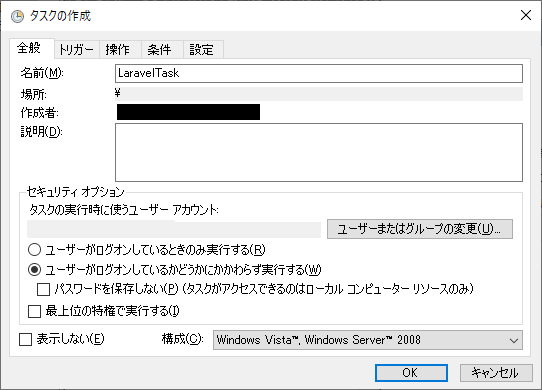
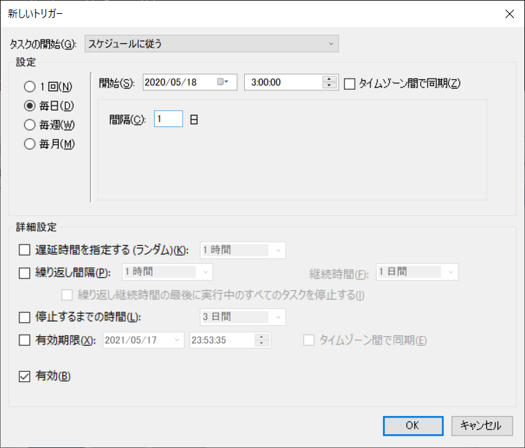

# （面向高级用户）自动更新
这是在 Exment 出了新版本时自动更新的设置。  
在服务器上登记一个每天在固定时间运行的处理（定期更新处理）。

- 通常的更新方法，以及会升级到哪个范围的版本，请看[更新](/zh/update)。

## 自动更新的规格
登记的处理每次进行下面的事情。

- 执行 Web API，取得 Exment 的最新版本信息(1)
- 取得已安装的 Exment 的版本(2)
- (1) 比 (2) 新时，执行更新批处理
- 另外，(2) 是以“dev”开头的版本时，不进行更新

## 设置方法
Linux 和 Windows 的步骤不同。

| 服务器 | 看哪里 | 使用的东西 |
|---|---|---|
| Linux（包括 Sakura Internet、XServer） | 设置步骤（Linux） | 更新批处理、ExmentAutoUpdate.bash、jq、cron |
| Windows | 设置步骤（Windows） | 更新批处理、ExmentAutoUpdate.exe、任务计划程序 |

### 设置步骤（Linux）
**(1) 放置更新批处理**

下载[更新批处理](/zh/update)，放到 Exment 的项目文件夹中。  
请根据环境下载下面的文件。

- Sakura Internet 时 : ExmentUpdateLinuxSakura.sh
- XServer 时 : ExmentUpdateLinuxXserver.sh
- 其他情况 : ExmentUpdateLinux.sh

> 进行更新的 shell 已经更新，请查看[更新](/zh/update)并替换。  
请确认 shell 文件的第 2 行写着“v1.1.0”以上的版本。

**(2) 下载检查更新用的批处理**

在 Exment 项目的根目录执行下面的命令。

~~~
wget https://exment.net/downloads/cmd/ExmentAutoUpdate.bash
chmod 775 ExmentAutoUpdate.bash
~~~

**(3) 安装“jq”**

要使用叫做“jq”的库。用下面的命令确认是否安装了“jq”命令。

```
jq --help
```

- 显示“没有这个命令”之类的内容时，说明没有安装 jq 命令。  
请用[官方文档的方法](https://stedolan.github.io/jq/download/)安装 jq 命令。

**(4) 在更新批处理中写入 composer 的位置**

查看 composer 的路径。在任意路径执行下面的命令，复制结果。

```
which composer
# 结果示例
# /home/xxx/usr/local/bin/composer
```

编辑下载的 ExmentUpdateLinux.sh（或 ExmentUpdateLinuxSakura.sh、ExmentUpdateLinuxXserver.sh）。  
把文件中 composer_path 的值改成“which composer”的结果。

```
# composer_path=''
# 改成下面这样
composer_path='/home/xxx/usr/local/bin/composer'
```

**(5) 登记到 cron**

执行下面的命令。

~~~
crontab -e
~~~

会出现 Cron 的设置页面，请写入下面的内容。

~~~

###添加下面的内容
(执行的分) (执行的时) * * * cd /(Exment的根目录); bash ExmentAutoUpdate.bash
# 例：每天 3:00 执行路径 /var/www/exment 下的 Exment 时
0 3 * * * cd /var/www/exment; bash ExmentAutoUpdate.bash >> storage/logs/ExmentAutoUpdate.log  2>&1
~~~


#### 以下是 XServer 时追加进行的内容

- 执行下面的命令，查看 HOME 路径。

```
echo $HOME
# 结果示例
# /home/xxx
```

- 然后编辑下载的 ExmentUpdateLinuxXserver.sh。  
把 home_path 的值改成“echo $HOME”的结果。

```
# home_path=''
# 改成下面这样。最后不要加“/”
home_path='/home/xxx'
```


#### 设置完成
- 这样，ExmentAutoUpdate.bash 会每天在固定时间运行。有最新版时，会自动升级版本。
- 自动更新的执行日志保留在 storage/logs/ExmentAutoUpdate.log 中。


### 设置步骤（Windows）
**(1) 放置更新批处理和自动更新的程序**

1. 下载[更新批处理 ExmentUpdateWindows.bat](https://exment.net/downloads/cmd/ExmentUpdateWindows.bat)，放到 Exment 的项目文件夹中。

2. 从[这里](https://exment.net/downloads/cmd/ExmentAutoUpdateWindows.zip)下载自动更新程序的 zip。

3. 解压下载的 zip 文件，把"ExmentAutoUpdateWindows"文件夹整个放到 Exment 的项目文件夹中。

```
# 文件夹层次（一部分）
- app
- bootstrap
- config
- ExmentUpdateWindows.bat
- ExmentAutoUpdateWindows
    - ExmentAutoUpdate.exe
    - ExmentAutoUpdate.exe.config
    - Newtonsoft.Json.dll
```

**(2) 登记到任务计划程序**

1. 在 Windows 的菜单中输入“task”，启动任务计划程序。  


2. 在任务计划程序中，点击“创建任务”。  


3. 在“常规”选项卡中，按下面这样设置。（“名称”是任意的名称）  


4. 点击“触发器”选项卡。创建触发器。  
    (1) 点击“新建”按钮。  
    然后按下面这样输入。  
    - 开始任务：按预定计划
    - 开始：开始日期的执行时间
    - 间隔：1 天
    - 勾选“已启用”  
    完成后点击“确定”。  


5. 在“操作”选项卡中，点击“新建”按钮。  
然后按下面这样输入。
    - 操作：启动程序
    - 程序或脚本：所放置的“ExmentAutoUpdate.exe”的路径

    

6. 笔记本电脑的情况下，在“条件”选项卡中，取消勾选“只有在计算机使用交流电源时才启动此任务”。  


7. 设置到这里后，点击“确定”。  
然后会出现输入用户凭据的页面，请输入密码。  


8. 设置完成后，请在“任务计划程序库”中选择创建的任务，点击“运行”。  


这样设置就完成了。


#### 设置完成
- 这样，ExmentAutoUpdate.exe 会每天在固定时间运行。有最新版时，会自动升级版本。

