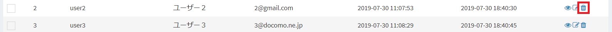

# 用户、登录用户
本页说明管理用户和登录用户的页面。

| 想做的事 | 查看的位置 |
|---|---|
| 添加、编辑、删除用户 | “用户管理” |
| 让用户可以登录、决定密码 | “登录用户管理” |
| 给很多用户一次性进行登录设置 | “批量导入登录用户信息” |
| 让用户可以查看、更改自己的信息 | “登录用户查看、编辑本人信息” |

## 名称定义
### 用户
属于本公司或组织的员工等人员。  
不使用本系统的人，也可以作为用户添加。  
用户代码、电子邮件地址为必填。  
用户可以关联到其他表的数据进行登记。不过，仅仅是用户，还不能登录系统。

### 登录用户
用户中可以登录 Exment 的人。  
用户信息带有密码，所以可以从 Exment 的登录页面登录，进行数据的登记和查看等。  

#### 用户、登录用户的设置步骤

到可以登录 Exment 为止的流程如上图所示。  
①在用户管理页面，登记用户的用户代码、用户名、电子邮件地址。  
②在登录用户管理页面，设置①中登记的用户的密码。  
这样，登记的用户就可以登录 Exment 了。  

> 登录时，密码输错达到规定的次数后，该用户会在一段时间内无法登录。  

## 用户管理
下面写管理所有用户信息的方法。  

### 显示列表页面
点击左侧菜单的“用户”。  
或者，请打开以下 URL。  
这样就会显示用户的列表页面。
http(s)://(Exment的URL)/data/user  
显示当前登记在系统中的用户的列表。

> ※这个 URL 是不带“/admin”的标准设置（v7.2.1 及以后新安装的站点）时的 URL。`.env` 的 `ADMIN_ROUTE_PREFIX` 有值时（以前的版本安装的站点为“admin”），请在站点的 URL 后面加上该值（例：`http(s)://(Exment的URL)/admin/data/user`）。详情请参阅[更改、删除 URL 中的“admin”](/zh/additional_prefix)。

### 新增用户
- 在“用户”的列表页面，点击页面右上角的［新建］按钮。

- 显示新增页面。输入必要的内容。

#### 所属组织设置
有要让用户所属的组织时，请从候选数据列表中选择，并移到已选数据中。  
※没有创建组织时，不显示此项目。

#### 角色组设置
有要分配给用户的角色组时，请从候选数据列表中选择，并移到已选数据中。

#### 登录设置
把授予登录权限设为 YES 后，可以把用户创建为登录用户。  
设置的方法请看下面的[登录用户管理](/zh/user?id=登录用户管理)。

### 保存
输入设置后，请点击［提交］。

### 编辑
要编辑用户，请点击该行的［编辑］链接。  

### 删除
要删除用户，请点击该行的［删除］链接。  

## 登录用户管理
对在上面的页面中创建的用户，进行登录用户的管理。  
可以添加密码、重新发放密码、删除登录权限等。  

### 显示页面
点击左侧菜单的“登录用户”。  
或者，请打开以下 URL。  
这样就会显示登录用户设置页面。
http(s)://(Exment的URL)/loginuser  
显示当前登记在系统中的用户及其登录信息。  

### 添加登录信息
请点击要添加登录信息的用户所在行的［编辑］链接。  

- 显示登录信息编辑页面。  
  
要添加登录权限时，把“授予登录权限”设为 YES。  
设为 YES 后，会显示“自动生成密码”项目。

#### 自动生成密码
为 YES 时，添加登录权限时会自动生成密码。  
生成后，密码的邮件会自动发送到该用户的电子邮件地址。  
**※要使用此功能，需要[邮件设置](/zh/system_setting)。**  
  
为 NO 时，会显示输入密码的文本框和“通过邮件发送用户信息”项目。

#### 输入密码
“自动生成密码”为 NO 时显示。  
请输入登录用户的密码。  

#### 通过邮件发送用户信息
“自动生成密码”为 NO 时显示。  
此项目为 YES 时，密码的邮件会发送到该用户的电子邮件地址。  
**※要使用此功能，需要[邮件设置](/zh/system_setting)。**

#### 首次登录时修改密码
设为 YES 后，用户第一次登录时，会显示更改密码的页面。  
对新登记的用户和重置了密码的用户有效。

### 删除登录权限
删除登录权限。  
请在列表页面，点击“登录用户设置”列为“YES”的用户的［编辑］链接。  
  

把“授予登录权限”改为 NO。  
  
然后，请点击［提交］。  

### 批量导入登录用户信息
可以一次性导入登录用户信息。  
不用在用户页面逐个进行登录设置，也可以一次性完成登录设置。

流程如下。

1. 登记用户（“登记用户信息”）  
2. 导出登录用户信息（“输出登录用户信息”）  
3. 编辑导出的文件（“制作导入文件”）  
4. 导入（“导入”）

#### 登记用户信息
请先在[用户管理](/zh/user?id=用户管理)页面添加要赋予登录信息的用户。

#### 输出登录用户信息
- 点击左侧菜单的“登录用户”。  
或者，请打开以下 URL。  
这样就会显示登录用户设置页面。
http(s)://(Exment的URL)/loginuser  
显示当前登记在系统中的用户及其登录信息。  

- 点击页面右上角的“导入/导出”按钮。  
然后点击“导出”。

  

- 输出已登记的用户信息，以及这些用户的登录用户信息。

  

#### 各列的内容
- id  
用户的 id。之后导入时，请不要更改这个值。  

- 用户名、用户代码、电子邮件地址  
用户信息。  
※之后导入时，即使更改了这些值，也不会反映到用户信息中。用户信息请在“用户”页面更改。

- 授予登录权限  
该用户是否带有 Exment 标准的登录信息。为1时，带有登录信息。

- 自动生成密码、密码、通过邮件发送用户信息  
导出时值为空。在导入时使用。

#### 制作导入文件
编辑上面导出的文件，制作导入文件。  
各列请按以下方式输入。

- 授予登录权限  
    - 要给该用户授予 Exment 标准的登录权限时，请设为1。  
    - 已经有登录权限，并且要继续保留时，请保持1。  
    - 要从已经有登录权限的用户删除登录权限时，请设为0。

- 自动生成密码  
要自动生成该用户的密码时，请输入1。  
对已经有登录权限的用户设置时，会重置密码。

- 密码  
要自己决定用户的密码时，请输入密码的字符串。  
对已经有登录权限的用户设置时，会重置密码。

- 通过邮件发送用户信息  
新授予登录信息时，或更改了密码时，如果要用邮件发送密码，请输入1。

#### 导入
- 在登录用户设置页面，点击页面右上角的“导入/导出”按钮。  
然后点击“导入”。

  

- 上传制作好的导入文件。

- 登录信息就会被授予。

## 登录用户查看、编辑本人信息
用户登记有“用户代码”“用户名”“电子邮件地址”“头像”“密码”等信息。

- “头像”“密码”从一开始就可以由登录用户自己显示、更改。  
- “用户代码”“用户名”“电子邮件地址”“其他新建的列”，进行以下设置后，登录用户自己就可以查看、编辑。  

#### 自定义列设置：查看/编辑本人信息

在用户表的自定义列设置中，可以设置“查看/编辑本人信息”。  
可以选择“不显示”“仅查看”“可编辑”3种。  
登录用户分别可以做的事如下。

##### 不显示
登录用户不能显示登记信息。  

##### 仅查看
登录用户可以显示登记信息，但不能编辑。  

##### 可编辑
登录用户既可以显示登记信息，也可以编辑。
> 设置了“仅可输入一次”等选项时，以该选项为优先。

#### 在登录用户页面查看、编辑

点击 Exment 页面右上角的登录用户名，再点击［设置］。  

显示登录用户可以显示的信息。  
可以输入的列，本人可以编辑并保存。    

※在图片的例子中，“用户代码”设为仅查看，“用户名”“电子邮件地址”设为可编辑。  

